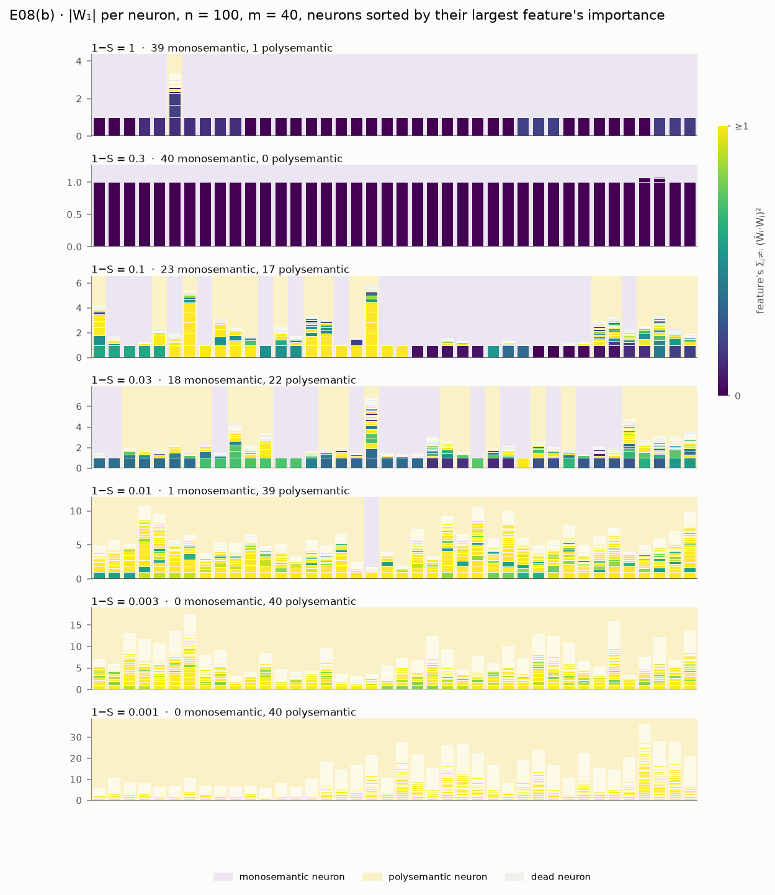
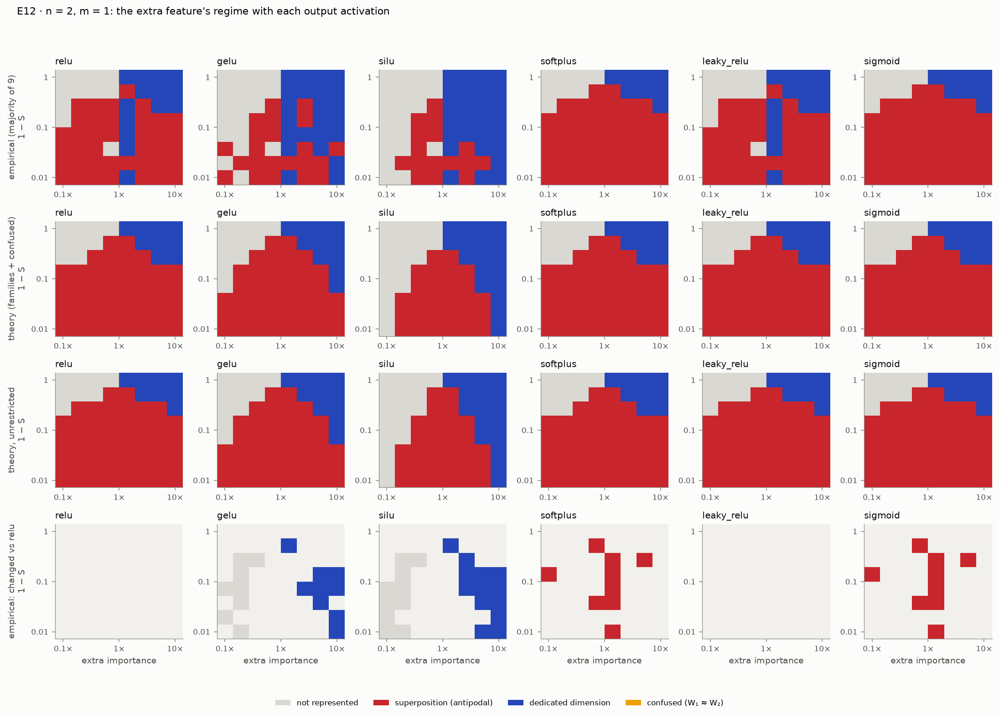

# superposition

A research-grade, independent replication of
[*Toy Models of Superposition*](https://transformer-circuits.pub/2022/toy_model/index.html)
(Elhage et al., 2022), with an interactive lab and mechanistic-interpretability tooling.

The repository does four things (see [SPEC.md](SPEC.md)):

1. **Replicates** the paper's experiments reproducibly, and reports every claim honestly as
   PASS, PARTIAL or FAIL ([docs/REPRODUCTION.md](docs/REPRODUCTION.md)).
2. **Provides an interactive lab**: a Streamlit app to train toy models live, probe them, and
   browse precomputed results.
3. **Provides mechanistic-interpretability tooling**: reverse-engineering trained networks,
   ablations, and sparse autoencoders scored against the known ground truth.
4. **Serves as a learning instrument**: notebooks and a study guide that follow the paper.

> **Status:** all six build phases are complete (SPEC §11): the engine, the theory, E00–E12,
> notebooks 00–11, and the lab (Home, Playground, Phase diagrams, Geometry, Non-uniform,
> Dynamics, Neurons, Adversarial, SAE lab). An independent review by five fresh-context
> reviewers is in [docs/REVIEW.md](docs/REVIEW.md); it re-graded E03 and left two decisions to
> the owner. The current statuses are below and in [docs/REPRODUCTION.md](docs/REPRODUCTION.md).
> Build history: [PLAN.md](PLAN.md) and [docs/progress/](docs/progress/).

**New here?** Start with the [visitor's tour](docs/TOUR.md): a stop-by-stop roadmap for reading
the paper alongside this repository, from p. 1 to p. 62. For each section it gives the pages to
read, the idea, where the repository shows it, what the replication found, and what to read
with care.

## Quickstart

Requires [uv](https://docs.astral.sh/uv/). Everything runs on a laptop CPU; `--device auto`
uses CUDA or Apple MPS when available.

```bash
uv sync                                       # create the environment from uv.lock
uv run superposition list                     # list experiments
uv run superposition run intro_pentagon       # reproduce the paper's first figure (p. 2), ~1 min
uv run superposition figures intro_pentagon   # redraw its figures from the saved run
uv run superposition report                   # refresh the tables in docs/REPRODUCTION.md
uv run superposition app                      # launch the lab in your browser
```

Developer commands: `make lint`, `make test` (fast tier), `make test-slow` (short replication
and notebook tests, under 15 minutes), `make test-paper` (every quick profile re-run and checked,
an estimated few hours; never timed as a whole). See [CLAUDE.md](CLAUDE.md) for the full list and conventions.

## Results gallery

**E00 · five features in two dimensions (p. 2).** As sparsity rises, the ReLU output model goes
from two dedicated dimensions, to two antipodal pairs, to a pentagon; the linear model keeps the
top two features throughout.


**E01 · twenty features in five dimensions (p. 11).** WᵀW with the bias, and ‖Wᵢ‖ colored by
superposition, from dense (left) to sparse (right).


**E02 · superposition as a phase change (p. 15).** Two features in one dimension: whether the
extra feature is dropped (gray), stored as an antipodal pair (red) or given the dimension (blue)
depends on its importance and on sparsity. The panels show trained models colored by norm and
superposition, their majority vote, the exact loss of each candidate weight family, and the
cells where vote and theory disagree. There, most models are stuck in a worse minimum, often
because their two weights started with the same sign. The n = 3, m = 2 agreement passes on the
cited seed but not on two held-out seeds (docs/REVIEW.md).


**E03 · feature dimensionality (p. 19).** 400 features in 30 dimensions: every feature's Dᵢ,
sticky at 1/2 (antipodal pairs, 29 digons on the plateau), with pentagons just past it. There
are no tetrahedra or triangles in the cited run, and the other fractions are not backed by
their polytopes, so the cluster criterion is PARTIAL.


**E04 · non-uniform superposition (p. 22).** Making one of five features sparser deforms the
pentagon until it snaps to two digons, where the loss curves of the two geometries cross.


**E05 · energy-level jumps (p. 26).** 400 features in 30 dimensions settle into antipodal
pairs; long after the loss has flattened, two features jump to Dᵢ = 1/2 to fill the last badly
used dimension, and the loss drops at that moment.


**E06 · adversarial vulnerability (p. 29).** Vulnerability to small analytic attacks, relative
to a model without superposition, tracks the number of features per dimension in the paper's
uniform setting (n = 400, m = 30). In SPEC's second setting (n = 20, m = 5) it does not.


**E07 · superposition in a privileged basis (p. 33).** With a ReLU on the hidden layer, neurons
go from monosemantic to polysemantic as features get sparser.


**E08 · computation in superposition (pp. 36–37).** |W₁| stack plots of the absolute-value
model, n = 100 features in m = 40 neurons. Neurons are monosemantic when features are dense
and polysemantic when they are sparse. The paper's claim that the sparse model usefully
computes more features than it has neurons does not reproduce (PARTIAL).



**E09 · reverse-engineering a model (p. 39).** Every neuron of a small |x| model named from its
weights and checked by ablation. Two neurons store a heavy and a victim feature with flipped
input and output sizes (asymmetric superposition), and two inhibitors cancel the resulting
interference: the p. 39 motif, found by gradient descent in 8–12 of 20 restarts per graded
setting.


**E10 · sparse autoencoders against ground truth (pp. 42–44).** Which SAE settings recover the
true feature directions of toy models in superposition, and how often a low reconstruction
error hides a failure to find them.


**E11 · removing superposition with L1 (p. 42).** A penalty λ‖h‖₁ removes superposition by
killing the least important features, at a price in loss; antipodal pairs along the hidden axes
survive until almost nothing is left.


**E12 · the phase diagram with other activations (p. 51; extension).** E02's n = 2, m = 1
diagram with six output activations. SiLU and GELU, whose negative lobe makes negative
interference cost something, have smaller optimal superposition regions than the ReLU. Their
trained models also rarely reach the antipodal pair when their weights start with the same
sign.



## The lab

`uv run superposition app` opens a Streamlit lab (options: `--port`, `--headless`).

- **Home:** the reproduction status (the cited run of each experiment next to your latest
  local run), the latest figures, and a searchable map from every paper section to code,
  experiments, notebooks and lab pages.
- **Playground:** train the linear, ReLU output or ReLU hidden model live (n ≤ 40, m ≤ 10, any
  importance decay and sparsity, with one-click presets for the paper's settings). See the
  loss, WᵀW with the bias, feature norms colored by superposition, a per-feature Dᵢ table, and
  the geometry (2D arrows, a rotatable 3D plot, or W itself for the ReLU hidden model). The
  **probe panel** sends any input you choose through the model and shows h, the readout, the
  bias, the ReLU and the reconstruction, feature by feature. The default setting (the p. 2
  pentagon) trains in about 4 seconds on a laptop CPU.

- **Phase diagrams:** E02's empirical and theoretical diagrams for n = 2, m = 1 and n = 3,
  m = 2, with McGrath's confused family and the zero-bias variant; pick a cell to see its ten
  trained models, the vote, representative weights and every family's optimum. A second tab
  shows E12: the same diagrams for six output activations, and their regime shares.
- **Geometry:** E03's D* and Dᵢ curves; pick a sparsity to see its geometry graph, Dᵢ histogram
  and tegum factors.
- **Non-uniform:** E04 with a density slider for the perturbed feature and the crossing loss
  curves; correlated and anticorrelated sets, local bases, and the collapse of correlated pairs.
- **Dynamics:** feature dimensionalities over training with a step scrubber (E05), and
  rotatable 3D trajectories of a model learning an octahedron.
- **Neurons:** W and neuron stack plots across sparsity for the ReLU hidden layer model (E07)
  and the absolute-value model (E08), with the ReLU-sidestepping table; E09's role tables,
  ablation matrices, motifs and rebuild test for every analyzed model.
- **Adversarial:** vulnerability against sparsity and features per dimension (E06).
- **SAE lab:** train a sparse autoencoder live on the pentagon or a sparse n = 20 model and
  compare its decoder with the true features (2D view, per-feature cosines); E10's sweeps and
  E11's λ trade-off with a λ slider.

## Reproduction status

Generated from the cited runs (`docs/cited_runs.yaml`) by `superposition report`; the full
table, the evidence and every discrepancy are in [docs/REPRODUCTION.md](docs/REPRODUCTION.md).
What the independent review found, and what changed because of it, is in
[docs/REVIEW.md](docs/REVIEW.md).

| Code | Experiment | Paper | Status | Note |
|---|---|---|---|---|
| E00 | intro_pentagon | p. 2 | PASS 11/11 | the pentagon, antipodal pairs and dedicated dimensions of p. 2 |
| E01 | basic_results | pp. 10–12 | PASS 12/12 | superposition grows with sparsity, least important features first |
| E02 | phase_change | pp. 14–16 | PASS 6/6 | on the cited seed; the n = 3 agreement fails on two held-out seeds (open) |
| E03 | uniform_geometry | pp. 16–21 | PARTIAL 3/4 | D* as on p. 17; fraction clusters backed by polytopes only at 1/2 |
| E04 | nonuniform_geometry | pp. 21–26 | PASS 9/9 | the deformed pentagon, correlated sets, collapse to principal components |
| E05 | learning_dynamics | pp. 26–28 | PASS 2/2 | energy-level jumps; octahedra in every run (stage B a documented variant) |
| E06 | adversarial | pp. 29–30 | PARTIAL 2/4 | tracks 1/D* in the uniform setting, not at n = 20, m = 5 |
| E07 | privileged_basis | pp. 31–34 | PASS 3/3 | monosemantic to polysemantic neurons; the ReLU is sidestepped given a bias |
| E08 | abs_computation | pp. 34–39 | PARTIAL 2/4 | the n = 3 model is exact; computation in superposition does not reproduce |
| E09 | mech_interp_abs | pp. 38–39 | PASS 3/3 | the asymmetric-superposition motif, with inhibition that cancels rather than converts |
| E10 | sae_recovery | pp. 42–44 | PARTIAL 1/3 | SAEs can recover every feature, but a practitioner's rule picks one that does in 1 of 3 models |
| E11 | l1_removes_superposition | p. 42 | PARTIAL 7/8 | L1 removes superposition by killing features; the pentagon only with one left |
| E12 | activation_functions | p. 51 | INFO (extension) | SiLU and GELU shrink the superposition region; training effects dominate the vote |

## Learning path

For a first reading of the paper, follow [docs/TOUR.md](docs/TOUR.md). For deeper study, use
[docs/STUDY_GUIDE.md](docs/STUDY_GUIDE.md) and the notebooks in `notebooks/`, one per paper
section (00–11). The study guide ends with a menu of extension projects drawn from the
paper's open questions (pp. 45–46), each with a first experiment. [docs/PAPER_MAP.md](docs/PAPER_MAP.md) maps every paper section to code,
experiments, notebooks and app pages; [docs/GLOSSARY.md](docs/GLOSSARY.md) defines the terms.
To learn to build a project like this yourself, without an AI writing the code, follow the
[research cookbook](docs/cookbook/README.md): how this repository was actually built, a recipe
per experiment, and a rebuild kit for the core engine.

## How to cite

Please cite the paper:

```bibtex
@article{elhage2022superposition,
  title={Toy Models of Superposition},
  author={Elhage, Nelson and Hume, Tristan and Olsson, Catherine and Schiefer, Nicholas and Henighan, Tom and Kravec, Shauna and Hatfield-Dodds, Zac and Lasenby, Robert and Drain, Dawn and Chen, Carol and Grosse, Roger and McCandlish, Sam and Kaplan, Jared and Amodei, Dario and Wattenberg, Martin and Olah, Christopher},
  year={2022},
  journal={Transformer Circuits Thread},
  note={https://transformer-circuits.pub/2022/toy_model/index.html}
}
```

To cite this repository, use [CITATION.cff](CITATION.cff) (GitHub shows a "Cite this
repository" button for it).

## Related implementations

This is an independent implementation written from the paper. Two reference implementations
exist; they were not used as sources (see SPEC §2 and [docs/DECISIONS.md](docs/DECISIONS.md)
for any diagnostic consultation):

- Anthropic's archived notebook: https://github.com/anthropics/toy-models-of-superposition
- ARENA §1.5.4: https://learn.arena.education/chapter1_transformer_interp/34_superposition/

## License

MIT; see [LICENSE](LICENSE). The paper itself is not redistributed here.
