# superposition

A research-grade, independent replication of
[*Toy Models of Superposition*](https://transformer-circuits.pub/2022/toy_model/index.html)
(Elhage et al., 2022), with an interactive lab and mechanistic-interpretability tooling.

The repository does four things (see [SPEC.md](SPEC.md)):

1. **Replicates** the paper's experiments reproducibly, and reports every claim honestly as
   PASS, PARTIAL or FAIL ([docs/REPRODUCTION.md](docs/REPRODUCTION.md)).
2. **Provides an interactive lab**: a Streamlit app to train toy models live, probe them, and
   browse precomputed results.
3. **Provides mechanistic-interpretability tooling**: reverse-engineering trained networks,
   ablations, and sparse autoencoders scored against the known ground truth.
4. **Serves as a learning instrument**: notebooks and a study guide that follow the paper.

> **Status:** Phases 0–5 of 6 complete (engine; theory; E00–E11; notebooks 00–10; lab Home,
> Playground, Phase diagrams, Geometry, Non-uniform, Dynamics, Neurons, Adversarial, SAE lab).
> Phase 6 (E12, the independent review, polish) is next. Build progress is tracked in
> [PLAN.md](PLAN.md) and [docs/progress/](docs/progress/).

## Quickstart

Requires [uv](https://docs.astral.sh/uv/). Everything runs on a laptop CPU; `--device auto`
uses CUDA or Apple MPS when available.

```bash
uv sync                                       # create the environment from uv.lock
uv run superposition list                     # list experiments
uv run superposition run intro_pentagon       # reproduce the paper's first figure (p. 2), ~1 min
uv run superposition figures intro_pentagon   # redraw its figures from the saved run
uv run superposition report                   # refresh the tables in docs/REPRODUCTION.md
uv run superposition app                      # launch the lab in your browser
```

Developer commands: `make lint`, `make test` (fast tier), `make test-slow` (short replication
and notebook tests, under 15 minutes), `make test-paper` (every quick profile re-run and checked,
an estimated few hours; never timed as a whole). See [CLAUDE.md](CLAUDE.md) for the full list and conventions.

## Results gallery

**E00 · five features in two dimensions (p. 2).** As sparsity rises, the ReLU output model goes
from two dedicated dimensions, to two antipodal pairs, to a pentagon; the linear model keeps the
top two features throughout.

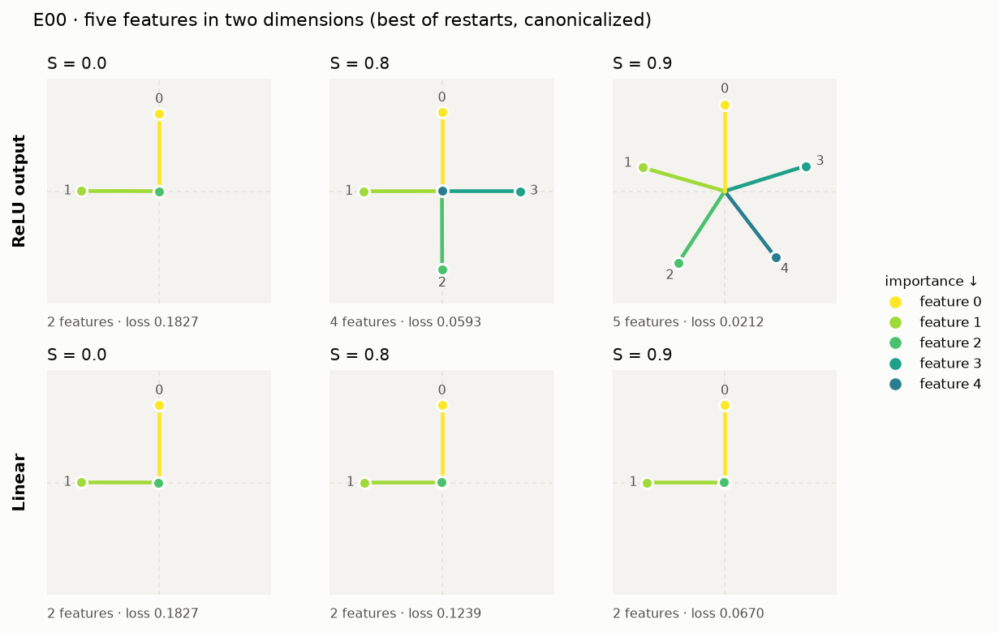

**E01 · twenty features in five dimensions (p. 11).** WᵀW with the bias, and ‖Wᵢ‖ colored by
superposition, from dense (left) to sparse (right).

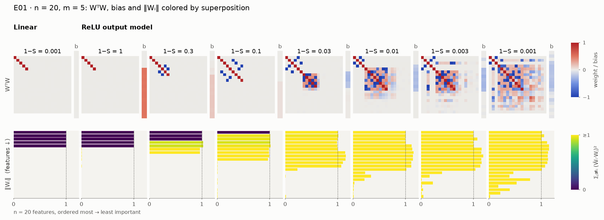

**E02 · superposition as a phase change (p. 15).** Two features in one dimension: whether the
extra feature is dropped (gray), stored as an antipodal pair (red) or given the dimension (blue)
depends on its importance and on sparsity. The panels show trained models colored by norm and
superposition, their majority vote, the exact theory, and the cells where vote and theory
disagree (most of their models are stuck in a worse minimum).

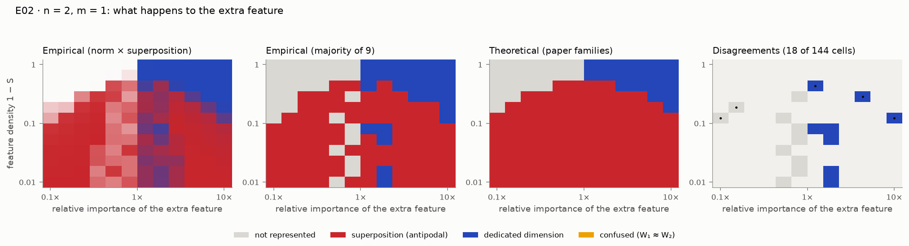

**E03 · feature dimensionality (p. 19).** 400 features in 30 dimensions: every feature's Dᵢ,
sticky at 1/2 (antipodal pairs) and clustering at the fractions of triangles, pentagons and
square antiprisms.

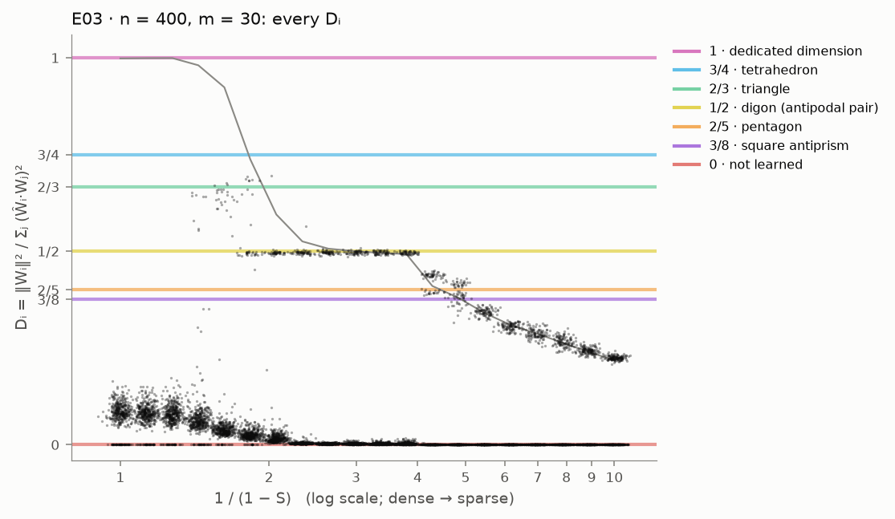

**E04 · non-uniform superposition (p. 22).** Making one of five features sparser deforms the
pentagon until it snaps to two digons, where the loss curves of the two geometries cross.

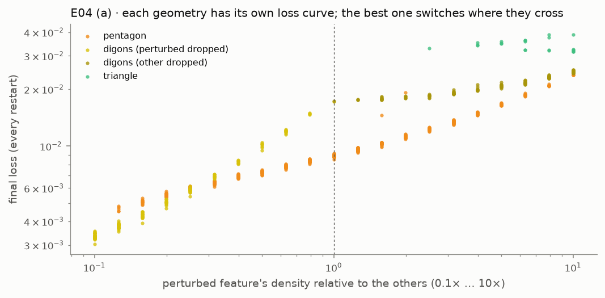

**E05 · energy-level jumps (p. 26).** 400 features in 30 dimensions settle into antipodal
pairs; long after the loss has flattened, two features jump to Dᵢ = 1/2 to fill the last badly
used dimension, and the loss drops at that moment.

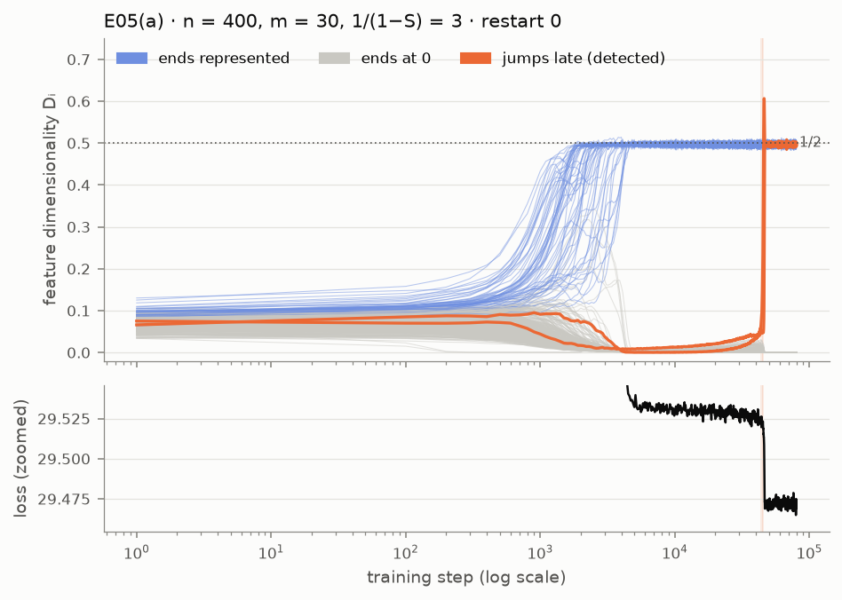

**E06 · adversarial vulnerability (p. 29).** Vulnerability to small analytic attacks, relative
to a model without superposition, tracks the number of features per dimension.

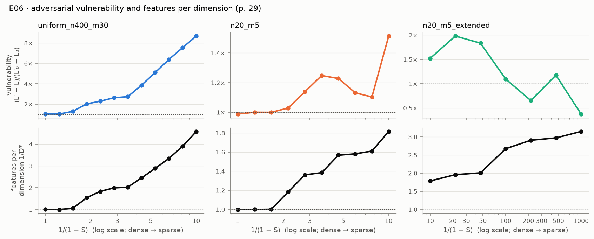

**E07 · superposition in a privileged basis (p. 33).** With a ReLU on the hidden layer, neurons
go from monosemantic to polysemantic as features get sparser.

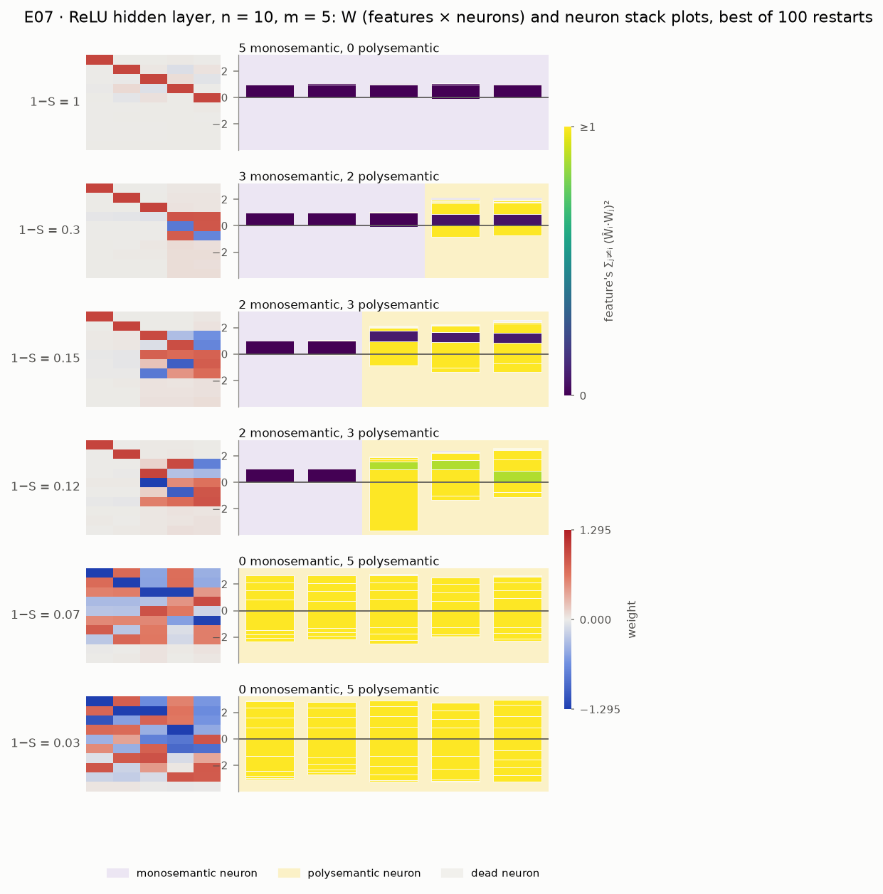

**E09 · reverse-engineering a model (p. 39).** Every neuron of a small |x| model named from its
weights and checked by ablation. Two neurons store a heavy and a victim feature with flipped
input and output sizes (asymmetric superposition), and two inhibitors cancel the resulting
interference: the p. 39 motif, found by gradient descent in most restarts.

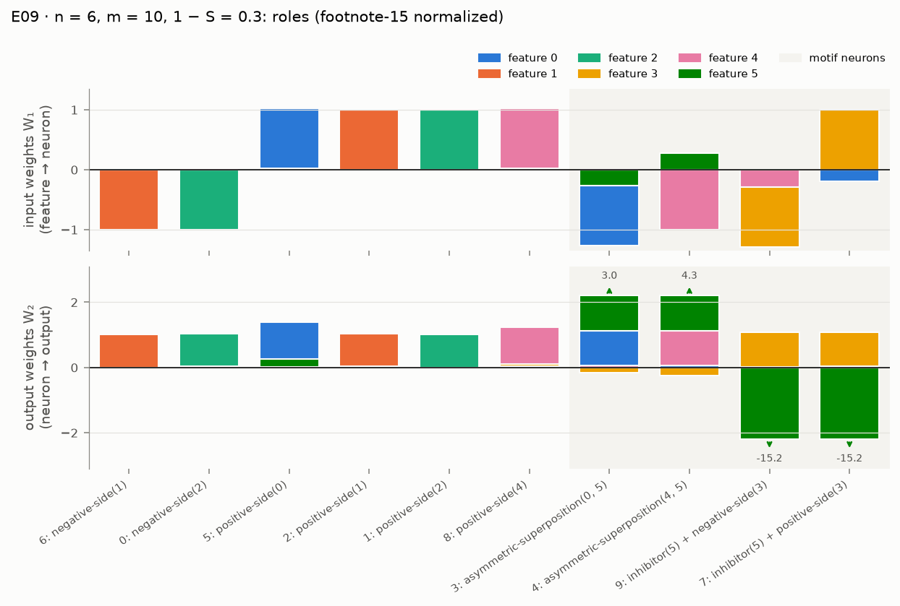

**E10 · sparse autoencoders against ground truth (pp. 42–44).** Which SAE settings recover the
true feature directions of toy models in superposition, and how often a low reconstruction
error hides a failure to find them.

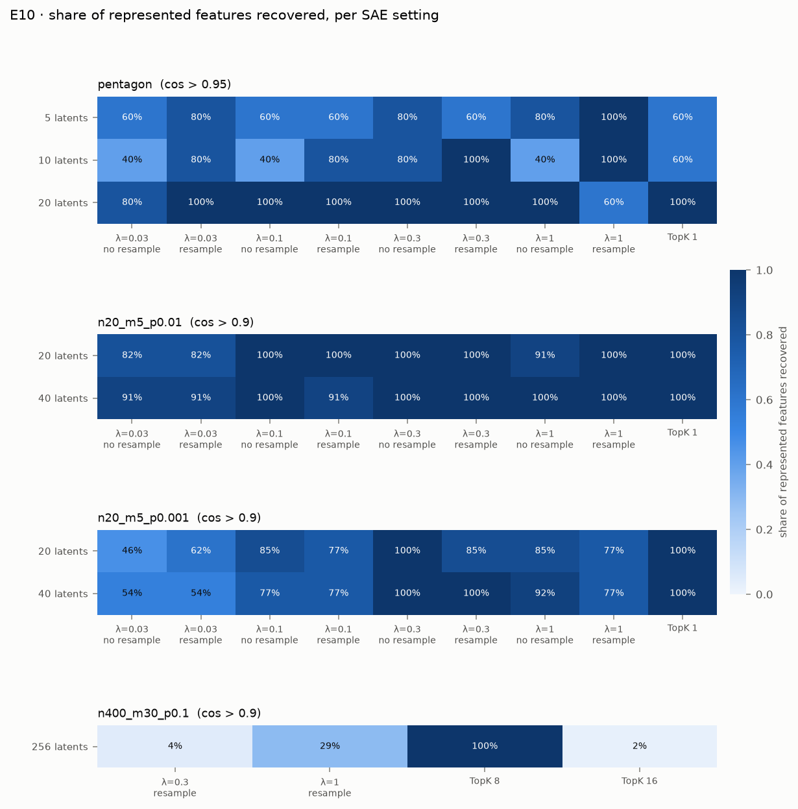

**E11 · removing superposition with L1 (p. 42).** A penalty λ‖h‖₁ removes superposition by
killing the least important features, at a price in loss; antipodal pairs along the hidden axes
survive until almost nothing is left.

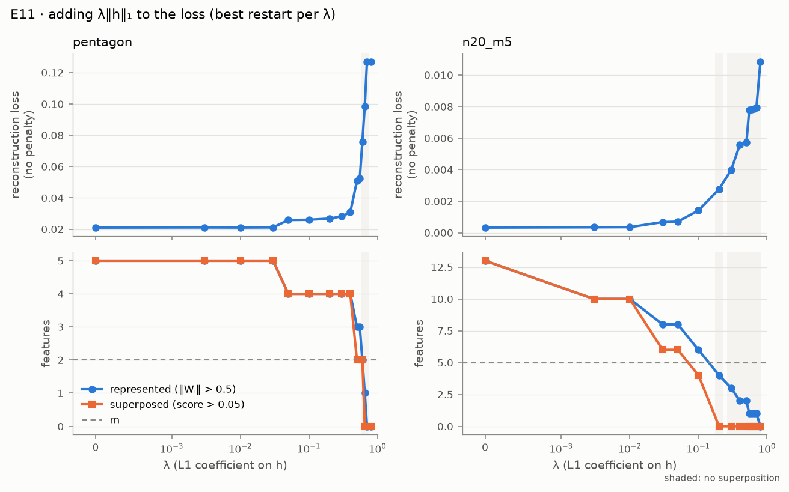

## The lab

`uv run superposition app` opens a Streamlit lab (options: `--port`, `--headless`).

- **Home:** the reproduction status (the cited run of each experiment next to your latest
  local run), the latest figures, and a searchable map from every paper section to code,
  experiments, notebooks and lab pages.
- **Playground:** train the linear, ReLU output or ReLU hidden model live (n ≤ 40, m ≤ 10, any
  importance decay and sparsity, with one-click presets for the paper's settings). See the
  loss, WᵀW with the bias, feature norms colored by superposition, a per-feature Dᵢ table, and
  the geometry (2D arrows, a rotatable 3D plot, or W itself for the ReLU hidden model). The
  **probe panel** sends any input you choose through the model and shows h, the readout, the
  bias, the ReLU and the reconstruction, feature by feature. The default setting (the p. 2
  pentagon) trains in about 4 seconds on a laptop CPU.

- **Phase diagrams:** E02's empirical and theoretical diagrams for n = 2, m = 1 and n = 3,
  m = 2, with McGrath's confused family and the zero-bias variant; pick a cell to see its ten
  trained models, the vote, representative weights and every family's optimum.
- **Geometry:** E03's D* and Dᵢ curves; pick a sparsity to see its geometry graph, Dᵢ histogram
  and tegum factors.
- **Non-uniform:** E04 with a density slider for the perturbed feature and the crossing loss
  curves; correlated and anticorrelated sets, local bases, and the collapse of correlated pairs.
- **Dynamics:** feature dimensionalities over training with a step scrubber (E05), and
  rotatable 3D trajectories of a model learning an octahedron.
- **Neurons:** W and neuron stack plots across sparsity for the ReLU hidden layer model (E07)
  and the absolute-value model (E08), with the ReLU-sidestepping table; E09's role tables,
  ablation matrices, motifs and rebuild test for every analyzed model.
- **Adversarial:** vulnerability against sparsity and features per dimension (E06).
- **SAE lab:** train a sparse autoencoder live on the pentagon or a sparse n = 20 model and
  compare its decoder with the true features (2D view, per-feature cosines); E10's sweeps and
  E11's λ trade-off with a λ slider.

## Reproduction status

See [docs/REPRODUCTION.md](docs/REPRODUCTION.md); the table there is generated from the latest
runs by `superposition report`.

## Learning path

Start with [docs/STUDY_GUIDE.md](docs/STUDY_GUIDE.md) and the notebooks in `notebooks/`, one per
paper section. [docs/PAPER_MAP.md](docs/PAPER_MAP.md) maps every paper section to code,
experiments, notebooks and app pages; [docs/GLOSSARY.md](docs/GLOSSARY.md) defines the terms.

## How to cite

Please cite the paper:

```bibtex
@article{elhage2022superposition,
  title={Toy Models of Superposition},
  author={Elhage, Nelson and Hume, Tristan and Olsson, Catherine and Schiefer, Nicholas and Henighan, Tom and Kravec, Shauna and Hatfield-Dodds, Zac and Lasenby, Robert and Drain, Dawn and Chen, Carol and Grosse, Roger and McCandlish, Sam and Kaplan, Jared and Amodei, Dario and Wattenberg, Martin and Olah, Christopher},
  year={2022},
  journal={Transformer Circuits Thread},
  note={https://transformer-circuits.pub/2022/toy_model/index.html}
}
```

To cite this repository, use [CITATION.cff](CITATION.cff) (GitHub shows a "Cite this
repository" button for it).

## Related implementations

This is an independent implementation written from the paper. Two reference implementations
exist; they were not used as sources (see SPEC §2 and [docs/DECISIONS.md](docs/DECISIONS.md)
for any diagnostic consultation):

- Anthropic's archived notebook: https://github.com/anthropics/toy-models-of-superposition
- ARENA §1.5.4: https://learn.arena.education/chapter1_transformer_interp/34_superposition/

## License

MIT; see [LICENSE](LICENSE). The paper itself is not redistributed here.
