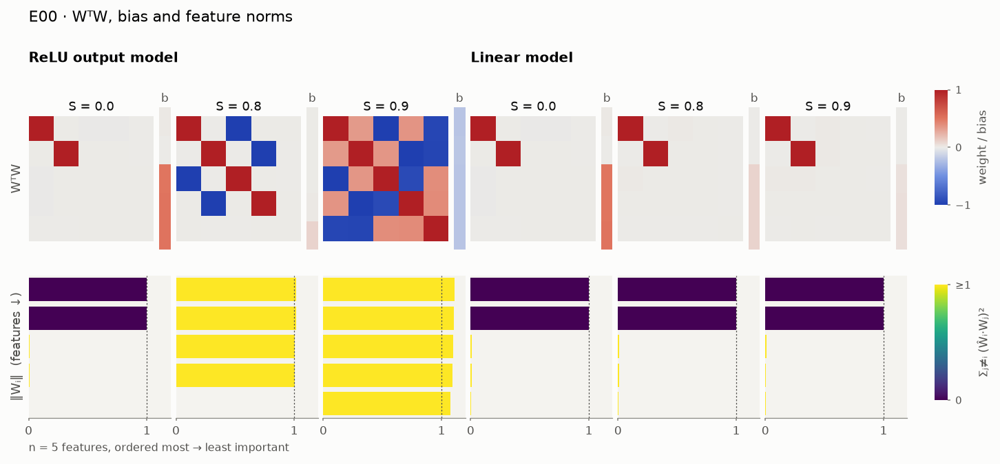
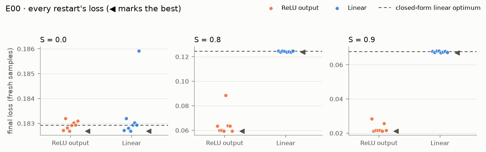
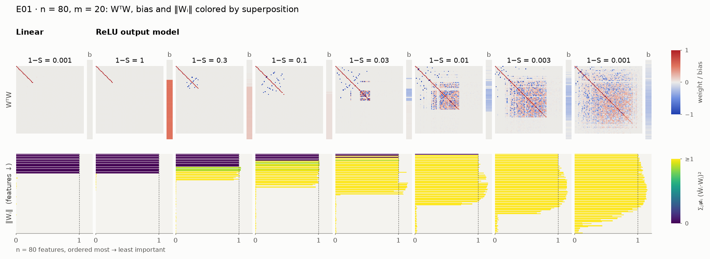
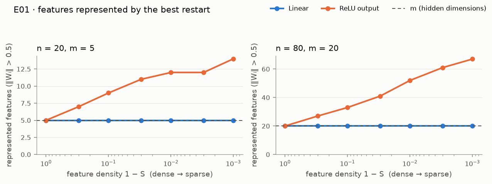

# Reproduction report

Per experiment: the paper's claim (with page), our figure, status, evidence, discrepancies
with hypotheses, and run IDs. Tables between `<!-- BEGIN AUTO … -->` and `<!-- END AUTO … -->`
markers are regenerated by `superposition report` from the latest run's `acceptance.json`;
everything else is written by hand from actual results (SPEC §10). Statuses are PASS, PARTIAL
or FAIL (SPEC §2); informational rows are marked INFO and do not affect the status.

Every number below comes from a logged run under `results/<experiment>/<run_id>/` (config,
manifest with git commit and dirty flag, acceptance record). Page numbers refer to the 62-page
PDF print of the paper (see `references/README.md`).

## Status

<!-- BEGIN AUTO:STATUS -->
| Code | Experiment | Paper | Status | Graded criteria passed | Run ID | Profile · device |
|---|---|---|---|---|---|---|
| E00 | `intro_pentagon` | p. 2 | **PASS** | 11/11 | `20260929T093651Z-5eeb804c` | quick · cpu |
| E01 | `basic_results` | pp. 10–12 | **PASS** | 12/12 | `20260929T093755Z-2cb0bbc4` | quick · cpu |
<!-- END AUTO:STATUS -->

## E00 intro_pentagon (p. 2)

**Paper's claim (p. 2; bias behaviour p. 10; linear baseline pp. 10–13).** With n = 5 features
of decreasing importance in m = 2 dimensions, the ReLU output model gives the two most important
features dedicated orthogonal dimensions when features are dense (S = 0), stores the four most
important as antipodal pairs at S = 0.8, and embeds all five as a pentagon, with positive
interference, at S = 0.9. The linear model keeps only the top two features at every sparsity.
Importance is unstated for this figure; Iᵢ = 0.9ⁱ reproduces it (SPEC §3).

**Our figures** (best of 8 restarts, canonicalized; quick profile):

**Status: PASS (11/11 graded criteria).** All three geometries appear as claimed: two
orthogonal features at S = 0 (|cos| = 0.0014), two exactly antipodal pairs {0, 2} and {1, 3} at
S = 0.8, and a pentagon at S = 0.9 with angular gaps 69.8°–74.0°, norms 1.08–1.11 and biases
−0.198 to −0.211. The linear model keeps features {0, 1} orthogonal at every sparsity and lands
within 1.0% of its exact optimum at each S, and every unrepresented feature's bias equals the
feature mean (1 − S)/2 to within 0.0016 (ReLU) and 0.0034 (linear), as p. 10 describes.

**Evidence.** Generated from the cited run's `acceptance.json`:

<!-- BEGIN AUTO:E00 -->
Run `20260929T093651Z-5eeb804c` · profile `quick` · seed 0 · device `cpu` · commit `340f825d57` · wall-clock 61.905 s · overall **PASS** (11/11)

| Group | Criterion | Paper | Status | Value | Threshold |
|---|---|---|---|---|---|
| relu_output | S = 0: exactly features {0, 1} represented, \|cos\| < 0.1 | p. 2 | PASS | {"represented": [0, 1], "abs_cos_01": 0.0014} | {"represented": [0, 1], "abs_cos_max": 0.1} |
| relu_output | S = 0.8: exactly {0, 1, 2, 3} represented, each with a partner at cos < −0.95 | p. 2 | PASS | {"represented": [0, 1, 2, 3], "antipodal_pairs": [[0, 2], [1, 3]], "min_partner_cos": {"0": -1.0, "1": -1.0, "2": -1.0, "3": -1.0}} | {"represented": [0, 1, 2, 3], "partner_cos_max": -0.95} |
| relu_output | S = 0.9: all 5 represented; angular gaps 72° ± 10°; all norms > 1; all biases < 0 | p. 2 | PASS | {"represented": [0, 1, 2, 3, 4], "gaps_deg": [69.8, 70.5, 72.7, 73.0, 74.0], "norms": [1.111, 1.101, 1.1, 1.09, 1.076], "biases": [-0.209, … | {"gap_deg": "72.0 ± 10.0", "norm_min": 1.0, "bias_max": 0.0} |
| relu_output | Represented-feature counts across all 8 restarts per S | p. 23 | INFO | {"S=0": {"2 features": 8}, "S=0.8": {"3 features": 1, "4 features": 6, "5 features": 1}, "S=0.9": {"4 features": 2, "5 features": 6}} | — |
| linear | S = 0: exactly features {0, 1} represented, orthogonal (\|cos\| < 0.1) | pp. 10–11 | PASS | {"represented": [0, 1], "abs_cos_01": 0.0017} | {"represented": [0, 1], "abs_cos_max": 0.1} |
| linear | S = 0.8: exactly features {0, 1} represented, orthogonal (\|cos\| < 0.1) | pp. 10–11 | PASS | {"represented": [0, 1], "abs_cos_01": 0.0001} | {"represented": [0, 1], "abs_cos_max": 0.1} |
| linear | S = 0.9: exactly features {0, 1} represented, orthogonal (\|cos\| < 0.1) | pp. 10–11 | PASS | {"represented": [0, 1], "abs_cos_01": 0.0002} | {"represented": [0, 1], "abs_cos_max": 0.1} |
| linear | S = 0: best linear loss within 3% of Σ_{i≥m} Iᵢ(p/3 − p²/4) | p. 13 | PASS | {"loss": 0.18269, "optimum": 0.18292, "rel_diff": 0.0013} | {"rel_diff_max": 0.03} |
| linear | S = 0.8: best linear loss within 3% of Σ_{i≥m} Iᵢ(p/3 − p²/4) | p. 13 | PASS | {"loss": 0.12392, "optimum": 0.12439, "rel_diff": 0.0038} | {"rel_diff_max": 0.03} |
| linear | S = 0.9: best linear loss within 3% of Σ_{i≥m} Iᵢ(p/3 − p²/4) | p. 13 | PASS | {"loss": 0.067, "optimum": 0.06768, "rel_diff": 0.0101} | {"rel_diff_max": 0.03} |
| relu_output | Every feature with ‖Wᵢ‖ < 0.05 has bias within 0.02 of (1 − S)/2 | p. 10 | PASS | [{"S": 0.0, "feature": 2, "bias": 0.4984, "expected": 0.5}, {"S": 0.0, "feature": 3, "bias": 0.5002, "expected": 0.5}, {"S": 0.0, "feature"… | {"norm_max": 0.05, "abs_diff_max": 0.02} |
| linear | Every feature with ‖Wᵢ‖ < 0.05 has bias within 0.02 of (1 − S)/2 | p. 10 | PASS | [{"S": 0.0, "feature": 2, "bias": 0.4973, "expected": 0.5}, {"S": 0.0, "feature": 3, "bias": 0.4999, "expected": 0.5}, {"S": 0.0, "feature"… | {"norm_max": 0.05, "abs_diff_max": 0.02} |
| relu_output | Best-restart loss per S next to the independent reference run (sanity check) | p. 2 | INFO | {"S=0": {"ours": 0.18269, "reference": 0.182}, "S=0.8": {"ours": 0.05932, "reference": 0.059}, "S=0.9": {"ours": 0.02117, "reference": 0.01… | — |
| linear | Best-restart loss per S next to the independent reference run (sanity check) | p. 2 | INFO | {"S=0": {"ours": 0.18269, "reference": 0.182}, "S=0.8": {"ours": 0.12392, "reference": 0.122}, "S=0.9": {"ours": 0.067, "reference": 0.067}} | — |
| relu_output | S = 0.9 best model: feature dimensionalities Dᵢ (pentagon: 2/5) and D* | pp. 17–19 | INFO | {"D_i": [0.41, 0.406, 0.402, 0.396, 0.387], "D_star": 0.333} | — |
| relu_output | S = 0.9 best restart re-evaluated on 1,000,000 samples | p. 2 | INFO | {"loss_100k_selection_eval": 0.02117, "loss_precise": 0.02139, "reference": 0.0196} | — |
| relu_output | Spread of 200 independent 20,000-sample loss estimates of that model | p. 2 | INFO | {"mean": 0.02134, "rel_std_pct": 3.68, "q2.5": 0.01997, "q97.5": 0.02302, "min": 0.01896, "fraction_at_or_below_reference": 0.005} | — |
| relu_output | Loss (1,000,000 samples) of each cyclic feature arrangement, trained 10,000 steps from an ideal pentagon; best restart'… | pp. 2, 22–23 | INFO | {"best_restart_arrangement": "01243", "min": 0.02142, "max": 0.02165, "n_arrangements_still_pentagons": 12, "by_arrangement": {"01243": 0.0… | — |
<!-- END AUTO:E00 -->

**Robustness.** The full profile (32 restarts, run on Apple MPS instead of CPU, run
`20260929T090615Z-eb7b9e3b`) also passes 11/11. At S = 0.9, 21 of its 32 restarts reach all five
features and 11 settle for four (quick profile: 6 of 8 and 2 of 8), matching the reference run's
note that 3 of 8 restarts stopped at four features. Keeping the best restart, as the paper does
for 2D models (p. 23), is what makes the S = 0.9 criterion robust.

**Discrepancy with the reference losses, and what it is.** SPEC §7 lists reference losses from
an independent verification run (20,000 evaluation samples each). Ours agree at S = 0 and
S = 0.8, but the best S = 0.9 pentagon is higher: 0.0214 on a 1,000,000-sample re-evaluation,
against 0.0196. What we checked, all logged as INFO rows of the cited run:

1. *Same geometry.* Our pentagon's norms (1.08–1.11) and biases (−0.20 to −0.21) match the
   reference geometry, so the two runs agree on *what* was learned.
2. *Other local optima, and convergence.* Every one of the 12 cyclic arrangements of the five
   features (up to rotation and reflection), trained for 10,000 more steps from an ideal
   pentagon, converges to 0.02142–0.02165. No pentagon comes near 0.0196, and the best restart
   (arrangement 0-1-2-4-3) is already the best arrangement.
3. *Sampling noise.* A 20,000-sample estimate of this loss has 3.7% relative noise, not the 1–2%
   SPEC assumes. Only 1 of 200 such estimates (0.5%) falls at or below 0.0196.
4. *Selection bias in the reference.* The reference linear losses (0.182, 0.122, 0.067) all lie
   **below the exact linear optimum** (0.1829, 0.1244, 0.0677), which no model can beat in
   expectation. Picking the best restart by a noisy estimate favours lucky draws (a winner's
   curse). Our own best-of-restarts losses show the same bias at a smaller scale: the linear
   losses are 0.13–1.0% below the optimum (e.g. S = 0.8: 0.1239 vs 0.1244), and the chosen
   pentagon's 100,000-sample loss (0.0212) is 1% below its 1M-sample value (0.0214). That is why
   E00 re-evaluates the chosen pentagon on independent samples.

The full-profile run on MPS repeats every diagnostic with the same conclusion (1M-sample loss
0.0212, arrangements 0.02127–0.02171, 20k-sample noise 3.3%, no estimate at or below 0.0196).

**Hypothesis:** 0.0196 is a low draw of a noisy, selection-biased estimate; the pentagon's
expected loss in this setup is ≈ 0.021. No acceptance criterion depends on it (the reference
values are sanity checks only, SPEC §7).

**Run IDs.** Cited (quick, CPU, seed 0, commit `340f825`): `20260929T093651Z-5eeb804c`.
Full profile (MPS): `20260929T090615Z-eb7b9e3b`.

## E01 basic_results (pp. 10–12)

**Paper's claim (pp. 10–12).** For n = 20 features in m = 5 dimensions with Iᵢ = 0.7ⁱ (p. 11),
and for n = 80, m = 20 with Iᵢ = 0.9ⁱ (p. 12): the linear model always learns the top-m
features, orthogonally, whatever the sparsity. The ReLU output model matches it on dense data;
as sparsity increases it represents more features by letting them be non-orthogonal.
Superposition starts with the less important features, first as antipodal pairs, then in other
geometries, until every represented feature is in superposition.

**Our figures** (best of 4 restarts per sparsity; quick profile). Leftmost column: the linear
model at 1 − S = 0.001; then the ReLU output model from dense to sparse, as on pp. 11–12.

**Status: PASS (12/12 graded criteria, six per model size).** Both model sizes behave as
described:

- The linear model keeps exactly the top m features at all seven sparsities, with superposition
  scores ≤ 0.0011.
- The ReLU model matches it when dense: the same represented set, and losses within 0.03%.
- Its represented count rises monotonically: 5 → 7 → 9 → 11 → 12 → 12 → 14 for n = 20, and
  20 → 27 → 33 → 41 → 52 → 61 → 67 for n = 80.
- Superposition first appears at 1 − S = 0.3, among the least important represented features.
  For n = 20, features 3–6 are superposed while 0–2 keep dedicated dimensions; for n = 80,
  features 13–26 are superposed while 0–12 stay orthogonal.
- Dimensions per feature D* fall from 1 to 0.32 (n = 20) and 0.28 (n = 80).

**Evidence.** Generated from the cited run's `acceptance.json`. The criteria are
operationalized as recorded in DECISIONS.md D-105:

<!-- BEGIN AUTO:E01 -->
Run `20260929T093755Z-2cb0bbc4` · profile `quick` · seed 0 · device `cpu` · commit `340f825d57` · wall-clock 472.425 s · overall **PASS** (12/12)

| Group | Criterion | Paper | Status | Value | Threshold |
|---|---|---|---|---|---|
| n20_m5 | Linear: exactly the top 5 features represented, superposition score < 0.05, at every sparsity | p. 11 | PASS | {"per_sparsity": {"1-S=1": {"n_represented": 5, "is_top_m": true, "max_score": 0.0}, "1-S=0.3": {"n_represented": 5, "is_top_m": true, "max… | {"represented": "features 0–4", "max_score_below": 0.05} |
| n20_m5 | ReLU at 1 − S = 1: same top-5 orthogonal solution as the linear model (loss within 5%) | p. 11 | PASS | {"represented": [0, 1, 2, 3, 4], "max_score": 0.0, "loss_relu": 0.04633, "loss_linear": 0.04633, "rel_loss_diff": 0.0} | {"represented": "features 0–4", "max_score_below": 0.05, "rel_loss_diff_max": 0… |
| n20_m5 | ReLU: represented-feature count never falls more than 1 below any denser setting's count | p. 11 | PASS | {"counts": {"1": 5, "0.3": 7, "0.1": 9, "0.03": 11, "0.01": 12, "0.003": 12, "0.001": 14}, "violations_at": []} | {"tolerance": 1} |
| n20_m5 | ReLU: more than m = 5 features represented at 1 − S = 0.001 | p. 11 | PASS | 14 | > 5 |
| n20_m5 | ReLU: at the first sparsity with superposition, the most important feature is untouched and every superposed feature is… | p. 11 | PASS | {"first_sparsity": "0.3", "orthogonal_represented": [0, 1, 2], "superposed": [3, 4, 5, 6]} | min(superposed) > max(orthogonal), feature 0 orthogonal |
| n20_m5 | ReLU: antipodal pairs (cos < −0.95) appear at an intermediate sparsity; report where | p. 12 | PASS | {"with_pairs": ["0.3", "0.1", "0.03", "0.01", "0.003"], "pairs_by_sparsity": {"1": [], "0.3": [[3, 5], [4, 6]], "0.1": [[1, 5], [2, 6], [3,… | ≥ 1 pair at some 1 − S strictly between 1 and 0.001 |
| n20_m5 | Best-restart summary per sparsity (ReLU output; linear loss for comparison) | p. 11 | INFO | {"1-S=1": {"relu_represented": 5, "relu_superposed": 0, "relu_D_star": 1.0, "relu_loss": 0.04633, "linear_loss": 0.04633}, "1-S=0.3": {"rel… | — |
| n80_m20 | Linear: exactly the top 20 features represented, superposition score < 0.05, at every sparsity | p. 12 | PASS | {"per_sparsity": {"1-S=1": {"n_represented": 20, "is_top_m": true, "max_score": 0.0011}, "1-S=0.3": {"n_represented": 20, "is_top_m": true,… | {"represented": "features 0–19", "max_score_below": 0.05} |
| n80_m20 | ReLU at 1 − S = 1: same top-20 orthogonal solution as the linear model (loss within 5%) | p. 12 | PASS | {"represented": [0, 1, 2, 3, 4, 5, 6, 7, 8, 9, 10, 11, 12, 13, 14, 15, 16, 17, 18, 19], "max_score": 0.0003, "loss_relu": 0.10101, "loss_li… | {"represented": "features 0–19", "max_score_below": 0.05, "rel_loss_diff_max": … |
| n80_m20 | ReLU: represented-feature count never falls more than 1 below any denser setting's count | p. 12 | PASS | {"counts": {"1": 20, "0.3": 27, "0.1": 33, "0.03": 41, "0.01": 52, "0.003": 61, "0.001": 67}, "violations_at": []} | {"tolerance": 1} |
| n80_m20 | ReLU: more than m = 20 features represented at 1 − S = 0.001 | p. 12 | PASS | 67 | > 20 |
| n80_m20 | ReLU: at the first sparsity with superposition, the most important feature is untouched and every superposed feature is… | p. 11 | PASS | {"first_sparsity": "0.3", "orthogonal_represented": [0, 1, 2, 3, 4, 5, 6, 7, 8, 9, 10, 11, 12], "superposed": [13, 14, 15, 16, 17, 18, 19, … | min(superposed) > max(orthogonal), feature 0 orthogonal |
| n80_m20 | ReLU: antipodal pairs (cos < −0.95) appear at an intermediate sparsity; report where | p. 12 | PASS | {"with_pairs": ["0.3", "0.1", "0.03", "0.01", "0.003"], "pairs_by_sparsity": {"1": [], "0.3": [[13, 19], [14, 24], [15, 23], [16, 26], [17,… | ≥ 1 pair at some 1 − S strictly between 1 and 0.001 |
| n80_m20 | Best-restart summary per sparsity (ReLU output; linear loss for comparison) | p. 12 | INFO | {"1-S=1": {"relu_represented": 20, "relu_superposed": 0, "relu_D_star": 1.0, "relu_loss": 0.10101, "linear_loss": 0.10104}, "1-S=0.3": {"re… | — |
<!-- END AUTO:E01 -->

**Where antipodal pairs appear.** Pairs of represented features with cos < −0.95 appear at every
intermediate sparsity, from 1 − S = 0.3 to 0.003 (n = 20: 2, 4, 3, 2, 2 pairs; n = 80: 7, 13, 13,
10, 10), and thin out at 0.001 (1 and 3 pairs) as other geometries take over. This is the
progression p. 12 describes: antipodal pairs first, other structures as more features are
packed in.

**Represented features at the sparsest setting.** Counts at 1 − S = 0.001 (14/20 and 67/80) are
of the same order as the paper's panels. Our 300-dpi readings (approximate, by eye): the p. 11
panel shows about 12 features at full norm plus about 4 near ‖Wᵢ‖ ≈ 0.5; the p. 12 panel shows
about 50 at full norm plus a tail of partial ones. The counts are also stable in training
length: the full profile (8 restarts, 30,000 steps, MPS, run `20260929T090856Z-6d287488`) passes
12/12 with 12/20 and 68/80 at the sparsest setting. An earlier worry that the quick profile
under-represents features came from reading low-resolution figures (DECISIONS.md D-114).

**Run IDs.** Cited (quick, CPU, seed 0, commit `340f825`): `20260929T093755Z-2cb0bbc4`
(472 s wall-clock). Full profile (MPS): `20260929T090856Z-6d287488` (1,673 s).
