# Reproduction report

Per experiment: the paper's claim (with page), our figure, status, evidence, discrepancies
with hypotheses, and run IDs. Tables between `<!-- BEGIN AUTO … -->` and `<!-- END AUTO … -->`
markers are regenerated by `superposition report` from the cited run's `acceptance.json`
(docs/cited_runs.yaml). Blocks named `<code>:<label>` hold a supplementary cited run, such as a
pilot or a held-out check (D-R07). Everything else is written by hand from actual results
(SPEC §10). Statuses are PASS, PARTIAL or FAIL (SPEC §2). A single graded criterion is PARTIAL
when it passes only in a degenerate form that the experiment defines up front (D-R05), and it
does not count as passed. Informational rows are marked INFO and do not affect the status.

Every number below comes from a logged run under `results/<experiment>/<run_id>/` (config,
manifest with git commit and dirty flag, acceptance record). Page numbers refer to the 62-page
PDF print of the paper (see `references/README.md`).

## Status

<!-- BEGIN AUTO:STATUS -->
| Code | Experiment | Paper | Status | Graded criteria passed | Run ID | Profile · device |
|---|---|---|---|---|---|---|
| E00 | `intro_pentagon` | p. 2 | **PASS** | 11/11 | `20260929T093651Z-5eeb804c` | quick · cpu |
| E01 | `basic_results` | pp. 10–12 | **PASS** | 12/12 | `20260929T093755Z-2cb0bbc4` | quick · cpu |
| E02 | `phase_change` | pp. 14–16 | **PASS** | 6/6 | `20260930T090540Z-4e3325bf` | quick · cpu |
| E03 | `uniform_geometry` | pp. 16–21 | **PASS** | 4/4 | `20260930T091350Z-2cb2dc61` | quick · cpu |
| E04 | `nonuniform_geometry` | pp. 21–26 | **PASS** | 9/9 | `20260930T091958Z-43c63e78` | quick · cpu |
| E05 | `learning_dynamics` | pp. 26–28 | **PASS** | 2/2 | `20260930T190604Z-2fae0fc5` | quick · cpu |
| E06 | `adversarial` | pp. 29–30 | **PARTIAL** | 2/4 | `20260929T173800Z-e84cec26` | quick · cpu |
| E07 | `privileged_basis` | pp. 31–34 | **PASS** | 3/3 | `20260929T174443Z-d54df07e` | quick · cpu |
| E08 | `abs_computation` | pp. 34–39 | **PARTIAL** | 2/4 | `20260930T191445Z-49fd30ed` | quick · cpu |
| E09 | `mech_interp_abs` | pp. 38–39 | **PASS** | 3/3 | `20260930T184323Z-3fdd1d10` | quick · cpu |
| E10 | `sae_recovery` | pp. 42–44 | **PARTIAL** | 1/3 | `20260930T192302Z-13117b27` | quick · cpu |
| E11 | `l1_removes_superposition` | p. 42 | **PARTIAL** | 7/8 | `20260930T185653Z-c4feb0cf` | quick · cpu |
<!-- END AUTO:STATUS -->

## E00 intro_pentagon (p. 2)

**Paper's claim (p. 2; bias behaviour p. 10; linear baseline pp. 10–13).** With n = 5 features
of decreasing importance in m = 2 dimensions, the ReLU output model gives the two most important
features dedicated orthogonal dimensions when features are dense (S = 0), stores the four most
important as antipodal pairs at S = 0.8, and embeds all five as a pentagon, with positive
interference, at S = 0.9. The linear model keeps only the top two features at every sparsity.
Importance is unstated for this figure; Iᵢ = 0.9ⁱ reproduces it (SPEC §3).

**Our figures** (best of 8 restarts, canonicalized; quick profile):

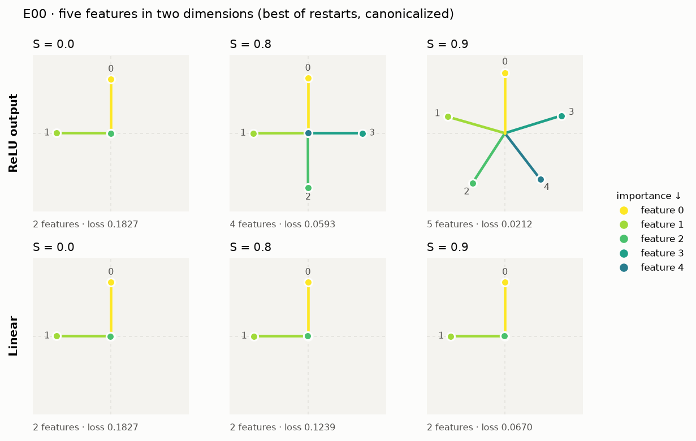

**Status: PASS (11/11 graded criteria).** All three geometries appear as claimed: two
orthogonal features at S = 0 (|cos| = 0.0014), two exactly antipodal pairs {0, 2} and {1, 3} at
S = 0.8, and a pentagon at S = 0.9 with angular gaps 69.8°–74.0°, norms 1.08–1.11 and biases
−0.198 to −0.211. The linear model keeps features {0, 1} orthogonal at every sparsity and lands
within 1.0% of its exact optimum at each S, and every unrepresented feature's bias equals the
feature mean (1 − S)/2 to within 0.0016 (ReLU) and 0.0034 (linear), as p. 10 describes.

**Evidence.** Generated from the cited run's `acceptance.json`:

<!-- BEGIN AUTO:E00 -->
Run `20260929T093651Z-5eeb804c` · profile `quick` · seed 0 · device `cpu` · commit `340f825d57` · wall-clock 61.905 s · overall **PASS** (11/11)

| Group | Criterion | Paper | Status | Value | Threshold |
|---|---|---|---|---|---|
| relu_output | S = 0: exactly features {0, 1} represented, \|cos\| < 0.1 | p. 2 | PASS | {"represented": [0, 1], "abs_cos_01": 0.0014} | {"represented": [0, 1], "abs_cos_max": 0.1} |
| relu_output | S = 0.8: exactly {0, 1, 2, 3} represented, each with a partner at cos < −0.95 | p. 2 | PASS | {"represented": [0, 1, 2, 3], "antipodal_pairs": [[0, 2], [1, 3]], "min_partner_cos": {"0": -1.0, "1": -1.0, "2": -1.0, "3": -1.0}} | {"represented": [0, 1, 2, 3], "partner_cos_max": -0.95} |
| relu_output | S = 0.9: all 5 represented; angular gaps 72° ± 10°; all norms > 1; all biases < 0 | p. 2 | PASS | {"represented": [0, 1, 2, 3, 4], "gaps_deg": [69.8, 70.5, 72.7, 73.0, 74.0], "norms": [1.111, 1.101, 1.1, 1.09, 1.076], "biases": [-0.209, … | {"gap_deg": "72.0 ± 10.0", "norm_min": 1.0, "bias_max": 0.0} |
| relu_output | Represented-feature counts across all 8 restarts per S | p. 23 | INFO | {"S=0": {"2 features": 8}, "S=0.8": {"3 features": 1, "4 features": 6, "5 features": 1}, "S=0.9": {"4 features": 2, "5 features": 6}} | — |
| linear | S = 0: exactly features {0, 1} represented, orthogonal (\|cos\| < 0.1) | pp. 10–11 | PASS | {"represented": [0, 1], "abs_cos_01": 0.0017} | {"represented": [0, 1], "abs_cos_max": 0.1} |
| linear | S = 0.8: exactly features {0, 1} represented, orthogonal (\|cos\| < 0.1) | pp. 10–11 | PASS | {"represented": [0, 1], "abs_cos_01": 0.0001} | {"represented": [0, 1], "abs_cos_max": 0.1} |
| linear | S = 0.9: exactly features {0, 1} represented, orthogonal (\|cos\| < 0.1) | pp. 10–11 | PASS | {"represented": [0, 1], "abs_cos_01": 0.0002} | {"represented": [0, 1], "abs_cos_max": 0.1} |
| linear | S = 0: best linear loss within 3% of Σ_{i≥m} Iᵢ(p/3 − p²/4) | p. 13 | PASS | {"loss": 0.18269, "optimum": 0.18292, "rel_diff": 0.0013} | {"rel_diff_max": 0.03} |
| linear | S = 0.8: best linear loss within 3% of Σ_{i≥m} Iᵢ(p/3 − p²/4) | p. 13 | PASS | {"loss": 0.12392, "optimum": 0.12439, "rel_diff": 0.0038} | {"rel_diff_max": 0.03} |
| linear | S = 0.9: best linear loss within 3% of Σ_{i≥m} Iᵢ(p/3 − p²/4) | p. 13 | PASS | {"loss": 0.067, "optimum": 0.06768, "rel_diff": 0.0101} | {"rel_diff_max": 0.03} |
| relu_output | Every feature with ‖Wᵢ‖ < 0.05 has bias within 0.02 of (1 − S)/2 | p. 10 | PASS | [{"S": 0.0, "feature": 2, "bias": 0.4984, "expected": 0.5}, {"S": 0.0, "feature": 3, "bias": 0.5002, "expected": 0.5}, {"S": 0.0, "feature"… | {"norm_max": 0.05, "abs_diff_max": 0.02} |
| linear | Every feature with ‖Wᵢ‖ < 0.05 has bias within 0.02 of (1 − S)/2 | p. 10 | PASS | [{"S": 0.0, "feature": 2, "bias": 0.4973, "expected": 0.5}, {"S": 0.0, "feature": 3, "bias": 0.4999, "expected": 0.5}, {"S": 0.0, "feature"… | {"norm_max": 0.05, "abs_diff_max": 0.02} |
| relu_output | Best-restart loss per S next to the independent reference run (sanity check) | p. 2 | INFO | {"S=0": {"ours": 0.18269, "reference": 0.182}, "S=0.8": {"ours": 0.05932, "reference": 0.059}, "S=0.9": {"ours": 0.02117, "reference": 0.01… | — |
| linear | Best-restart loss per S next to the independent reference run (sanity check) | p. 2 | INFO | {"S=0": {"ours": 0.18269, "reference": 0.182}, "S=0.8": {"ours": 0.12392, "reference": 0.122}, "S=0.9": {"ours": 0.067, "reference": 0.067}} | — |
| relu_output | S = 0.9 best model: feature dimensionalities Dᵢ (pentagon: 2/5) and D* | pp. 17–19 | INFO | {"D_i": [0.41, 0.406, 0.402, 0.396, 0.387], "D_star": 0.333} | — |
| relu_output | S = 0.9 best restart re-evaluated on 1,000,000 samples | p. 2 | INFO | {"loss_100k_selection_eval": 0.02117, "loss_precise": 0.02139, "reference": 0.0196} | — |
| relu_output | Spread of 200 independent 20,000-sample loss estimates of that model | p. 2 | INFO | {"mean": 0.02134, "rel_std_pct": 3.68, "q2.5": 0.01997, "q97.5": 0.02302, "min": 0.01896, "fraction_at_or_below_reference": 0.005} | — |
| relu_output | Loss (1,000,000 samples) of each cyclic feature arrangement, trained 10,000 steps from an ideal pentagon; best restart'… | pp. 2, 22–23 | INFO | {"best_restart_arrangement": "01243", "min": 0.02142, "max": 0.02165, "n_arrangements_still_pentagons": 12, "by_arrangement": {"01243": 0.0… | — |
<!-- END AUTO:E00 -->

**Robustness.** The full profile (32 restarts, run on Apple MPS instead of CPU, run
`20260929T090615Z-eb7b9e3b`) also passes 11/11. At S = 0.9, 21 of its 32 restarts reach all five
features and 11 settle for four (quick profile: 6 of 8 and 2 of 8), matching the reference run's
note that 3 of 8 restarts stopped at four features. Keeping the best restart, as the paper does
for 2D models (p. 23), is what makes the S = 0.9 criterion robust.

**Discrepancy with the reference losses, and what it is.** SPEC §7 lists reference losses from
an independent verification run (20,000 evaluation samples each). Ours agree at S = 0 and
S = 0.8, but the best S = 0.9 pentagon is higher: 0.0214 on a 1,000,000-sample re-evaluation,
against 0.0196. What we checked, all logged as INFO rows of the cited run:

1. *Same geometry.* Our pentagon's norms (1.08–1.11) and biases (−0.20 to −0.21) match the
   reference geometry, so the two runs agree on *what* was learned.
2. *Other local optima, and convergence.* Every one of the 12 cyclic arrangements of the five
   features (up to rotation and reflection), trained for 10,000 more steps from an ideal
   pentagon, converges to 0.02142–0.02165. No pentagon comes near 0.0196, and the best restart
   (arrangement 0-1-2-4-3) is already the best arrangement.
3. *Sampling noise.* A 20,000-sample estimate of this loss has 3.7% relative noise, not the 1–2%
   SPEC assumes. Only 1 of 200 such estimates (0.5%) falls at or below 0.0196.
4. *Selection bias in the reference.* The reference linear losses (0.182, 0.122, 0.067) all lie
   **below the exact linear optimum** (0.1829, 0.1244, 0.0677), which no model can beat in
   expectation. Picking the best restart by a noisy estimate favours lucky draws (a winner's
   curse). Our own best-of-restarts losses show the same bias at a smaller scale: the linear
   losses are 0.13–1.0% below the optimum (e.g. S = 0.8: 0.1239 vs 0.1244), and the chosen
   pentagon's 100,000-sample loss (0.0212) is 1% below its 1M-sample value (0.0214). That is why
   E00 re-evaluates the chosen pentagon on independent samples.

The full-profile run on MPS repeats every diagnostic with the same conclusion (1M-sample loss
0.0212, arrangements 0.02127–0.02171, 20k-sample noise 3.3%, no estimate at or below 0.0196).

**Hypothesis:** 0.0196 is a low draw of a noisy, selection-biased estimate; the pentagon's
expected loss in this setup is ≈ 0.021. No acceptance criterion depends on it (the reference
values are sanity checks only, SPEC §7).

**Run IDs.** Cited (quick, CPU, seed 0, commit `340f825`): `20260929T093651Z-5eeb804c`.
Full profile (MPS): `20260929T090615Z-eb7b9e3b`.

## E01 basic_results (pp. 10–12)

**Paper's claim (pp. 10–12).** For n = 20 features in m = 5 dimensions with Iᵢ = 0.7ⁱ (p. 11),
and for n = 80, m = 20 with Iᵢ = 0.9ⁱ (p. 12): the linear model always learns the top-m
features, orthogonally, whatever the sparsity. The ReLU output model matches it on dense data;
as sparsity increases it represents more features by letting them be non-orthogonal.
Superposition starts with the less important features, first as antipodal pairs, then in other
geometries, until every represented feature is in superposition.

**Our figures** (best of 4 restarts per sparsity; quick profile). Leftmost column: the linear
model at 1 − S = 0.001; then the ReLU output model from dense to sparse, as on pp. 11–12.

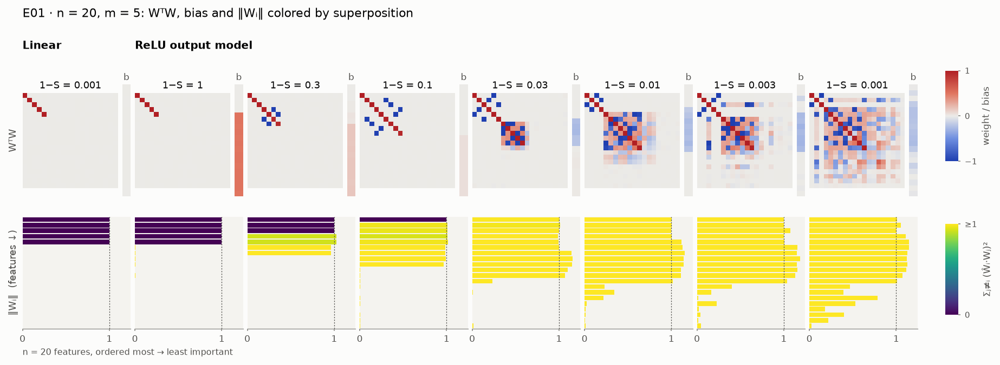

**Status: PASS (12/12 graded criteria, six per model size).** Both model sizes behave as
described:

- The linear model keeps exactly the top m features at all seven sparsities, with superposition
  scores ≤ 0.0011.
- The ReLU model matches it when dense: the same represented set, and losses within 0.03%.
- Its represented count rises monotonically: 5 → 7 → 9 → 11 → 12 → 12 → 14 for n = 20, and
  20 → 27 → 33 → 41 → 52 → 61 → 67 for n = 80.
- Superposition first appears at 1 − S = 0.3, among the least important represented features.
  For n = 20, features 3–6 are superposed while 0–2 keep dedicated dimensions; for n = 80,
  features 13–26 are superposed while 0–12 stay orthogonal.
- Dimensions per feature D* fall from 1 to 0.32 (n = 20) and 0.28 (n = 80).

**Evidence.** Generated from the cited run's `acceptance.json`. The criteria are
operationalized as recorded in DECISIONS.md D-105:

<!-- BEGIN AUTO:E01 -->
Run `20260929T093755Z-2cb0bbc4` · profile `quick` · seed 0 · device `cpu` · commit `340f825d57` · wall-clock 472.425 s · overall **PASS** (12/12)

| Group | Criterion | Paper | Status | Value | Threshold |
|---|---|---|---|---|---|
| n20_m5 | Linear: exactly the top 5 features represented, superposition score < 0.05, at every sparsity | p. 11 | PASS | {"per_sparsity": {"1-S=1": {"n_represented": 5, "is_top_m": true, "max_score": 0.0}, "1-S=0.3": {"n_represented": 5, "is_top_m": true, "max… | {"represented": "features 0–4", "max_score_below": 0.05} |
| n20_m5 | ReLU at 1 − S = 1: same top-5 orthogonal solution as the linear model (loss within 5%) | p. 11 | PASS | {"represented": [0, 1, 2, 3, 4], "max_score": 0.0, "loss_relu": 0.04633, "loss_linear": 0.04633, "rel_loss_diff": 0.0} | {"represented": "features 0–4", "max_score_below": 0.05, "rel_loss_diff_max": 0… |
| n20_m5 | ReLU: represented-feature count never falls more than 1 below any denser setting's count | p. 11 | PASS | {"counts": {"1": 5, "0.3": 7, "0.1": 9, "0.03": 11, "0.01": 12, "0.003": 12, "0.001": 14}, "violations_at": []} | {"tolerance": 1} |
| n20_m5 | ReLU: more than m = 5 features represented at 1 − S = 0.001 | p. 11 | PASS | 14 | > 5 |
| n20_m5 | ReLU: at the first sparsity with superposition, the most important feature is untouched and every superposed feature is… | p. 11 | PASS | {"first_sparsity": "0.3", "orthogonal_represented": [0, 1, 2], "superposed": [3, 4, 5, 6]} | min(superposed) > max(orthogonal), feature 0 orthogonal |
| n20_m5 | ReLU: antipodal pairs (cos < −0.95) appear at an intermediate sparsity; report where | p. 12 | PASS | {"with_pairs": ["0.3", "0.1", "0.03", "0.01", "0.003"], "pairs_by_sparsity": {"1": [], "0.3": [[3, 5], [4, 6]], "0.1": [[1, 5], [2, 6], [3,… | ≥ 1 pair at some 1 − S strictly between 1 and 0.001 |
| n20_m5 | Best-restart summary per sparsity (ReLU output; linear loss for comparison) | p. 11 | INFO | {"1-S=1": {"relu_represented": 5, "relu_superposed": 0, "relu_D_star": 1.0, "relu_loss": 0.04633, "linear_loss": 0.04633}, "1-S=0.3": {"rel… | — |
| n80_m20 | Linear: exactly the top 20 features represented, superposition score < 0.05, at every sparsity | p. 12 | PASS | {"per_sparsity": {"1-S=1": {"n_represented": 20, "is_top_m": true, "max_score": 0.0011}, "1-S=0.3": {"n_represented": 20, "is_top_m": true,… | {"represented": "features 0–19", "max_score_below": 0.05} |
| n80_m20 | ReLU at 1 − S = 1: same top-20 orthogonal solution as the linear model (loss within 5%) | p. 12 | PASS | {"represented": [0, 1, 2, 3, 4, 5, 6, 7, 8, 9, 10, 11, 12, 13, 14, 15, 16, 17, 18, 19], "max_score": 0.0003, "loss_relu": 0.10101, "loss_li… | {"represented": "features 0–19", "max_score_below": 0.05, "rel_loss_diff_max": … |
| n80_m20 | ReLU: represented-feature count never falls more than 1 below any denser setting's count | p. 12 | PASS | {"counts": {"1": 20, "0.3": 27, "0.1": 33, "0.03": 41, "0.01": 52, "0.003": 61, "0.001": 67}, "violations_at": []} | {"tolerance": 1} |
| n80_m20 | ReLU: more than m = 20 features represented at 1 − S = 0.001 | p. 12 | PASS | 67 | > 20 |
| n80_m20 | ReLU: at the first sparsity with superposition, the most important feature is untouched and every superposed feature is… | p. 11 | PASS | {"first_sparsity": "0.3", "orthogonal_represented": [0, 1, 2, 3, 4, 5, 6, 7, 8, 9, 10, 11, 12], "superposed": [13, 14, 15, 16, 17, 18, 19, … | min(superposed) > max(orthogonal), feature 0 orthogonal |
| n80_m20 | ReLU: antipodal pairs (cos < −0.95) appear at an intermediate sparsity; report where | p. 12 | PASS | {"with_pairs": ["0.3", "0.1", "0.03", "0.01", "0.003"], "pairs_by_sparsity": {"1": [], "0.3": [[13, 19], [14, 24], [15, 23], [16, 26], [17,… | ≥ 1 pair at some 1 − S strictly between 1 and 0.001 |
| n80_m20 | Best-restart summary per sparsity (ReLU output; linear loss for comparison) | p. 12 | INFO | {"1-S=1": {"relu_represented": 20, "relu_superposed": 0, "relu_D_star": 1.0, "relu_loss": 0.10101, "linear_loss": 0.10104}, "1-S=0.3": {"re… | — |
<!-- END AUTO:E01 -->

**Where antipodal pairs appear.** Pairs of represented features with cos < −0.95 appear at every
intermediate sparsity, from 1 − S = 0.3 to 0.003 (n = 20: 2, 4, 3, 2, 2 pairs; n = 80: 7, 13, 13,
10, 10), and thin out at 0.001 (1 and 3 pairs) as other geometries take over. This is the
progression p. 12 describes: antipodal pairs first, other structures as more features are
packed in.

**Represented features at the sparsest setting.** Counts at 1 − S = 0.001 (14/20 and 67/80) are
of the same order as the paper's panels. The sparsest counts can shift by about ±2 with the
choice of restart: the best restart is picked on a 20,000-sample loss. Re-evaluated on 400,000
(n = 20) or 200,000 (n = 80) samples, the reviewer found that another restart is lowest in 7 of
14 conditions, with counts such as 12 instead of 14 (n = 20, 1 − S = 0.003). Every E01
criterion still passes with those picks (review R1-06). Our 300-dpi readings (approximate, by eye): the p. 11
panel shows about 12 features at full norm plus about 4 near ‖Wᵢ‖ ≈ 0.5; the p. 12 panel shows
about 50 at full norm plus a tail of partial ones. The counts are also stable in training
length: the full profile (8 restarts, 30,000 steps, MPS, run `20260929T090856Z-6d287488`) passes
12/12 with 12/20 and 68/80 at the sparsest setting. An earlier worry that the quick profile
under-represents features came from reading low-resolution figures (DECISIONS.md D-114).

**Run IDs.** Cited (quick, CPU, seed 0, commit `340f825`): `20260929T093755Z-2cb0bbc4`
(472 s wall-clock). Full profile (MPS): `20260929T090856Z-6d287488` (1,673 s).

## E02 phase_change (pp. 14–16)

**Paper's claims (pp. 14–16).** Store n features in m = n − 1 dimensions and vary one "extra"
feature's importance relative to the others (0.1× to 10×) and every feature's density
(1 − S from 1 to 0.01). The extra feature is either not learned, stored in superposition as an
antipodal pair, or given a dedicated dimension, and the transitions look sharp: a phase change.
A "toy model of the toy model", the exact loss of a few natural weight configurations, predicts
the same three regions, with a first-order transition where two configurations' loss curves
cross (p. 15). Shown for n = 2, m = 1 (p. 15) and n = 3, m = 2 (p. 16), each with an empirical
and a theoretical diagram. McGrath (pp. 51–53) solved the n = 2, m = 1 problem exactly without
biases and found a fourth, "confused" solution W₁ ≈ W₂, and several local minima.

**Our figures** (quick profile). Left to right: the empirical diagram colored by the extra
feature's norm and superposition as on pp. 15–16; the majority label of the nine models kept
per cell; the theoretical diagram (the paper's families, each optimized exactly, D-301/D-302);
and the cells where the two disagree (dots: next to a theoretical boundary).

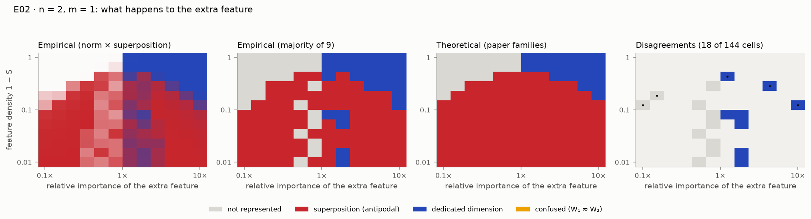

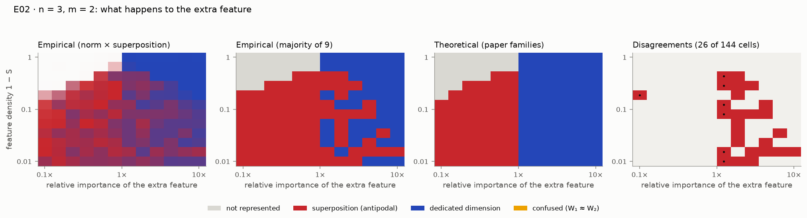

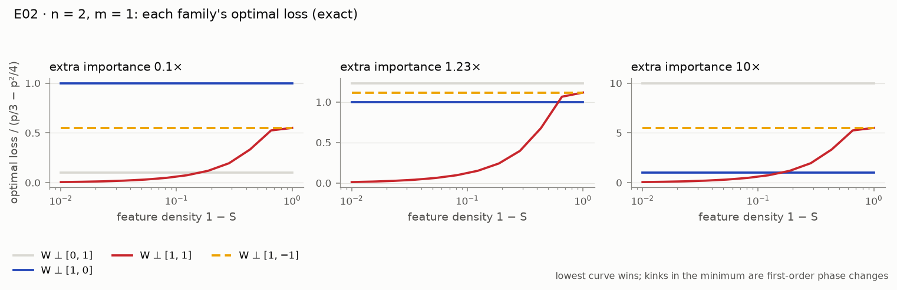

**Status: PASS (6/6 graded criteria).**

Both problems show all three regions in both diagrams, arranged as on pp. 15–16. For n = 2,
m = 1 the vote matches the theory in 126 of 144 cells (0.875); for n = 3, m = 2 in 118 of 144
(0.819), just above SPEC's 0.80. The theory finds the paper's crossing loss curves (the
family-loss figure): each family's optimum is smooth in the density, and the winner switches
where two curves cross.

*What the disagreements are.* In n = 2 all 18 disagreeing cells are ones where the theory says
superposition and the vote says the extra feature was dropped (10) or given the dimension (8).
In n = 3, 25 of the 26 are cells where the theory gives the extra feature a dimension and the
vote says superposition (18 of them at relative importance 1.2–2.9×); in the last one, at
0.1×, the theory drops it. The votes are close: 5–4 or 6–3 in 35 of the 44 cells, 7–2 in 8
(and 5–3–1 in one).
Notebook 04 (section 3) compares each cell's voting models with the theory's winning family
(`lab.phase_cell_shared_losses`):
- *n = 2, exactly* (every n = 2, m = 1 model's loss is computable in closed form): in all 18
  cells the lowest-loss voting model has the theory's label, and in 14 it is within 0.3% of the
  theory's optimum. The other voting models sit in worse minima and outnumber it, which is what
  McGrath reports for this problem (p. 52) and why the paper discards the worst model.
- *n = 3, on 2,000,000 shared inputs* (trained n = 3 models have no closed form): in all 26
  cells the lowest-loss voting model has the theory's label, within 0.7% of its optimum. At
  densities 0.01–0.015 the loss comes from a few hundred double activations and such sampled
  comparisons are only indicative; at 0.023 and above they are precise.

Labeling each cell by its lowest-loss model according to the run's own 20,000-sample losses
(INFO row) agrees with the theory in all 144 n = 2 cells and in 136 of 144 n = 3 cells.

*Solutions the paper's families miss.* In 4 of the n = 2 cells (density 0.12–0.28, extra
importance 0.1–0.15× or 4–10×) the best trained model beats the theory's antipodal family by
5.4–6.5% in exact loss. It is an *asymmetric* pair: the more important feature 1.02–1.04 long,
the other 0.82–0.89, with a small positive bias (0.017–0.065) on the less important output. The
family W ⊥ [1, 1] cannot express it, because W₁ + W₂ = 0 forces equal lengths. The label is still
superposition, so no agreement number changes. In one dense n = 3 cell (density 0.66, 1.23×),
where the vote agrees with the theory, the best model stores all three features in joint
superposition (pairwise cosines −0.79, −0.33, −0.32) and beats every family by 1.3% on shared
inputs; p. 15 says the paper deliberately leaves that solution out. Both are reported, not
graded (docs/progress/phase-3.md, open issue 2).

*The confused feature.* With every bias fixed at 0 the confused family wins 16 cells (n = 2)
and 13 (n = 3), as McGrath found; with fitted biases it wins none. No cell's vote is confused:
5 of the 2,880 trained models end confused, and 3 of those are their cell's discarded
highest-loss model. A bias can predict a feature's mean on its own, which is most of what
sharing a direction was buying (notebook 04, section 4).

**Evidence.** Generated from the cited run's `acceptance.json`:

<!-- BEGIN AUTO:E02 -->
Run `20260930T090540Z-4e3325bf` · profile `quick` · seed 0 · device `cpu` · commit `230a51dddd` · wall-clock 486.673 s · overall **PASS** (6/6)

| Group | Criterion | Paper | Status | Value | Threshold |
|---|---|---|---|---|---|
| n2_m1 | Empirical diagram shows all three regions (not represented, superposition, dedicated dimension) | p. 15 | PASS | {"regions_present": ["dedicated", "not_learned", "superposition"], "cells_per_region": {"superposition": 88, "not_learned": 29, "dedicated"… | {"required": ["not_learned", "superposition", "dedicated"]} |
| n2_m1 | Theoretical diagram shows all three regions (not represented, superposition, dedicated dimension) | p. 15 | PASS | {"regions_present": ["dedicated", "not_learned", "superposition"], "cells_per_region": {"superposition": 106, "not_learned": 19, "dedicated… | {"required": ["not_learned", "superposition", "dedicated"]} |
| n2_m1 | Empirical majority label equals the theoretical label (paper's families) | p. 15 | PASS | {"agreement": 0.875, "cells": 144, "agreeing": 126} | {"min": 0.8} |
| n2_m1 | Agreement when each cell is labeled by its lowest-loss model instead of the majority | p. 15 | INFO | {"agreement": 1.0} | — |
| n2_m1 | Disagreeing cells: where they are relative to the theoretical boundaries | pp. 15, 52 | INFO | {"n_disagree": 18, "on_or_next_to_a_theory_boundary": 5, "empirical_label_counts": {"not_learned": 10, "dedicated": 8}, "cells": [{"density… | — |
| n2_m1 | McGrath's confused-feature regime: empirical cells, and where the confused family wins in theory with and without biases | pp. 51–53 | INFO | {"empirical_confused_cells": 0, "cells_with_a_confused_model": 0, "theory_confused_wins_with_bias": 0, "theory_confused_wins_without_bias":… | — |
| n3_m2 | Empirical diagram shows all three regions (not represented, superposition, dedicated dimension) | p. 16 | PASS | {"regions_present": ["dedicated", "not_learned", "superposition"], "cells_per_region": {"superposition": 79, "dedicated": 47, "not_learned"… | {"required": ["not_learned", "superposition", "dedicated"]} |
| n3_m2 | Theoretical diagram shows all three regions (not represented, superposition, dedicated dimension) | p. 16 | PASS | {"regions_present": ["dedicated", "not_learned", "superposition"], "cells_per_region": {"superposition": 53, "dedicated": 72, "not_learned"… | {"required": ["not_learned", "superposition", "dedicated"]} |
| n3_m2 | Empirical majority label equals the theoretical label (paper's families) | p. 16 | PASS | {"agreement": 0.8194, "cells": 144, "agreeing": 118} | {"min": 0.8} |
| n3_m2 | Agreement when each cell is labeled by its lowest-loss model instead of the majority | p. 16 | INFO | {"agreement": 0.9444} | — |
| n3_m2 | Disagreeing cells: where they are relative to the theoretical boundaries | pp. 15, 52 | INFO | {"n_disagree": 26, "on_or_next_to_a_theory_boundary": 7, "empirical_label_counts": {"superposition": 26}, "cells": [{"density": 0.01, "impo… | — |
| n3_m2 | McGrath's confused-feature regime: empirical cells, and where the confused family wins in theory with and without biases | pp. 51–53 | INFO | {"empirical_confused_cells": 0, "cells_with_a_confused_model": 1, "theory_confused_wins_with_bias": 0, "theory_confused_wins_without_bias":… | — |
<!-- END AUTO:E02 -->

**Discrepancies and notes.**
- *n = 3, m = 2 margin.* 0.819 is close to the 0.80 bar; the batch-1024 run gives 0.833
  (D-309). The disagreements are stuck models, not physics (above), so more restarts per cell
  would likely raise it; the quick profile keeps the paper's ten.
- *Where the empirical n = 3 diagram differs from p. 16.* The paper's empirical diagram shows
  red specks near 1× at low density; ours has a band of red cells at 1.2–3×. The cause is the
  one above: in those cells most voting models pair the extra feature with another one, a
  minimum the theory ranks 12% to 4.5× worse than giving it a dimension, and they outvote the
  models that found the optimum.
- *Batch size.* Quick profiles train at batch 256 to fit 10 minutes on a CPU; a batch-1024 run
  gives identical labels in 284 of 288 cells (D-309).

**Run IDs.** Cited (quick, CPU, seed 0, commit `230a51d`): `20260930T090540Z-4e3325bf`
(487 s wall-clock). Batch comparison: `20260930T075829Z-609cc6fb` (D-309).

## E03 uniform_geometry (pp. 16–21)

**Paper's claims (pp. 17–20).** With n = 400 equally important, equally sparse features in
m = 30 dimensions, D* = m/‖W‖²_F is "sticky" at 1 and at 1/2 as sparsity grows (p. 17): about
1 up to 1/(1 − S) ≈ 1.2, a plateau at 1/2 (roughly 2.6–3.7, read from the figure), then a
fall to about 0.25 at 8. Individual Dᵢ cluster at fractions that belong to uniform polytopes
(3/4 tetrahedron, 2/3 triangle, 1/2 digon, 2/5 pentagon, 3/8 square antiprism, p. 19), and the
Dᵢ add up to m when features are packed efficiently (p. 18). Tegum factors are the connected
components of the geometry graph (p. 20).

**Our figures** (quick profile; best of 2 restarts at each of 20 sparsities):

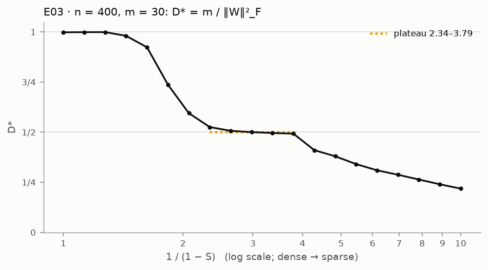

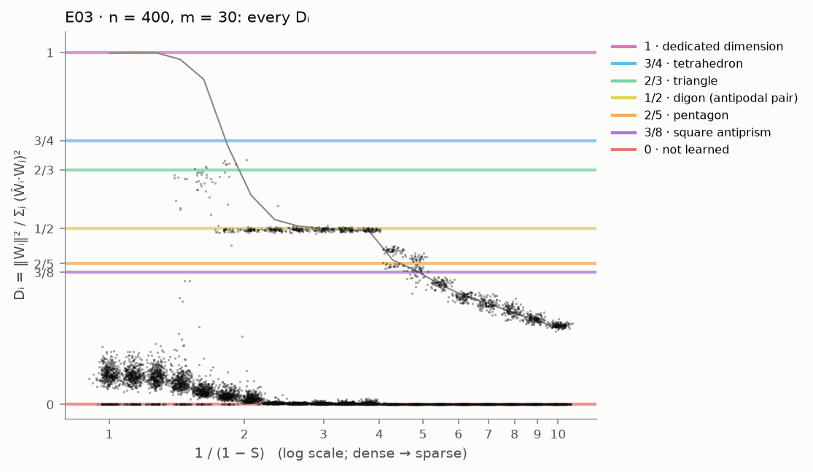

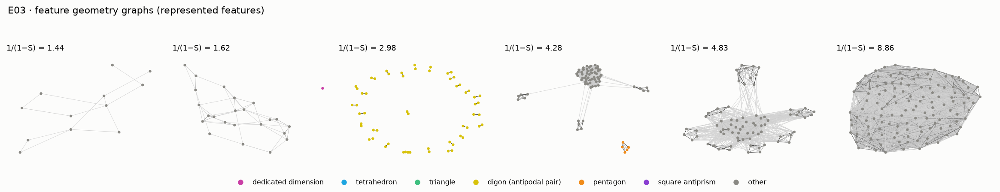

**Status: PASS (4/4 graded criteria).**

D* is 0.998–0.999 at 1/(1 − S) ≤ 1.2. It sits within 0.03 of 1/2 from 2.34 to 3.79
(0.525, 0.507, 0.500, 0.496, 0.493), wider than the paper's roughly 2.6–3.7, then falls
steadily to 0.264 at 7.85 and 0.218 at 10. Σᵢ Dᵢ stays between 29.84 and 29.99 at every
sparsity, as p. 18 says it should. From 2.64 to 3.79 all 58 represented features are in
digons (29 antipodal pairs). Dᵢ cluster at four fractions: 2/3 (10 features at 1/(1 − S) = 1.62),
1/2 (58 at 2.64), 2/5 (33 at 4.83) and 3/8 (29 at 4.83). Beyond about 5 the Dᵢ form a band that
falls with D* instead of sitting on fraction lines, as in the paper's figure.

*Which polytopes are really there.* Dᵢ alone cannot name a polytope, so the run also names each
connected component of the geometry graph (D-308). With E03's edge threshold, |Wᵢ·Wⱼ| > 0.05
(D-110), only the plateau's digons and one pentagon are separate factors; at higher sparsity a
few small overlaps link everything into one component. Ignoring overlaps below 0.2 (notebook
05, section 2) separates them: at 1/(1 − S) = 4.28 all 70 represented features sit in digons
(50) and pentagons (20); at 4.83 there are 5 pentagons, 12 digons, a square antiprism and two
uniform pieces (11 features in 4 dimensions, 4 in 2); at 5.46 two square antiprisms and two
pentagons. From 6.16 on, one uniform component spans all 30 dimensions even at 0.2. The paper's
geometric story holds in the middle of the range, with factors that are nearly rather than
exactly orthogonal.

**Evidence.** Generated from the cited run's `acceptance.json`:

<!-- BEGIN AUTO:E03 -->
Run `20260930T091350Z-2cb2dc61` · profile `quick` · seed 0 · device `cpu` · commit `230a51dddd` · wall-clock 364.968 s · overall **PASS** (4/4)

| Group | Criterion | Paper | Status | Value | Threshold |
|---|---|---|---|---|---|
| — | D* ≈ 1 (≥ 0.95) at every 1/(1 − S) ≤ 1.2 | p. 17 | PASS | {"1.000": 0.9983, "1.129": 0.999} | {"min_dstar": 0.95, "up_to": 1.2} |
| — | A plateau at 0.5 ± 0.03 over a contiguous range (end points at least 1.25× apart in 1/(1 − S)); report the span | p. 17 | PASS | {"span": [2.336, 3.793], "width_ratio": 1.624, "dstar_on_plateau": [0.5254, 0.5067, 0.5003, 0.4958, 0.4926], "paper_span": [2.6, 3.7]} | {"value": 0.5, "tol": 0.03, "min_span": 1.25} |
| — | D* falls below the plateau after it and is 0.25 ± 0.05 at 1/(1 − S) ≈ 8 | p. 17 | PASS | {"at": 7.848, "dstar": 0.2637, "all_after_plateau_below": true, "dstar_after_plateau": [0.4102, 0.3797, 0.3407, 0.3096, 0.2876, 0.2637, 0.2… | {"value": 0.25, "tol": 0.05} |
| — | Nonzero Dᵢ cluster within ±0.02 of at least 3 characteristic fractions | p. 19 | PASS | {"clusters": ["triangle (0.667)", "antipodal pair (digon) (0.5)", "pentagon (0.4)", "square antiprism (0.375)"], "by_fraction": {"tetrahedr… | {"min_clusters": 3, "cluster": "≥ 20% and ≥ 8 of one model's represented featur… |
| — | Σᵢ Dᵢ of the best model at each sparsity, against m = 30 | p. 18 | INFO | {"1.000": {"sum_D": 29.99, "D_star": 0.9983}, "1.129": {"sum_D": 29.986, "D_star": 0.999}, "1.274": {"sum_D": 29.98, "D_star": 0.9993}, "1.… | — |
| — | Represented features per tegum-factor type (geometry-graph components named by size, rank and uniformity) | pp. 19–20 | INFO | {"1.000": {}, "1.129": {}, "1.274": {}, "1.438": {"12 in 12 (non-uniform)": 12}, "1.624": {"23 in 23 (non-uniform)": 23, "dedicated dimensi… | — |
<!-- END AUTO:E03 -->

**Discrepancies and notes.**
- *No tetrahedra.* The paper shows a cluster at 3/4 near 1/(1 − S) ≈ 1.3; we have none (and
  neither did the batch-1024 run or the draft's longer exploratory runs). The 2/3 cluster at
  1.62 is not backed by triangle factors in this run either: its geometry graph is one
  non-uniform component (the batch-1024 run does find 6 triangles there).
- *The drop from 1 to 1/2 comes late.* Between 1/(1 − S) ≈ 1.5 and 1.9 our D* is about 0.1
  above the paper's curve (read by eye from p. 19: ≈ 0.82 at 1.6 and ≈ 0.6 at 1.8; ours 0.92 at
  1.62 and 0.74 at 1.83). This is the least converged part of the curve: batch 1024 lowers it by
  up to 0.085 (D-309) and the draft's uncited 50,000-step run by more. Hypothesis: the paper
  trained longer. No criterion reads this range; the full profile (batch 1024, 20,000 steps,
  60 points) is the test.
- *Plateau wider than the paper's.* 2.34–3.79 against roughly 2.6–3.7; our reading of the
  figure is approximate.

**Run IDs.** Cited (quick, CPU, seed 0, commit `230a51d`): `20260930T091350Z-2cb2dc61`
(365 s wall-clock). Batch comparison: `20260930T082510Z-c635c83a` (D-309).

## E04 nonuniform_geometry (pp. 21–26)

**Paper's claims (pp. 21–25).** (a) Five features in two dimensions at density 0.05 form a
pentagon; making one feature denser pushes its neighbours away, making it sparser lets them
close in, and past about 2.5× sparser the pentagon snaps to two digons with that feature
dropped, where the loss curves of the two geometries cross (p. 22). (b) In m = 2, correlated
features prefer to be orthogonal and, when they cannot be, side by side; anticorrelated
features prefer to be antipodal (pp. 23–24). (c) In a larger model, each correlated set forms a
local almost-orthogonal basis (pp. 24–25). (d) Three correlated pairs in m = 2 form a hexagon
with pair members adjacent when very sparse, and collapse pair by pair onto their principal
components as density rises (p. 25).

**Our figures** (quick profile):

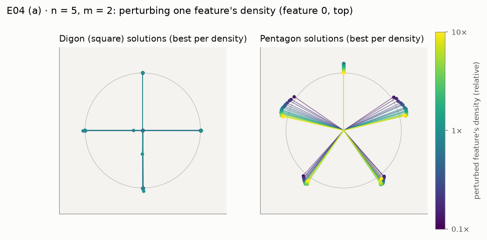

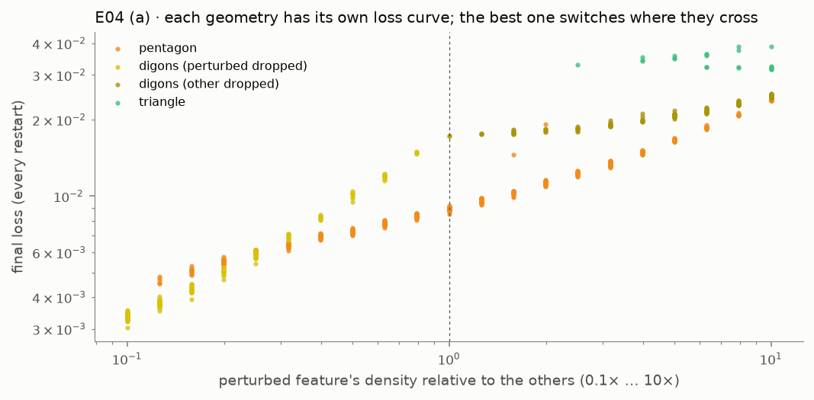

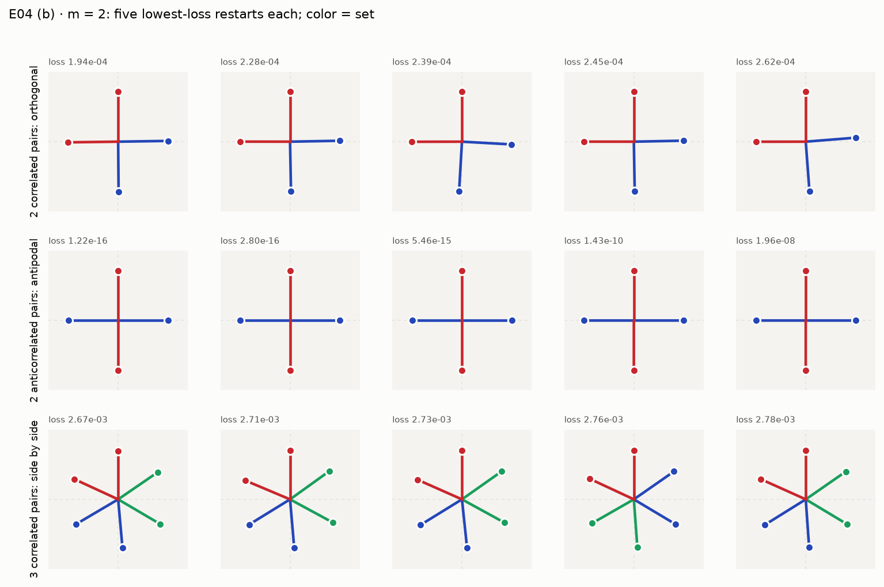

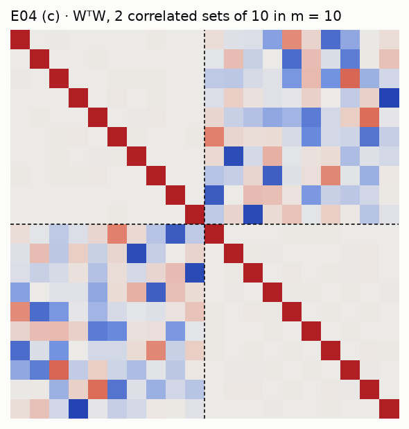

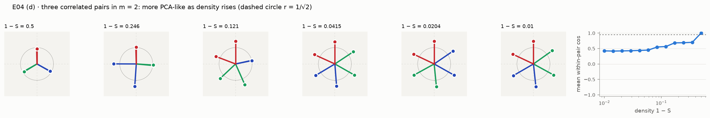

**Status: PASS (9/9 graded criteria).**

*(a)* The angle between feature 0 and its neighbours grows with its density, from 55.7° at
0.126× to 72.2° at 1× and 76.3° at 10× (it levels off above about 4×); Spearman ρ = 0.991 over
ratios ≥ 1 and 1.0 over ratios ≤ 1. The best restart is two digons with feature 0 dropped
(‖W₀‖ = 0.0003) at every ratio up to 0.251, and a pentagon from 0.316 on. Every restart's loss
is plotted: the digon and pentagon curves cross between 0.251 (0.00544 against 0.00582) and
0.316 (0.00672 against 0.00612), the first-order transition of p. 22.

*(b)* The best correlated 2 × 2 model has each pair orthogonal (|cos| = 0.013 and 0.007; all 16
restarts have mean within-pair cos within ±0.05). The best anticorrelated model has each pair
exactly antipodal (cos −1.0) and a loss of about 10⁻¹⁶: two members are never active together,
so the pair costs nothing. Only 5 of 16 restarts find it; the other 11 keep each pair
orthogonal. With three correlated pairs, all six features are represented and each pair sits
side by side, 64.6–65.2° apart (a regular hexagon would give 60°).

*(c)* In two correlated sets of 10 in m = 10, features are almost orthogonal within a set (mean
|cos| 0.007) and not across sets (0.216), in every one of the 8 restarts.

*(d)* At density 0.01 the six features form a hexagon with pair members adjacent (within-pair
cos 0.41–0.43). One pair is collapsed (cos > 0.95) at densities 0.085–0.121, two at
0.172–0.35 (collapsed features at norm 0.71–0.73, the paper's 1/√2), and all three at 0.5
(norm 0.65); the mean within-pair cosine rises from about 0.42 to 1.0 (Spearman ρ = 0.979).

**Evidence.** Generated from the cited run's `acceptance.json`:

<!-- BEGIN AUTO:E04 -->
Run `20260930T091958Z-43c63e78` · profile `quick` · seed 0 · device `cpu` · commit `230a51dddd` · wall-clock 287.461 s · overall **PASS** (9/9)

| Group | Criterion | Paper | Status | Value | Threshold |
|---|---|---|---|---|---|
| a_perturbed | Denser perturbed feature → its neighbours move away: the neighbour angle grows with density (Spearman ≥ 0.8 over ratios… | p. 22 | PASS | {"spearman": 0.991, "densest_angle_deg": 76.33, "angle_by_ratio": {"0.126": 55.74, "0.158": 58.78, "0.2": 61.24, "0.251": 64.02, "0.316": 6… | {"min_spearman": 0.8, "densest_above_deg": 73.0} |
| a_perturbed | Sparser perturbed feature → its neighbours close in: the neighbour angle shrinks with density (Spearman ≥ 0.8 over pent… | p. 22 | PASS | {"spearman": 1.0, "sparsest_pentagon_angle_deg": 55.74, "sparsest_pentagon_ratio": 0.1259} | {"min_spearman": 0.8, "sparsest_below_deg": 71.0} |
| a_perturbed | Sparsest setting: the best solution is two digons with the perturbed feature at ≈ 0 (‖W‖ < 0.1); report the threshold | p. 22 | PASS | {"sparsest_ratio": 0.1, "best_geometry": "digons (perturbed dropped)", "perturbed_norm": 0.0003, "largest_ratio_with_collapse": 0.2512, "be… | {"geometry": "digons (perturbed dropped)", "norm_below": 0.1} |
| a_perturbed | Lowest loss of each geometry at each density ratio (the crossing loss curves) | p. 22 | INFO | {"0.1": {"digons (perturbed dropped)": 0.003038}, "0.126": {"digons (perturbed dropped)": 0.003543, "pentagon": 0.004532}, "0.158": {"digon… | — |
| b_correlation | Anticorrelated features interfere more negatively (lower mean within-set cosine) than correlated features (2 sets of 2,… | pp. 23–24 | PASS | {"anticorrelated_mean_cos": -1.0, "correlated_mean_cos": -0.0098} | anticorrelated < correlated |
| b_correlation | 2 correlated pairs in m = 2: each pair orthogonal (\|cos\| < 0.1) | p. 24 | PASS | {"within_pair_abs_cos": [0.0131, 0.0065]} | {"abs_cos_max": 0.1} |
| b_correlation | 3 correlated pairs in m = 2: all 6 represented and each pair's members side by side (angular neighbours) | p. 24 | PASS | {"represented": 6, "pairs_adjacent": true, "within_pair_angle_deg": [65.2, 64.6, 64.9]} | {"represented": 6, "pairs_adjacent": true} |
| b_correlation | Mean within-set cosine of every restart (not just the best) | pp. 23–24 | INFO | {"correlated_2x2": [-0.011, 0.002, -0.001, -0.01, -0.002, -0.001, -0.001, -0.003, 0.001, 0.034, 0.004, 0.01, 0.005, 0.003, -0.003, 0.046], … | — |
| c_local_bases | 2 correlated sets of 10 in m = 10: mean \|cos\| within a set < mean \|cos\| across sets | pp. 24–25 | PASS | {"within": 0.0069, "across": 0.2162, "all_restarts_within_across": [[0.0071, 0.2183], [0.0072, 0.2389], [0.0069, 0.2296], [0.0069, 0.2162],… | within < across |
| d_collapse | Sparsest density: all 6 represented, pair members adjacent, no pair collapsed (cos < 0.95) | p. 25 | PASS | {"density": 0.01, "represented": 6, "pairs_adjacent": true, "within_pair_cos": [0.43, 0.412, 0.431]} | {"represented": 6, "pairs_adjacent": true, "collapsed": 0} |
| d_collapse | Within-pair cosine rises toward 1 as density rises (Spearman ≥ 0.8; densest setting mean cos > 0.95) | p. 25 | PASS | {"spearman": 0.979, "mean_within_pair_cos": {"0.01": 0.424, "0.0143": 0.417, "0.0204": 0.422, "0.0291": 0.429, "0.0415": 0.438, "0.0592": 0… | {"min_spearman": 0.8, "densest_above": 0.95} |
| d_collapse | Collapsed pairs (cos > 0.95) per density, and the norms of collapsed features (the paper draws them at r = 1/√2 ≈ 0.707) | p. 25 | INFO | {"0.01": {"collapsed_pairs": 0, "collapsed_norms": []}, "0.0143": {"collapsed_pairs": 0, "collapsed_norms": []}, "0.0204": {"collapsed_pair… | — |
<!-- END AUTO:E04 -->

**Discrepancies and notes.**
- *(a) Where the pentagon snaps: no discrepancy with the paper's figure.* Our pentagon
  survives down to 0.316× the others' density and collapses at ≤ 0.251×. The p. 22 caption
  says "≈ 2.5× less dense" (0.4×), but the boundary in the paper's own loss figure sits at about
  0.27×, between our two grid points (review R2-04, from a pixel reading of p. 22). An earlier
  version of this note called our snap "later" by comparing with the caption only. The
  reviewer also found that our best losses divided by n = 5 match the p. 22 curves (for
  example 1.7e-3 for the pentagon at 1×), so the paper evidently plots a per-feature mean.
  That match was read off the figure, not computed in a run.
- *(b) The anticorrelated criterion is lenient, and the data exceed it.* "Lower mean cosine than
  the correlated sets" would pass with any negative within-pair cosine. The best restart is
  exactly antipodal, as p. 24's figure shows, but only 5 of 16 restarts find it. The two setups
  also differ in density: 0.01 per anticorrelated feature against 0.02 per correlated one
  (D-307; review R2-09).
- *(d) The regimes are shifted.* The paper's "one set collapsed" at 0.05–0.15, "two sets" at
  0.15–0.2 and "all sets" at 0.25–0.5 correspond to ours at 0.085–0.121, 0.172–0.35 and 0.5; at
  0.5 our collapsed features have norm 0.65, below 1/√2.
- *Unstated settings.* The paper gives no density for (b)–(d); ours are in D-307.

**Run IDs.** Cited (quick, CPU, seed 0, commit `230a51d`): `20260930T091958Z-43c63e78`
(287 s wall-clock). Batch comparison: `20260930T084945Z-5297207f` (D-309).

## E05 learning_dynamics (pp. 26–28)

**Paper's claims.** (a) In the uniform setup (many features of equal importance and sparsity,
p. 17), training is "dominated by 'energy level jumps' where features jump between different
feature dimensionalities", and the loss drops suddenly when they do (p. 26). (b) Six features
in m = 3, as two correlated sets of three, learn through a sequence of geometric
transformations visible as regimes of the loss curve: weights near zero (A), the sets push
apart (B), each set expands into a triangle (C), the triangles rotate into an antiprism, an
octahedron with antipodal pairs joining the two sets (D); other trajectories exist, varying at
step C (p. 27).

**Our figures** (quick profile): (a) Dᵢ of all 400 features and the loss over training, for
the restart with the largest coinciding loss drop (the other restarts are in
`docs/figures/learning_dynamics/`); (b) one run's weight trajectories at stages A–D above its
loss curve, and the stage of every run over training.

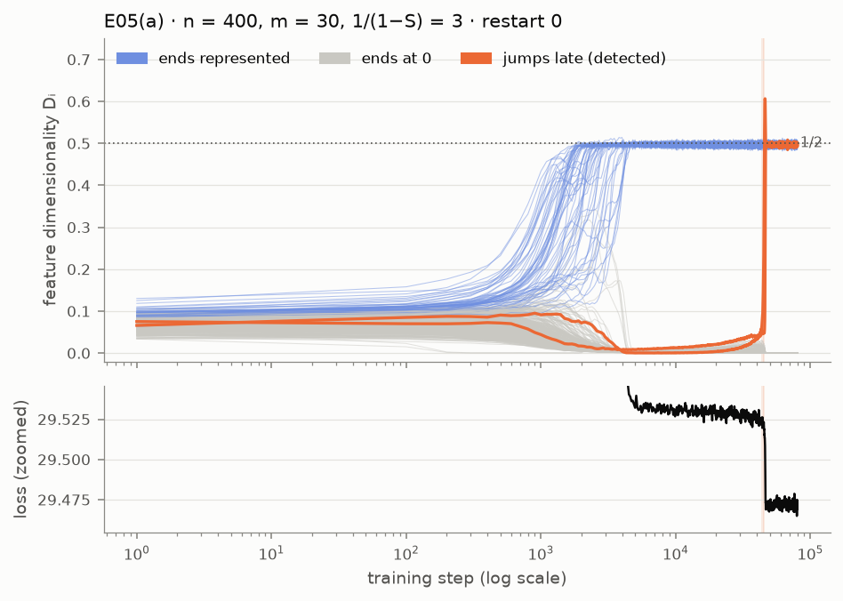

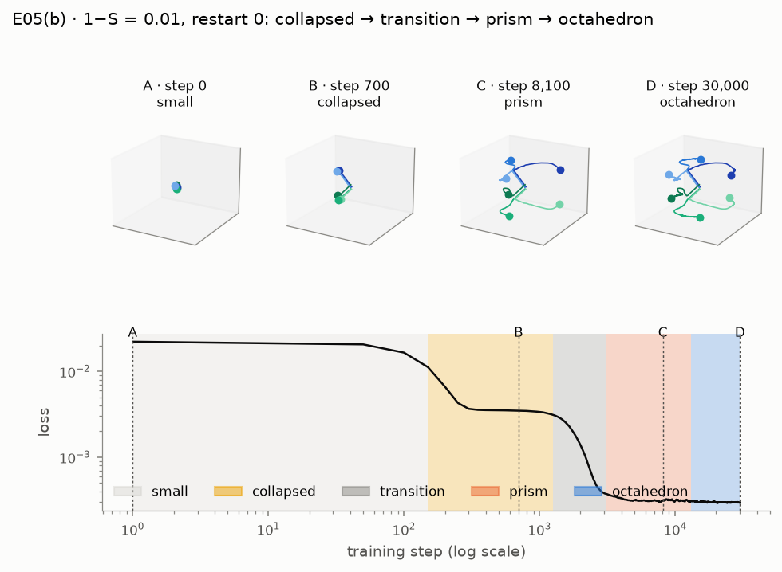

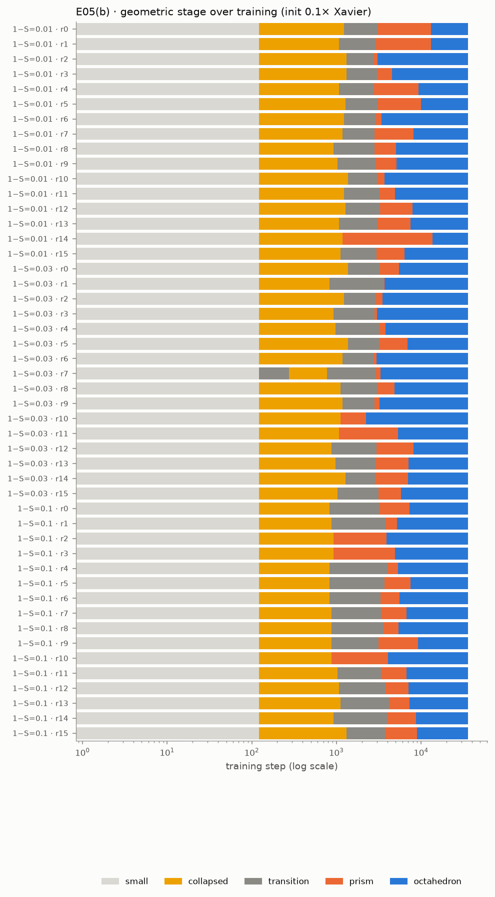

**Status: PASS (2/2 graded criteria).**

*(a) Energy levels.* All four restarts (n = 400, m = 30, 1/(1 − S) = 3) organize by step
10,000 into 58 features at Dᵢ ≈ 1/2 and 342 at 0, with Σᵢ Dᵢ ≈ 29.87: 29 clean digons, and one
dimension shared by a few weak features. Most of this happens in the first 5,000 steps, but two
restarts still have a few features in between at step 5,000 (review R2-07). They then sit on a plateau (the loss changes
by at most 0.015 between steps 10,000 and 25,000; its fluctuations are ≈ 0.011) until two of
the weak features win that dimension. Their Dᵢ jumps from ≈ 0.05 towards 1/2 (by > 0.15 within 2,000 steps). In every
restart one of them overshoots before settling: the reviewer read peaks of 0.58–0.66 off the
snapshots, close to the transient at 1/√2 in p. 26's figure and the loss drops by 0.043–0.055 within ≈ 4,000 steps,
between steps 29,200 and 52,100 depending on the restart. The detector found exactly these
two features in every restart (8 jumps, all with a coinciding loss drop) and nothing else.
Every restart ends with 60 features at 1/2 and Σᵢ Dᵢ = 29.994 (D* ≈ 0.491, inside the p. 17
plateau). This is the p. 26 picture: a long plateau with one dimension badly used, then a
discrete jump and a sudden drop.

*(b) Transformations.* All 48 runs (100%: 0.1 × Xavier init; set densities 0.01, 0.03, 0.1;
16 each) end as the octahedron with cross-set antipodal pairs. Only this end state is graded.
The stage labels appear in the paper's order, but stage B's geometry differs (see below): every run passes through *collapsed* (each set moving as one direction) for a median
750–1,075 steps; 38 of 48 then sit in the aligned *prism* for at least 1,000 steps (median
3,950 steps at 1 − S = 0.01, 1,475 at 0.03, 3,300 at 0.1) before rotating into the antiprism;
others go straight to the octahedron, as the paper notes for step C. Counting only stages that
last ≥ 1,000 steps, the runs follow six trajectory types:
- *transition → prism → octahedron:* 19 runs (5, 3 and 11 at 1 − S = 0.01, 0.03, 0.1);
- *collapsed → transition → prism → octahedron:* 13 (7, 4, 2);
- *collapsed → transition → octahedron:* 6 (3, 3, 0);
- *transition → octahedron:* 4 (0, 4, 0);
- *prism → octahedron:* 4 (0, 1, 3);
- *collapsed → prism → octahedron:* 2 (1, 1, 0).

The collapsed stage is often shorter than 1,000 steps, which is why it is missing from some
types. p. 28 says several trajectories exist and that they "vary at step C". Ours vary there
too (with or without a lasting prism), and also in whether the collapsed stage lasts.

**Documented variant: stage B (D-R02).** p. 27's panel B shows the two sets pushed apart along
one axis (opposed centroids). In our runs, while each set is collapsed onto one direction, the
two directions are usually close to orthogonal:
- the median cosine between the set centroids over all collapsed snapshots is −0.058, −0.044
  and −0.037 at 1 − S = 0.01, 0.03 and 0.1 (quartiles between −0.30 and 0.00);
- only 6%, 13% and 18% of collapsed snapshots have opposed centroids (cos ≤ −0.9);
- at the end of each run's collapsed stage, the median cosine is −0.09, −0.09 and −0.04. At
  every density at least one run ends that stage with the sets opposed (minimum −1.0).

The two sets are independent of each other, so in m = 3 there is room to give their two
directions orthogonal axes, which removes interference between them. That is the "linear PCA
solution" p. 28 says the network learns "before moving to a better nonlinear solution". (An
earlier version of this paragraph justified it with p. 23's sentence about correlated features.
That sentence is about features correlated with each other, and the two sets are not: review
R2-03.) All runs still reach the octahedron. Following D-R02, this is reported as a documented
variant of the trajectory, not a discrepancy.

The paper's panel B picture, opposed sets, is the exception:
- it is a minority of collapsed snapshots;
- the reviewer counted only 6 of 48 runs that ever have a collapsed snapshot with opposed
  centroids;
- the published figure's B panel itself shows the variant (centroid cosine about −0.3). The paper does not give this figure's density, initialization scale or
importance (D-403).

**Evidence.** Generated from the cited run's `acceptance.json`:

<!-- BEGIN AUTO:E05 -->
Run `20260930T190604Z-2fae0fc5` · profile `quick` · seed 0 · device `cpu` · commit `fd32b02273` · wall-clock 517.951 s · overall **PASS** (2/2)

| Group | Criterion | Paper | Status | Value | Threshold |
|---|---|---|---|---|---|
| a_energy_levels | (a) At least one jump of a feature's Dᵢ by > 0.15 within 2,000 steps, from a level held for 5,000 steps, coinciding wit… | p. 26 | PASS | {"per_restart": {"restart 0": {"jumps": 2, "with_loss_drop": 2}, "restart 1": {"jumps": 2, "with_loss_drop": 2}, "restart 2": {"jumps": 2, … | {"jump": "\|ΔDᵢ\| > 0.15 within 2000 steps", "loss_drop": "> 3.0× background an… |
| a_energy_levels | (a) Final state per restart: D* (plateau value 1/2), Σᵢ Dᵢ (vs m) and how many features end at Dᵢ ≈ 1/2 or ≈ 0 | pp. 17, 26 | INFO | {"restart 0": {"D_star": 0.4907, "sum_D": 29.994, "at_1/2": 60, "at_0": 340, "other": 0, "loss": 29.4576}, "restart 1": {"D_star": 0.4912, … | — |
| a_energy_levels | (a) Every detected jump (feature, steps, Dᵢ before → after, loss drop over the jump and one more window, background dro… | p. 26 | INFO | [{"restart": 0, "feature": 165, "steps": "43100–45100", "D": "0.05 → 0.23", "loss_drop": 0.0508, "background": 0.0029, "plateau_range": 0.0… | — |
| b_transformations | (b) At least one restart ends in the octahedron: three orthogonal antipodal pairs, each joining features of different c… | p. 27 | PASS | {"octahedra_per_set_density": {"1-S=0.01": "16/16", "1-S=0.03": "16/16", "1-S=0.1": "16/16"}, "octahedra_total": "48/48", "fraction": 1.0} | ≥ 1 restart |
| b_transformations | (b) Trajectory types: the stages each restart passes through (stages shorter than 1,000 steps left out), counted per in… | p. 27 | INFO | {"init 0.1× · 1-S=0.01": {"collapsed → transition → prism → octahedron": 7, "transition → prism → octahedron": 5, "collapsed → transition →… | — |
| b_transformations | (b) Stage B: where each set's centroid points while the sets are collapsed. Opposed (cos ≤ -0.9) is the paper's panel B… | p. 27 | INFO | {"init 0.1× · 1-S=0.01": {"runs_visiting_collapsed": "16/16", "median_steps_collapsed": 1075, "centroid_cos_while_collapsed": {"median": -0… | — |
| b_transformations | (b) When the octahedron is first reached, and how long runs sit in the aligned 'prism' stage (C) before rotating into t… | p. 27 | INFO | {"init 0.1× · 1-S=0.01": {"median_first_octahedron_step": 6975, "restarts_with_prism_stage": 13, "median_prism_steps": 3950}, "init 0.1× · … | — |
<!-- END AUTO:E05 -->

**Discrepancies and notes.**
- *Stage B* is a documented variant, not a discrepancy (D-R02; above).
- *Initialization.* Part (b) starts from 0.1 × the Xavier init to follow p. 27 ("initially,
  weights are initialized randomly close to zero"); SPEC §3's plain Xavier init is run as a
  variant in the full profile (D-403).
- *Loss size.* Our jump's loss drop is ≈ 0.2% of the loss; p. 26's is ≈ 0.8%.
  - A relative drop does not depend on how the loss is normalized, so an earlier explanation
    ("a differently normalized loss") was wrong (review R2-05).
  - The paper's final loss per feature, read off p. 26, is ≈ 0.053, against our 29.46/400 ≈
    0.074. Our hypothesis is that its run used another density or n; the paper gives neither.
  - The drop is visible in our runs because every snapshot is evaluated on the same 8,192
    inputs (D-402).

**Run IDs.** Cited (quick, CPU, seed 0, commit `fd32b02`): `20260930T190604Z-2fae0fc5`
(518 s wall-clock). It reproduces the previous cited run (`20260929T172920Z-2fae0fc5`, commit
`5a825d0`, 516 s) exactly in every earlier row; the octahedron fraction and INFO
`stage_b_placement` are new (D-R02).

## E06 adversarial (pp. 29–30)

**Paper's claim (p. 29).** With L2 attacks of at most 0.1 of the average input norm, built
analytically from the rows of WᵀW, "vulnerability to adversarial examples sharply increases as
superposition forms (increasing by >3x), and … closely tracks the number of features per
dimension (the reciprocal of feature dimensionality)"; p. 30 plots vulnerability against
1/D*.

**Our figures** (quick profile; best restart per sparsity): vulnerability relative to a
no-superposition model and 1/D* against 1/(1 − S) for each setting, and vulnerability against
1/D*.

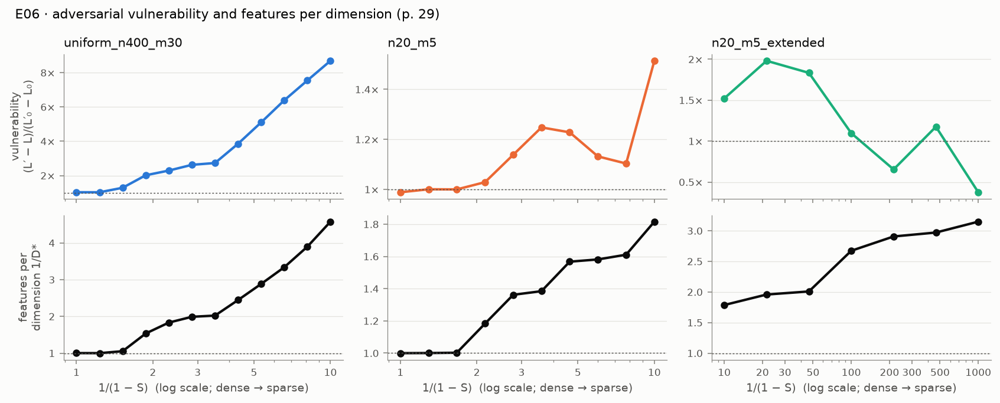

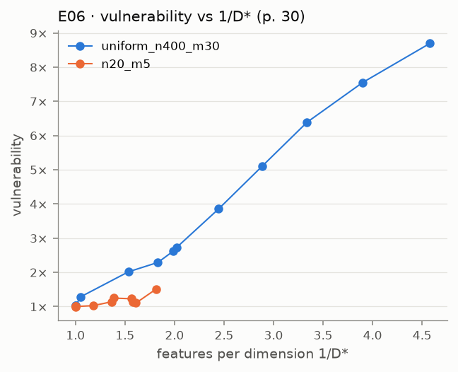

**Status: PARTIAL (2/4 graded criteria).**

*Uniform setup (n = 400, m = 30, Iᵢ = 1; the setting the p. 29 axes show): both criteria
pass.* Vulnerability is 1.03× at 1/(1 − S) = 1 and 8.70× at 10, a rise of 8.5× (paper: > 3×),
and its Spearman correlation with 1/D* across the 12 sparsities is 1.0 (1/D* rises from 1.00
to 4.58). The curve has the paper's shape: flat while there is no superposition (V ≈ 1.03 up
to 1/(1 − S) = 1.23), a rise as antipodal pairs form, a shoulder while 1/D* sits near 2
(V = 2.6–2.7 at 1/(1 − S) = 2.8–3.5, the p. 17 plateau), and a second rise as features pack
more densely. The p. 30 scatter reaches about 8× at 1/D* ≈ 5; ours reaches 8.7× at 4.58.
This size depends on choosing the worst attack per input (D-405); one attack per model, the
other reading of p. 29, gives a smaller rise, which the reviewer measured at about 3.7×
(review R3-13; not in the run's record).

*n = 20, m = 5 (Iᵢ = 0.7ⁱ; SPEC's example), same range: both criteria fail, and vulnerability
does not track superposition here.*
- Vulnerability rises from 0.99 to only 1.51 (rise 1.53×; peak 1.51 at 1/(1 − S) = 10), with
  Spearman ρ = 0.78 (threshold 0.8).
- It tracks 1/D* up to 1/(1 − S) ≈ 3.6, then *falls* from 1.25 to 1.10 while 1/D* rises from
  1.39 to 1.61 (1/(1 − S) = 3.6 to 7.7).
- At the same features per dimension the two setups differ: at 1/D* ≈ 1.82–1.83 the uniform
  model has V = 2.29 and this one 1.51.

*n = 20, m = 5 extended to 1/(1 − S) = 1,000 (not graded).* Vulnerability peaks at 1.98 at
1/(1 − S) = 21.5 (1/D* ≈ 1.96), then falls to 0.38 at 1,000 although 1/D* rises to 3.15
(Spearman −0.79 over this range).

**Evidence.** Generated from the cited run's `acceptance.json`:

<!-- BEGIN AUTO:E06 -->
Run `20260929T173800Z-e84cec26` · profile `quick` · seed 0 · device `cpu` · commit `5a825d0653` · wall-clock 400.746 s · overall **PARTIAL** (2/4)

| Group | Criterion | Paper | Status | Value | Threshold |
|---|---|---|---|---|---|
| uniform_n400_m30 | Vulnerability rises as superposition forms: V(sparsest)/V(densest) > 2 over 1/(1 − S) ∈ [1, 10] (paper: > 3×) | p. 29 | PASS | {"rise": 8.469, "V_densest": 1.027, "V_sparsest": 8.695, "V_max": 8.695, "V_max_at": 10.0} | > 2 |
| uniform_n400_m30 | Spearman ρ between vulnerability and features per dimension 1/D* ≥ 0.8 across the sweep | pp. 29–30 | PASS | 1.0 | ≥ 0.8 |
| uniform_n400_m30 | Per sparsity: vulnerability V, features per dimension 1/D*, budget ε and the feature most often targeted by the worst-c… | p. 29 | INFO | {"1": {"V": 1.027, "1/D*": 1.002, "eps": 1.1543, "most_attacked": 141}, "1.23": {"V": 1.025, "1/D*": 1.001, "eps": 1.0397, "most_attacked":… | — |
| n20_m5 | Vulnerability rises as superposition forms: V(sparsest)/V(densest) > 2 over 1/(1 − S) ∈ [1, 10] (paper: > 3×) | p. 29 | FAIL | {"rise": 1.532, "V_densest": 0.989, "V_sparsest": 1.514, "V_max": 1.514, "V_max_at": 10.0} | > 2 |
| n20_m5 | Spearman ρ between vulnerability and features per dimension 1/D* ≥ 0.8 across the sweep | pp. 29–30 | FAIL | 0.7818 | ≥ 0.8 |
| n20_m5 | Per sparsity: vulnerability V, features per dimension 1/D*, budget ε and the feature most often targeted by the worst-c… | p. 29 | INFO | {"1": {"V": 0.989, "1/D*": 1.0, "eps": 0.2572, "most_attacked": 0}, "1.29": {"V": 1.001, "1/D*": 1.001, "eps": 0.2251, "most_attacked": 0},… | — |
| n20_m5_extended | Vulnerability and 1/D* over 1/(1 − S) ∈ [10, 1000] (not graded): rise V(sparsest)/V(densest) and Spearman ρ(V, 1/D*) | pp. 11, 29 | INFO | {"rise": 0.247, "V_densest": 1.522, "V_sparsest": 0.375, "V_max": 1.981, "V_max_at": 21.544, "spearman": -0.786, "per_sparsity": {"10": {"V… | — |
<!-- END AUTO:E06 -->

**Discrepancies and hypotheses.**
- *n = 20, m = 5 is a genuine case where vulnerability does not track superposition* in the
  paper's range. An earlier version of this section called the small rise "what the claim
  predicts". It is not: vulnerability falls over a range where 1/D* rises, and is lower than the
  uniform model's at the same 1/D* (review R3-03). The paper shows only the uniform setting, so
  this does not contradict its figure, but it limits the claim.
  - *Hypothesis, partial:* the importance decay concentrates the loss on the top features, so
    the reference damage I₀ε² is large compared with what interference can add. This explains
    the small size of the rise, not the dip. The reviewer's diagnostic with unit importance in
    the attack loss still finds the dip (not in the run's record).
  - *What it is not:* the biases of the represented features stay near 0 in this range, so the
    bias mechanism of the extended range (below) does not apply. It is not sampling noise
    either: the reviewer re-ran the attacks with two fresh seeds and got the same ρ.
  - We graded this setting because we said we would before running it (D-406).
- *Extended range.* ε = 0.1 · E‖x‖₂ shrinks with the density (0.069 at 1/(1 − S) = 10, 0.0095
  at 100, 0.001 at 1,000). Up to 1/(1 − S) = 46 the represented features' biases are ≈ 0; from
  100 on they are clearly negative (median −0.16 to −0.23 in the cited run's best models,
  computed in notebook 07 and not stored in the run's record; the reviewer reproduced them),
  20 to 200 times larger than ε, and that is exactly where vulnerability
  falls (1.10 at 100, 0.38 at 1,000). An attack that small cannot lift an output past its
  threshold, so the measure stops tracking superposition. Untested prediction: a budget that
  does not shrink with sparsity would keep tracking it (notebook 07, exercise 4).
- *Operationalization* (D-405): per-example worst case over the n candidate attacks (and δ = 0),
  loss against the clean target, and the no-superposition reference W = [Iₘ | 0], whose damage
  equals max Iᵢ ε² exactly (checked in every run; see the INFO notes).
- *What the Spearman criterion shows.* V and 1/D* both rise with sparsity, so a high ρ follows
  from both being monotone in 1/(1 − S); it does not show that V follows 1/D*'s shape (review
  R3-12). The shape does line up in the uniform setting: V's shoulder (2.63–2.73) sits where
  1/D* is on its plateau near 2 (1.99–2.02).

**Run IDs.** Cited (quick, CPU, seed 0, commit `5a825d0`): `20260929T173800Z-e84cec26`
(401 s wall-clock).

## E07 privileged_basis (pp. 31–34)

**Paper's claims.** In the ReLU hidden layer model h = ReLU(Wx), x′ = ReLU(Wᵀh + b), with
n = 10, m = 5, Iᵢ = 0.75ⁱ (best of 1,000 models per setting), neurons shift from monosemantic to
polysemantic as sparsity rises, in named regimes (p. 33): all monosemantic (1 − S ≥ 0.5),
three features in two neurons (0.2–0.5), five in three with two monosemantic neurons (0.15),
six in four (0.12), eight in five, all polysemantic (0.05–0.08), pairs of neurons per feature
(≤ 0.04). And the model "will only use the ReLU activation function if absolutely forced": with
a hidden bias it sets all biases positive and keeps the neurons linear (p. 34).

**Our figures** (quick profile, best of 100 restarts): W (features × neurons) and the neuron
stack plot for one sparsity per regime, and the neuron counts across sparsity.

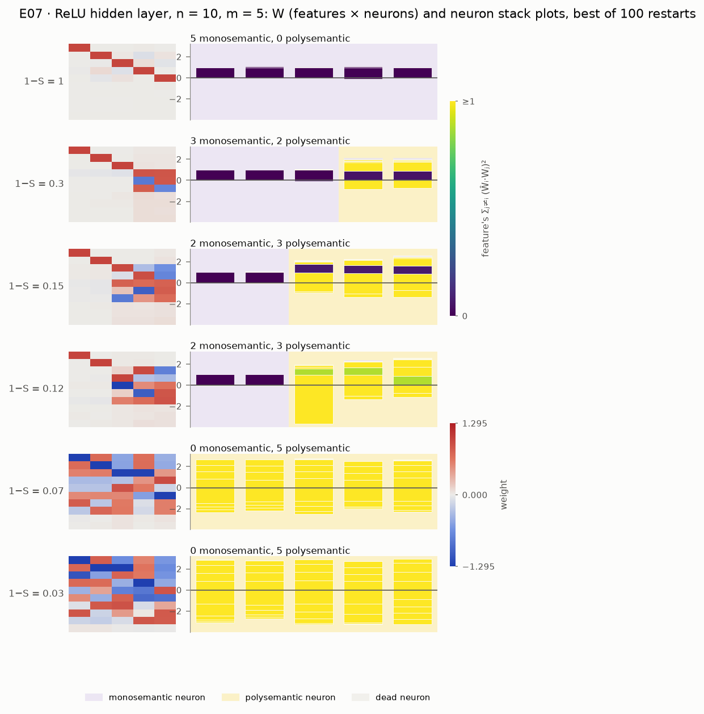

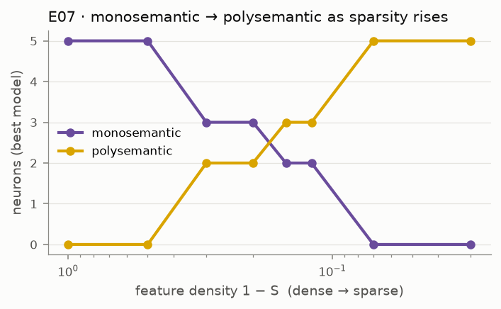

**Status: PASS (3/3 graded criteria).** Dense (1 − S = 1): five monosemantic neurons, one per
most important feature. The polysemantic count never falls as sparsity rises (0, 0, 2, 2, 3,
3, 5, 5 at 1 − S = 1, 0.5, 0.3, 0.2, 0.15, 0.12, 0.07, 0.03) and all five neurons are
polysemantic at the sparsest setting. The regimes match p. 33 at four of the six settings it
names:
- at 0.3 and 0.2, three monosemantic neurons plus two neurons sharing three features (a binary
  code);
- at 0.15, two monosemantic and three polysemantic neurons with 7 features represented;
- at 0.07, all five neurons polysemantic with 8 features represented (p. 33: "eight features in
  five neurons").

They differ at 0.12 and at 0.03, where the best model represents 9 features, not all 10 on
pairs of neurons (see the notes below).

*Sidestepping the ReLU (p. 34, INFO).* Given a hidden bias, the best models set **all** five
biases positive at every tested sparsity (mean 0.28 at 1 − S = 1, 0.93 at 0.1, 0.80 at 0.03).
Their ReLUs clip only 0.06–0.21% of (input, neuron) pairs. The replication model without a
hidden bias clips 53.8% at 0.03, and 34.6% at its nearest grid point to 0.1, which is 0.12
(review R3-04).
- At 0.03, where both models share the sparsity, the sidestepping model's loss is much lower
  (0.00043 vs 0.00288): the ReLU only limits this model.
- The row labeled 0.1 compares the bias model at 0.1 (0.0054) with the replication model at
  0.12 (0.0199). That is two sparsities, so the losses are not comparable (footnote 17). The
  clipping shares are still far apart.

**Evidence.** Generated from the cited run's `acceptance.json`:

<!-- BEGIN AUTO:E07 -->
Run `20260929T174443Z-d54df07e` · profile `quick` · seed 0 · device `cpu` · commit `5a825d0653` · wall-clock 418.544 s · overall **PASS** (3/3)

| Group | Criterion | Paper | Status | Value | Threshold |
|---|---|---|---|---|---|
| — | Dense (1 − S = 1): every neuron is monosemantic (exactly one feature at ≥ 25% of its largest \|weight\|) | pp. 32–33 | PASS | {"features_per_neuron": [1, 1, 1, 1, 1], "monosemantic": 5} | 5/5 neurons carry exactly 1 feature |
| — | The polysemantic-neuron count never falls more than 1 below any denser setting's count | pp. 32–33 | PASS | {"counts": {"1": 0, "0.5": 0, "0.3": 2, "0.2": 2, "0.15": 3, "0.12": 3, "0.07": 5, "0.03": 5}, "violations_at": []} | {"tolerance": 1} |
| — | Polysemantic neurons exist at the sparsest setting (1 − S = 0.03) | pp. 32–33 | PASS | 5 | > 0 |
| — | Best model per sparsity: neuron counts, features per neuron, represented and superposed features, loss, and the share o… | pp. 32–33 | INFO | {"1-S=1": {"mono": 5, "poly": 0, "dead": 0, "features_per_neuron": [1, 1, 1, 1, 1], "represented": 5, "superposed": 0, "loss": 0.05998, "sa… | — |
| — | p. 34: with a hidden bias the model sets it positive and keeps neurons linear. Per sparsity: share of hidden biases > 0… | p. 34 | INFO | {"1-S=1": {"hidden_biases_positive": "5/5", "mean_hidden_bias": 0.276, "clipped_with_bias": 0.0006, "clipped_without_bias": 0.0076, "loss_w… | — |
<!-- END AUTO:E07 -->

**Discrepancies and notes.**
- At 1 − S = 0.03 the best model represents 9 features (the 10th has ‖W₉‖ ≈ 0.05); p. 33's
  sparsest regime has all 10, each on a pair of neurons. Two of the five lowest-loss restarts
  there do represent all 10 (review R3-09, from the reviewer's reading of the checkpoint).
- At 1 − S = 0.12 we find two monosemantic neurons and 7 represented features; p. 33 shows one
  monosemantic neuron and six features in four neurons. Regimes near 0.12–0.15 are narrow
  ("this sparsity level … seems quite narrow"), and only 5–8% of our restarts reach the best
  model's polysemantic count there (vs 78–100% at 0.07 and 0.03): 100 restarts instead of the
  paper's 1,000 may not find the paper's optimum.
- Neurons count as carrying a feature when |W[h, i]| ≥ 25% of their largest weight (D-407).
- Not tested: the second sidestepping route ("simulate a bias by averaging over many
  features").

**Run IDs.** Cited (quick, CPU, seed 0, commit `5a825d0`): `20260929T174443Z-d54df07e`
(419 s wall-clock).

## E08 abs_computation (pp. 34–39)

**Paper's claims.** (a) With n = 3 features and m = 6 neurons, the model computes |x| exactly
as ReLU(x) + ReLU(−x): one "positive side" and one "negative side" neuron per feature (p. 36).
(b) With n = 100, m = 40, Iᵢ = 0.8ⁱ: dense → each neuron represents a single feature; sparse →
"this model, too, uses superposition to represent more features than it has neurons", and it
"manages to find solutions that usefully approximate the computation even when each neuron
encodes a mix of multiple features"; many neurons have a primary feature plus smaller secondary
ones (pp. 36–38).

**What is graded in (b) (D-R01).** SPEC's sparse criterion asked for more than m/2 = 20
features *computed well* (per-feature loss below 50% of predicting the mean, which needs both
sides of |x|). It came from the spec, not the paper, and the owner decided to re-derive it
from p. 37. There the paper says that "once the features become sufficiently sparse, this
model, too, uses superposition to represent more features than it has neurons", and that
gradient descent "manages to find solutions that usefully approximate the computation".
- *Graded now:* at 1 − S = 0.001, more than m = 40 features are *usefully computed*, meaning a
  per-feature loss below 75% of predicting the mean. 75% is the midpoint between one side of
  |x| computed exactly (≈ 50%) and nothing (100%), so a feature counts when it is closer to the
  first.
- *Why it tests superposition:* without it, each neuron serves one side of one feature, so more
  than m usefully computed features needs neurons shared between features.
- *The original criterion* is still reported, as INFO next to the graded one.

**Our figures** (quick profile, footnote-15 normalization): (a) W₁ and W₂ per neuron; (b) |W₁|
stack plots per sparsity (as p. 37), and the features usefully computed (against m) and
computed well (against m/2).

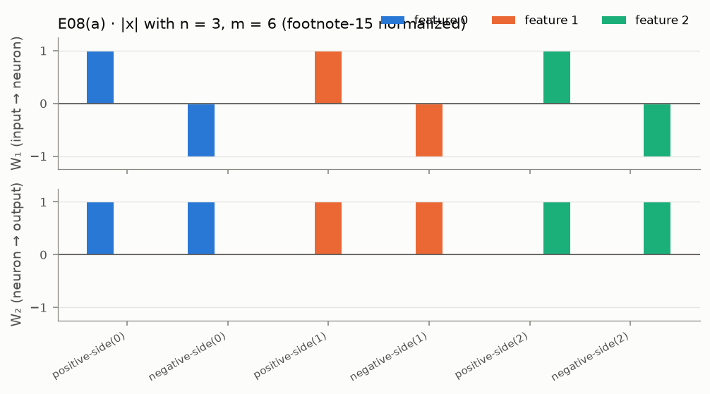

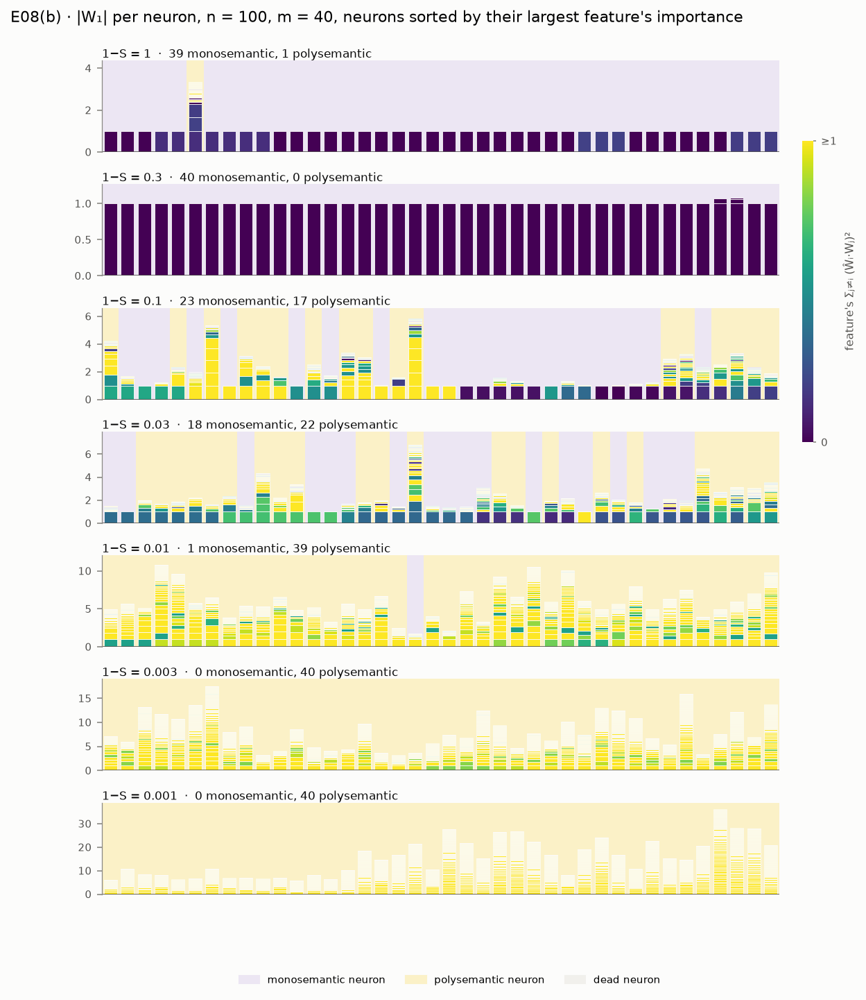

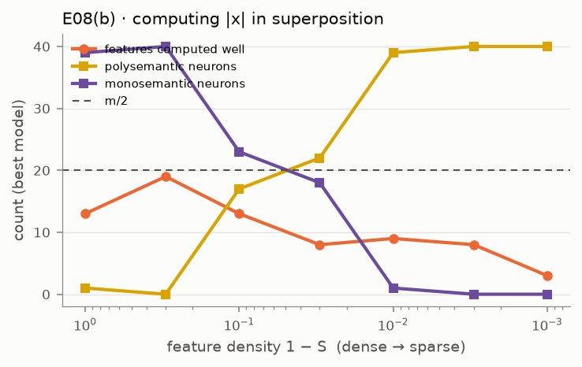

**Status: PARTIAL (2/4 graded criteria).** Part (a) reproduces exactly. Of the neuron picture
of pp. 37–38, the trend reproduces (monosemantic when dense, polysemantic when sparse, primary
plus secondary features in between), but two details do not (below). Computation in
superposition does not reproduce, under the re-derived criterion or the original one.

*(a) passes exactly.* Each feature gets one positive-side and one negative-side neuron
(normalized W₁ rows ±eᵢ, off-feature weights ≤ 0.002; W₂ weights 1.000; b = 0) and every
per-feature loss is 0 to six decimals.

*(b) Neurons: the trend of p. 37 reproduces; the strict dense criterion misses by one
neuron.*
- At 1 − S = 1, 39 of 40 neurons are monosemantic (one neuron carries three features), so
  "every neuron is monosemantic" fails; at 1 − S = 0.3 all 40 are.
- Polysemantic neurons then appear: 17 at 0.1, 22 at 0.03, 39 at 0.01, and 40 at 0.003 and
  0.001. The most features on one neuron grows from 1 (at 1 − S = 0.3) to 59 (at 0.001).
- Neurons with one primary feature (≥ 2× the next weight) plus secondary ones peak at
  intermediate sparsity (11 at 0.1, 15 at 0.03, 8 at 0.01), as p. 38 describes.
- *Not reproduced (review R3-01):*
  - p. 38 says the neurons of the most important features "tend to be monosemantic". In the
    reviewer's analysis of the stack plots, monosemantic and polysemantic neurons have the
    same median top-feature importance rank at 1 − S = 0.1, 0.03 and 0.01. The published
    stack plot shows polysemantic neurons at the far left at 0.1 and 0.03.
  - The dense model spends its 40 neurons on few features. It usefully computes only 13 (the
    count below), with several neurons on the same feature. Its loss is 5.5× the
    no-superposition reference at the same density (table below), so even the dense model is
    not the paper's clean one-neuron-per-feature solution.
  - The polysemantic counts at 1 − S = 0.001 include weights that barely moved from their
    initial values (review R3-11). All 40 neurons stay polysemantic if those are left out.

*(b) Computation: fails under both criteria.*
- *Re-derived criterion (graded):* the best models usefully compute 13, 19, 23, 33, 35, 27
  and 23 features at 1 − S = 1 … 0.001. At the sparsest setting that is 23, against more
  than 40 required.
  - At no sparsity are more features usefully computed than the model has neurons. A model
    without superposition could usefully compute m of them, one side each, so counts above
    m/2 do not by themselves show superposition (an earlier sentence here said they did:
    review R3-08).
- *SPEC's original criterion (INFO):* 13, 19, 13, 8, 9, 8 and 3 features computed well, and 3
  at 0.001, against more than 20.
  - These sparse counts are noisy. At 1 − S ≤ 0.01 about 20 features sit within ±0.02 of the
    50% bar, and their inactive term is estimated from rare events.
  - A re-estimate by the reviewer with another seed changed the counts at 0.01, 0.003 and
    0.001 from 9, 8 and 3 to 5, 5 and 7 (review R3-05).
  - The graded counts at the 75% bar did not change.
- *The uncited full profile* (8 restarts × 30,000 steps; run `20260929T180008Z-db58449f`) does
  not get there either. From its saved per-feature losses it usefully computes 29 features at
  0.001, and at most 33 at any sparsity (at 0.03).

*Within one sparsity, the trained models are far from a model without superposition.*
Footnote 17 rules out comparing losses across sparsities, but at one sparsity they are
comparable. INFO `b_within_sparsity_references` compares each best model's loss (exact
per-feature estimator) with two references at its own sparsity: predicting every mean, and no
superposition (both sides of the 20 most important features exact, every other feature at its
mean). The ratio of model loss to the no-superposition reference:

| 1 − S | 1 | 0.3 | 0.1 | 0.03 | 0.01 | 0.003 | 0.001 |
|---|---|---|---|---|---|---|---|
| model loss / no-superposition reference | 5.5 | 1.26 | 7.6 | 23 | 41 | 49 | 54 |

At 1 − S = 0.001 the model's loss (0.00103) removes only 38% of the loss of predicting every
mean (0.00167). A model with no superposition at all, 20 features computed exactly with two
neurons each, would reach 0.0000192. The trained models do not approach the solution without
superposition, let alone improve on it. That is an optimization failure, not evidence about
what superposition can compute. Footnote 16 hints at the difficulty: the model "learns more
easily when there are more neurons", and n = 100, m = 40 was chosen to keep the figure
readable.

**Evidence.** Generated from the cited run's `acceptance.json`:

<!-- BEGIN AUTO:E08 -->
Run `20260930T191445Z-49fd30ed` · profile `quick` · seed 0 · device `cpu` · commit `fd32b02273` · wall-clock 492.778 s · overall **PARTIAL** (2/4)

| Group | Criterion | Paper | Status | Value | Threshold |
|---|---|---|---|---|---|
| a_n3_m6 | (a) n = 3, m = 6: each feature gets one positive-side and one negative-side neuron (after footnote-15 normalization) | p. 36 | PASS | {"roles": ["negative-side(0)", "positive-side(0)", "positive-side(1)", "positive-side(2)", "negative-side(2)", "negative-side(1)"], "per_fe… | exactly one of each per feature |
| a_n3_m6 | (a) Every per-feature loss is below 5% of the loss of predicting the mean | p. 36 | PASS | [0.0, 0.0, 0.0] | < 0.05 |
| a_n3_m6 | (a) Normalized W₁ rows (per neuron), W₂ columns and b of the best model | p. 36 | INFO | {"W1": [[-1.0, -0.0, -0.002], [1.0, -0.0, -0.002], [-0.0, 1.0, -0.001], [0.001, -0.0, 1.0], [0.001, -0.0, -1.0], [-0.0, -1.0, -0.001]], "W2… | — |
| b_n100_m40 | (b) Dense (1 − S = 1): every neuron is monosemantic | pp. 36–38 | FAIL | {"monosemantic": 39, "polysemantic": 1, "dead": 0} | 40/40 neurons carry exactly 1 feature |
| b_n100_m40 | (b) Sparse (1 − S = 0.001): the model represents more features than it has neurons while usefully approximating \|x\|: … | pp. 36–38 | FAIL | {"usefully_computed": 23, "polysemantic_neurons": 40, "features": [0, 3, 4, 5, 6, 9, 10, 16, 18, 19, 21, 23, 25, 28, 32, 35, 36, 37, 38, 39… | > 40 |
| b_n100_m40 | (b) SPEC's original sparse criterion, no longer graded (D-R01): more than m/2 = 20 features computed well (per-feature … | pp. 36–38 | INFO | {"computed_well": 3, "threshold": "> 20", "would_pass": false} | — |
| b_n100_m40 | (b) Best model per sparsity: features usefully computed and computed well, neuron counts, polysemantic neurons with a p… | pp. 36–38 | INFO | {"1-S=1": {"usefully_computed": 13, "computed_well": 13, "mono": 39, "poly": 1, "dead": 0, "primary_plus_secondary": 0, "max_features_per_n… | — |
| b_n100_m40 | (b) Each best model's loss (exact per-feature estimator) against two references at the same sparsity (footnote 17): eve… | pp. 36–38 | INFO | {"1-S=1": {"loss": 0.02629, "mean_reference": 0.4167, "no_superposition_reference": 0.004804, "loss_over_no_superposition": 5.473}, "1-S=0.… | — |
| b_n100_m40 | (b) Which feature sides get computed (1-sparse relative error < 25%), split by whether the side's gain Σₕ W₂[i,h]·ReLU(… | pp. 36–38 | INFO | {"1-S=1": {"feature_probability": 1.0, "sides_alive_at_init": 91, "computed_if_alive": "68/91", "computed_if_dead": "82/109", "features_bot… | — |
| b_n100_m40 | (b) Diagnostic variant, not the replication (D-409): output bias initialized to 0.1 instead of 0 (2 restarts), against … | pp. 36–38 | INFO | {"1-S=0.01": {"loss_default": 0.007849, "loss_variant": 0.003532, "computed_well_default": 9, "computed_well_variant": 10, "usefully_comput… | — |
| b_n100_m40 | (b) Diagnostic variant, not the replication (D-R01): both weight matrices initialized at 0.187× the Xavier init, the sc… | pp. 36–38 | INFO | {"1-S=0.01": {"loss_default": 0.007849, "loss_variant": 0.001268, "computed_well_default": 9, "computed_well_variant": 25, "usefully_comput… | — |
<!-- END AUTO:E08 -->

**A contributing factor: dead sides at initialization (D-409).**
- At very sparse settings almost every input has one active feature, so each side of feature i
  (xᵢ > 0 or xᵢ < 0) is trained only by its own examples.
- The output bias starts at 0 (SPEC §3). A side whose initial gain Σₕ W₂[i,h] ReLU(±W₁[h,i])
  is negative therefore produces a negative pre-activation, the output ReLU clips it, and no
  gradient reaches it.
- INFO `b_side_diagnostics` measures this. At 1 − S = 0.001, 0 of the 89 sides that were dead at
  initialization are computed after training, against 23 of the 111 alive ones. The same holds
  at 0.003 (1/87 against 28/113) and 0.01 (2/87 against 37/113). These counts are meaningful
  only at 1 − S ≤ 0.01: when dense, a side that is predicted by its mean also passes the
  diagnostic's 0.25 bar, so the dense rows overcount (review R3-10).
- *Dead sides are not the whole story* (review R3-02; an earlier version of this section gave
  them as the cause):
  - 111 sides start alive at 0.001, more than either criterion needs, yet only 23 of them end
    up computed.
  - The dense model, where the 1-sparse mechanism does not apply, is also far from its
    reference (5.5×).
  - Untested alternatives: sides that die during training as output biases go negative; a
    best restart chosen by a noisy 20,000-sample loss (at 0.001 the noise is about as large as
    the spread between restarts: review R3-06); training length.

**What the reference implementations showed (D-R01).** The owner allowed consulting Anthropic's
archived notebook and ARENA §1.5.4 to diagnose the dead sides. No code was copied; D-R01 lists
what was read.
- Neither contains a remedy. Anthropic's notebook has no |x| model, and ARENA's starts the
  output bias at zero, as we do.
- The one substantive difference is ARENA's weight scale, about 5.3× smaller than SPEC §3's
  Xavier init (its Kaiming init takes the whole m × n matrix as the fan-in). That makes every
  side's initial gain about 28× smaller, without changing which sides start dead, so a small
  positive output bias could revive them.

Two diagnostic variants (never the replication default) test what the default runs lack. Same
sparsities as the default runs:

| Diagnostic at 1 − S = 0.01 / 0.001 | loss | computed well | usefully computed | dead sides computed |
|---|---|---|---|---|
| default (4 restarts) | 0.00785 / 0.00103 | 9 / 3 | 35 / 23 | 2 of 87 / 0 of 89 |
| ARENA's init scale, 0.187 × Xavier (4 restarts) | 0.00127 / 0.00099 | 25 / 11 | 30 / 16 | 22 of 109 / 4 of 109 |
| output bias starting at +0.1 (2 restarts) | 0.00353 / 0.00037 | 10 / 14 | 34 / 27 | 15 of 109 / 8 of 103 |

- *Init scale at 0.01:* the smaller init cuts the loss 6× and revives dead sides (22 of 109,
  against 2 of 87). The variant's restarts start from different random draws than the default
  runs (other instance indices), so the comparison is unpaired: part of any difference may
  come from the draws (review R3-07). It computes 25 features well, more than m/2, but usefully computes fewer
  (30 against 35): fewer features, more of them on both sides.
- *Init scale at 0.001:* it changes little. A hypothesis, not tested here: each side sees only
  about 5,000 examples in 10,000 steps at that density, too few for weights that start small to
  grow.
- *Bias init:* the positive output bias helps most at 0.001.

No variant usefully computes more than m features at the sparsest setting. The initialization
scale explains much of the gap at 1 − S = 0.01 and little of it at 0.001. E08 stays PARTIAL:
the neurons look as the paper describes, and the computation it describes is not reproduced.

**Discrepancies and hypotheses.**
- *The paper does not quantify computation.* Its evidence is the stack plots, which we
  reproduce, and the statement that the model "usefully approximate[s]" |x|. SPEC's
  operationalization (> m/2 computed well) is replaced by D-R01's re-derivation (> m usefully
  computed); both fail, and both are reported.
- *Hypotheses for the gap.* Optimization: dead sides at initialization, as one factor among
  several (above); an init scale that helps at 1 − S = 0.01 but may need longer training at
  0.001; more neurons (footnote 16).
  Details of the paper's setup that it does not state (restarts, training length): ARENA trains
  one model per density for 5,000 steps and reports no count.

**Run IDs.** Cited (quick, CPU, seed 0, commit `fd32b02`): `20260930T191445Z-49fd30ed` (493 s
wall-clock). It reproduces the previous cited run (`20260929T175145Z-5a0a35cf`, commit
`5a825d0`, 369 s) bit for bit in every per-feature loss; the new rows and the init-scale
variant are added. Full profile (MPS, commit `24ec2e9`, not cited):
`20260929T180008Z-db58449f` (981 s).

## E09 mech_interp_abs (pp. 38–39)

**Paper's claims.** A small absolute-value model "only doing a limited amount of superposition"
(the p. 39 figure: 6 features, 10 neurons) can be understood almost completely: "many of the
weights can be understood as simply implementing absolute value in the expected way", and the
remaining neurons implement "two instances of asymmetric superposition and inhibition". One
neuron stores two features with unequal input weights and reciprocal output weights, so one
feature "heavily interfere[s] with the other, but avoid[s] the other interfering with the
first"; a second neuron reads "a small amount" of the heavy feature and uses it "to massively
inhibit" the victim, which "essentially converts positive interference … into negative
interference". A few other weights are "effectively small conditional biases" (p. 39).

**What we test** (SPEC §7 E09, D-501, D-502): absolute-value models with m = 2n − 2 neurons
((n, m) = (4, 6), (5, 8), (6, 10); Iᵢ = 1; 20 restarts), graded at 1 − S = 0.3 and 0.2 and
reported at 0.5 and 0.1. `interp.py` names every neuron of each best model from its path gains
|W₁[h,i]|·W₂[j,h], zero- and mean-ablates it, searches every restart for the motif, and
rebuilds an idealized model by hand from the roles.

**Our figures** (quick profile): the best n = 6, m = 10 model drawn like p. 39 (input weights
above, output weights below, colored by feature, each neuron labeled with its role, the motif's
neurons shaded; large output weights are cut and marked with their value), its ablation
matrices, the rebuild test for every setting, and the role census.

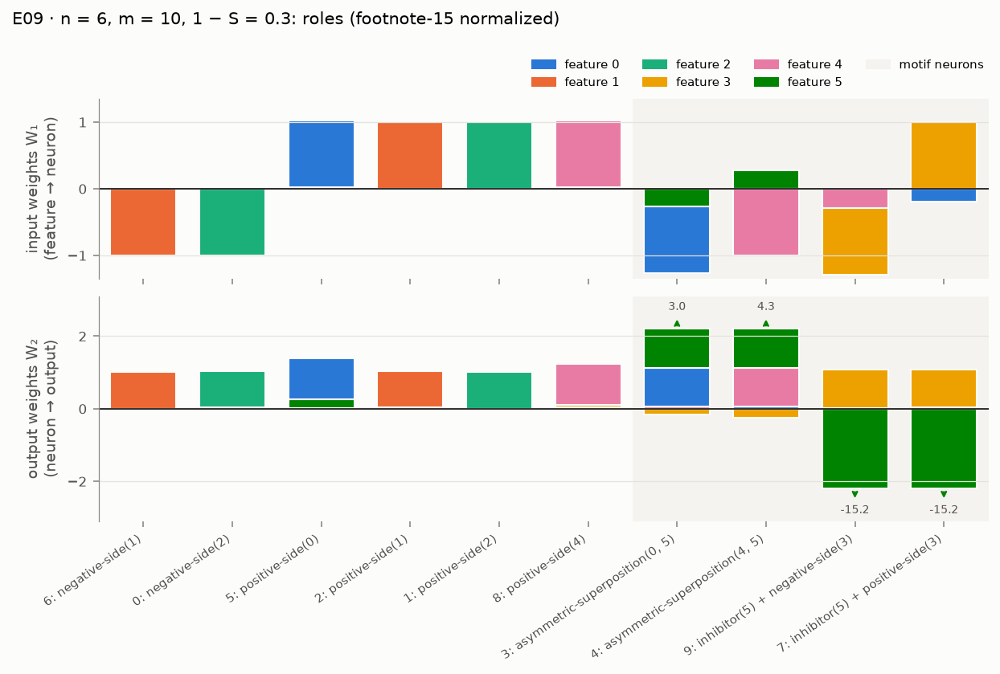

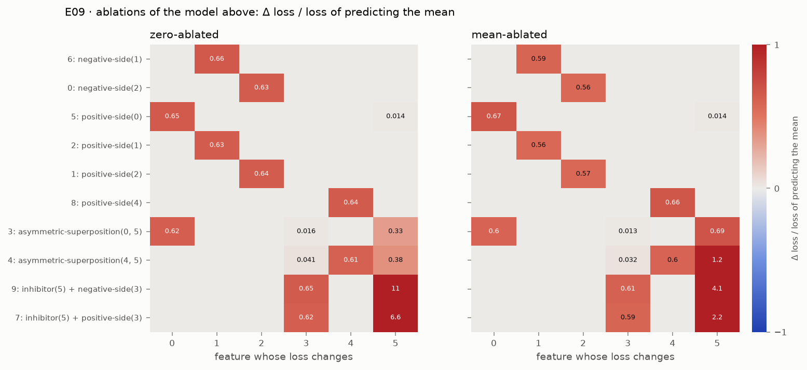

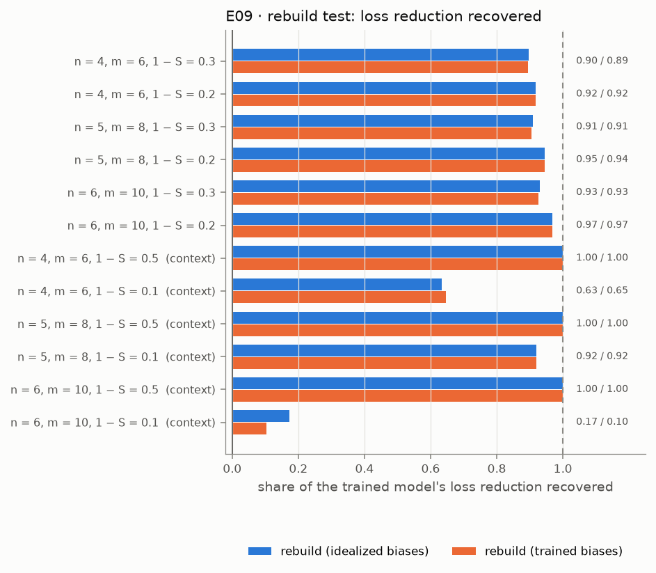

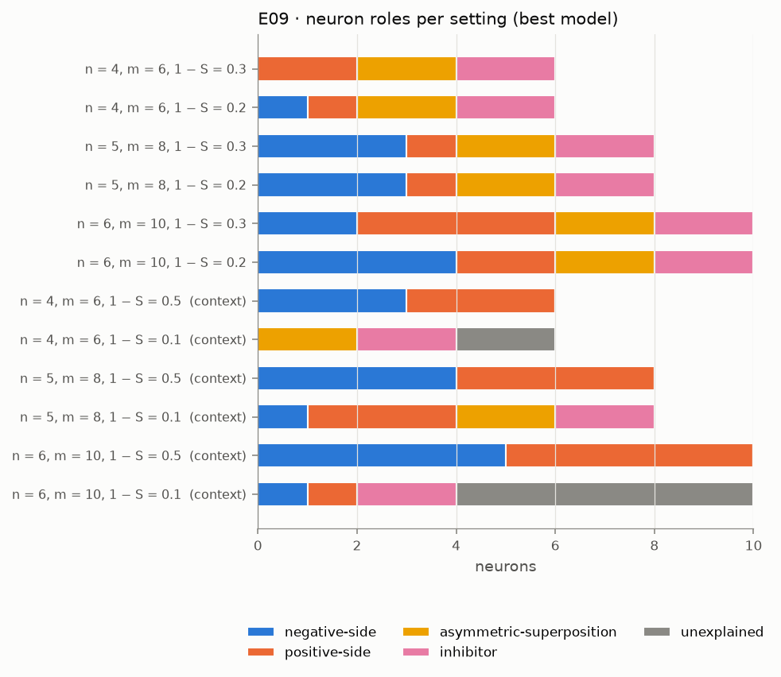

**Status: PASS (3/3 graded criteria), with a discrepancy on one sub-claim** (inhibition,
below; D-R03). In all six graded models every live neuron receives a
named role (48/48; all 48 with one of SPEC's four roles; no dead neurons), and for every one of
them both the zero and the mean ablation raise exactly the losses the role predicts (48/48).
The motif is found in 134 of the 240 trained models, in every graded configuration (11–18 of
20 restarts) and never at 1 − S = 0.5.

*The trained models reproduce the p. 39 structure, not just the motif.* Every graded best model
has exactly two asymmetric-superposition neurons that share one victim feature (each supplies
one of the victim's two sides), two inhibitors of that victim whose secondary roles are the two
sides of one other feature, and plain side neurons for the rest. At n = 6, m = 10 the counts
match the p. 39 figure feature for feature: two features with both sides, one feature whose
two sides live in the inhibitors (light blue on p. 39), two heavy features with one side neuron
plus a share of an asymmetric neuron (light orange and green), and the victim with no neuron of
its own (red). In the graded models the asymmetric neurons flip sizes by 3.4–4.2× on the input
side and 2.8–4.0× on the output side (the paper's example: 4× each way).

*Rebuild.* The model built by hand from the roles (side neurons ±1 → 1, asymmetric neurons
with reciprocal outputs, inhibitors with their trained strength and triggers, nothing else)
recovers 90–97% of the trained models' loss reduction over predicting the mean in the graded
settings (0.90, 0.92 at n = 4; 0.91, 0.95 at n = 5; 0.93, 0.97 at n = 6; for 1 − S = 0.3, 0.2),
and 89–97% with the trained biases. The missing few percent are the "small conditional biases"
of p. 39: small weights no role names.

*Where the regime ends (INFO).* At 1 − S = 0.5 the models do no superposition at all: they drop
one feature and compute the others with clean side neurons, every neuron is named, and the
rebuild recovers 100%. At 0.1 the picture depends on the size: n = 5 is still fully named
(8/8, rebuild 0.92), while n = 4 has 2 and n = 6 has 6 unexplained neurons and the rebuild
recovers 0.63 and 0.17. The motif still occurs there (12–17 of 20 restarts), but next to
neurons that fit no role.

**Evidence.** Generated from the cited run's `acceptance.json`:

<!-- BEGIN AUTO:E09 -->
Run `20260930T184323Z-3fdd1d10` · profile `quick` · seed 0 · device `cpu` · commit `fd32b02273` · wall-clock 257.997 s · overall **PASS** (3/3)

| Group | Criterion | Paper | Status | Value | Threshold |
|---|---|---|---|---|---|
| — | ≥ 90% of live neurons receive a named role (best model of each of n=4/m=6, n=5/m=8, n=6/m=10 at 1 − S ∈ {0.3, 0.2}) | pp. 38–39 | PASS | {"fraction": 1.0, "named": 48, "live": 48, "dead": 0, "fraction_spec_roles_only": 1.0, "per_model": {"n4_m6 1-S=0.3": "6/6", "n4_m6 1-S=0.2… | ≥ 0.9 |
| — | Ablation effects agree with the assigned roles: for ≥ 90% of named neurons, zeroing and mean-ablating each raise the lo… | pp. 38–39 | PASS | {"fraction": 1.0, "agree": 48, "named": 48, "per_model": {"n4_m6 1-S=0.3": "6/6", "n4_m6 1-S=0.2": "6/6", "n5_m8 1-S=0.3": "8/8", "n5_m8 1-… | ≥ 0.9 |
| — | The asymmetric superposition + inhibition motif is found in at least one model (searched in every restart); restarts wi… | pp. 38–39 | PASS | {"models_with_motif": 134, "per_configuration": {"n4_m6 1-S=0.3": "11/20", "n4_m6 1-S=0.2": "17/20", "n4_m6 1-S=0.5": "0/20", "n4_m6 1-S=0.… | ≥ 1 model |
| — | Rebuild test: share of the trained model's loss reduction (vs predicting the mean) recovered by the model rebuilt by ha… | pp. 38–39 | INFO | {"n4_m6 1-S=0.3": {"recovered": 0.8975, "recovered_trained_bias": 0.8941}, "n4_m6 1-S=0.2": {"recovered": 0.9179, "recovered_trained_bias":… | — |
| — | Motifs in the best models: input and output size ratios, the positive interference, the inhibition, and the net 1-spars… | pp. 38–39 | INFO | {"motifs_in_best_models": 18, "net_interference_negative": "6/18", "all_restarts_net_negative": "111/292", "net_interference_best_models": … | — |
| — | Outside the graded regime (reported only): named roles, ablation agreement, motifs and rebuild of the best model at the… | pp. 38–39 | INFO | {"n4_m6 1-S=0.5": {"named": "6/6", "agree": "6/6", "motifs": 0, "restarts_with_motif": "0/20", "rebuild_recovered": 1.0001, "roles": ["nega… | — |
| — | Role of every neuron in the graded models (best restart) | pp. 38–39 | INFO | {"n4_m6 1-S=0.3": ["inhibitor(1) + negative-side(3)", "inhibitor(1) + positive-side(3)", "positive-side(0)", "positive-side(2)", "asymmetri… | — |
<!-- END AUTO:E09 -->

**Discrepancy on one sub-claim (p. 39; D-R03): the inhibitors cancel the interference, they
do not convert it.** p. 39 says the inhibiting neuron "essentially converts positive
interference (which could greatly increase the loss) into negative interference". In our
models the inhibition matches the positive interference almost exactly, so the victim's net
1-sparse pre-activation (bias included) sits near zero rather than below it:
- in the 18 motifs of the best models (two each in the six graded models and the three at
  1 − S = 0.1), the net ranges from −0.081 to +0.075 with median +0.023, and only 6 of 18 are
  negative;
- relative to the interference it cancels (2.3–4.3), the net is −2.8% to +2.5% (median +0.6%);
- over all 292 motifs in all restarts, 111 are negative (quartiles −0.030 and +0.062, median
  +0.018). A few restarts do overshoot (the most negative net is −0.83).

A net near zero leaves the victim's output within a few hundredths of its target when the heavy
feature fires, so the motif works; a negative net would be clipped to exactly zero by the
output ReLU. The paper's own model may overshoot, but its figure does not show the net value. We report this as a discrepancy on the sub-claim, not as a failed criterion: SPEC's
criteria ask for the motif, the roles and the ablations, and all pass.

**The density pilot, re-run as a cited run (D-R03).** The graded densities (1 − S = 0.3, 0.2)
were chosen from a pilot (D-502), which was first run as an uncited script. It has now been
re-run through the CLI with the same design: `superposition run mech_interp_abs --profile
pilot`, with the three sizes, all four densities, 16 restarts each, analyzed the same way (not
bit-identical to the script, which ordered the densities differently). It supports the choice:
- *1 − S = 0.5:* no superposition. Every neuron is named, the motif appears in 0 of 16
  restarts at every size, and the rebuild recovers 100%.
- *0.3 and 0.2 (graded):* every live neuron is named (48/48), every ablation agrees (48/48),
  the motif appears in 6–14 of 16 restarts, and the rebuild recovers 89–98%.
- *0.1:* the regime breaks down. There are 2, 6 and 1 unexplained neurons at n = 4, 5 and 6,
  and the rebuild recovers 0.21, −0.29 and 0.57, although the motif still appears in 9–12 of
  16 restarts.

The pilot's motifs repeat the discrepancy above: the net is negative in 4 of 18 best-model
motifs (median +0.045), and in 78 of 211 over all restarts.

<!-- BEGIN AUTO:E09:pilot -->
Run `20260930T183948Z-1e8bafbd` · profile `pilot` · seed 0 · device `cpu` · commit `fd32b02273` · wall-clock 212.446 s · overall **PASS** (3/3)

| Group | Criterion | Paper | Status | Value | Threshold |
|---|---|---|---|---|---|
| — | ≥ 90% of live neurons receive a named role (best model of each of n=4/m=6, n=5/m=8, n=6/m=10 at 1 − S ∈ {0.3, 0.2}) | pp. 38–39 | PASS | {"fraction": 1.0, "named": 48, "live": 48, "dead": 0, "fraction_spec_roles_only": 1.0, "per_model": {"n4_m6 1-S=0.3": "6/6", "n4_m6 1-S=0.2… | ≥ 0.9 |
| — | Ablation effects agree with the assigned roles: for ≥ 90% of named neurons, zeroing and mean-ablating each raise the lo… | pp. 38–39 | PASS | {"fraction": 1.0, "agree": 48, "named": 48, "per_model": {"n4_m6 1-S=0.3": "6/6", "n4_m6 1-S=0.2": "6/6", "n5_m8 1-S=0.3": "8/8", "n5_m8 1-… | ≥ 0.9 |
| — | The asymmetric superposition + inhibition motif is found in at least one model (searched in every restart); restarts wi… | pp. 38–39 | PASS | {"models_with_motif": 99, "per_configuration": {"n4_m6 1-S=0.3": "9/16", "n4_m6 1-S=0.2": "14/16", "n4_m6 1-S=0.5": "0/16", "n4_m6 1-S=0.1"… | ≥ 1 model |
| — | Rebuild test: share of the trained model's loss reduction (vs predicting the mean) recovered by the model rebuilt by ha… | pp. 38–39 | INFO | {"n4_m6 1-S=0.3": {"recovered": 0.8918, "recovered_trained_bias": 0.8863}, "n4_m6 1-S=0.2": {"recovered": 0.9125, "recovered_trained_bias":… | — |
| — | Motifs in the best models: input and output size ratios, the positive interference, the inhibition, and the net 1-spars… | pp. 38–39 | INFO | {"motifs_in_best_models": 18, "net_interference_negative": "4/18", "all_restarts_net_negative": "78/211", "net_interference_best_models": {… | — |
| — | Outside the graded regime (reported only): named roles, ablation agreement, motifs and rebuild of the best model at the… | pp. 38–39 | INFO | {"n4_m6 1-S=0.5": {"named": "6/6", "agree": "6/6", "motifs": 0, "restarts_with_motif": "0/16", "rebuild_recovered": 1.0001, "roles": ["posi… | — |
| — | Role of every neuron in the graded models (best restart) | pp. 38–39 | INFO | {"n4_m6 1-S=0.3": ["inhibitor(3) + negative-side(1)", "inhibitor(3) + positive-side(1)", "asymmetric-superposition(2, 3)", "asymmetric-supe… | — |
<!-- END AUTO:E09:pilot -->

**Discrepancies and notes.**
- *Inhibition cancels rather than converts* (above; D-R03).
- The regime (m = 2n − 2, 1 − S ∈ {0.3, 0.2}, Iᵢ = 1) was chosen from a pilot because the paper
  gives no density or importance for its p. 39 model (D-502). The pilot is now a cited run
  (above; D-R03), and the context densities show where the regime ends.
- Roles and motifs are defined on path gains, which describe 1-sparse inputs; the ablations
  use the full input distribution, which is why both are reported.
- *superposition(i, j)* (normal superposition) and *dead* extend SPEC's role list (D-501); no
  graded model uses either.

**Run IDs.** Cited (quick, CPU, seed 0, commit `fd32b02`): `20260930T184323Z-3fdd1d10` (258 s
wall-clock). It reproduces the previous cited run (`20260929T211826Z-3fdd1d10`, commit
`dbe87c8`, 271 s) exactly in every earlier row; the spread of the net interference is new.
Pilot (profile `pilot`, CPU, seed 0, commit `fd32b02`, cited as `mech_interp_abs:pilot`):
`20260930T183948Z-1e8bafbd` (212 s).

## E10 sae_recovery (pp. 42–44)

**Paper's claims.** Approach 2 to "solving superposition" is to "take a regular model, which has
superposition, and find an overcomplete basis describing how features are embedded after the
fact", "a relatively standard sparse coding problem" (p. 43; footnote 20: H ≈ AB with A
sparse). The toy models are where this can be checked, because "we do know what the features
are!" (p. 44). The paper does not run it; SPEC §7 E10 asks whether sparse autoencoders (the
modern form of this sparse coding) recover the known feature directions.

**What we test** (D-503, D-504, D-R04): toy models (ReLU output model, best restart) with E00's,
E01's and E03's settings, frozen; SAEs trained on their hidden activations h = Wx, over
dictionary size × λ × resampling off/on plus TopK. A feature counts as recovered when some
*live* decoder column has cosine > 0.95 (pentagon) or > 0.9 (others) with +Wᵢ; only
represented features (‖Wᵢ‖ > 0.5) are scored.
- *Graded (D-R04): the SAE a practitioner would pick without ground truth.* That is the
  sparsest SAE of the sweep (lowest held-out L0) among those that explain at least 90% of the
  activation variance (held-out FVU ≤ 0.1). The rule never looks at recovery, and it was fixed
  and committed before the run that grades it. Two caveats (review R4-04, R4-11):
  - The rule is free of ground truth only within the sweep, and the sweep itself was built from
    the true n: dictionary sizes n, 2n and 4n, and TopK k = 1 from the known sparsity. p. 43
    names the number of features as exactly what a practitioner would not know. The reviewer
    re-ran the rule without the n-sized dictionaries; it changes no outcome.
  - The grading run reproduces the run inspected before the rule was fixed bit for bit, so the
    outcome was computable from data already seen. No bar near 0.1 (0.05, 0.1 or 0.12) changes
    the count.
- *Upper bound (INFO):* the best SAE by ground truth, which was graded before D-R04.
- *Also reported:* the pass rate across the sweep, and the TopK k = 8 against k = 16 contrast on
  the E03 model.

**Our figures** (quick profile): the pentagon's true features with the decoder directions of
the selected SAE, the oracle-best SAE and the worst 5-latent SAE; recovery for every SAE
setting; reconstruction error against recovery for every SAE.

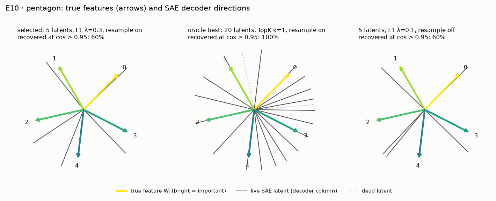

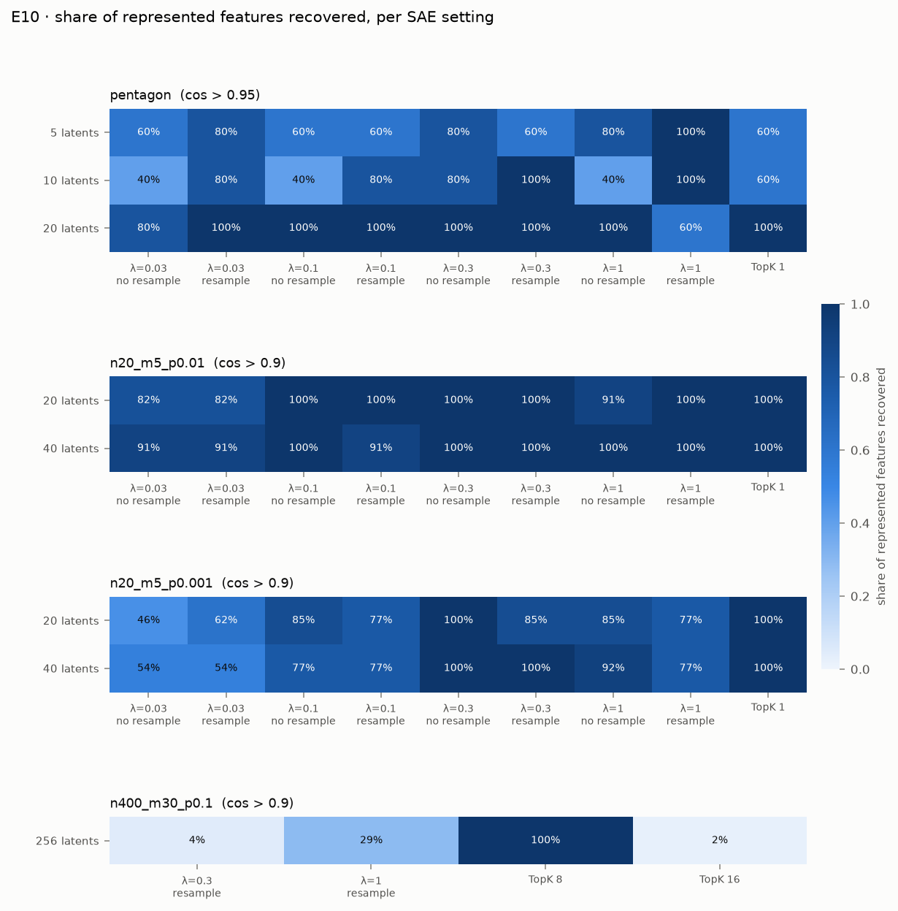

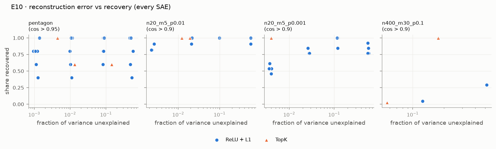

**Status: PARTIAL (1/3 graded criteria).** Every sweep contains an SAE that recovers all the
represented features: the oracle upper bound passes all three graded toy models, as before
D-R04. Reconstruction error and sparsity alone find such an SAE for one of the three.

| Toy model | SAEs with FVU ≤ 0.1 | Selected without ground truth | Its recovery | Oracle best | Settings that pass |
|---|---|---|---|---|---|
| pentagon (1 − S = 0.1) | 20/27 | 5 latents, λ = 0.3, resampling on (L0 0.63; FVU 0.082) | 3/5 at cos > 0.95: **FAIL** | 20 latents, TopK k = 1: 5/5 | 10/27 |
| n = 20, 1 − S = 0.01 | 12/18 | 20 latents, λ = 0.3, no resampling (L0 0.148; FVU 0.0996) | 11/11 at cos > 0.9: **PASS** | 40 latents, TopK k = 1: 11/11 | 16/18 |
| n = 20, 1 − S = 0.001 | 10/18 | 40 latents, λ = 0.1, resampling on (L0 0.046; FVU 0.028) | 10/13: **FAIL** | 40 latents, TopK k = 1: 13/13 | 6/18 |
| E03 model (INFO) | 1/4 | 256 latents, TopK k = 16 (FVU 0.057) | 3/134 (2.2%) | TopK k = 8: 134/134 | 1/4 |

*Pentagon.* The selected SAE's latents point close to all five features: every feature is
found at cos > 0.9, and the mean max cosine is 0.967. Only three clear the graded 0.95. Its
L0 is 0.63, against a true L0 of 0.5.

*n = 20, 1 − S = 0.001: the bar is fragile.* The SAEs that recover every feature here are
λ = 0.3 (three of its four settings) and TopK k = 1, and the rule passes over both kinds:
- the λ = 0.3 SAEs explain 88% of the variance (FVU 0.117–0.121), just short of the 90% bar;
- TopK k = 1 fires on every input (L0 = 1).

The rule picks λ = 0.1 instead, whose code is 3.5× denser than the true one (L0 0.046 against
0.013). The bar was fixed before the run (D-R04) and is not moved. This case shows how much a
practitioner's rule depends on a threshold they would have to guess.

*The E03 model: TopK k = 8 against k = 16 (INFO).* 134 of 400 features are represented, and an
input activates 13.4 of them on average.
- Only TopK k = 16 meets the FVU bar (FVU 0.057), so the rule picks it. It recovers 2.2% of the
  features, and 68% of its latents are dead.
- TopK k = 8 recovers all 134 at cos > 0.95 (mean max cosine 0.999), but explains only 82% of
  the variance (FVU 0.176).
- ReLU + L1 SAEs recover 4.5% (λ = 0.3, 47.5 latents active per input) and 29% (λ = 1, with
  52% of the variance unexplained).

With more slots than active features (k = 16 against 13.4), the better reconstruction comes
with almost no recovery, and a reconstruction-based rule prefers it.

*Reconstruction is not recovery (INFO).* Of the SAEs with FVU ≤ 0.1, 7 of 20 recover the
pentagon's features, 10 of 12 and 2 of 10 the n = 20 models' (1 − S = 0.01, 0.001), and 0 of 1
the E03 model's.

*Resampling (INFO).* With the frequency rule of D-503, resampling fired for 43 latents of the
ReLU + L1 SAEs at 1 − S = 0.001 (none at the other settings) and for 0–56 latents of TopK SAEs
(4 of the 9 resampled none; review R4-05).
It changed little:
- the best recovery is 100% with and without it everywhere;
- the mean recovery moves by initialization noise (pentagon 0.72 → 0.85 with nothing
  resampled; 1 − S = 0.001: 0.80 → 0.76);
- the final dead fractions are similar, because overcomplete dictionaries shed their surplus
  latents after the last check (60% of training). With 5 latents for 5 features, only one of
  the nine SAEs loses a latent.

**Evidence.** Generated from the cited run's `acceptance.json`:

<!-- BEGIN AUTO:E10 -->
Run `20260930T192302Z-13117b27` · profile `quick` · seed 0 · device `cpu` · commit `fd32b02273` · wall-clock 415.275 s · overall **PARTIAL** (1/3)

| Group | Criterion | Paper | Status | Value | Threshold |
|---|---|---|---|---|---|
| pentagon | pentagon (E00, p. 2, n = 5, m = 2, 1 − S = 0.1): the SAE selected without ground truth (sparsest with held-out FVU ≤ 0.… | pp. 42–44 | FAIL | {"represented": 5, "setting": "5 latents, L1 λ=0.3, resample on", "recovered": 0.6, "mean_max_cos": 0.967, "fvu": 0.0824, "l0": 0.6335, "sa… | ≥ 1.0 |
| n20_m5_p0.01 | n20_m5_p0.01 (E01, p. 11, n = 20, m = 5, 1 − S = 0.01): the SAE selected without ground truth (sparsest with held-out F… | pp. 42–44 | PASS | {"represented": 11, "setting": "20 latents, L1 λ=0.3, resample off", "recovered": 1.0, "mean_max_cos": 0.9904, "fvu": 0.0996, "l0": 0.148, … | ≥ 0.9 |
| n20_m5_p0.001 | n20_m5_p0.001 (E01, p. 11, n = 20, m = 5, 1 − S = 0.001): the SAE selected without ground truth (sparsest with held-out… | pp. 42–44 | FAIL | {"represented": 13, "setting": "40 latents, L1 λ=0.1, resample on", "recovered": 0.7692, "mean_max_cos": 0.9502, "fvu": 0.028, "l0": 0.0456… | ≥ 0.9 |
| — | Upper bound: the best SAE of each sweep chosen by ground-truth recovery (a choice a practitioner cannot make; the grade… | pp. 42–44 | INFO | {"pentagon": {"setting": "20 latents, TopK k=1, resample on", "recovered": 1.0, "mean_max_cos": 1.0, "fvu": 0.0045, "l0": 1.0}, "n20_m5_p0.… | — |
| — | SAE settings whose recovery reaches the toy model's threshold, over the whole sweep and by kind | pp. 42–44 | INFO | {"pentagon": {"all": "10/27", "l1_resample_off": "3/12", "l1_resample_on": "6/12", "topk": "1/3"}, "n20_m5_p0.01": {"all": "16/18", "l1_res… | — |
| — | Toy models reported without grading (E03 setup): the SAE selected without ground truth | pp. 42–44 | INFO | {"n400_m30_p0.1": {"represented": 134, "selected": {"setting": "256 latents, TopK k=16, resample on", "recovered": 0.0224, "mean_max_cos": … | — |
| — | TopK SAEs with different k on the same toy model: recovery, reconstruction, dead latents, and which one the selection r… | pp. 42–44 | INFO | {"n400_m30_p0.1": {"k=8, 256 latents": {"recovered": 1.0, "mean_max_cos": 0.999, "fvu": 0.1758, "dead_fraction": 0.1016, "selected_by_rule"… | — |
| — | With and without dead-latent resampling (ReLU + L1 SAEs): best and mean recovery, mean dead-latent fraction on held-out… | pp. 42–44 | INFO | {"pentagon": {"resample_off": {"best_recovered": 1.0, "mean_recovered": 0.7167, "mean_dead_fraction": 0.1292, "latents_resampled": 0}, "res… | — |
| — | TopK SAEs (λ = 0, resampling on) against the best ReLU + L1 SAE: share recovered | pp. 42–44 | INFO | {"pentagon": {"l1_best": 1.0, "topk_1_5": 0.6, "topk_1_10": 0.6, "topk_1_20": 1.0}, "n20_m5_p0.01": {"l1_best": 1.0, "topk_1_20": 1.0, "top… | — |
| — | Low reconstruction error does not imply recovery: SAEs with FVU ≤ 0.1 and how many of them recover the features; true L… | pp. 42–44 | INFO | {"pentagon": {"settings_with_fvu_at_most_0.1": 20, "of_which_recover": 7, "true_l0": 0.5}, "n20_m5_p0.01": {"settings_with_fvu_at_most_0.1"… | — |
<!-- END AUTO:E10 -->

**Discrepancies and notes.**
- **Selection without ground truth (D-R04).** Until this session the graded SAE was the sweep's
  best by recovery, which a practitioner could not choose. That choice still passes all three
  models, and it is reported as the upper bound. The practitioner's rule passes one.
- **TopK k against the true L0.** On the E03 model TopK works with k = 8 but fails with
  k = 16, above the true 13.4 active features per input, and a reconstruction-based rule picks
  k = 16. A hypothesis, not tested here: with more slots than active features, the extra slots
  are filled by latents that fit combinations of features (which reconstruct well), and most
  latents die. How recovery depends on k is worth a finer sweep (full profile or an
  extension).
- The toy models are retrained with their experiments' settings rather than loaded, so they
  differ in detail from the E01 cited run (11 and 13 represented features here, 12 and 14
  there, at 1 − S = 0.01 and 0.001).
- TopK SAEs keep the k largest ReLU outputs, so fewer than k latents fire when fewer than k
  pre-activations are positive. Their L0 is close to k here (7.9996 for the E03 model's
  k = 8) because the latents also fire on the all-zero input; it is not k by construction (an
  earlier version said it was: review R4-05).

**Run IDs.** Cited (quick, CPU, seed 0, commit `fd32b02`): `20260930T192302Z-13117b27` (415 s
wall-clock). Its toy models and SAEs are identical to those of the previous cited run
(`20260929T212259Z-fa564b17`, commit `dbe87c8`, 406 s; PASS 3/3 when graded by ground truth);
only the grading changed (D-R04).

## E11 l1_removes_superposition (p. 42)

**Paper's claim.** "It's actually quite easy to get rid of superposition in the toy models
described in this paper, albeit at the cost of a higher loss. Simply apply an L1 regularization
term to the hidden layer activations (i.e. add λ‖h‖₁ to the loss). This actually has a nice
interpretation in terms of killing features below a certain importance threshold, especially if
they're not basis aligned" (p. 42). Footnote 21 adds that a little L1 should reduce
superposition "with essentially no effect on performance". The paper shows no experiment.

**What we test** (D-505, D-R05): the ReLU output model with λ E‖h‖₁ added to its loss, on the E00
pentagon (n = 5, m = 2, 1 − S = 0.1, 16 restarts) and E01's n = 20, m = 5 at 1 − S = 0.01 (8
restarts), over 15 values of λ from 0 to 0.8. Per λ we keep the restart with the lowest
training objective and score every model on the same 200,000 samples: the reconstruction loss
without the penalty (comparable across λ: same task, footnote 17), represented features
(‖Wᵢ‖ > 0.5), superposed ones (superposition score > 0.05), and the formal test (WᵀW singular on
the represented features, p. 8).

**Our figures** (quick profile): loss and feature counts against λ (shaded: no superposition),
the trade-off curve, the pentagon's weights at five values of λ (in the raw hidden basis, which
the penalty makes privileged), and the n = 20 model's WᵀW.

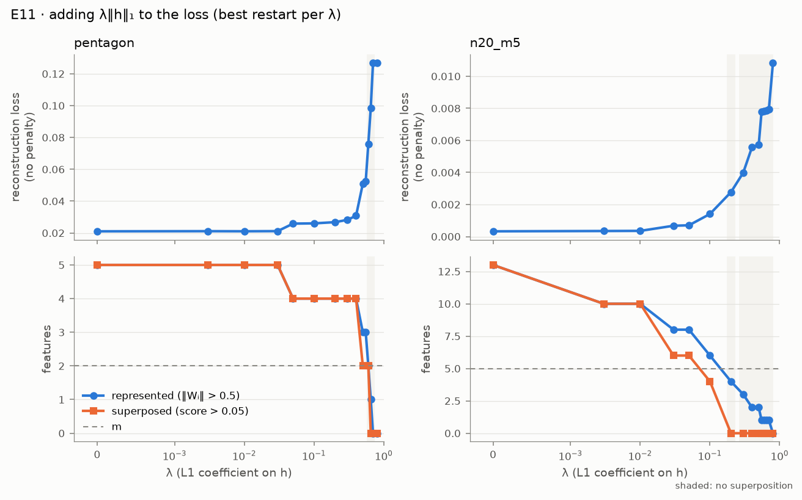

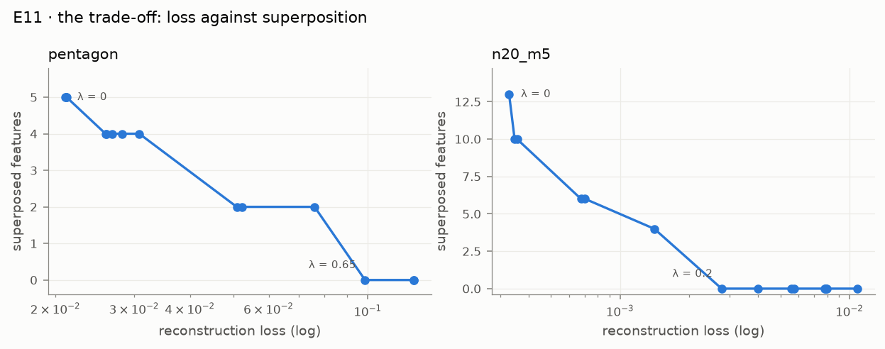

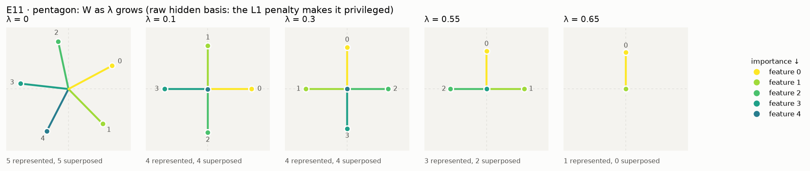

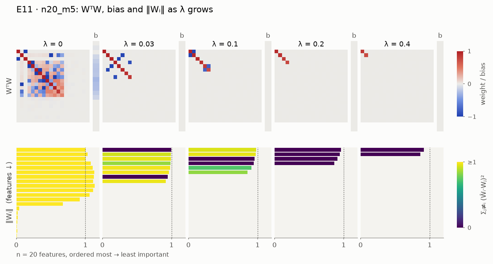

**Status: PARTIAL (7/8 graded criteria; D-R05).** The n = 20 setup passes all four criteria,
on the cited seed and on a held-out one. The pentagon passes three criteria and is PARTIAL on
"falls to none". It is free of superposition only at λ = 0.65, where a single feature is left,
and a lone feature cannot be in superposition with anything. The owner decided to mark the
pentagon PARTIAL (D-R05). In the acceptance record this is a graded PARTIAL: "falls to none"
needs at least two features left to pass.

*n = 20, m = 5 (1 − S = 0.01): the claim as stated, by killing features.* The unregularized
model superposes 13 features. As λ grows, the least important superposed features go first (13 → 10 → 6 → 4
superposed at λ = 0.003, 0.03, 0.1). At λ = 0.2 the model keeps the four most important
features, orthogonal and with no superposition, at 8.4× the loss (0.00033 → 0.00277). Larger λ
kills more features (2 at 0.4, 1 at 0.55, none at 0.8). Superposition is removed by killing
features, as p. 42 says, not by rearranging them: the first superposition-free model keeps 4
features in m = 5 dimensions, and no λ keeps m orthogonal features (at λ = 0.1 the best model
still superposes 4 of its 6; review R4-09).

At λ = 0.003 the superposed count falls from 13 to 10 and the loss rises by 6%. This does not
test footnote 21's "essentially no effect on performance" (review R4-08):
- the grid has nothing between λ = 0 and 0.003;
- the λ = 0 best restart is at the top of its restarts' range of superposed features;
- on the held-out seed the step is 11 → 10 at a 7.5% loss rise.

The held-out seed repeats the rest (below).

*Pentagon (n = 5, m = 2, 1 − S = 0.1): superposition goes only with the features.*
- The pentagon survives small λ (up to 0.03, loss +0.5%).
- It then becomes two antipodal pairs aligned with the hidden axes (λ = 0.05–0.4; loss +23% to
  +46%), then one pair plus one feature (0.5–0.55), then one pair (0.6).
- It is free of superposition only at λ = 0.65, where only feature 0 is left, at 4.7× the loss
  (0.0211 → 0.0986). At 0.7 every feature is gone. At no λ does it keep two orthogonal
  features.

**Against p. 42.** The paper does not say that L1 rearranges features into an orthogonal
basis. It says the penalty "has a nice interpretation in terms of killing features below a
certain importance threshold, especially if they're not basis aligned", and that is what the
pentagon does:
- Features die from the least important up, and the survivors are always the most important
  ones: {0, 1, 2, 3} from λ = 0.05, then {0, 1, 2}, {0, 1} and {0}.
- The survivors are basis aligned. The pentagon's arrangement, which is not, goes first: at
  λ = 0.05 feature 4 dies and the other four move onto the hidden axes as two antipodal pairs.
  An antipodal pair along one hidden axis is basis aligned, and its penalty is smaller than that
  of two orthogonal features: h = w(x₀ − x₁), and |x₀ − x₁| ≤ x₀ + x₁ whenever both are active.
  Among the cited run's own restarts at λ = 0.6, the antipodal pair, the orthogonal pair and
  feature 0 alone reach training objectives of 0.12333, 0.12359 and 0.12380, within 0.4% of
  each other with the pair lowest. (These come from the reviewer's reading of the cited
  checkpoint, review R4-07. An earlier version cited an uncited development run that is no
  longer on disk.)
- So the pair is kept until the importance threshold passes feature 1, and superposition ends
  only when one feature is left.

The paper's mechanism therefore holds, including its "especially if they're not basis
aligned". Its summary, that superposition is "quite easy to get rid of … at the cost of a
higher loss", holds for the pentagon only in the degenerate form with one feature left. That is
why the pentagon is PARTIAL.

**Evidence.** Generated from the cited run's `acceptance.json`:

<!-- BEGIN AUTO:E11 -->
Run `20260930T185653Z-c4feb0cf` · profile `quick` · seed 0 · device `cpu` · commit `fd32b02273` · wall-clock 548.382 s · overall **PARTIAL** (7/8)

| Group | Criterion | Paper | Status | Value | Threshold |
|---|---|---|---|---|---|
| pentagon | pentagon (E00, p. 2, n = 5, m = 2, 1 − S = 0.1): at λ = 0 the model is in superposition (more than m features represent… | p. 42 | PASS | {"represented": 5, "superposed": 5} | > 2 represented, formal test true |
| pentagon | pentagon (E00, p. 2, n = 5, m = 2, 1 − S = 0.1): the number of superposed features never increases with λ by more than 1 | p. 42 | PASS | {"λ=0": 5, "λ=0.003": 5, "λ=0.01": 5, "λ=0.03": 5, "λ=0.05": 4, "λ=0.1": 4, "λ=0.2": 4, "λ=0.3": 4, "λ=0.4": 4, "λ=0.5": 2, "λ=0.55": 2, "λ… | rises ≤ 1 |
| pentagon | pentagon (E00, p. 2, n = 5, m = 2, 1 − S = 0.1): some λ gives a model with no superposition (no superposed feature, WᵀW… | p. 42 | PARTIAL | {"first_lambda": 0.65, "represented": 1, "features": [0], "free_lambdas": [0.65], "free_lambdas_with_several_features": []} | exists with ≥ 2 features (PASS); only with fewer (PARTIAL) |
| pentagon | pentagon (E00, p. 2, n = 5, m = 2, 1 − S = 0.1): the reconstruction loss rises with λ (no drop larger than 2% between c… | p. 42 | PASS | {"loss_at_zero": 0.021053, "loss_when_free": 0.098584, "largest_relative_drop": 0.0028, "drops": [[0.01, 0.0028]], "loss_up_to_first_free":… | drops ≤ 0.02; loss(free) > loss(0) |
| n20_m5 | n20_m5 (E01, p. 11, n = 20, m = 5, 1 − S = 0.01): at λ = 0 the model is in superposition (more than m features represen… | p. 42 | PASS | {"represented": 13, "superposed": 13} | > 5 represented, formal test true |
| n20_m5 | n20_m5 (E01, p. 11, n = 20, m = 5, 1 − S = 0.01): the number of superposed features never increases with λ by more than… | p. 42 | PASS | {"λ=0": 13, "λ=0.003": 10, "λ=0.01": 10, "λ=0.03": 6, "λ=0.05": 6, "λ=0.1": 4, "λ=0.2": 0, "λ=0.3": 0, "λ=0.4": 0, "λ=0.5": 0, "λ=0.55": 0,… | rises ≤ 1 |
| n20_m5 | n20_m5 (E01, p. 11, n = 20, m = 5, 1 − S = 0.01): some λ gives a model with no superposition (no superposed feature, Wᵀ… | p. 42 | PASS | {"first_lambda": 0.2, "represented": 4, "features": [0, 1, 2, 3], "free_lambdas": [0.2, 0.3, 0.4, 0.5, 0.55, 0.6, 0.65, 0.7], "free_lambdas… | exists with ≥ 2 features (PASS); only with fewer (PARTIAL) |
| n20_m5 | n20_m5 (E01, p. 11, n = 20, m = 5, 1 − S = 0.01): the reconstruction loss rises with λ (no drop larger than 2% between … | p. 42 | PASS | {"loss_at_zero": 0.000328, "loss_when_free": 0.00277, "largest_relative_drop": 0.0, "drops": [], "loss_up_to_first_free": [0.000328, 0.0003… | drops ≤ 0.02; loss(free) > loss(0) |
| — | The trade-off per setup: λ → reconstruction loss (no penalty), features represented and superposed, D* (best restart by… | p. 42 | INFO | {"pentagon": [{"lambda": 0.0, "loss": 0.021053, "represented": 5, "superposed": 5, "dims_per_feature": 0.334}, {"lambda": 0.003, "loss": 0.… | — |
<!-- END AUTO:E11 -->

**Held-out check on fresh seeds (D-R05).** The λ grid was refined between 0.5 and 0.8 after a
development run (D-505). To check that refinement on seeds it has never seen, the unchanged
quick profile was re-run with `--seed 1` (fresh initializations, training batches and
evaluation samples; run `20260930T184744Z-e8c803d0`, cited as `l1_removes_superposition:heldout`).
- *n = 20 is confirmed.* 11 superposed → 0 at λ = 0.2, with the four most important features
  orthogonal, at 8.8× the loss (0.000319 → 0.002821); losses never fall; 4/4 criteria pass.
- *The pentagon's window is not confirmed.* The pentagon is superposition-free, again with
  only feature 0 left, at λ = 0.6 instead of 0.65. At 0.65 it keeps an antipodal pair.
- Its superposed count rises by 2 from λ = 0.5 to 0.55 and from 0.6 to 0.65, and its loss drops
  by 29% and 21% there. At both λ values seed 1's restarts miss the state seed 0 found, whose
  training objective is lower: {0, 1, 2} at 0.55 (0.1193, against 0.1210 for seed 1's two
  pairs) and {0} at 0.65 (0.1259 against 0.1268 for seed 1's pair).
- At λ = 0.6 the two seeds' winners are different states: one antipodal pair (seed 0) and
  feature 0 alone (seed 1).
  - Each run scores its objectives on its own 200,000 samples (0.12333 and 0.12330), and each
    estimate has a standard error of about 0.4%. An earlier version called this "a tie to
    0.03%", but the difference is far below the noise.
  - The reviewer scored both states on common samples. Seed 0's antipodal pair is lower, by
    about 0.25% (about 4 standard errors of the difference), and none of seed 1's 16 restarts
    at λ = 0.6 found it (review R4-06).
  - So seed 1's superposition-free model at λ = 0.6 is itself a restart that missed the lower
    state.
- On this seed the pentagon therefore passes "superposition at λ = 0", is PARTIAL on "falls to
  none", and fails "declines" and "loss rises". The whole run is PARTIAL 5/8.

Between λ = 0.5 and 0.7 the pentagon's competing states have training objectives within about
1% of each other (D-505), and 16 restarts do not reliably find the lowest one at each λ. The cited seed's clean pass of "declines" and "loss rises" in that range is
therefore not robust either. What does hold on both seeds is the order in which features die,
the survival of basis-aligned antipodal pairs, and freedom from superposition only with a single
feature left.

<!-- BEGIN AUTO:E11:heldout -->
Run `20260930T184744Z-e8c803d0` · profile `quick` · seed 1 · device `cpu` · commit `fd32b02273` · wall-clock 546.189 s · overall **PARTIAL** (5/8)

| Group | Criterion | Paper | Status | Value | Threshold |
|---|---|---|---|---|---|
| pentagon | pentagon (E00, p. 2, n = 5, m = 2, 1 − S = 0.1): at λ = 0 the model is in superposition (more than m features represent… | p. 42 | PASS | {"represented": 5, "superposed": 5} | > 2 represented, formal test true |
| pentagon | pentagon (E00, p. 2, n = 5, m = 2, 1 − S = 0.1): the number of superposed features never increases with λ by more than 1 | p. 42 | FAIL | {"λ=0": 5, "λ=0.003": 5, "λ=0.01": 5, "λ=0.03": 5, "λ=0.05": 4, "λ=0.1": 4, "λ=0.2": 4, "λ=0.3": 4, "λ=0.4": 4, "λ=0.5": 2, "λ=0.55": 4, "λ… | rises ≤ 1 |
| pentagon | pentagon (E00, p. 2, n = 5, m = 2, 1 − S = 0.1): some λ gives a model with no superposition (no superposed feature, WᵀW… | p. 42 | PARTIAL | {"first_lambda": 0.6, "represented": 1, "features": [0], "free_lambdas": [0.6], "free_lambdas_with_several_features": []} | exists with ≥ 2 features (PASS); only with fewer (PARTIAL) |
| pentagon | pentagon (E00, p. 2, n = 5, m = 2, 1 − S = 0.1): the reconstruction loss rises with λ (no drop larger than 2% between c… | p. 42 | FAIL | {"loss_at_zero": 0.021376, "loss_when_free": 0.097823, "largest_relative_drop": 0.2936, "drops": [[0.003, 0.0078], [0.55, 0.2936], [0.65, 0… | drops ≤ 0.02; loss(free) > loss(0) |
| n20_m5 | n20_m5 (E01, p. 11, n = 20, m = 5, 1 − S = 0.01): at λ = 0 the model is in superposition (more than m features represen… | p. 42 | PASS | {"represented": 11, "superposed": 11} | > 5 represented, formal test true |
| n20_m5 | n20_m5 (E01, p. 11, n = 20, m = 5, 1 − S = 0.01): the number of superposed features never increases with λ by more than… | p. 42 | PASS | {"λ=0": 11, "λ=0.003": 10, "λ=0.01": 10, "λ=0.03": 6, "λ=0.05": 6, "λ=0.1": 4, "λ=0.2": 0, "λ=0.3": 0, "λ=0.4": 0, "λ=0.5": 0, "λ=0.55": 0,… | rises ≤ 1 |
| n20_m5 | n20_m5 (E01, p. 11, n = 20, m = 5, 1 − S = 0.01): some λ gives a model with no superposition (no superposed feature, Wᵀ… | p. 42 | PASS | {"first_lambda": 0.2, "represented": 4, "features": [0, 1, 2, 3], "free_lambdas": [0.2, 0.3, 0.4, 0.5, 0.55, 0.6, 0.65, 0.7], "free_lambdas… | exists with ≥ 2 features (PASS); only with fewer (PARTIAL) |
| n20_m5 | n20_m5 (E01, p. 11, n = 20, m = 5, 1 − S = 0.01): the reconstruction loss rises with λ (no drop larger than 2% between … | p. 42 | PASS | {"loss_at_zero": 0.000319, "loss_when_free": 0.002821, "largest_relative_drop": 0.0, "drops": [], "loss_up_to_first_free": [0.000319, 0.000… | drops ≤ 0.02; loss(free) > loss(0) |
| — | The trade-off per setup: λ → reconstruction loss (no penalty), features represented and superposed, D* (best restart by… | p. 42 | INFO | {"pentagon": [{"lambda": 0.0, "loss": 0.021376, "represented": 5, "superposed": 5, "dims_per_feature": 0.332}, {"lambda": 0.003, "loss": 0.… | — |
<!-- END AUTO:E11:heldout -->

**Discrepancies and notes.**
- *The pentagon is PARTIAL* (D-R05). It is free of superposition only with one feature left, at
  a single λ (0.65 on the cited seed, 0.6 on the held-out one). The λ grid was refined between
  0.5 and 0.8 after a development run with a coarser grid (…, 0.6, 0.8, 1) found no
  superposition-free λ with a feature alive. The diagnosis predicted the window (λ ≈ 0.61–0.67)
  before the cited run, and the criteria were not changed then (D-505). The held-out seed does
  not confirm the window: its superposition-free model at λ = 0.6 is a restart that missed a
  lower-objective state (review R4-06), so the window rests on the cited seed alone.
- *Against p. 42* (above). "Killing features below a certain importance threshold" holds in both
  setups and on both seeds: the survivors are always the most important features ({0, 1, 2, 3}
  at λ = 0.2 for n = 20; {0} for the pentagon). Antipodal pairs along a hidden axis are basis
  aligned, and they outlast everything else, as "especially if they're not basis aligned"
  implies.
- Evaluation uses common random numbers and restarts are chosen by training objective; with
  independent samples and fewer restarts a first development run showed spurious non-monotone
  losses (D-505).

**Run IDs.** Cited (quick, CPU, seed 0, commit `fd32b02`): `20260930T185653Z-c4feb0cf` (548 s
wall-clock). It reproduces the previous cited run (`20260929T212948Z-027b0327`, commit
`dbe87c8`, 533 s, then PASS 8/8) in every number; only the pentagon's "falls to none" status
changed (D-R05). Held-out seed (quick, CPU, seed 1, commit `fd32b02`, cited as
`l1_removes_superposition:heldout`): `20260930T184744Z-e8c803d0` (546 s).
