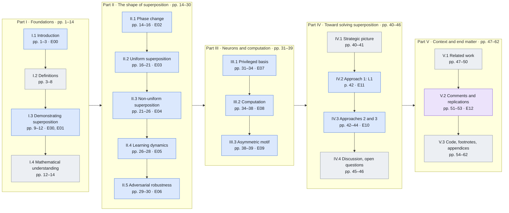

# A visitor's tour: reading the paper with this repository

This is a roadmap for reading *Toy Models of Superposition* (Elhage et al., 2022) side by side
with this repository, from the paper's first page to its last. Each stop names the pages to
read and the idea to take away. It then points to where the repository shows that idea (figure,
evidence, notebook, lab page, code), says what the replication found, and lists what to read
with care.

You need no prior knowledge of the repository. To follow the reading alone, you need linear
algebra (dot products, norms, rank) and basic deep learning (a loss, gradient descent, a ReLU).
The hands-on parts also need Python and PyTorch.

**How this page relates to the other documents.**

| Document | Use it for |
|---|---|
| This tour | The order to read things in, and what to look at in each place |
| [STUDY_GUIDE.md](STUDY_GUIDE.md) | Deep study: questions to answer from memory, exercises, extension projects |
| [PAPER_MAP.md](PAPER_MAP.md) | Lookup: paper section → code, experiment, notebook, lab page |
| [GLOSSARY.md](GLOSSARY.md) | Definitions in the paper's sense, with pages |
| [REPRODUCTION.md](REPRODUCTION.md) | Evidence: each claim, our figure, the status, the numbers, discrepancies, run IDs |
| [DECISIONS.md](DECISIONS.md) | Every choice the paper leaves open, with its rationale and alternatives |
| [REVIEW.md](REVIEW.md) | What an independent review found, how each finding was resolved, what is open |
| [SPEC.md](../SPEC.md) | The specification: integrity rules (§2) and the paper's conventions (§3) |

## Contents

1. [Before you start](#1-before-you-start)
2. [The roadmap at a glance](#2-the-roadmap-at-a-glance)
3. [The tour](#3-the-tour)
   - [Part I · Foundations (pp. 1–14)](#part-i--foundations-pp-114)
   - [Part II · The shape of superposition (pp. 14–30)](#part-ii--the-shape-of-superposition-pp-1430)
   - [Part III · Neurons and computation (pp. 31–39)](#part-iii--neurons-and-computation-pp-3139)
   - [Part IV · Toward solving superposition (pp. 40–46)](#part-iv--toward-solving-superposition-pp-4046)
   - [Part V · Context and end matter (pp. 47–62)](#part-v--context-and-end-matter-pp-4762)
4. [What the paper shows, and what this repository adds](#4-what-the-paper-shows-and-what-this-repository-adds)
5. [Side trip: auditing a result](#5-side-trip-auditing-a-result)
6. [After the tour](#6-after-the-tour)
7. [Quick reference](#7-quick-reference)

## 1. Before you start

### 1.1 Get the paper

- **Read the web article** (canonical): https://transformer-circuits.pub/2022/toy_model/index.html.
  It is also on arXiv: https://arxiv.org/abs/2209.10652.
- **Page numbers.** Every page number in this repository refers to a 62-page print of the web
  article: docs, docstrings, notebooks, the lab and this tour. That PDF is not in the
  repository, because it may not be redistributed. To get the same numbering, print the web
  article to PDF from a desktop browser (US Letter, default margins), as
  [references/README.md](../references/README.md) describes.
- **Reading the web article instead?** It has no page numbers, so navigate by section title.
  Every stop below names its sections as the paper titles them.
- **Footnotes.** In the print, the footnotes are collected on pp. 56–57, far from the text that
  cites them. [§7.3](#73-footnotes-to-read-with-each-stop) lists the ones worth reading with
  each stop.

### 1.2 Choose a route

| Route | For | What you use | Setup |
|---|---|---|---|
| **Reader** | Understanding the paper and what was reproduced | The paper, this tour, [REPRODUCTION.md](REPRODUCTION.md) and the published figures | None: everything renders on GitHub |
| **Hands-on** | Seeing it happen: training models, probing them, re-running experiments | The above, plus the notebooks and the lab | [§1.3](#13-set-up-hands-on-and-deep-study) |
| **Deep study** | Learning it well enough to extend it | The above, plus [STUDY_GUIDE.md](STUDY_GUIDE.md)'s questions, the notebooks' exercises and the extension projects | [§1.3](#13-set-up-hands-on-and-deep-study) |
| **Audit** (a side trip) | Checking that a result is what it claims to be | SPEC §2–3, DECISIONS, REVIEW, cited runs, re-runs | [§5](#5-side-trip-auditing-a-result) |

Every stop marks its items **Read**, **Hands-on** or **Study**. Follow the items of your route
and skip the rest; each route includes the items of the routes above it.

### 1.3 Set up (Hands-on and Deep study)

Install [uv](https://docs.astral.sh/uv/), then create the environment from the lock file. A
laptop CPU is enough for everything; `--device auto` uses CUDA or Apple MPS when available.

```bash
uv sync
```

- **The lab** opens in your browser with `uv run superposition app`.
- **The notebooks** are in `notebooks/`, one per part of the paper (00–11). The environment
  has a Jupyter kernel but no Jupyter front end. Open them in VS Code with the project's
  `.venv` interpreter, or start JupyterLab with `uv run --with jupyter jupyter lab`.
- **Runs.** Experiment outputs go to `results/`, which is not in git, so a fresh clone has none.
  Notebooks 00–03 and the lab's Playground need no runs.
  - Notebooks 04–11 reuse your latest quick run of their experiment, or start one.
  - The lab's results pages show the command that creates a missing run.
- **Run everything once, up front** (optional). The cited quick runs took between 68 s (E00)
  and 548 s (E11) each on a CPU, about 87 minutes for all thirteen (measured; see each run's
  wall-clock in REPRODUCTION.md):

```bash
for e in E00 E01 E02 E03 E04 E05 E06 E07 E08 E09 E10 E11 E12; do uv run superposition run "$e"; done
```

Then open `notebooks/00_orientation.ipynb`. It walks through the layout, a config, the data, a
model, a training run, a metric and the record a run leaves behind, before the paper starts.

### 1.4 Conventions to settle before page 1

Most confusion while reading the paper next to the code comes from these points.

1. **Sparsity and density.** The paper's sparsity S is the probability that a feature is zero.
   The code uses the density p = 1 − S (`feature_probability`). Figures plot 1 − S or
   1/(1 − S), as the paper does. *Sparser* means a smaller 1 − S, or a larger 1/(1 − S).
2. **Feature order.** Features are numbered from the most important (feature 0) to the least,
   in the paper and in every figure here. Importance usually decays geometrically, Iᵢ = rⁱ;
   SPEC §3 lists the r of each experiment.
3. **The bias sign.** This repository writes +b everywhere. The phase-change section writes
   ReLU(WᵀWx − b) (p. 14), so a negative bias here is a positive b there.
4. **Represented, and in superposition.** Feature i is *represented* when ‖Wᵢ‖ > 0.5. Whether
   it is in superposition is measured three ways:
   - the superposition score Σ_{j≠i}(Ŵᵢ·Wⱼ)² (p. 11);
   - the feature dimensionality Dᵢ (p. 18);
   - the formal test, WᵀW not invertible (p. 8). It is applied to represented features only,
     since the zero column of one unlearned feature would make any WᵀW singular.
5. **Losses at different sparsities are not comparable.** They measure different tasks
   (footnote 17). Compare losses only at the same sparsity.
6. **Best of several restarts.** Small models, and 2D ones especially, often stop in a worse
   solution (p. 23). Like the paper, the experiments train several restarts and keep the one
   with the lowest loss. 2D solutions are rotated or reflected to a common orientation before
   they are compared (p. 22; D-109).
7. **What a status means.** The paper states its results with figures and prose and gives no
   pass/fail thresholds. Each experiment here turns the paper's claims into graded criteria
   (SPEC §7, operationalized in DECISIONS.md), and every later change to a criterion is
   recorded there with its reason.
   - **PASS:** every graded criterion passes. **FAIL:** every one fails. **PARTIAL:** anything
     in between, including a criterion that passes only in a degenerate form the experiment
     defines up front (D-R05).
   - **INFO:** report only, with no pass/fail. E12 is an extension and has only INFO rows; the
     other experiments have INFO rows next to their graded ones.
   - Statuses come from each experiment's **cited run** (docs/cited_runs.yaml), a run made
     from a clean, committed tree. Every cited run uses the quick profile on a CPU. The full
     profiles were not run (D-R06).
8. **Four models.** Know which one a section uses:

   | Model | Hidden layer | Output | Paper | Experiments |
   |---|---|---|---|---|
   | Linear | h = Wx | x′ = WᵀWx + b | p. 10 | E00, E01 (the baseline) |
   | ReLU output | h = Wx | x′ = ReLU(WᵀWx + b) | p. 10 | E00–E06, E10, E11; E12 swaps the output ReLU |
   | ReLU hidden layer | h = ReLU(Wx), no hidden bias | x′ = ReLU(Wᵀh + b) | p. 31 | E07 |
   | Absolute value | h = ReLU(W₁x), W₁ and W₂ untied | y′ = ReLU(W₂h + b), target \|x\| | p. 35 | E08, E09 |

## 2. The roadmap at a glance

The paper falls into five parts, and the tour follows them in the paper's order. Blue stops
have an experiment of their own, gray stops are reading only, and the purple stop is an
extension.



**Jumping ahead.** The paper is best read in order, but if you skip around, take these
prerequisites with you:
- II.4 (learning dynamics) and II.5 (adversarial robustness) use D* and Dᵢ from II.2, and II.4
  uses the correlated feature sets of II.3.
- Part III needs the privileged basis of I.2.
- IV.2 and IV.3 reuse the toy models of I.3 and II.2.
- V.2's McGrath comment and E12 build on II.1, and II.1 builds on I.4.

| Stop | Paper section (as titled) | Pages | Experiment | Cited status | Notebook | Lab page |
|---|---|---|---|---|---|---|
| [I.1](#i1-introduction-and-key-results) | Introduction; Key Results from Our Toy Models | 1–3 | E00 (first look) | PASS 11/11 | 02 | Playground |
| [I.2](#i2-definitions-and-motivation) | Definitions and Motivation: Features, Directions, and Superposition | 3–8 | — | — | 01 | Playground (probe panel) |
| [I.3](#i3-demonstrating-superposition) | Demonstrating Superposition: Experiment Setup; Basic Results | 9–12 | E00, E01 | PASS 11/11; PASS 12/12 | 02 | Playground |
| [I.4](#i4-mathematical-understanding) | Mathematical Understanding | 12–14 | — (theory) | — | 03 | Playground (probe panel) |
| [II.1](#ii1-superposition-as-a-phase-change) | Superposition as a Phase Change | 14–16 | E02 | PASS 6/6 on the cited seed (open) | 04 | Phase diagrams |
| [II.2](#ii2-uniform-superposition) | The Geometry of Superposition: Uniform Superposition | 16–21 | E03 | PARTIAL 3/4 | 05 | Geometry |
| [II.3](#ii3-non-uniform-superposition) | Non-Uniform Superposition | 21–26 | E04 | PASS 9/9 | 05 | Non-uniform |
| [II.4](#ii4-learning-dynamics) | Superposition and Learning Dynamics | 26–28 | E05 | PASS 2/2 | 06 | Dynamics |
| [II.5](#ii5-adversarial-robustness) | Relationship to Adversarial Robustness | 29–30 | E06 | PARTIAL 2/4 | 07 | Adversarial |
| [III.1](#iii1-superposition-in-a-privileged-basis) | Superposition in a Privileged Basis | 31–34 | E07 | PASS 3/3 | 08 | Neurons; Playground |
| [III.2](#iii2-computation-in-superposition) | Computation in Superposition | 34–38 | E08 | PARTIAL 2/4 | 08 | Neurons |
| [III.3](#iii3-the-asymmetric-superposition-motif) | The Asymmetric Superposition Motif | 38–39 | E09 | PASS 3/3 | 09 | Neurons (E09 tab) |
| [IV.1](#iv1-the-strategic-picture) | The Strategic Picture of Superposition | 40–41 | — | — | — | — |
| [IV.2](#iv2-approach-1-models-without-superposition) | Approach 1: Creating Models Without Superposition | 42 | E11 | PARTIAL 7/8 | 10 | SAE lab (E11 tab) |
| [IV.3](#iv3-approaches-2-and-3-finding-an-overcomplete-basis) | Approach 2: Finding an Overcomplete Basis; Approach 3; Additional Considerations | 42–44 | E10 | PARTIAL 1/3 | 10 | SAE lab |
| [IV.4](#iv4-discussion-and-open-questions) | Discussion; Open Questions | 45–46 | — | — | 11 | — |
| [V.1](#v1-related-work) | Related Work | 47–50 | — | — | — | — |
| [V.2](#v2-comments-and-replications) | Comments & Replications | 51–53 | E12 (and E02) | INFO | 04, 11 | Phase diagrams (E12 tab) |
| [V.3](#v3-end-matter) | Code; Citation Information; Footnotes; References; appendices | 54–62 | — | — | — | — |

**The paper's key results (pp. 2–3), and where the tour tests them.**

| Key result (paraphrased) | Stops | Experiments and cited status |
|---|---|---|
| Superposition is a real, observed phenomenon | I.3 | E00 PASS, E01 PASS |
| Monosemantic and polysemantic neurons can both form | III.1, III.2 | E07 PASS; E08 PARTIAL (the neuron picture reproduces) |
| Some computation can be done in superposition | III.2, III.3 | E08 PARTIAL (not reproduced at scale); E09 PASS (the small motif) |
| A phase change governs whether features are stored in superposition | II.1 | E02 PASS on the cited seed; open across seeds |
| Superposition organizes features into geometric structures | II.2, II.3 | E03 PARTIAL; E04 PASS |

## 3. The tour

Every stop has the same parts: **Paper** (what to read), **The idea**, **In the repository**
(marked Read, Hands-on or Study), **What the replication found**, **Read with care**, and a
**checkpoint**. The study guide's numbered stops follow the notebooks; each stop here names the
one that goes deeper.

### Part I · Foundations (pp. 1–14)

#### I.1 Introduction and key results

**Paper.** "Introduction" and "Key Results from Our Toy Models", pp. 1–3. Footnote 1
(importance).

**The idea.** Neurons in real networks often respond to several unrelated things
(polysemanticity). The paper's explanation is superposition: a network can represent more
features than it has dimensions, by giving them almost-orthogonal directions and tolerating
some interference. Superposition pays when features are sparse. The paper studies it in models
small enough that the true features are known. The p. 2 figure is the story in miniature: five
features squeezed into two dimensions are kept, paired or packed into a pentagon, depending on
how sparse they are.

**In the repository.**
- *Read:* the E00 entry of the README's results gallery, then
  [REPRODUCTION.md, E00](REPRODUCTION.md#e00-intro_pentagon-p-2).
- *Hands-on:* the lab's Playground. Step through the four "p. 2 · …" presets and watch the
  geometry change.

**What the replication found.** E00 is **PASS 11/11**. The ReLU output model gives two features
orthogonal dimensions at S = 0, forms two antipodal pairs at S = 0.8 and a pentagon at S = 0.9.
The linear model keeps the top two features at every S.

**Read with care.**
- Treat the figure as a first look. The setup that produces it comes on pp. 9–10 (I.3).
- The paper does not state the importance curve for this figure. Iᵢ = 0.9ⁱ reproduces it
  (SPEC §3).
- The paper points to its authors' Colab notebook. This repository was written from the paper
  without it (SPEC §2; see V.3).
- The key results on pp. 2–3 are the claims the whole tour checks; the table in §2 maps each
  one to its stops.

**Checkpoint.** Say in one sentence what changes across the p. 2 figure, and what drives it.

#### I.2 Definitions and motivation

**Paper.** "Definitions and Motivation: Features, Directions, and Superposition", pp. 3–8:
Empirical Phenomena (p. 4), What are Features? (pp. 4–5), Features as Directions (pp. 5–6),
Privileged vs Non-privileged Bases (pp. 6–7), The Superposition Hypothesis (pp. 7–8), and
Summary: A Hierarchy of Feature Properties (p. 8). Footnotes 2–4.

**The idea.** This is the paper's vocabulary.
- *Features are directions* (a linear representation): an input with several active features
  is represented by the sum of their directions, each scaled by its activation.
- *A basis is privileged* when something in the architecture, usually an elementwise
  nonlinearity, makes its directions special. Only then is "neuron" a meaningful unit.
- *Superposition* represents more features than dimensions, as almost-orthogonal directions.
  The price is interference between features, which is small when features are rarely active
  together.
- The formal definition (p. 8): a linear representation is in superposition when WᵀW is not
  invertible.

**In the repository.**
- *Read:* [GLOSSARY.md](GLOSSARY.md): feature, linear representation, privileged basis,
  superposition, polysemanticity, interference.
- *Hands-on:* notebook 01: features as directions, privileged and non-privileged bases,
  interference and how a ReLU and a negative bias filter it, almost-orthogonal vectors, and the
  hierarchy of p. 8.
- *Study:* [STUDY_GUIDE.md, stop 1](STUDY_GUIDE.md#stop-1--features-directions-and-superposition-pp-18),
  including its probe-panel exercise in the Playground. Code: `metrics.is_superposition`.

**What the replication found.** Nothing is graded here: the section defines terms. The
experiments start at I.3.

**Read with care.**
- The paper weighs three definitions of "feature" and writes with the last one in mind:
  properties a large enough model would give a neuron of its own. In the toy models each input
  coordinate *is* a feature, which is what makes them a ground truth.
- The formal test is applied here to represented features only (§1.4, point 4).
- The hidden space of the linear and ReLU output models is *not* privileged: any rotation of it
  gives the same model (p. 31). Neurons appear only in Part III.

**Checkpoint.** Explain why superposition needs both sparse features and a nonlinearity to pay
off.

#### I.3 Demonstrating superposition

**Paper.** "Demonstrating Superposition" (its heading is at the foot of p. 8): Experiment
Setup (pp. 9–10) and Basic Results (pp. 10–12). Footnotes 5–9.

**The idea.** This is the experiment the whole paper builds on.
- *Data:* n features, each 0 with probability S and otherwise uniform on [0, 1], with
  importances Iᵢ.
- *Models:* project to m < n dimensions with h = Wx, and read back with Wᵀ. The linear model
  outputs x′ = WᵀWx + b, the ReLU output model x′ = ReLU(WᵀWx + b).
- *Loss:* the importance-weighted squared error Σᵢ Iᵢ(xᵢ − x′ᵢ)².
- *Result:* the linear model learns the m most important features at every sparsity, like
  principal components. The ReLU output model does the same on dense data, but as features get
  sparser it represents more features than it has dimensions. The least important represented
  features go into superposition first, starting with antipodal pairs.

**In the repository.**
- *Read:* [REPRODUCTION.md, E00](REPRODUCTION.md#e00-intro_pentagon-p-2) (now with its
  setup understood) and [E01](REPRODUCTION.md#e01-basic_results-pp-1012), with the figures
  [`weights_n20_m5.png`](figures/basic_results/weights_n20_m5.png) and [`weights_n80_m20.png`](figures/basic_results/weights_n80_m20.png).
- *Hands-on:* notebook 02 (runs E00 and trains E01's n = 20 model). In the Playground, use the
  preset "p. 11 · n = 20, m = 5, 1 − S = 0.01". Then switch the model to Linear and compare its
  loss with the closed-form optimum in the metrics row.
- *Study:* [STUDY_GUIDE.md, stop 2](STUDY_GUIDE.md#stop-2--demonstrating-superposition-pp-812).
  Code: `data.IndependentSparse`, `models.TiedModel`, `train`, and `metrics` (feature norms,
  the superposition score).

**What the replication found.** E00 is **PASS 11/11** and E01 **PASS 12/12**.
- The linear model keeps exactly the top m features at every sparsity.
- The ReLU model's represented count rises as features get sparser: from 5 to 14 of 20
  features, and from 20 to 67 of 80.
- Superposition first appears at 1 − S = 0.3, among the least important represented features.
  Antipodal pairs appear at every intermediate sparsity.

**Read with care.**
- Read each column of the p. 11 figure as two panels: WᵀW as a heatmap with the bias vector
  beside it, and the bars of ‖Wᵢ‖ colored by the superposition score. The repository's figures
  use the same layout.
- The loss is summed over features and averaged over the batch (SPEC §3).
- Importance decays as 0.7ⁱ for n = 20 (p. 11) and 0.9ⁱ for n = 80 (p. 12).
- A feature the model does not represent gets a bias equal to its mean, (1 − S)/2 (p. 10): the
  model predicts what it cannot represent by its average. E00 checks this.
- At the sparsest settings the represented count can move by about ±2 with the choice of
  restart, because restarts are compared on sampled losses (REVIEW.md, R1-06).

**Checkpoint.** Before training a model in the Playground, predict which features the ReLU
model will drop at a given sparsity, and why.

#### I.4 Mathematical understanding

**Paper.** "Mathematical Understanding", pp. 12–14. Footnotes 10–12.

**The idea.** Two forces compete.
- *Feature benefit:* representing a feature lowers its error.
- *Interference:* features that are not orthogonal leak into each other's outputs.

In the linear model, representing extra features never pays (footnote 12). With a ReLU, split
the loss by the number of active features. When features are sparse, the terms for zero and
one active feature dominate. With one feature active, negative interference is clipped to zero
for free, and a negative bias can turn small positive interference negative. That is why sparse
features can afford superposition. The section ends with a "toy model of the toy model", the
exact loss of a few weight configurations, which II.1 uses.

**In the repository.**
- *Hands-on:* notebook 03 (exact computations only, under a minute). In the Playground's probe
  panel, activate one feature of a pentagon and read the other outputs before and after the
  bias: that is the one-active-feature interference term.
- *Study:* [STUDY_GUIDE.md, stop 3](STUDY_GUIDE.md#stop-3--the-math-pp-1214). Code:
  `src/superposition/theory.py` (`linear_loss_decomposition`, `one_sparse_decomposition`,
  `linear_optimum_loss`, `relu_output_expected_loss`).

**What the replication found.** This section has no experiment of its own. The theory is
unit-tested and used in two places:
- E00 grades the linear models against the closed-form optimum Σ_{i≥m} Iᵢ(p/3 − p²/4); their
  exact expected losses are within 0.01% of it.
- E02 builds its theoretical phase diagrams from the exact losses.

**Read with care.**
- The linear model's equation (pp. 12–13) adapts Saxe et al.'s analysis of linear networks,
  which keeps Gaussian inputs (footnote 10). The repository computes expected losses exactly,
  for the paper's sparse uniform data (D-301).
- Mind the −b sign on p. 14 (§1.4, point 3).

**Checkpoint.** Explain why negative interference is free when one feature is active, and what
a negative bias costs.

### Part II · The shape of superposition (pp. 14–30)

#### II.1 Superposition as a phase change

**Paper.** "Superposition as a Phase Change", pp. 14–16. Footnote 13. Then read McGrath's
comment, pp. 51–53 (V.2), and come back.

**The idea.** Store n features in m = n − 1 dimensions. Vary one extra feature's importance
and every feature's sparsity. The extra feature ends in one of three states: not learned,
stored in superposition (an antipodal pair), or given a dedicated dimension. The boundaries
between the states are sharp. The toy model of the toy model computes the exact loss of each
candidate weight configuration. Where two configurations' loss curves cross, the optimum jumps:
a first-order phase change. (Footnote 13 uses "phase change" in the general sense of a
discontinuous change.) The paper shows empirical and theoretical diagrams for n = 2, m = 1
(p. 15) and n = 3, m = 2 (p. 16).

**In the repository.**
- *Read:* [REPRODUCTION.md, E02](REPRODUCTION.md#e02-phase_change-pp-1416), with
  [`phase_n2_m1.png`](figures/phase_change/phase_n2_m1.png), [`phase_n3_m2.png`](figures/phase_change/phase_n3_m2.png) and [`family_losses_n2_m1.png`](figures/phase_change/family_losses_n2_m1.png).
- *Hands-on:* notebook 04 (runs E02, or reuses your latest quick run). In the lab's **Phase
  diagrams** page, pick a cell with the sliders and compare its trained models with the
  winning family's optimum. Then show the theory with every bias fixed at 0.
- *Study:* [STUDY_GUIDE.md, stop 4](STUDY_GUIDE.md#stop-4--superposition-as-a-phase-change-pp-1416-5153).
  Code: `theory` (the weight families W ⊥ v, `optimize_family`, `theoretical_phase_diagram`)
  and `plotting.phase`.

**What the replication found.** E02 is **PASS 6/6 on the cited seed**.
- All three regions appear in both diagrams.
- The vote of the trained models matches the theory in 126 of 144 cells for n = 2 and 118 of
  144 for n = 3 (0.819, against a bar of 0.80).
- On two held-out seeds the n = 3 agreement is 0.764 and 0.792, so it does not hold across
  seeds. Whether E02 should become PARTIAL is an open decision for the owner (REVIEW.md, R1-01).

**Read with care.**
- *How a cell is labeled.* The paper discards each cell's highest-loss model and colors the
  cell by averaging the other nine. The repository grades their majority vote (D-304), and the
  first panel of each figure shows the averaged view.
- *Stuck models.* Most disagreements are trained models stuck in a worse minimum. In one
  dimension, two weights that start with the same sign reach the antipodal pair only about
  half the time; opposite-sign starts almost always do. In every n = 2 cell, the lowest-loss
  model has the theory's label (INFO row).
- *What "theory" means here.* It is the exact loss of each of the paper's restricted families,
  such as an antipodal pair of equal length (D-301, D-302). It is not a global optimum: for
  n = 2, the best trained model beats the cheapest family by more than 1% in 24 of 144 cells,
  without changing any label.
- *McGrath's confused feature* (W₁ ≈ W₂) wins only when every bias is fixed at 0. With free
  biases it wins nowhere (notebook 04, section 4).

**Checkpoint.** Explain how the crossing of two families' loss curves makes the optimum change
discontinuously.

#### II.2 Uniform superposition

**Paper.** "The Geometry of Superposition" (p. 16) and its first part, "Uniform
Superposition" (pp. 17–21): Feature Dimensionality (p. 18), Why These Geometric Structures?
(pp. 19–20) and Aside: Polytopes and Low-Rank Matrices (pp. 20–21). Footnote 14.

**The idea.** Give every feature the same importance and sparsity (n = 400, m = 30) and
measure how many dimensions the features get.
- *Dimensions per feature,* D* = m/‖W‖²_F, is "sticky" at 1 and at 1/2 as sparsity grows
  (p. 17).
- *Per-feature dimensionality,* Dᵢ = ‖Wᵢ‖²/Σⱼ(Ŵᵢ·Wⱼ)², clusters at the fractions of uniform
  polytopes (p. 19): 3/4 (tetrahedron), 2/3 (triangle), 1/2 (antipodal pair, or digon),
  2/5 (pentagon) and 3/8 (square antiprism).
- *Tegum products:* the polytopes sit in mutually orthogonal subspaces, so features in
  different polytopes do not interfere (p. 20).
- *The aside* ties polytopes to low-rank WᵀW: a solution can be named by the direction it does
  not represent (pp. 20–21).

**In the repository.**
- *Read:* [REPRODUCTION.md, E03](REPRODUCTION.md#e03-uniform_geometry-pp-1621), with
  [`dstar.png`](figures/uniform_geometry/dstar.png), [`dimensionality.png`](figures/uniform_geometry/dimensionality.png) and [`geometry_graphs.png`](figures/uniform_geometry/geometry_graphs.png).
- *Hands-on:* notebook 05, sections 1–2 (dimensionality by hand, then E03). In the lab's
  **Geometry** page, drag the sparsity slider across the 1/2 plateau and watch the geometry
  graph break into digons.
- *Study:* [STUDY_GUIDE.md, stop 5](STUDY_GUIDE.md#stop-5--the-geometry-of-superposition-pp-1625).
  Code: `metrics.feature_dimensionality`, `metrics.geometry_graph`,
  `metrics.component_geometry`, `metrics.geometry_census`.

**What the replication found.** E03 is **PARTIAL 3/4**.
- D* behaves as on p. 17. It is about 1 at low sparsity, and within 0.03 of 1/2 from
  1/(1 − S) = 2.34 to 3.79. It is 0.26 at 7.85 (the paper: about 0.25 at 8).
- Σᵢ Dᵢ stays close to m = 30 throughout, as p. 18 says it should.
- The cluster criterion fails. A feature counts toward a fraction only when it also sits in
  that fraction's polytope (D-603), and on that rule only the digons (1/2) form a cluster.

**Read with care.**
- Dᵢ alone cannot name a polytope. 2/5 and 3/8 are only 0.025 apart, so under the earlier rule
  one band of values near 0.39 counted as two clusters (REVIEW.md, R2-01).
- Pentagons and square antiprisms do appear once overlaps below 0.2 are ignored (notebook 05,
  section 2). So the paper's tegum factors are nearly, not exactly, orthogonal. Whether the
  criterion should read factors at 0.2 instead of 0.05 is open for the owner, since choosing
  after seeing the result would be tuning.
- The cited run has no tetrahedra.
- A tegum factor is a connected component of the geometry graph, whose edges are the overlaps
  |Wᵢ·Wⱼ| above a threshold (D-110, D-308).

**Checkpoint.** Explain why D* is sticky at 1/2, and why every vertex of a uniform polytope has
Dᵢ = (dimensions)/(features).

#### II.3 Non-uniform superposition

**Paper.** "Non-Uniform Superposition", pp. 21–26: Perturbing a Single Feature (p. 22), Setup
for Exploring Correlated and Anticorrelated Features (p. 23), Organization of Correlated and
Anticorrelated Features (p. 24), Local Almost-Orthogonal Bases (pp. 24–25) and Collapsing of
Correlated Features (pp. 25–26).

**The idea.** Real features differ in importance and sparsity, and some occur together. The
paper finds that non-uniform superposition looks like uniform polytopes, deformed, with jumps
between them.
- *One feature perturbed:* making one feature of a pentagon sparser lets its neighbours close
  in, until the pentagon snaps to two digons where the two loss curves cross (p. 22).
- *Correlated and anticorrelated features:* correlated features prefer to be orthogonal, or
  side by side when they cannot be. Anticorrelated features prefer to be antipodal (pp. 23–24).
- *Local bases:* each correlated set forms its own almost-orthogonal basis (pp. 24–25).
- *Collapse:* as density rises, correlated pairs collapse onto their principal components, so
  PCA and superposition trade off (pp. 25–26).

**In the repository.**
- *Read:* [REPRODUCTION.md, E04](REPRODUCTION.md#e04-nonuniform_geometry-pp-2126) and its
  five figures in `docs/figures/nonuniform_geometry/`.
- *Hands-on:* notebook 05, section 3. In the lab's **Non-uniform** page, move feature 0's
  density to find where the pentagon snaps, then step through the collapse of correlated pairs.
- *Study:* [STUDY_GUIDE.md, stop 5](STUDY_GUIDE.md#stop-5--the-geometry-of-superposition-pp-1625)
  (its second half). Code: `data.CorrelatedSets`, `data.AnticorrelatedSets`,
  `metrics.canonicalize_2d`.

**What the replication found.** E04 is **PASS 9/9**.
- The angle between feature 0 and its neighbours grows with its density.
- The pentagon snaps to two digons between 0.251× and 0.316× the other features' density, where
  the two geometries' loss curves cross.
- Correlated pairs are orthogonal and anticorrelated pairs exactly antipodal; correlated sets
  form local bases; correlated pairs collapse one by one as density rises.

**Read with care.**
- The p. 22 caption puts the snap at about 2.5× less dense. The paper's own loss figure puts it
  near 0.27×, which is where it happens here (REVIEW.md, R2-04).
- The paper gives no densities for its correlated and anticorrelated experiments; the
  repository's are in D-307.
- Only 5 of 16 restarts find the antipodal arrangement of the anticorrelated pairs; the others
  keep each pair orthogonal. Keeping the best restart matters here (p. 23).
- The collapse happens at somewhat different densities than the paper's (REPRODUCTION.md, E04
  notes).

**Checkpoint.** Explain why correlated features prefer to be orthogonal and anticorrelated ones
antipodal.

#### II.4 Learning dynamics

**Paper.** "Superposition and Learning Dynamics", pp. 26–28. Look at p. 17 (the D* plateau)
and p. 18 (Dᵢ) again first.

**The idea.** Track Dᵢ during training.
- In the uniform setup, training is dominated by discrete *energy-level jumps*: a feature's Dᵢ
  hops from one value to another, and the loss drops at the same moment. The paper suggests
  that smooth loss curves in larger models may be made of many such small jumps (pp. 26–27).
- In a 3D model with two correlated sets of three features, learning passes through a sequence
  of geometric stages and ends in an octahedron (pp. 27–28).

**In the repository.**
- *Read:* [REPRODUCTION.md, E05](REPRODUCTION.md#e05-learning_dynamics-pp-2628), with
  [`energy_levels.png`](figures/learning_dynamics/energy_levels.png), [`trajectories.png`](figures/learning_dynamics/trajectories.png) and
  [`stage_raster.png`](figures/learning_dynamics/stage_raster.png).
- *Hands-on:* notebook 06. In the lab's **Dynamics** page, drag the step slider across a jump,
  and scrub the 3D trajectories.
- *Study:* [STUDY_GUIDE.md, stop 6](STUDY_GUIDE.md#stop-6--learning-dynamics-pp-2628). Code:
  `train` (snapshots), `experiments.learning_dynamics` (the jump detector and the geometric
  stages).

**What the replication found.** E05 is **PASS 2/2**.
- Every restart sits on a long plateau with one dimension badly used. Then two features jump
  to Dᵢ ≈ 1/2 and the loss drops.
- All 48 of the 3D runs end as the octahedron, with antipodal pairs that join features from
  different sets.

**Read with care.**
- The paper's stage B shows the two sets pushed apart along one axis. Here the sets usually
  take orthogonal directions instead. This is reported as a documented variant, not a
  discrepancy (D-R02).
- Part (b) starts from 0.1 × the Xavier initialization, following p. 27, which starts the
  weights near zero (D-403).
- The jump's loss drop is about 0.2% of the loss here, against about 0.8% on p. 26. The paper
  gives neither the density nor n of its run.

**Checkpoint.** Explain how a model can sit on a plateau for tens of thousands of steps and then
improve suddenly.

#### II.5 Adversarial robustness

**Paper.** "Relationship to Adversarial Robustness", pp. 29–30.

**The idea.** In superposition, a feature's output also reads the other features, through the
off-diagonal entries of WᵀW. A small perturbation of the input along that row of WᵀW therefore
raises the output a lot. The paper builds such attacks analytically. It finds that
vulnerability rises sharply as superposition forms, and that it tracks the number of features
per dimension, 1/D* (pp. 29–30).

**In the repository.**
- *Read:* [REPRODUCTION.md, E06](REPRODUCTION.md#e06-adversarial-pp-2930) and its two
  figures in `docs/figures/adversarial/`.
- *Hands-on:* notebook 07 (computes an attack by hand, then runs E06), and the lab's
  **Adversarial** page.
- *Study:* [STUDY_GUIDE.md, stop 7](STUDY_GUIDE.md#stop-7--superposition-and-adversarial-examples-pp-2830).
  Code: `adversarial.py`.

**What the replication found.** E06 is **PARTIAL 2/4**.
- In the paper's uniform setting (n = 400, m = 30), both criteria pass. Vulnerability rises
  8.5× and tracks 1/D*.
- In a second setting from the specification (n = 20, m = 5, Iᵢ = 0.7ⁱ), both fail. It rises
  only 1.5× and stops tracking 1/D*.
- The paper shows only the uniform setting, so this limits the claim rather than contradicting
  its figure.

**Read with care.**
- The size of the rise depends on taking the worst of the n attacks for each input (D-405). One
  attack per model gives a smaller rise (about 3.7×, by the reviewer's measurement; not in the
  run's record).
- The attack budget, 0.1 of the average input norm, shrinks as features get sparser. At extreme
  sparsity it can no longer push outputs past their negative biases, and vulnerability falls
  (an extended range, not graded).
- A rank correlation between two curves that both rise with sparsity is weak evidence that one
  tracks the other (REVIEW.md, R3-12).

**Checkpoint.** Write the attack for feature i, and explain why vulnerability should grow with
features per dimension.

### Part III · Neurons and computation (pp. 31–39)

#### III.1 Superposition in a privileged basis

**Paper.** "Superposition in a Privileged Basis", pp. 31–34.

**The idea.** Put a ReLU on the hidden layer: h = ReLU(Wx), x′ = ReLU(Wᵀh + b). Now the neuron
basis is privileged, and you can ask which features each neuron carries.
- A *stack plot* draws each neuron's weights as stacked blocks, one color per feature (p. 32).
- As sparsity rises, neurons go from monosemantic to polysemantic through a series of named
  regimes (p. 33), and both kinds can coexist in one model.
- Given a hidden bias, the model sidesteps its ReLU by keeping every neuron in its linear range
  (p. 34). That is why this model has no hidden bias.

**In the repository.**
- *Read:* [REPRODUCTION.md, E07](REPRODUCTION.md#e07-privileged_basis-pp-3134), with
  [`neurons.png`](figures/privileged_basis/neurons.png) and [`neuron_counts.png`](figures/privileged_basis/neuron_counts.png).
- *Hands-on:* notebook 08, section 1. The lab's **Neurons** page (E07 tab), and the Playground
  preset "p. 32 · ReLU hidden layer, n = 10, m = 5, 1 − S = 0.1".
- *Study:* [STUDY_GUIDE.md, stop 8](STUDY_GUIDE.md#stop-8--neurons-and-computation-in-superposition-pp-3139).
  Code: `models.TiedModel(hidden_act="relu")`, `metrics.neuron_polysemanticity`,
  `plotting.neurons`.

**What the replication found.** E07 is **PASS 3/3**.
- When features are dense, five monosemantic neurons each carry one of the most important
  features.
- The number of polysemantic neurons never falls as sparsity rises, and all five are
  polysemantic at the sparsest setting.
- The regimes match p. 33 at four of the six settings it names.
- Given a hidden bias, the best models set every bias positive and their ReLUs barely clip
  (INFO).

**Read with care.**
- The repository keeps the best of 100 restarts per setting; the paper keeps the best of 1,000
  (p. 32). The two settings that differ (1 − S = 0.12 and 0.03) are narrow regimes that few
  restarts reach.
- A neuron counts as carrying a feature when |W[h, i]| is at least 25% of its largest weight
  (D-407). The paper reads this off its plots.

**Checkpoint.** Say what a stack plot shows that WᵀW cannot, and why the model sidesteps its
ReLU when it has a bias.

#### III.2 Computation in superposition

**Paper.** "Computation in Superposition", pp. 34–38. Footnotes 15–17.

**The idea.** So far the models only store features. Now they compute y = |x| with ReLU
neurons, using |x| = ReLU(x) + ReLU(−x). Without superposition that takes two neurons per
feature. The model has separate input and output weights, W₁ and W₂, and nonzero inputs are
uniform on [−1, 1].
- With n = 3 and m = 6, each feature gets one positive-side and one negative-side neuron
  (p. 36).
- With n = 100 and m = 40, neurons are monosemantic when features are dense. When features are
  sparse the model uses superposition, its neurons become polysemantic, and the paper says it
  still usefully approximates |x| for more features than it has neurons (pp. 37–38).

**In the repository.**
- *Read:* [REPRODUCTION.md, E08](REPRODUCTION.md#e08-abs_computation-pp-3439), with
  [`abs_n3_m6.png`](figures/abs_computation/abs_n3_m6.png), [`abs_stack_plots.png`](figures/abs_computation/abs_stack_plots.png) and [`abs_capacity.png`](figures/abs_computation/abs_capacity.png).
- *Hands-on:* notebook 08, sections 2–3, and the lab's **Neurons** page (E08 tab).
- *Study:* [STUDY_GUIDE.md, stop 8](STUDY_GUIDE.md#stop-8--neurons-and-computation-in-superposition-pp-3139).
  Code: `models.AbsModel`, `metrics.normalize_hidden_units`, `metrics.per_feature_loss`.

**What the replication found.** E08 is **PARTIAL 2/4**.
- The n = 3 model reproduces exactly.
- The trend of the neuron picture reproduces: monosemantic neurons when dense, polysemantic
  ones when sparse, and neurons with a primary feature plus smaller secondary ones in between.
  The strict dense criterion misses by one neuron.
- Computation in superposition does not reproduce. At no sparsity does the model usefully
  compute more features than it has neurons. The sparse models stay far from even a solution
  without superposition, which points to an optimization gap rather than to a limit of what
  superposition can compute.

**Read with care.**
- *Footnote 15:* a neuron can be rescaled (its row of W₁ by α, its column of W₂ by 1/α)
  without changing the model, so weights are normalized before they are drawn or compared.
- *Footnote 16:* n = 100, m = 40 was chosen to keep the figure readable, and the model learns
  more easily with more neurons.
- *Footnote 17* is cited here: computation cannot be read off losses at different sparsities.
  Within one sparsity losses are comparable, and E08 compares them there.
- The paper does not quantify "usefully approximates". The graded criterion (more than m
  features with a per-feature loss below 75% of predicting the mean) was re-derived from p. 37
  by the owner's decision (D-R01).
- One contributing factor: sides of |x| whose output starts negative never receive gradient
  ("dead sides", D-409). To diagnose it, the reference implementations were consulted, without
  copying code (D-R01), the only such consultation so far. A smaller initialization scale, as
  in ARENA's, helps at 1 − S = 0.01 but not at 0.001. Neither explains the whole gap.

**Checkpoint.** Explain why |x| needs two neurons per feature without superposition, and why
E08's sparse result is described as an optimization gap.

#### III.3 The asymmetric superposition motif

**Paper.** "The Asymmetric Superposition Motif", pp. 38–39, and its figure on p. 39.

**The idea.** The paper reverse-engineers a small |x| model that does a little superposition.
Most of its neurons are plain side neurons. The rest form two instances of a motif:
- one neuron stores two features with unequal input weights and reciprocal output weights
  (*asymmetric superposition*), so the heavy feature interferes with the other one, the
  victim, but not the reverse;
- a second neuron reads a little of the heavy feature and strongly inhibits the victim,
  cancelling that interference.

**In the repository.**
- *Read:* [REPRODUCTION.md, E09](REPRODUCTION.md#e09-mech_interp_abs-pp-3839), with
  [`motif_model.png`](figures/mech_interp_abs/motif_model.png), [`ablations.png`](figures/mech_interp_abs/ablations.png), [`rebuild.png`](figures/mech_interp_abs/rebuild.png) and
  [`role_census.png`](figures/mech_interp_abs/role_census.png).
- *Hands-on:* notebook 09 builds the motif by hand, then analyzes E09's trained models; its
  section 4 has you analyze one yourself. The lab's **Neurons** page (E09 tab) has role tables,
  ablation matrices and the rebuild test.
- *Study:* [STUDY_GUIDE.md, stop 9](STUDY_GUIDE.md#stop-9--mechanistic-interpretability-of-a-toy-model-pp-3839).
  Code: `interp` (path gains, neuron roles, the motif detector, ablations, the rebuild).

**What the replication found.** E09 is **PASS 3/3**.
- In every graded model, every live neuron gets a role with nothing left unexplained.
- Zero and mean ablations raise the losses that each role predicts.
- The motif, with its neurons carrying the motif's roles, appears in 8–12 of 20 restarts in each
  graded setting.
- A model rebuilt by hand from the roles recovers 90–97% of the trained model's loss
  reduction. The best n = 6, m = 10 model matches the p. 39 figure feature for feature.

**Read with care.**
- *One sub-claim differs.* The paper says the inhibitor turns positive interference into
  negative interference. Here it cancels it to about zero (D-R03).
- *The regime was chosen.* The paper gives no density or importance for its model, so a pilot
  picked m = 2n − 2, 1 − S = 0.3 and 0.2, and Iᵢ = 1 (D-502). At 1 − S = 0.1 the naming breaks
  down for two of the three model sizes.
- *Naming alone is weak evidence.* The role rules also name about half the neurons of an
  untrained model. The ablations and the rebuild are what test the explanation (D-604).
- The path gain |W₁[h, i]|·W₂[j, h] is unchanged by footnote 15's rescaling, which is why roles
  are read from it.

**Checkpoint.** Draw the motif's two neurons, and say which losses each ablation should raise.

### Part IV · Toward solving superposition (pp. 40–46)

#### IV.1 The strategic picture

**Paper.** "The Strategic Picture of Superposition" and "Safety, Interpretability, & 'Solving
Superposition'", pp. 40–41, including the paragraph on decomposing activation space (p. 41).
Footnotes 18–19.

**The idea.** Why superposition matters beyond toy models. Safety arguments from
interpretability would like to enumerate a model's features, and superposition stands in the
way of decomposing its activations into independent parts. In the paper's sense, solving
superposition means being able to enumerate the features (p. 41). Three approaches follow.

**In the repository.** This section is an argument, not an experiment.
- *Read:* GLOSSARY.md: sparse autoencoder, dictionary learning.
- *Study:* [STUDY_GUIDE.md, stop 10](STUDY_GUIDE.md#stop-10--solving-superposition-saes-and-l1-pp-4044),
  question 3.

**Read with care.** The repository tests the two approaches that can be run on toy models
(IV.2 and IV.3); the third is not implemented.

**Checkpoint.** State what "solving superposition" means in the paper's sense.

#### IV.2 Approach 1: models without superposition

**Paper.** "Approach 1: Creating Models Without Superposition", p. 42. Footnote 21, which is
cited in Approach 3 (p. 43).

**The idea.** Add an L1 penalty on the hidden activations, λ‖h‖₁, to the loss. Superposition
disappears at a cost in loss, by killing the features below an importance threshold,
especially those that are not aligned with the basis. The paper states this in prose and shows
no experiment.

**In the repository.**
- *Read:* [REPRODUCTION.md, E11](REPRODUCTION.md#e11-l1_removes_superposition-p-42), with
  [`l1_sweep.png`](figures/l1_removes_superposition/l1_sweep.png), [`l1_tradeoff.png`](figures/l1_removes_superposition/l1_tradeoff.png) and
  [`pentagon_arrows.png`](figures/l1_removes_superposition/pentagon_arrows.png).
- *Hands-on:* notebook 10, section 3. The lab's **SAE lab** page (E11 tab) has a λ slider.
- *Study:* [STUDY_GUIDE.md, stop 10](STUDY_GUIDE.md#stop-10--solving-superposition-saes-and-l1-pp-4044).
  Code: the `l1_hidden` option of the trainer (`train.py`).

**What the replication found.** E11 is **PARTIAL 7/8**.
- *n = 20, m = 5:* as λ grows, the least important superposed features die first. At λ = 0.2
  four orthogonal features remain, with no superposition, at 8.4× the loss. A held-out seed
  confirms this.
- *The pentagon:* superposition goes only with the features. The model is free of
  superposition only when a single feature is left, which is graded PARTIAL (D-R05).
- *The mechanism holds:* features die from the least important up, and antipodal pairs along
  the hidden axes, which are basis aligned, survive longest.

**Read with care.**
- The loss reported is the reconstruction loss without the penalty, which is comparable across
  λ because the task is the same.
- Footnote 21 expects a little L1 to cost almost nothing. E11's λ grid does not test that
  (REVIEW.md, R4-08).
- The pentagon's λ window rests on the cited seed alone; the held-out seed does not confirm it.

**Checkpoint.** Explain why L1 removes superposition mostly by killing features, and why it does
not penalize an antipodal pair along a hidden axis.

#### IV.3 Approaches 2 and 3: finding an overcomplete basis

**Paper.** "Approach 2: Finding an Overcomplete Basis" (pp. 42–43), "Approach 3: Hybrid
Approaches" (p. 43) and "Additional Considerations" (p. 44). Footnote 20.

**The idea.** Leave the model as it is, and find afterwards an overcomplete set of feature
directions in its activations. This is a sparse coding, or dictionary learning, problem
(footnote 20: factor the activations as a sparse code times a dictionary). Toy models are where
the result can be checked, because their features are known. Approach 3 combines the two:
train models with less superposition, so they are easier to decode. "Additional
Considerations" discusses, among other things, why phase changes give hope that superposition
can be removed.

**In the repository.** E10 trains sparse autoencoders (SAEs), the modern form of this sparse
coding, on the activations of frozen toy models with E00's, E01's and E03's settings, and
scores their decoders against the true Wᵢ.
- *Read:* [REPRODUCTION.md, E10](REPRODUCTION.md#e10-sae_recovery-pp-4244), with the three
  figures in `docs/figures/sae_recovery/`.
- *Hands-on:* notebook 10, sections 1–2. In the lab's **SAE lab** page, train a 5-latent and
  then a 20-latent SAE on the pentagon live and compare their decoders with the true features.
- *Study:* [STUDY_GUIDE.md, stop 10](STUDY_GUIDE.md#stop-10--solving-superposition-saes-and-l1-pp-4044).
  Code: `sae.py`. Approach 3 is not implemented.

**What the replication found.** E10 is **PARTIAL 1/3**.
- Every sweep contains an SAE that recovers every represented feature: the oracle upper bound
  passes for all three toy models.
- The graded SAE is the one a practitioner would pick without ground truth: the sparsest SAE
  that explains at least 90% of the activation variance (D-R04). It recovers every feature for
  one of the three toy models.
- A low reconstruction error often hides a failure to find the features.

**Read with care.**
- The paper does not run this experiment, and it does not use the term SAE. E10 is the
  repository's test of the approach (SPEC §7).
- The sweep was built knowing n (dictionary sizes n, 2n and 4n), which a practitioner would not
  know (REVIEW.md, R4-04).
- The selection bar is fragile. In one toy model (n = 20, 1 − S = 0.001), the L1 SAEs that
  recover every feature explain 88% of the variance, just short of the 90% bar, so the rule
  picks a denser SAE that misses three features.

**Checkpoint.** Give a 2D example of an SAE that reconstructs well without finding the
features.

#### IV.4 Discussion and open questions

**Paper.** "Discussion" (p. 45), which opens with "To What Extent Does Superposition Exist in
Real Models?", and "Open Questions" (pp. 45–46).

**The idea.** How far the toy models' predictions agree with what is observed in real networks,
then a list of open questions.

**In the repository.**
- *Hands-on:* notebook 11, section 5.
- *Study:* [STUDY_GUIDE.md's extension projects](STUDY_GUIDE.md#extension-projects-the-papers-open-questions-pp-4546):
  14 projects drawn from the open questions, each with a first experiment you can run with
  this library.
  [REVIEW.md's open items](REVIEW.md#open-items) list what this replication itself has not
  settled.

**Read with care.** Put an extension in its own config profile or experiment, never in a
replication default, and record its choices in DECISIONS.md (SPEC §2).

**Checkpoint.** Pick one open question and name the first experiment you would run.

### Part V · Context and end matter (pp. 47–62)

#### V.1 Related work

**Paper.** "Related Work", pp. 47–50: Interpretable Features, Superposition and
Disentanglement (p. 47), Compressed Sensing (p. 48), and Theories of Neural Coding and
Representation (pp. 49–50).

**In the repository.** Nothing is implemented. On a first pass this section is optional.
Compressed sensing (p. 48) is the part most worth reading: it frames two open questions (how
many features fit, and whether the phase change relates to compressed sensing's) and the
appendix on pp. 61–62.

#### V.2 Comments and replications

**Paper.** "Comments & Replications", pp. 51–53. Three external groups comment, each followed
by the original authors' response:
- Redwood Research (Kshitij Sachan): a replication, and a forthcoming paper (p. 51);
- Tom McGrath (DeepMind): a replication with further results (pp. 51–53);
- OpenAI (Jeffrey Wu and Dan Mossing): a replication (p. 53).

**The idea.** Redwood reports that the phase diagrams depend on the activation function.
McGrath solves the n = 2, m = 1 problem exactly without biases and finds a "confused feature"
solution, W₁ ≈ W₂. OpenAI reports reproducing, with little effort, plots like those of the
basic results (E01), feature dimensionality (E03) and energy-level jumps (E05).

**In the repository.**
- McGrath's analysis is part of E02 (II.1): the theory is computed with and without biases.
- Redwood's remark is tested by **E12**, an extension. It runs E02's n = 2, m = 1 problem with
  six output activations.
  - *Read:* [REPRODUCTION.md, E12](REPRODUCTION.md#e12-activation_functions-p-51-extension),
    with [`diagrams_n2_m1.png`](figures/activation_functions/diagrams_n2_m1.png) and [`shares_n2_m1.png`](figures/activation_functions/shares_n2_m1.png).
  - *Hands-on:* notebook 11, sections 1–4, and the lab's **Phase diagrams** page (E12 tab).
  - *Study:* [STUDY_GUIDE.md, stop 11](STUDY_GUIDE.md#stop-11--extensions-activation-functions-p-51-and-the-open-questions-pp-4546).
    Code: the activation registry in `models`, and `theory.activation_square_integral`.

**What the replication found.** E12 is **INFO**: an extension, with no pass/fail.
- In the loss landscape, the superposition region is clearly smaller for SiLU and slightly
  smaller for GELU than for the ReLU. Leaky ReLU matches the ReLU. Softplus and sigmoid differ
  from it by less than a grid cell.
- What training reaches depends mostly on where it starts. GELU and SiLU models whose two
  weights start with the same sign almost never reach the antipodal pair.

**Read with care.**
- The paper does not show Redwood's diagrams, or say which activations or problem sizes they
  used. E12 tests the remark on one problem with one seed. It does not replicate Redwood's
  result.
- Compare losses across activations only within a cell, where the task is the same.

**Checkpoint.** Separate what the loss landscape says from what training reaches, for one
activation.

#### V.3 End matter

**Paper.** Code (p. 54), Acknowledgments and Author Contributions (pp. 54–55), Citation
Information (p. 55), Footnotes (pp. 56–57), References (pp. 58–60), the appendix on Nonlinear
Compression (pp. 60–61), and the Connection between Compressed Sensing Lower Bounds and the Toy
Model (pp. 61–62).

**In the repository.**
- *Code (p. 54).* The authors provide notebooks. This repository was written from the paper
  without them. The reference implementations may be consulted only to diagnose a failed
  replication, after an honest attempt, and every consultation is logged (SPEC §2; so far only
  D-R01, for E08).
- *Citation.* The README's "How to cite" section, `CITATION.cff`, and the BibTeX of p. 55 in
  [references/README.md](../references/README.md).
- *Footnotes.* Read them with their stops ([§7.3](#73-footnotes-to-read-with-each-stop)).
- *Appendices.* Neither is implemented. Nonlinear compression relates to the open question
  about nonlinear representations, and the compressed sensing bound to the question of how many
  features fit (STUDY_GUIDE.md, extension projects 14 and 9).

## 4. What the paper shows, and what this repository adds

A PARTIAL does not always mean the same thing. Sometimes a figure is only partly reproduced.
Sometimes the paper's own setting passes and an added one fails. Sometimes the paper made the
claim only in prose, and the experiment here is this repository's own test of it. The table
says which.

| Exp. | The paper's evidence | What the repository tests | Cited status |
|---|---|---|---|
| E00 | A figure (p. 2) | The figure, and the geometry at each S | PASS 11/11 |
| E01 | Figures (pp. 11–12) | The figures, and the claims of the text (D-105) | PASS 12/12 |
| E02 | Empirical and theoretical diagrams (pp. 15–16) | Both diagrams, recomputed: trained models and exact family losses | PASS 6/6 on the cited seed; open across seeds |
| E03 | Figures (pp. 17, 19–20) | The D* curve, Dᵢ clusters and tegum factors | PARTIAL 3/4 |
| E04 | Figures (pp. 22–25) | Four setups: perturbation, correlated sets, local bases, collapse | PASS 9/9 |
| E05 | Figures (pp. 26–27) | Energy-level jumps, and the 3D trajectories' end state | PASS 2/2 |
| E06 | Figures for the uniform setting only (pp. 29–30) | The uniform setting, and a second setting added by SPEC | PARTIAL 2/4 |
| E07 | Figures (pp. 32–33); sidestepping in prose (p. 34) | The regimes; sidestepping as INFO | PASS 3/3 |
| E08 | Figures (pp. 36–37); useful computation in prose only (p. 37) | The neuron picture, and computation as quantified here (D-R01) | PARTIAL 2/4 |
| E09 | One model's figure (p. 39) | Whether training finds the motif across restarts and sizes; ablations; a rebuild | PASS 3/3 |
| E10 | A proposal (pp. 42–44); no experiment | SAEs scored against the true features, selected as a practitioner would | PARTIAL 1/3 |
| E11 | Prose only (p. 42) | An L1 sweep on two setups | PARTIAL 7/8 |
| E12 | A remark in a comment (p. 51); no figure | Six output activations on E02's n = 2 problem | INFO |

**Where the paper is silent.** The paper leaves many settings unstated. Every choice the
repository made is in DECISIONS.md, with its rationale and the alternatives:

| Topic | Decisions |
|---|---|
| Optimizer, training length and batch size | D-101, D-309 |
| Seeds | D-103 |
| Orientation of 2D solutions; metric thresholds | D-109, D-110 |
| E02's grids, labels and criteria | D-303, D-304, D-305, D-605 |
| E03's clusters and tegum factors | D-306, D-308, D-603 |
| E04's setups | D-307 |
| E05's setups, jumps and stages | D-402, D-403, D-404, D-R02 |
| E06's attack, and the models attacked | D-405, D-406 |
| E07's grid, restarts and polysemanticity | D-407 |
| E08's setups and criteria | D-408, D-409, D-R01 |
| E09's roles and the models analyzed | D-501, D-502, D-604, D-R03 |
| E10's SAEs, sweeps and grading | D-503, D-504, D-R04 |
| E11's λ grid and criteria | D-505, D-R05 |
| E12's activations and exact losses | D-601, D-602, D-608 |

## 5. Side trip: auditing a result

To check a result rather than take it on trust, follow it from claim to run.

1. **Read the contract.** SPEC §2 (the integrity rules) and §3 (the paper's conventions, which
   the code must implement exactly).
2. **Read the claim and its evidence.** Each REPRODUCTION.md section states the paper's claim,
   our status and numbers, and the discrepancies with hypotheses. The tables between
   `<!-- BEGIN AUTO … -->` markers are generated from the cited run's `acceptance.json` by
   `superposition report`; the rest is written by hand from that run.
3. **Follow the decisions.** The DECISIONS.md entries the section cites (see §4) say what was
   chosen where the paper is silent, and why.
4. **Read the review.** The experiment's entries in REVIEW.md say what the independent review
   found, and whether each finding was fixed, corrected, or left open.
5. **Check the provenance.** docs/cited_runs.yaml records each cited run's ID, commit, seed,
   profile, device and dirty flag. Every published figure folder has a `SOURCE.txt` with the run
   ID and commit.
6. **Re-run it.** To reproduce a cited run, check out its commit in a separate worktree, so
   your main tree stays untouched:

   ```bash
   git worktree add ../superposition-audit <commit>
   ```

   Then, inside `../superposition-audit`, create its environment and run the experiment with
   the cited seed on the CPU:

   ```bash
   uv sync && uv run superposition run <experiment> --seed <seed> --device cpu
   ```

   Compare `results/<experiment>/<run_id>/acceptance.json` with the section's evidence table.
   Several cited runs were re-run at later commits and matched their predecessors exactly (each
   section's "Run IDs" says so). Another machine may differ in the last digits; a criterion
   that changes its outcome is worth reporting.
7. **Run the tests.** `make test` runs the fast tier, which checks the code and the criteria
   logic on hand-built weights. `make test-slow` (under 15 minutes) and `make test-paper`
   (every quick profile; an estimated few hours) re-run replications.

## 6. After the tour

- **Go deeper:** [STUDY_GUIDE.md](STUDY_GUIDE.md), with its questions to answer from memory,
  the notebooks' exercises, and the 14 extension projects.
- **Help settle what is open:** [REVIEW.md's open items](REVIEW.md#open-items) and the open
  issues of the latest progress report ([docs/progress/phase-6.md](progress/phase-6.md)).
- **Extend the code:** [DESIGN.md](DESIGN.md) explains the architecture and how to add an
  experiment.
- **Compare with other implementations:** the README lists two, Anthropic's archived notebook
  and ARENA §1.5.4. Neither was used to write this one.

## 7. Quick reference

### 7.1 Commands

| Command | What it does |
|---|---|
| `uv sync` | Create the environment from `uv.lock` |
| `uv run superposition list` | List the experiments, their pages and cited statuses |
| `uv run superposition run E00` | Run an experiment's quick profile (by code or name); `--seed`, `--device`, `--profile` |
| `uv run superposition figures intro_pentagon` | Redraw an experiment's figures from its latest run |
| `uv run superposition report` | Regenerate REPRODUCTION.md's tables from the cited runs |
| `uv run superposition app` | Open the lab in your browser |
| `uv run --with jupyter jupyter lab` | Open the notebooks in JupyterLab |
| `make test` | Run the fast test tier |

### 7.2 Paper notation and code

| Paper | Meaning | In the code |
|---|---|---|
| n, m | Number of features; hidden dimensions | `n_features`, `n_hidden` |
| W, Wᵢ, Ŵᵢ | Weights (m × n); feature i's direction; its unit vector | `W` (with a leading instance dimension) |
| x, h, x′ | Input; hidden activations; output | `x`, `h` |
| b | Output bias (+b here; −b on p. 14) | `b` |
| Iᵢ | Importance of feature i | `importance` |
| S, 1 − S | Sparsity; density | `feature_probability` = 1 − S |
| D*, Dᵢ | Dimensions per feature; feature dimensionality | `metrics.dims_per_feature`, `metrics.feature_dimensionality` |

SPEC §3 has the full conventions, and every module names the paper section and page it
implements.

### 7.3 Footnotes to read with each stop

| Footnote | Cited on | About | Read with |
|---|---|---|---|
| 1 | p. 1 | What "importance" means | I.1, I.3 |
| 2–4 | pp. 4–5 | Examples of interpretable neurons; why defining a feature is hard | I.2 |
| 5–9 | pp. 9–10 | The setup as an autoencoder, and other setup choices | I.3 |
| 10–12 | pp. 12–13 | The linear model's analysis, and why it never uses superposition | I.4 |
| 13 | p. 14 | "Phase change" in the general sense | II.1 |
| 14 | p. 17 | Scaling every importance changes nothing | II.2 |
| 15 | p. 36 | Rescaling the absolute-value model's neurons | III.2, III.3 |
| 16 | p. 36 | Why n = 100, m = 40 | III.2 |
| 17 | p. 37 | Losses at different sparsities are not comparable | III.2, and everywhere |
| 18–19 | p. 40 | What enumerating features would let us say; directions without a privileged basis | IV.1 |
| 20 | p. 43 | Sparse coding, formally | IV.3 |
| 21 | p. 43 | A little L1 should be nearly free | IV.2 |

### 7.4 Where things live

| Path | Contents |
|---|---|
| `docs/` | This tour and the other documents; published figures in `docs/figures/<experiment>/` |
| `notebooks/` | The learning path, 00–11, committed without outputs |
| `app/` | The Streamlit lab |
| `src/superposition/` | The library: data, models, training, metrics, theory, interpretability, SAEs, experiments |
| `configs/` | One YAML file per experiment, with its quick and full profiles |
| `results/` | Your runs (not in git) |
| `tests/` | Unit tests, and replication tests that re-run quick profiles |
