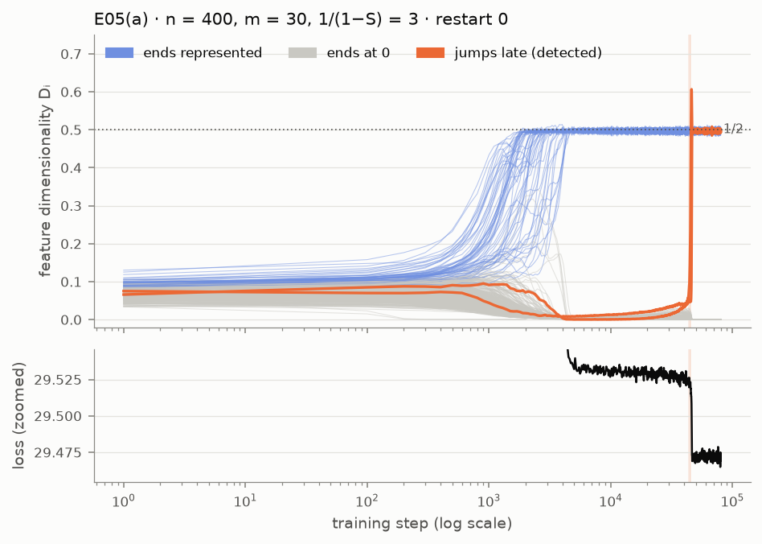
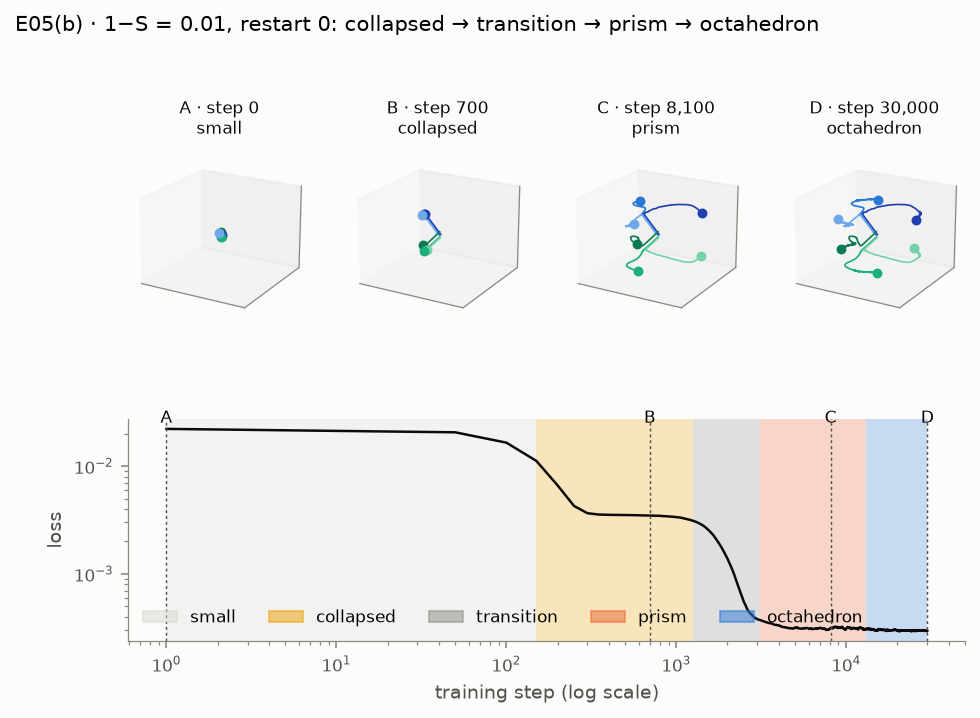
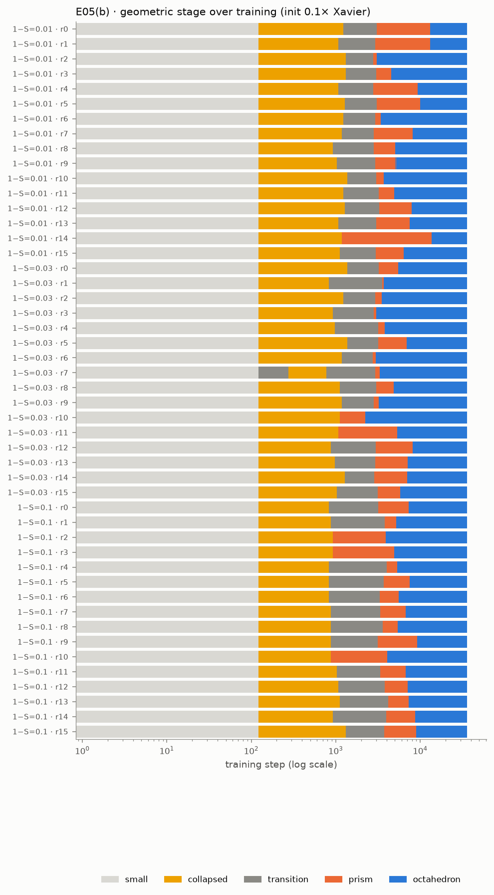

# E05 · learning_dynamics: energy-level jumps and geometric transformations

Recipe card for experiment E05 (`learning_dynamics`, paper pp. 26–28). Status: **PASS 2/2** on
the cited run `20260930T190604Z-2fae0fc5`. The labels **[Documented]**, **[Reconstructed]** and
**[Recommended]** are defined in the cookbook [README](../README.md). Dates and sessions are in
[01_timeline.md](../01_timeline.md). Terms are in the [glossary](../../GLOSSARY.md).

## 1. Claim and pages

**(a) Energy-level jumps (p. 26).** Take the uniform setup of p. 17: many features of equal
importance and equal sparsity. During training, a feature's dimensionality Dᵢ jumps between
discrete levels, and the loss drops suddenly when it does. Dᵢ = ‖Wᵢ‖² / Σⱼ(Ŵᵢ·Wⱼ)² is the
fraction of a hidden dimension that feature i owns (1 for a dedicated dimension, 1/2 for an
antipodal pair, 0 for an unlearned feature).

**(b) Learning as geometric transformations (pp. 27–28).** Six features in m = 3 dimensions,
as two correlated sets of three (features in one set are active together). Training passes
through stages: (A) weights near zero, (B) the two sets push apart, (C) each set expands into a
triangle, (D) the triangles rotate into an antiprism, which is an octahedron whose antipodal
pairs join features from different sets. Other trajectories exist, and they differ mainly at
step C. p. 28 calls the early stage a linear, PCA-like solution that the network later leaves.

SPEC §7 E05 turned these into two proposals: (a) at least one jump |ΔDᵢ| > 0.15 within a short
window that coincides with a loss drop; (b) at least one restart ends in the octahedron, with
the trajectory types reported ([SPEC.md](../../../SPEC.md) §7 E05). **[Documented]**

## 2. Prerequisites

| Need | Where | Why E05 needs it |
|---|---|---|
| Sparse uniform data, correlated sets | `data.IndependentSparse`, `data.CorrelatedSets` | (a) and (b) inputs |
| Tied ReLU output model, x′ = ReLU(WᵀWx + b) | `models.TiedModel` (`relu_output`) | both parts |
| Trainer that keeps weight snapshots | `train.train_from_config` with `snapshot_every` | trajectories |
| Dᵢ, D*, norms, cosines | `metrics.feature_dimensionality`, `dims_per_feature`, `feature_norms`, `cosine_similarity_matrix` | jumps and stages |
| The D* = 1/2 plateau, roughly 1/(1 − S) ∈ [2.6, 3.7] | p. 17 reading (SPEC §7 E03) | where to put (a) |

E05 did **not** use an E03 run. Phase 3 was unfinished when E05 was built, so part (a) took the
plateau from the paper's p. 17 figure, not from E03's code or runs (D-401). **[Documented]**

If you are rebuilding by hand, finish rebuild milestones M1–M4 first (data, models, training,
metrics) in [the rebuild kit](../../../rebuild/README.md). **[Recommended]**

## 3. Config and commands

Source: [`configs/learning_dynamics.yaml`](../../../configs/learning_dynamics.yaml). The quick
profile is the base block unchanged.

| Setting | quick | full |
|---|---|---|
| (a) n, m, Iᵢ, 1/(1 − S) | 400, 30, 1, 3 | same |
| (a) restarts × steps, batch, lr | 4 × 80,000, 256, 1e-3 constant | 8 × 150,000 |
| (a) snapshot every / loss batch | 100 steps / 8,192 fixed inputs | same |
| (a) jump rule (D-402) | ΔDᵢ > 0.15 in 2,000 steps, level held ±0.05 for 5,000 steps, drop ≥ 3× background and > plateau range | same |
| (b) sets × size, m, Iᵢ | 2 × 3, 3, 1 | same |
| (b) set densities 1 − S | 0.01, 0.03, 0.1 | same |
| (b) init scale × Xavier | 0.1 | 0.1 and 1.0 (D-403) |
| (b) restarts × steps, batch | 16 × 30,000, 1024; snapshot every 50 | 32 × 60,000 |
| (b) stage thresholds (D-404) | small 0.3, collapsed 0.8, opposed −0.9, antipodal −0.95, orthogonal 0.1, min stage 1,000 steps | same |

List the experiments, then run the quick profile exactly as the cited run did:

```bash
uv run superposition list
```

```bash
uv run superposition run learning_dynamics --profile quick --device cpu
```

[Verified against manifest] (runs `20260929T172920Z-2fae0fc5` and `20260930T190604Z-2fae0fc5`)

```bash
uv run superposition run learning_dynamics --profile full --device cpu
```

[Not verified: the full profile was never run (D-R06); its ≈ 30 min and ≈ 1 GB are estimates in
the config]

Redraw the figures of the cited run (writes only into that run's folder):

```bash
uv run superposition figures learning_dynamics --run 20260930T190604Z-2fae0fc5
```

[Not verified: needs the cited run's folder under `results/`, which is git-ignored and exists
only on the owner's machine]

Tests:

```bash
uv run pytest tests/unit/test_learning_dynamics.py -q
```

```bash
uv run pytest -m paper tests/replication/test_learning_dynamics.py
```

[Not verified: paper tier; it re-runs the whole quick profile on CPU (518 s measured for the
run itself)]

## 4. Procedure

### 4a. The steps as executed

1. **Read the pages.** The Phase 4 session extracted pp. 26–39 and the footnote page (p. 56) as
   text. [S 92884087 @ 2026-09-29T16:30–16:31Z] **[Documented]**
2. **Benchmarked and prototyped outside the provenance system.** A speed benchmark, then
   scratchpad prototypes of (a) and (b): `proto_e05a`, `proto_e05b`, a longer (a) run
   (`e05a_long`), small-init (b) runs with a stage classifier, and a first jump detector tried
   on the long prototype's output. [S 92884087 @ 2026-09-29T16:36–16:51Z] **[Documented]**
   None of their outputs are on disk. What they showed is known only through the DECISIONS
   entries: late jumps between 33,000 and 52,000 steps (D-402); densities 0.01–0.1 end as
   octahedra while 0.3 ends in a PCA-like solution, and 0.01 sits in the aligned-triangle stage
   for up to about 20,000 steps (D-403). **[Documented]**
3. **Chose the settings with the prototypes in view.** The 80,000-step length was chosen
   knowing that the prototype's late jumps fell inside it, and the three densities were chosen
   where the prototypes reached the octahedron (D-402, D-403). D-402 says the jump thresholds
   came from the paper and SPEC's 0.15 "before the graded run, then checked against the
   prototype". The transcript shows the detector being run on the prototype before the module
   was committed; whether any threshold moved after that check is unknown.
   **[Documented]**
4. **Wrote the module, the stage classifier and unit tests together.** The jump detector is
   tested on synthetic trajectories (a jump with a drop, a jump without one, an early change
   that must not count) and the stage classifier on ideal geometries. Both landed in `fd60e7c`
   (17:28Z), with `plotting/dynamics.py`. **[Documented: git]**
5. **Ran the quick profile from the main tree** at `5a825d0`, as the first of four runs queued
   in one shell loop (E05–E08): `20260929T172920Z-2fae0fc5`, 516 s, PASS 2/2.
   [S 92884087 @ 2026-09-29T17:29Z] **[Documented]**
6. **Wrote the decisions after seeing the run.** D-402–D-404 were drafted in the scratchpad
   and appended to DECISIONS.md at 17:52Z, after this run had finished; the thresholds
   themselves were already in the committed code. [S 92884087 @ 2026-09-29T17:52Z; `de6dd81`]
   **[Documented]**
7. **Fixed the figure, then published from the saved run.** `24ec2e9` zoomed the loss panel to
   the plateau. The figures were redrawn from the saved run, not retrained.
   [S 92884087 @ 2026-09-29T17:58Z] **[Documented]**
8. **Wrote the replication test after the result** (`aceb2e3`, 18:08Z). It requires
   PASS. It passed in a 32-minute batch with E06–E08 under the old `slow` marker (phase-4.md
   "Test status"); D-310 later moved it to the opt-in `paper` tier. **[Documented]**
9. **Bounded memory after the cited run.** `da8aed1` chunked the Dᵢ computation over
   snapshots; the session checked that the chunked result equals the one-shot one.
   [S 92884087 @ 2026-09-29T18:11Z] **[Documented]**
10. **Rectification 2 (D-R02).** The owner made stage B a documented variant. The session
    added the octahedron fraction and INFO `stage_b_placement` (`f1fe311`), committed D-R02
    (`d8f1ce6`) before any run, and re-ran from a clean detached worktree at `fd32b02`:
    `20260930T190604Z-2fae0fc5`, 518 s. Every earlier row is identical; only the new rows were
    added (rectification.md "Runs"). **[Documented]**
11. **Phase 6 review (R2).** Four findings on E05 were corrected in the docs (`f3932ec`):
    R2-03, R2-05, R2-07 and R2-11 (section 6). No number or status changed. **[Documented]**

### 4b. How to do it by hand

Each step: action → command → expected result → check → if it fails. **[Recommended]** for
the whole subsection.

1. **Write down the levels.** Read pp. 17–18 and 26. List the Dᵢ values a feature can sit at
   (1, 3/4, 2/3, 1/2, 2/5, 3/8, 0) and the uniform setup. No command. Expected: a short table.
   Check: against the glossary entry for Dᵢ. If unsure: re-read p. 18's figure caption.
2. **Get Dᵢ right first.** Implement it as a pure function and test known answers: an
   antipodal pair gives 1/2, a regular pentagon 2/5, a zero column 0.

   ```bash
   uv run pytest -c rebuild/pytest.ini rebuild/tests/test_metrics.py
   ```

   Expected: all metric tests pass. If one fails: test on a 2-feature example by hand.
3. **Add snapshots to your trainer.** Save W and b every k steps. Expected: a
   (time, inst, hidden, feat) tensor. Check: the last snapshot equals the final weights. If
   memory blows up: compute Dᵢ in chunks of snapshots, as `da8aed1` did.
4. **Write the jump detector before any real run.** A pure function of (steps, Dᵢ, loss).
   Test it on synthetic curves: a plateau then a 0.05 → 0.5 ramp, with and without a loss
   drop, and an early ramp that must be rejected. Then compare with the repo's tests:

   ```bash
   uv run pytest tests/unit/test_learning_dynamics.py -q -k jump
   ```

   Expected: your detector agrees on the same three cases. If it reports hundreds of jumps on
   real data: you have no stable-window condition, so the initial organization counts.
5. **Evaluate every snapshot on one fixed batch.** The paper's drop is under 1% of the loss,
   far below training-batch noise (D-402). Expected: a smooth loss curve with visible steps.
   If the curve is noisy: you are plotting the training-batch loss.
6. **Write the criterion and the DECISIONS entry, commit, and only then run part (a).** Use
   the quick settings above. Run from a clean tree so the manifest records `dirty: false`.
   Expected (cited run): by step 10,000 about 58 features at 1/2 and Σᵢ Dᵢ ≈ 29.87; a late jump
   of two features between steps 29,200 and 52,100, loss drop 0.043–0.055; final 60 features at
   1/2, Σᵢ Dᵢ = 29.994. Check: against REPRODUCTION.md's E05 table. If no jump: check that
   1/(1 − S) = 3 really sits on the plateau, and train longer.
7. **Build part (b)'s stage classifier on ideal geometries.** Construct the octahedron, an
   aligned prism, a collapsed state and a near-zero state by hand; check each gets its stage,
   and that a rotation changes nothing.

   ```bash
   uv run pytest tests/unit/test_learning_dynamics.py -q -k stage
   ```

   Expected: these tests pass, and yours agree on the same geometries.
8. **Run part (b) from 0.1 × Xavier.** Expected (cited run): 48/48 restarts end as the
   octahedron; six trajectory types. Check: the stage raster figure. If none reach the
   octahedron: check that antipodal partners are tested across sets, not within.
9. **Report stage B honestly.** Measure the centroid cosine while each set is collapsed.
   Expected: near 0, not −1 (section 6). Write it as a variant with the evidence.

## 5. Acceptance

Values from `results/learning_dynamics/20260930T190604Z-2fae0fc5/acceptance.json`, cited in
[`docs/cited_runs.yaml`](../../cited_runs.yaml).

| Criterion (id) | Origin | Status | Value | Evidence |
|---|---|---|---|---|
| (a) `energy_jump_with_loss_drop` | SPEC §7 proposal (0.15 from SPEC); "short window" and "coincides" operationalized in D-402 | **PASS** | 8 jumps (2 per restart), all with a coinciding drop; largest: restart 0, feature 320, steps 44,200–46,200, Dᵢ 0.050 → 0.241, drop 0.0545 vs plateau range 0.0112 | `20260930T190604Z-2fae0fc5`; identical in `20260929T172920Z-2fae0fc5` |
| (b) `octahedron_final_state` | SPEC §7 proposal from p. 27; stage tests in D-404; the fraction added by D-R02 | **PASS** | 48/48 (16/16 at each density), fraction 1.0 | same two runs (the fraction only in the second) |
| (a) `energy_final_state` | INFO | INFO | every restart: 60 at 1/2, 340 at 0, Σᵢ Dᵢ 29.994, D* 0.4905–0.4912 | same |
| (b) `trajectory_types`, `trajectory_timing` | INFO (SPEC: report the types) | INFO | six types; median prism stage 3,950 / 1,475 / 3,300 steps at 1 − S = 0.01 / 0.03 / 0.1 | same |
| (b) `stage_b_placement` | INFO, D-R02 | INFO | median centroid cosine while collapsed −0.058 / −0.044 / −0.037; opposed share 6% / 13% / 18% | `20260930T190604Z-2fae0fc5` only |

**[Documented]** for the table.

The (b) bar, "at least one restart", is an existence test. It passed with 48 of 48, so it
cannot tell a robust result from a lucky one; the reported fraction carries that information.
**[Recommended]**: when a criterion is "at least one", also pre-declare the fraction you expect.

## 6. What actually happened

- **Built beside an unfinished Phase 3** (D-401; [phase-4.md](../../progress/phase-4.md)
  opening note). **[Documented]**
- **Settings chosen after prototypes** (section 4a, steps 2–3). The training length and the
  densities were picked with prototype results known (D-402, D-403). This was disclosed, not
  hidden. *Changed after results were seen:* the choice of settings, not a threshold.
  **[Documented]**
- **Stage B differs from the paper's picture.** The paper's panel B shows the two sets pushed
  to opposite ends of one axis. In our runs, while each set is collapsed onto one direction,
  the two directions are usually close to orthogonal (median cosine −0.04 to −0.06). Only 6–18%
  of collapsed snapshots are opposed, though at every density some run ends that stage opposed
  (phase-4.md open issue 3; REPRODUCTION.md E05). **[Documented]**
- **The owner decided it is a documented variant (D-R02), not a discrepancy**, because pp.
  27–28 say several trajectories exist. Only the end state is graded. [Planning conversation,
  per owner] item 3 recommended this. **[Documented]**
- **The variant's justification was later found wrong.** D-R02 and rectification.md justified
  it with pp. 23–24 (correlated features prefer orthogonal placement). Review R2-03 pointed
  out that the two sets are independent of each other, so that sentence does not apply. The
  corrected reason: independent sets have room in m = 3 to take orthogonal directions, the
  PCA-like solution of p. 28. The reviewer also found the paper's own panel B shows a centroid
  cosine of about −0.3. *Changed after review:* the rationale in REPRODUCTION.md (`f3932ec`).
  D-R02 itself still cites pp. 23–24. **[Documented]**
- **R2-07.** The text first said the features organize by step 5,000 and one restart
  overshoots; the reviewer found step 10,000, and every restart overshoots (peaks 0.58–0.66,
  the reviewer's reading). Corrected. **[Documented]**
- **R2-05.** Our jump's loss drop is about 0.2% of the loss; the paper's about 0.8%. The first
  explanation, "a differently normalized loss", cannot explain a relative drop. The current
  hypothesis is a different density or n (the paper gives neither). **[Documented]**
- **R2-11.** D-404 gave the aligned prism's cross-set cosines as −1/3 or −2/3; they are +1/3
  and −2/3. Corrected in place; the test was unaffected. **[Documented]**
- **Never measured:** the Xavier-init variant of (b) and the full profile (D-403, D-R06). How
  stage A looks from a plain Xavier init in this repo is therefore unknown. **[Documented]**

## 7. Compute

| Run | Commit | Device | Wall-clock | (a) training | (b) training |
|---|---|---|---|---|---|
| `20260929T172920Z-2fae0fc5` (superseded) | `5a825d0` | Apple M2 CPU | 516.428 s | 275.4 s | 196.8 s |
| `20260930T190604Z-2fae0fc5` (cited) | `fd32b02` | Apple M2 CPU | 517.951 s | 266.4 s | 205.4 s |

Wall-clock from each `manifest.json`; training times from each run's `log.txt`. **[Documented]**
The full profile was never run: ≈ 30 min on a laptop CPU and ≈ 1 GB of memory are estimates
scaled from the quick run (config comment; D-R06). The prototypes' compute is unknown.

## 8. What to look at

- Figures in [`docs/figures/learning_dynamics/`](../../figures/learning_dynamics/), from the
  cited run (`SOURCE.txt`):
  -  — the restart
    with the largest coinciding drop; `energy_levels_restart1.png`–`restart3.png` hold the
    others. Put it next to p. 26.
  -  — one run at
    stages A–D above its loss curve. Put it next to p. 27.
  -  — the stage of
    all 48 runs over training.
- The rotatable 3D version is `trajectories_3d.html` inside the run folder
  (`results/learning_dynamics/<run>/figures/`); it is not published.
- The lab's **Dynamics** page ([`app/pages/5_Dynamics.py`](../../../app/pages/5_Dynamics.py)):
  tabs "Energy-level jumps (p. 26)", "Geometric transformations (p. 27)" and "Acceptance",
  with step scrubbers. It shows the latest complete run, which is the cited one unless you
  run E05 again.
- Notebook [`06_learning_dynamics.ipynb`](../../../notebooks/06_learning_dynamics.ipynb) and
  REPRODUCTION.md's [E05 section](../../REPRODUCTION.md).

## 9. Explain it back

1. In (a), the late jump always involves two features at once, and the loss drops by about
   0.05, less than the ≈ 0.083 that storing two unlearned features from scratch would save at
   1/(1 − S) = 3 (phase-4.md question 1). Why two, and why less?
2. Why does the detector need the feature to hold a level for 5,000 steps first, and why must
   every snapshot's loss be measured on the same batch?
3. The two correlated sets end with antipodal pairs that join *different* sets. Why would a
   pair within one set be a bad idea under a ReLU output?

**Drill.** Build three 3 × 6 weight matrices by hand: two equilateral triangles in parallel
planes on opposite sides of the origin (aligned prism), the same with one triangle rotated by
60° (antiprism), and both sets collapsed onto orthogonal axes. Compute every cross-set cosine
and every Dᵢ. Self-check: the prism's cross-set cosines are +1/3 and −2/3 (D-404 as corrected
by R2-11); the antiprism's cross-set partners are exactly −1 and every Dᵢ is 1/2; your
stage labels match `stage_codes` on the same matrices.

## 10. Answer key

Open these after trying:

- [`src/superposition/experiments/learning_dynamics.py`](../../../src/superposition/experiments/learning_dynamics.py):
  `find_jumps`, `level_census`, `snapshot_losses`, `run_energy_levels`,
  `evaluate_energy_levels`, `stage_codes`, `centroid_cosines`, `stage_b_placement`,
  `trajectory_type`, `representative_restart`, `canonical_frame_3d`.
- `metrics.feature_dimensionality`, `metrics.dims_per_feature`; `data.CorrelatedSets`;
  `train.train_from_config` (snapshots).
- [`tests/unit/test_learning_dynamics.py`](../../../tests/unit/test_learning_dynamics.py) and
  [`tests/replication/test_learning_dynamics.py`](../../../tests/replication/test_learning_dynamics.py).
- [`src/superposition/plotting/dynamics.py`](../../../src/superposition/plotting/dynamics.py).
- D-402, D-403, D-404, D-R02 in [DECISIONS.md](../../DECISIONS.md); R2-03, R2-05, R2-07,
  R2-11 in [REVIEW.md](../../REVIEW.md).
