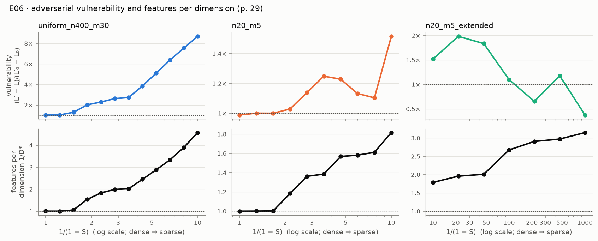
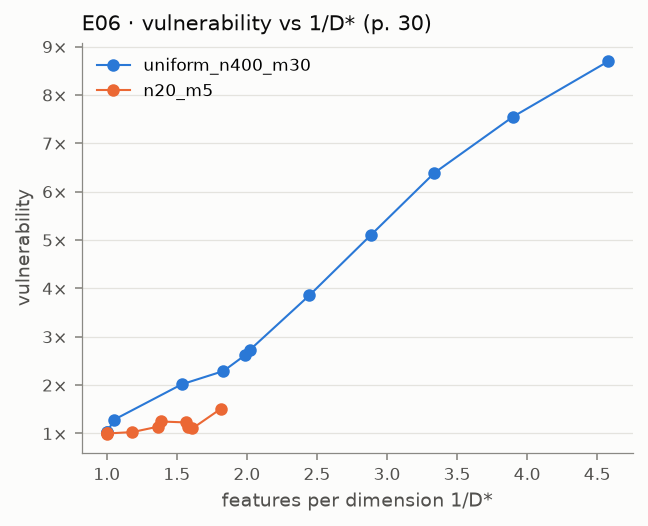

# E06 · adversarial: vulnerability rises with superposition

Recipe card for experiment E06 (`adversarial`, paper pp. 29–30). Status: **PARTIAL 2/4** on
the cited run `20260929T173800Z-e84cec26`, the only E06 run that exists. The labels
**[Documented]**, **[Reconstructed]** and **[Recommended]** are defined in the cookbook
[README](../README.md). Dates and sessions are in [01_timeline.md](../01_timeline.md). Terms are
in the [glossary](../../GLOSSARY.md).

## 1. Claim and pages

**The claim (p. 29).** Attack each trained model with small L2 perturbations: the budget ε is
0.1 of the average input norm, and the attacks are built analytically from the rows of WᵀW
rather than by gradient descent. Vulnerability, measured relative to a model without
superposition, rises sharply as superposition forms (more than 3× in the paper's figure) and
closely tracks the number of features per dimension, 1/D*. p. 30 plots vulnerability against
1/D*.

**Why it should happen (p. 29).** Without superposition, row i of WᵀW is (1, 0, 0, …): output i
moves only with input i. With superposition it looks like (1, ε, −ε, …), and every small
interference term is a direction an adversary can push along.

**Terms.** The *attack direction* for feature i is (WᵀW)ᵢ/‖(WᵀW)ᵢ‖₂: the unit input direction
that raises output i's pre-activation the most per unit of L2 norm. *Vulnerability* is
(L′ − L)/(L′₀ − L₀): the loss increase the attack causes, divided by the increase it causes on a
reference model with no superposition at the same sparsity and budget. *Features per dimension*
is 1/D*, with D* = m/‖W‖²_F.

SPEC §7 E06 proposed: sweep sparsity on a setup prone to superposition, "e.g. n = 20, m = 5";
accept a rise of more than 2× (the paper reports more than 3×) and Spearman ρ(V, 1/D*) ≥ 0.8;
adversarial training optional. SPEC §6 specified `adversarial.py` ([SPEC.md](../../../SPEC.md)
§6, §7 E06). **[Documented]**

## 2. Prerequisites

| Need | Where | Why E06 needs it |
|---|---|---|
| Tied ReLU output model and a sparsity grid with restarts | `models.TiedModel`, `experiments/common.train_sparsity_grid` | the models to attack |
| D* | `metrics.dims_per_feature` | the x-axis of the claim |
| The attack, the budget, the reference model | `adversarial.attack_budget`, `attack_directions`, `analytic_attack`, `no_superposition_model`, `vulnerability` | the measurement |
| The uniform setup (n = 400, m = 30) and its plateau | p. 17; E03 | the graded setting |
| The n = 20, m = 5 model | p. 11; E01 | SPEC's example |

`adversarial.py` existed as a placeholder from Phase 0 (`9e13751`) and was written in Phase 4
(`fd60e7c`). **[Documented: git]** E06 trains its own uniform models; it uses no E03 code or run
(D-401). **[Documented]** Rebuild milestones M1–M4 cover everything before the attack.
**[Recommended]**

## 3. Config and commands

Source: [`configs/adversarial.yaml`](../../../configs/adversarial.yaml). Every setting trains
ReLU output models for 10,000 steps (full: 20,000) at lr 1e-3, and attacks the best restart per
sparsity.

| Setting | Graded | Iᵢ | 1/(1 − S) range, points | restarts, batch, attack samples (quick) | full |
|---|---|---|---|---|---|
| `uniform_n400_m30` | yes (p. 29) | 1 | 1–10, 12 log-spaced | 2, 256, 4,000 | 32 points, 4 restarts, 8,000 samples |
| `n20_m5` | yes (pp. 11, 29) | 0.7ⁱ | 1–10, 10 | 4, 1024, 20,000 | 20 points, 8 restarts, 50,000 |
| `n20_m5_extended` | no | 0.7ⁱ | 10–1,000, 7 | 4, 1024, 100,000 | 13 points, 8 restarts, 200,000 |

Thresholds: budget fraction 0.1, rise > 2, Spearman ≥ 0.8.

```bash
uv run superposition run adversarial --profile quick --device cpu
```

[Verified against manifest] (run `20260929T173800Z-e84cec26`)

```bash
uv run superposition run adversarial --profile full --device cpu
```

[Not verified: the full profile was never run (D-R06); ≈ 1 hour on a laptop CPU is an estimate
in the config]

```bash
uv run superposition figures adversarial --run 20260929T173800Z-e84cec26
```

[Not verified: needs the cited run's folder under `results/`, which is git-ignored and exists
only on the owner's machine]

Tests, and a one-line check of the attack directions on an antipodal pair:

```bash
uv run pytest tests/unit/test_adversarial.py -q
```

```bash
uv run python -c "import torch; from superposition.adversarial import attack_directions; print(attack_directions(torch.tensor([[[1.0, -1.0, 0.0]]])))"
```

```bash
uv run pytest -m paper tests/replication/test_adversarial.py
```

[Not verified: paper tier; it re-runs the whole quick profile on CPU (401 s measured for the
run itself)]

## 4. Procedure

### 4a. The steps as executed

1. **Read the pages** (pp. 26–39 as text, with the footnote page). [S 92884087 @
   2026-09-29T16:30Z] **[Documented]**
2. **Prototyped both candidate setups outside the provenance system.** First n = 20, m = 5 over
   1/(1 − S) from 1 to 1,000, then the uniform n = 400, m = 30 over 1 to 10 (several attempts
   of the same command). [S 92884087 @ 2026-09-29T16:54Z and 16:56–16:58Z] **[Documented]**
   Neither output is on disk. D-406 discloses what the first showed: vulnerability rising to
   ≈ 2 by 1/(1 − S) ≈ 12, then falling as ε shrinks below the models' negative biases. What
   the uniform prototype showed is unknown. **[Documented]**
3. **Chose what to grade.** The session found that the p. 29 figure's axes (1/(1 − S) up to
   10, 1/D* rising to about 5) match the uniform setup, not n = 20, m = 5, whose 1/D* cannot
   exceed 4 and is near 1.5 at 1/(1 − S) = 10. It graded the uniform setup, also graded SPEC's
   n = 20, m = 5 over the same range, and reported the extended range ungraded (D-406).
   **[Documented]**
   A prototype peak of about 2 at 1/(1 − S) ≈ 12 means a rise near or below the 2× bar inside
   [1, 10]. So the session graded a setting that its own prototype suggested might fail.
   **[Reconstructed: from D-406's quoted prototype numbers; the prototype's output is not on
   disk, and whether the session drew this inference is not recorded]**
4. **Fixed the measurement (D-405).** The per-example worst case over the n candidate attacks
   (and δ = 0, since the budget is a maximum). The loss is taken against the clean target. The
   reference is W = [Iₘ | 0], b = 0, whose damage is exactly maxᵢ<ₘ Iᵢ ε². The thresholds stayed
   SPEC's. **[Documented]**
5. **Wrote `adversarial.py` with unit tests on hand-built models.** The tests check the budget,
   the unit attack directions, the reference damage max Iᵢ ε², an antipodal pair exactly 2× as
   vulnerable on the zero input, and attacked ≥ clean loss (`tests/unit/test_adversarial.py`,
   `fd60e7c`, 17:28Z). **[Documented: git; phase-4.md "Test status"]**
6. **Ran the quick profile from the main tree** at `5a825d0`, second in the E05–E08 queue:
   `20260929T173800Z-e84cec26`, 401 s, PARTIAL 2/4. [S 92884087 @ 2026-09-29T17:38Z]
   **[Documented]**
7. **Checked one mechanism after the run:** which feature the worst-case attack targets,
   against the row norms of WᵀW. [S 92884087 @ 2026-09-29T17:45Z] Notebook 07's exercise 2
   carries the result. **[Documented]**
8. **Kept the failing setting graded.** The phase report says grading n = 20, m = 5 was the
   session's choice, made before the graded run, so it stays graded (phase-4.md open issue 2).
   **[Documented]**
9. **Wrote the replication test after the result** (`aceb2e3`, 18:08Z). It requires the
   uniform setting's two PASSes and allows the overall status to be PASS or PARTIAL, so a
   change in the n = 20 outcome shows up in the record, not as a broken test. **[Documented]**
10. **Phase 6 review (R3).** No re-run. Docs corrected in `f3932ec` for R3-03, R3-12 and R3-13
    (section 6). **[Documented]**

### 4b. How to do it by hand

**[Recommended]** for the whole subsection.

1. **Derive the attack on paper.** For x′ = ReLU(WᵀWx + b), show that among all δ with ‖δ‖₂ ≤ ε
   the one that raises output i's pre-activation the most is ε(WᵀW)ᵢ/‖(WᵀW)ᵢ‖₂, by
   Cauchy–Schwarz. No command. Check: notebook 07, section 1. If stuck: write the
   pre-activation as a dot product of row i of WᵀW with x + δ.
2. **Derive the reference damage.** For W = [Iₘ | 0], b = 0 and inputs in [0, 1], every attack
   adds ε to one output, so the damage is maxᵢ<ₘ Iᵢ ε² exactly. Check numerically against the
   repo's test:

   ```bash
   uv run pytest tests/unit/test_adversarial.py -q -k "reference or antipodal"
   ```

   Expected: 2 passed. Your own implementation should give the same two numbers: damage
   I₀ε² for the reference, and vulnerability exactly 2 for W = [1, −1] on zero inputs.
3. **Implement the attack as a batched evaluation.** For every input and every candidate,
   compute the loss of the output on x + δ against the clean target; keep the per-input
   maximum, and never go below the clean loss. Expected: shape (inst,) results. Check: the
   attacked loss is ≥ the clean loss on random models. If memory runs out: chunk over inputs.
4. **Decide what to grade before running.** Read the p. 29 figure's axes and work out which
   setup can reach 1/D* ≈ 5 in [1, 10]. Write the decision and why in DECISIONS first.
   Expected: a short entry naming graded and ungraded settings.
5. **Train the sparsity grid and attack the best restart per sparsity.** Use the quick
   settings above. Expected (cited run): uniform V from 1.03 to 8.70 (rise 8.5×), ρ = 1.0; flat
   V ≈ 1.03 up to 1/(1 − S) = 1.23, then a shoulder of 2.6–2.7 where 1/D* sits near 2. Check:
   REPRODUCTION.md's E06 table. If V stays near 1: your budget is probably computed from
   nonzero inputs only; zeros count in the mean.
6. **Look at the shape, not just ρ.** Plot V and 1/D* on the same x-axis. Expected: the
   shoulder of V lines up with the 1/D* plateau. If they diverge, report it (section 6).
7. **Run the ungraded extended range and explain it.** Expected: V peaks near 2 at
   1/(1 − S) ≈ 21.5 and then falls while 1/D* keeps rising. Check the represented features'
   biases against ε at each sparsity.

## 5. Acceptance

Values from `results/adversarial/20260929T173800Z-e84cec26/acceptance.json`, cited in
[`docs/cited_runs.yaml`](../../cited_runs.yaml).

| Setting · criterion | Origin | Status | Value |
|---|---|---|---|
| uniform · `vulnerability_rises` (> 2×) | SPEC §7 proposal; the paper says > 3× (p. 29); SPEC relaxed it to 2× before any run | **PASS** | rise 8.469 (V 1.027 → 8.695, max at 1/(1 − S) = 10) |
| uniform · `vulnerability_tracks_features_per_dimension` (ρ ≥ 0.8) | SPEC §7 proposal for p. 29's "closely tracks" | **PASS** | ρ = 1.0 (1/D* from 1.002 to 4.578) |
| n20_m5 · `vulnerability_rises` | SPEC §7 (its example setting) | **FAIL** | rise 1.532 (0.989 → 1.514) |
| n20_m5 · `vulnerability_tracks_features_per_dimension` | SPEC §7 | **FAIL** | ρ = 0.7818 |
| extended · `vulnerability_extended` | INFO (D-406) | INFO | V max 1.981 at 1/(1 − S) = 21.5; V 0.375 at 1,000; ρ = −0.786 |
| each graded setting · `vulnerability_per_sparsity` | INFO | INFO | V, 1/D*, ε and the most attacked feature per sparsity; the reference damage matches max Iᵢ ε² (note in the record) |

Evidence: `20260929T173800Z-e84cec26` only (commit `5a825d0`, CPU, seed 0). **[Documented]**

No criterion was changed after the run. The settings were chosen after the prototypes (section
4a, steps 2–3). **[Documented]**

## 6. What actually happened

- **The paper's own setting passes strongly; SPEC's example fails.** In the uniform setup the
  curve has the paper's shape: flat, a rise as antipodal pairs form, a shoulder on the 1/D* ≈ 2
  plateau, a second rise. n = 20, m = 5 barely enters superposition in [1, 10] (1/D* ≤ 1.82).
  (REPRODUCTION.md E06; phase-4.md open issue 2.) **[Documented]**
- **Wrong reading of the failure, corrected by review (R3-03).** The first write-up called the
  n = 20 result "what the claim predicts". The reviewer showed that V *falls* from 1.25 to 1.10
  while 1/D* rises from 1.39 to 1.61 (1/(1 − S) = 3.6 to 7.7), and that at the same 1/D* (about
  1.82) the uniform model has V = 2.29 against 1.51. It is now reported as a genuine case where
  vulnerability does not track superposition, and the README's statement of the claim was
  qualified. *Changed after review:* the interpretation, not the status. **[Documented]**
- **A partial hypothesis.** The importance decay concentrates the loss on the top features, so
  the reference damage I₀ε² is large next to what interference adds. That explains the small
  rise, not the dip. The reviewer's diagnostic with unit importance still found the dip, and
  two fresh attack seeds gave the same ρ (reviewer's analysis; not in the run's record).
  **[Documented: REPRODUCTION.md E06]**
- **The extended range.** ε = 0.1 · E‖x‖₂ shrinks with density (0.069 at 1/(1 − S) = 10, 0.001
  at 1,000). From 100 on, the represented features' biases are clearly negative (median −0.16
  to −0.23) and 20–200× larger than ε, which is where V falls. Those bias medians were computed
  in notebook 07, not stored in the run (the reviewer reproduced them; R3-15 fixed an
  untraceable earlier version). **[Documented]**
- **What the Spearman criterion can show (R3-12).** V and 1/D* both rise with sparsity, so a
  high ρ follows from monotonicity alone. The shape agreement (shoulder on the plateau) is the
  stronger evidence. **[Documented]**
- **The size depends on the attack definition (R3-13).** p. 29's "the one of these attacks
  which most harms model performance" can be read per input (D-405, used here) or per model.
  The reviewer measured about 3.7× for one attack per model, against 8.5× here (reviewer's
  number, not in the run's record). **[Documented]**
- **Not done:** gradient attacks and adversarial training, both optional in SPEC (D-405).
  **[Documented]**

## 7. Compute

| Run | Commit | Device | Wall-clock | Training: uniform / n20_m5 / extended |
|---|---|---|---|---|
| `20260929T173800Z-e84cec26` (cited) | `5a825d0` | Apple M2 CPU | 400.746 s | 208.0 s / 87.4 s / 63.5 s |

Wall-clock from `manifest.json`; training times from the run's `log.txt`. **[Documented]**
The full profile was never run; ≈ 1 hour on a laptop CPU is an estimate (config comment;
D-R06). The prototypes' compute is unknown.

Since `5a825d0`, the code E06 runs on has changed only in comments and in metrics functions it
does not call, so a quick re-run today should reproduce the cited numbers on the same machine.
**[Reconstructed: from `git diff 5a825d0 HEAD` over `adversarial.py`, the E06 module,
`common.py`, `train.py`, `models.py`, `data.py`, `metrics.py` and the config; not re-run]**

## 8. What to look at

- Figures in [`docs/figures/adversarial/`](../../figures/adversarial/), from the cited run:
  -  — V and 1/D* against
    1/(1 − S) per setting. Put the uniform panel next to p. 29.
  - 
    — the p. 30 scatter for the graded settings.
- The lab's **Adversarial** page ([`app/pages/7_Adversarial.py`](../../../app/pages/7_Adversarial.py)):
  curves per setting and per-sparsity tables, read from the latest run.
- Notebook [`07_adversarial.ipynb`](../../../notebooks/07_adversarial.ipynb): section 1
  computes an attack by hand before the sweep. Then REPRODUCTION.md's
  [E06 section](../../REPRODUCTION.md).

## 9. Explain it back

1. Vulnerability divides by the damage to a no-superposition model at the *same* sparsity and
   budget. What goes wrong if you compare raw damages L′ − L across sparsities (phase-4.md
   question 2; compare footnote 17)?
2. Why does the paper build attacks analytically instead of by gradient descent, and why does
   that matter most at high sparsity?
3. In the extended range, vulnerability falls while 1/D* rises. Which assumption of the
   measure breaks there, and what change to the budget would you predict keeps it tracking?

**Drill.** Take W = [[1, −1]] (one dimension, an antipodal pair), b = 0, I = (1, 1), ε = 0.1,
and the input x = 0. By hand, compute both attack directions, the attacked output, the attacked
loss, and the reference damage for W = [[1, 0]]. Self-check: each direction is ±(1, −1)/√2,
the attacked loss is 2ε² = 0.02, the reference damage is ε² = 0.01, so V = 2
(`test_antipodal_pair_on_zero_inputs_is_twice_as_vulnerable`). Then repeat with b = (−0.2,
−0.2) and explain why V drops to 0.

## 10. Answer key

Open these after trying:

- [`src/superposition/adversarial.py`](../../../src/superposition/adversarial.py):
  `attack_budget`, `attack_directions`, `analytic_attack`, `AttackResult.damage`,
  `no_superposition_model`, `vulnerability`.
- [`src/superposition/experiments/adversarial.py`](../../../src/superposition/experiments/adversarial.py):
  `AdversarialSetting`, `measure_vulnerability`, `evaluate_setting`.
- [`tests/unit/test_adversarial.py`](../../../tests/unit/test_adversarial.py) and
  [`tests/replication/test_adversarial.py`](../../../tests/replication/test_adversarial.py).
- [`src/superposition/plotting/adversarial.py`](../../../src/superposition/plotting/adversarial.py).
- D-405, D-406 in [DECISIONS.md](../../DECISIONS.md); R3-03, R3-12, R3-13, R3-15 in
  [REVIEW.md](../../REVIEW.md).
