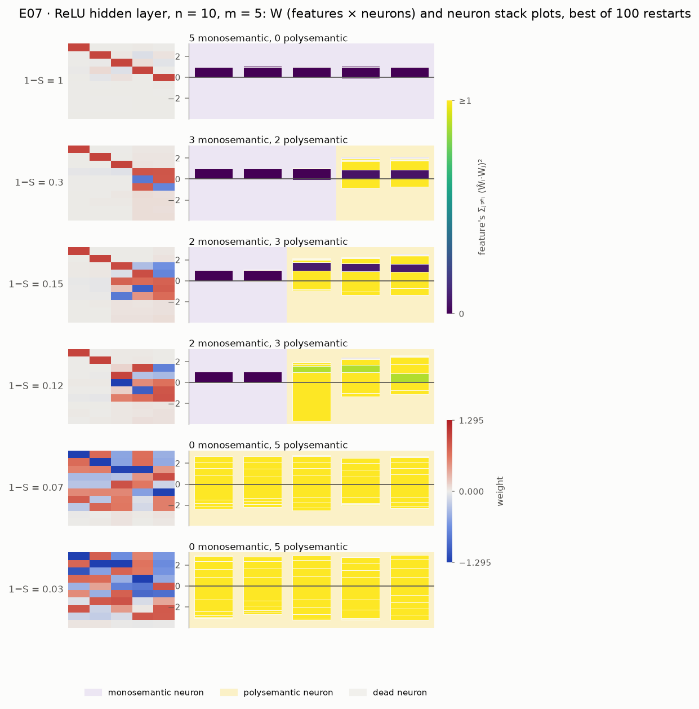
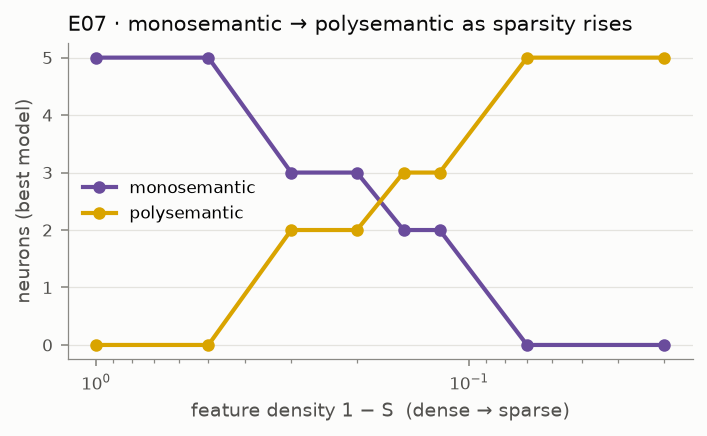

# E07 · privileged_basis: from monosemantic to polysemantic neurons

Recipe card for experiment E07 (`privileged_basis`, paper pp. 31–34). Status: **PASS 3/3** on
the cited run `20260929T174443Z-d54df07e`, the only E07 run that exists. The labels
**[Documented]**, **[Reconstructed]** and **[Recommended]** are defined in the cookbook
[README](../README.md). Dates and sessions are in [01_timeline.md](../01_timeline.md). Terms are
in the [glossary](../../GLOSSARY.md).

## 1. Claim and pages

**The model (pp. 31, 34).** The ReLU hidden layer model is h = ReLU(Wx), x′ = ReLU(Wᵀh + b),
with **no hidden bias** (p. 34). Because the ReLU acts on each hidden dimension separately,
rotating the hidden space would change the model. The hidden basis is therefore *privileged*:
each hidden dimension is a *neuron*, and W can be read neuron by neuron. A neuron that carries
one feature is *monosemantic*; one that carries several is *polysemantic*.

**The claims (pp. 32–34).** For n = 10, m = 5, Iᵢ = 0.75ⁱ, keeping the lowest-loss model of
1,000 per setting:

- dense data: every neuron is monosemantic, one per most important feature;
- as sparsity rises, neurons shift from monosemantic to polysemantic through named regimes
  (p. 33): all monosemantic (1 − S ≥ 0.5), three features in two neurons (0.2–0.5), five in
  three with two monosemantic neurons (0.15), six in four (0.12), eight in five, all
  polysemantic (0.05–0.08), pairs of neurons per feature (≤ 0.04);
- the model avoids its ReLU when it can: given a hidden bias, it sets every bias positive so
  the neurons stay linear (p. 34).

SPEC §7 E07 proposed: 1,000 restarts per setting (quick: 100); accept dense → every neuron
monosemantic; the polysemantic-neuron count never decreases as sparsity rises (tolerance 1) and
is > 0 at the sparsest setting; document the sidestepping ([SPEC.md](../../../SPEC.md) §7 E07).
**[Documented]**

## 2. Prerequisites

| Need | Where | Why E07 needs it |
|---|---|---|
| ReLU hidden layer model, no hidden bias | `models.TiedModel` (`relu_hidden`) | the model |
| Grid of sparsities × restarts, best restart per setting | `experiments/common.train_sparsity_grid`, `train.select_best` | "best of many" (p. 33) |
| Features per neuron | `metrics.neuron_polysemanticity` (25% rule, dead below 0.05) | every criterion |
| Represented and superposed features | `metrics.represented_mask`, `metrics.superposition_score` | the per-sparsity summary |
| The count-tolerance rule | E01's criteria | "never decreases (tolerance 1)" |

The 25% threshold and the 0.05 dead threshold were set in Phase 1 as provisional defaults of
`neuron_polysemanticity` (D-110), before E07 existed, and E07 kept them (D-407). So E07's main
threshold was fixed before any E07 data. **[Documented]** Rebuild milestones M1–M4 cover the
engine. **[Recommended]**

## 3. Config and commands

Source: [`configs/privileged_basis.yaml`](../../../configs/privileged_basis.yaml).

| Setting | quick | full |
|---|---|---|
| n, m, Iᵢ | 10, 5, 0.75ⁱ | same |
| 1 − S (densest first) | 1, 0.5, 0.3, 0.2, 0.15, 0.12, 0.07, 0.03 | 15 values, 1 to 0.01 |
| restarts per setting | 100 (800 models) | 1,000 (the paper's number) |
| training | 10,000 steps, batch 256, lr 1e-3 constant | same |
| hidden-bias variant (never graded) | h = ReLU(Wx + c) at 1 − S = 1, 0.1, 0.03; 20 restarts | 100 restarts |
| thresholds | 25% of a neuron's largest weight; dead < 0.05; count tolerance 1 | same |

```bash
uv run superposition run privileged_basis --profile quick --device cpu
```

[Verified against manifest] (run `20260929T174443Z-d54df07e`)

```bash
uv run superposition run privileged_basis --profile full --device cpu
```

[Not verified: never run (D-R06); ≈ 2 hours on a laptop CPU is an estimate in the config, which
advises a GPU]

```bash
uv run superposition figures privileged_basis --run 20260929T174443Z-d54df07e
```

[Not verified: needs the cited run's folder under `results/`, which is git-ignored and exists
only on the owner's machine]

Tests:

```bash
uv run pytest tests/unit/test_neurons.py -q -k "e07 or hidden_bias"
```

```bash
uv run pytest -m paper tests/replication/test_privileged_basis.py
```

[Not verified: paper tier; it re-runs the whole quick profile on CPU (419 s measured for the
run itself)]

## 4. Procedure

### 4a. The steps as executed

1. **Read the pages** (pp. 26–39 as text, with the footnote page). [S 92884087 @
   2026-09-29T16:30Z] **[Documented]**
2. **Benchmarked, did not prototype results.** The session timed the ReLU hidden layer and
   absolute-value models (`bench2.py`). [S 92884087 @ 2026-09-29T17:00Z] Unlike E05, E06 and
   E08, no E07 results prototype appears in the session's command list; a smoke test ran
   E05–E08 end to end on tiny configs. [S 92884087 @ 2026-09-29T17:09Z] **[Documented]**
3. **Fixed the design (D-407).** A grid with one or more points in each regime p. 33 names;
   best of 100 restarts (SPEC's quick number); batch 256 instead of 1,024 because 800 models at
   batch 1,024 would take about 25 minutes (an estimate, never measured); the D-110 thresholds;
   "dense" means 1 − S = 1; a hidden-bias variant to document sidestepping, never the
   default. **[Documented]**
4. **Wrote the module and unit tests.** `privileged_basis.py`, `plotting/neurons.py` and
   `tests/unit/test_neurons.py` landed in `27c0f82` (17:28Z). The tests check the E07 criteria
   on a synthetic sweep that should pass and one that should fail, and that a large hidden bias
   makes the ReLU never clip. **[Documented: git]**
5. **Ran the quick profile from the main tree** at `5a825d0`, third in the E05–E08 queue:
   `20260929T174443Z-d54df07e`, 419 s, PASS 3/3. [S 92884087 @ 2026-09-29T17:44Z]
   **[Documented]**
6. **Fixed figure scales after the run and published from the saved run.** `bb00883` made the
   neuron figures' scales readable; the E07 figures were redrawn from the saved run, not
   retrained, and committed with the Phase 4 docs (`de6dd81`). [S 92884087 @
   2026-09-29T17:59Z] **[Documented]**
7. **Wrote the replication test after the result** (`aceb2e3`, 18:08Z). Beyond PASS, it pins
   the sidestepping outcome seen in the run: every hidden bias positive ("5/5") and the ReLU
   clipping under 1% with a bias. **[Documented]**
8. **Phase 6 review (R3).** The reviewer checked how robust the counts are to the thresholds
   and to re-selection, and found the PASS sound. Two statements were corrected (R3-04, R3-09;
   `f3932ec`). No re-run. **[Documented]**

### 4b. How to do it by hand

**[Recommended]** for the whole subsection.

1. **Write the model and check the privileged basis.** Implement h = ReLU(Wx),
   x′ = ReLU(Wᵀh + b), with no hidden bias. Check: rotating W by an orthogonal matrix changes the
   outputs (for the ReLU output model of E01 it would not). If it does not change them: the
   hidden ReLU is missing.
2. **Write the features-per-neuron count as a pure function, with a known answer.** For neuron
   h, feature i counts when |W[h, i]| ≥ 0.25 · maxⱼ |W[h, j]|; a neuron whose largest weight is
   below 0.05 is dead. Test on a 3-neuron example: one feature, two features, dead. Check
   against `test_neuron_polysemanticity` in `tests/unit/test_metrics.py` (expected counts
   [1, 2, 0]).
3. **Write the criteria and test them on synthetic sweeps before training.** One sweep that
   passes (polysemantic counts 0, 2, 3, 5) and one that fails all three (1, 4, 1, 0).

   ```bash
   uv run pytest tests/unit/test_neurons.py -q -k "e07 or hidden_bias"
   ```

   Expected: 2 passed, and your own criteria give the same verdicts. If the decreasing sweep
   passes: your tolerance compares with the previous point, not the running maximum.
4. **Choose the grid from p. 33 before running.** At least one point per named regime; write
   it in DECISIONS with the page. Expected: a list like the quick grid above.
5. **Train 100 restarts per setting and keep the lowest-loss model.** Expected (cited run):
   polysemantic counts 0, 0, 2, 2, 3, 3, 5, 5 from dense to sparse; at 0.3 and 0.2, three
   monosemantic neurons and two neurons sharing three features; at 0.07, eight features over
   five polysemantic neurons. Check: REPRODUCTION.md's E07 table. If the counts jump around:
   look at the share of restarts that reach the best model's count (it is 5–8% at 0.12–0.15 in
   the cited run); more restarts help there.
6. **Add the hidden-bias variant and measure clipping.** Train h = ReLU(Wx + c) at three
   sparsities. Measure how often a pre-activation is negative on inputs with at least one
   active feature. Expected (cited run): every cᵢ > 0; clipping 0.06–0.21% with a bias, 53.8%
   without at 1 − S = 0.03. If you compare losses, compare only at the same sparsity
   (footnote 17).

## 5. Acceptance

Values from `results/privileged_basis/20260929T174443Z-d54df07e/acceptance.json`, cited in
[`docs/cited_runs.yaml`](../../cited_runs.yaml).

| Criterion (id) | Origin | Status | Value |
|---|---|---|---|
| `dense_all_monosemantic` | SPEC §7 proposal from pp. 32–33; "dense" = 1 − S = 1 and the 25% rule (D-407, D-110) | **PASS** | features per neuron [1, 1, 1, 1, 1] |
| `polysemantic_count_non_decreasing` (tolerance 1) | SPEC §7 proposal; the tolerance rule reused from E01 (D-407) | **PASS** | 0, 0, 2, 2, 3, 3, 5, 5 at 1 − S = 1 … 0.03; no violations |
| `polysemantic_at_sparsest` | SPEC §7 proposal | **PASS** | 5 at 1 − S = 0.03 |
| `per_sparsity_summary` | INFO | INFO | represented 5, 5, 6, 6, 7, 7, 8, 9; share of restarts with the best model's count 0.58, 0.96, 0.49, 0.21, 0.08, 0.05, 0.78, 1.0 |
| `relu_sidestepping` | INFO; SPEC "document" (p. 34) | INFO | all 5 biases positive at every tested sparsity (means 0.276, 0.929, 0.801); clipping with a bias 0.0006–0.0021, without 0.0076 / 0.3456 / 0.5376 |

Evidence: `20260929T174443Z-d54df07e` only (commit `5a825d0`, CPU, seed 0). **[Documented]**
No criterion or threshold changed after the run. **[Documented: D-407 unchanged; REVIEW R3
found no criterion issue]**

## 6. What actually happened

- **Built beside an unfinished Phase 3** (D-401), but E07 needs nothing from E02–E04.
  **[Documented]**
- **The regimes match p. 33 at four of the six named settings** (0.3, 0.2, 0.15, 0.07).
  **[Documented: REPRODUCTION.md E07]**
- **Two regimes differ.** At 1 − S = 0.12 we find two monosemantic neurons and 7 represented
  features; p. 33 shows one monosemantic neuron and six features in four neurons. Only 5–8% of
  restarts reach the best model's polysemantic count at 0.12–0.15, so 100 restarts instead of
  1,000 may miss the paper's optimum (phase-4.md open issue 4). The full profile that would test
  this was never run. **[Documented]**
- **An overclaim corrected (R3-09).** The text first said the regimes "match p. 33 closely". At
  1 − S = 0.03 the best model represents 9 features (the 10th has ‖W₉‖ ≈ 0.05), not all 10 on
  pairs of neurons. The reviewer found that two of the five lowest-loss restarts there do
  represent all 10 (reviewer's reading of the checkpoint). Now listed as a discrepancy.
  **[Documented]**
- **A mislabeled comparison corrected (R3-04).** The sidestepping row labeled "0.1" compares
  the bias model at 1 − S = 0.1 with the replication model at its nearest grid point, 0.12. Two
  sparsities, so the losses (0.0054 vs 0.0199) are not comparable (footnote 17); the
  cross-sparsity loss comparison was withdrawn. The clipping shares are still far apart. Only
  the docs changed: the run record still keys that row `1-S=0.1`. At 0.03, where both models
  share the sparsity, the bias model's loss is much lower (0.00043 vs 0.00288).
  **[Documented: REPRODUCTION.md E07; acceptance.json]**
- **The replication test pins what was observed.** It requires every bias positive and
  clipping under 1%, values the run had already produced when the test was written (run
  started 17:44Z, test committed 18:08Z in `aceb2e3`). **[Documented: git; manifest]** That
  suits a claim the paper states without exceptions, but it is a pin, not an independent check.
  **[Recommended]**: write such thresholds down before the run, from the paper alone.
- **Not tested:** the paper's second sidestepping route, simulating a bias by averaging over
  many features (D-407). **[Documented]**

## 7. Compute

| Run | Commit | Device | Wall-clock | Main grid training | Hidden-bias variant |
|---|---|---|---|---|---|
| `20260929T174443Z-d54df07e` (cited) | `5a825d0` | Apple M2 CPU | 418.544 s | 380.5 s (800 models) | about 36 s between its log lines |

Wall-clock from `manifest.json`; training times from the run's `log.txt`. **[Documented]**
The full profile (15 sparsities × 1,000 restarts) was never run: ≈ 2 hours on a laptop CPU is
an estimate (config comment; D-R06). The batch-1,024 alternative (≈ 25 minutes) is also an
estimate (D-407).

The E07 code and the engine it calls have changed only in comments since `5a825d0`, so a
quick re-run should reproduce the cited numbers on the same machine. **[Reconstructed: from
`git diff 5a825d0 HEAD`; not re-run]**

## 8. What to look at

- Figures in [`docs/figures/privileged_basis/`](../../figures/privileged_basis/), from the cited
  run:
  -  — one row per regime: W
    (features × neurons) and the neuron stack plot of the best model. Put it next to p. 33.
  -  — monosemantic and
    polysemantic counts across sparsity.
- The lab's **Neurons** page ([`app/pages/6_Neurons.py`](../../../app/pages/6_Neurons.py)), tab
  "E07 · privileged basis (pp. 31–34)": W matrices and stack plots per sparsity, the counts,
  and the sidestepping table.
- Notebook [`08_neurons_and_computation.ipynb`](../../../notebooks/08_neurons_and_computation.ipynb),
  section 1, and REPRODUCTION.md's [E07 section](../../REPRODUCTION.md).

## 9. Explain it back

1. Why does a ReLU applied per hidden dimension make the basis privileged, when the ReLU output
   model of E01 has none? What would you lose by reading neurons in E01's hidden space?
2. Giving the hidden layer a bias makes this model *better*, while E08's absolute-value model
   needs its ReLU. What property of the task decides whether a hidden ReLU is used or
   sidestepped (phase-4.md question 3)?
3. The count criterion uses a tolerance of 1 and a running maximum. Why a running maximum
   rather than the previous point, and what pattern of counts would pass one and fail the
   other?

**Drill.** Write a 5 × 10 matrix W by hand for the 1 − S = 0.3 regime: three neurons with one
feature each (features 0–2) and two neurons sharing three more features in a binary code.
Compute the features per neuron with the 25% rule and the polysemantic count. Then add a hidden
bias c = 10 to every neuron and check, on a few random sparse inputs, that h = Wx + c exactly.
Self-check: counts [1, 1, 1, ≥2, ≥2] and 2 polysemantic neurons; with c = 10 nothing clips, as
in `test_hidden_bias_variant_and_clipping`.

## 10. Answer key

Open these after trying:

- [`src/superposition/experiments/privileged_basis.py`](../../../src/superposition/experiments/privileged_basis.py):
  `ReluHiddenWithBias`, `neuron_counts`, `clipped_fraction`, `summarize`, `evaluate`,
  `run_hidden_bias_variant`.
- `metrics.neuron_polysemanticity`; `experiments/common.train_sparsity_grid`;
  `train.select_best`.
- [`tests/unit/test_neurons.py`](../../../tests/unit/test_neurons.py) (`test_e07_criteria_on_a_synthetic_sweep`,
  `test_hidden_bias_variant_and_clipping`) and
  [`tests/replication/test_privileged_basis.py`](../../../tests/replication/test_privileged_basis.py).
- [`src/superposition/plotting/neurons.py`](../../../src/superposition/plotting/neurons.py):
  `neuron_rows`, `neuron_count_figure`, `neuron_order_by_top_feature`.
- D-110, D-407 in [DECISIONS.md](../../DECISIONS.md); R3-04, R3-09 in
  [REVIEW.md](../../REVIEW.md).
