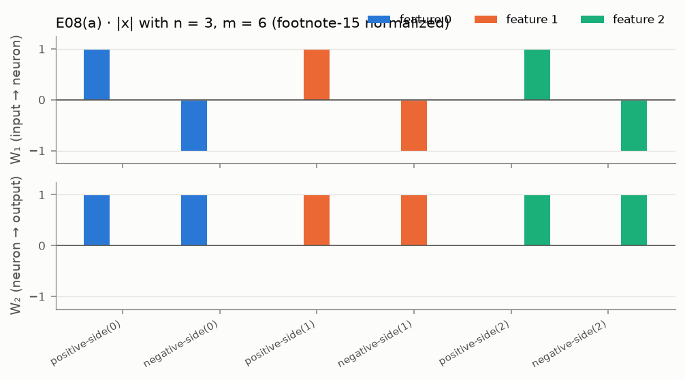
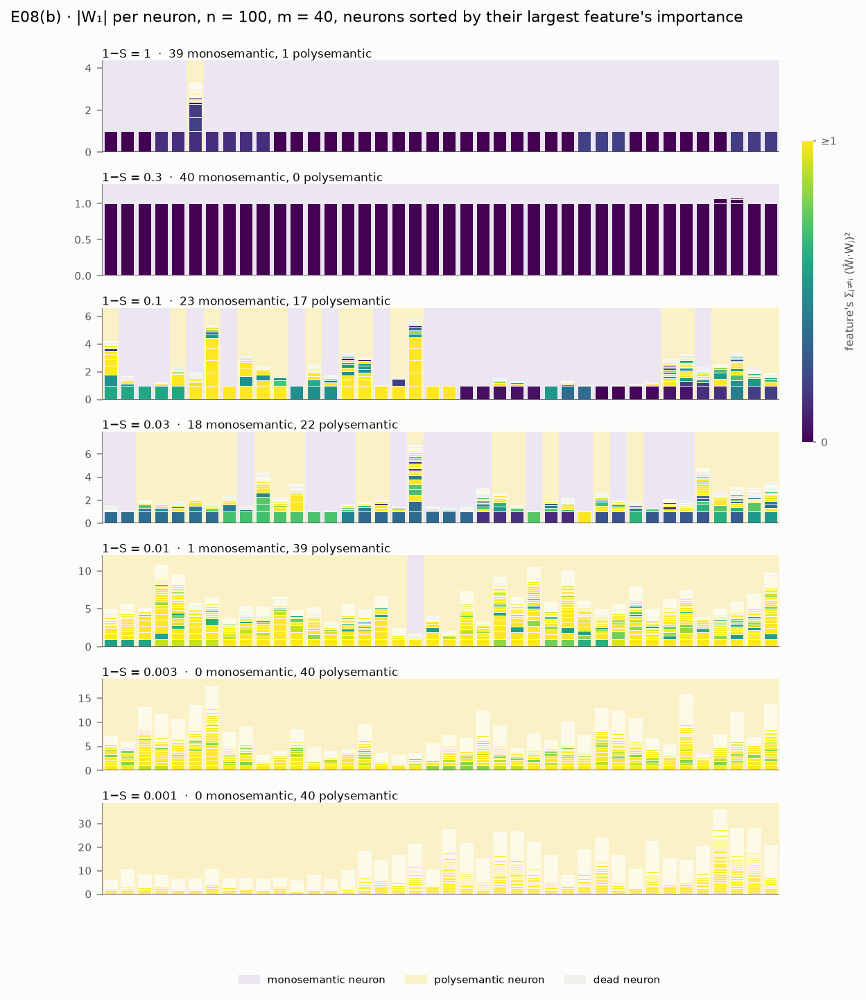
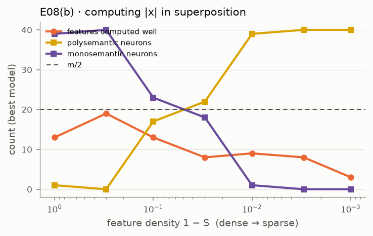

# E08 · abs_computation: computing |x|, with and without superposition

Recipe card for experiment E08 (`abs_computation`, paper pp. 34–39). Status: **PARTIAL 2/4** on
the cited run `20260930T191445Z-49fd30ed`. This is the experiment where a SPEC criterion turned
out not to come from the paper, and where the first explanation of a failure was too strong.
Read section 6 carefully. The labels **[Documented]**, **[Reconstructed]** and
**[Recommended]** are defined in the cookbook [README](../README.md). Dates and sessions are in
[01_timeline.md](../01_timeline.md). Terms are in the [glossary](../../GLOSSARY.md).

## 1. Claim and pages

**The model (p. 35).** Inputs xᵢ are 0 with probability S, otherwise uniform on [−1, 1]; the
target is |x|. The model is h = ReLU(W₁x), y′ = ReLU(W₂h + b), with untied W₁ (m × n) and W₂
(n × m). It *needs* its hidden ReLU, because |x| = ReLU(x) + ReLU(−x), so unlike E07's model it
cannot sidestep the nonlinearity.

**(a) No superposition (p. 36).** With n = 3 features and m = 6 neurons, the model builds a
*positive-side* neuron ReLU(xᵢ) and a *negative-side* neuron ReLU(−xᵢ) for each feature, and adds
them. Footnote 15 (p. 56): rescaling neuron h's row of W₁ by α > 0 and its column of W₂ by 1/α
leaves the function unchanged, so weights are shown after scaling each neuron's largest |W₁|
weight to 1.

**(b) Superposition (pp. 36–38).** n = 100, m = 40, Iᵢ = 0.8ⁱ, across the p. 37 sparsities. Dense
data gives one feature per neuron. Sparse data gives superposition: more features than neurons,
with solutions that, in the paper's words, "usefully approximate the computation" (p. 37). Many
neurons have one *primary* feature with a large weight plus *secondary* ones (p. 38). Footnote
16: the paper chose n = 100, m = 40 to keep the figure readable, although the model learns more
easily with more neurons. Footnote 17: losses at different sparsities are not comparable.

**What SPEC proposed** ([SPEC.md](../../../SPEC.md) §7 E08). (a) One positive- and one
negative-side neuron per feature; every per-feature loss below 5% of the loss of predicting the
mean. (b) Dense → monosemantic neurons; sparse → **more than m/2 features computed well**, a
feature counting when its per-feature loss is below 50% of the mean-prediction baseline. That
last criterion came from the spec, not the paper. **[Documented: D-R01]**

## 2. Prerequisites

| Need | Where | Why E08 needs it |
|---|---|---|
| Absolute-value model, data on [−1, 1] | `models.AbsModel`; `data.IndependentSparse(..., low=-1.0, high=1.0)` | the task |
| Footnote-15 normalization | `metrics.normalize_hidden_units` | reading neurons |
| Exact per-feature loss | `metrics.per_feature_loss` | every (b) count |
| Mean-prediction baseline Var(\|xᵢ\|) = p/3 − p²/4 | `theory.uniform_feature_variance` | the denominator of each ratio |
| Features per neuron | `metrics.neuron_polysemanticity` (25% rule) | neuron counts |
| Neurons and privileged bases | E07 | the reading of W₁ |

`per_feature_loss` and `normalize_hidden_units` were added to `metrics.py` for this experiment
(`27c0f82`). **[Documented: git; phase-4.md "What was built"]** E09 later reverse-engineers this
same model. Rebuild milestones M1–M4 cover the engine. **[Recommended]**

## 3. Config and commands

Source: [`configs/abs_computation.yaml`](../../../configs/abs_computation.yaml). Training is
shared: Adam, lr 1e-3 constant, batch 1,024.

| Setting | quick | full |
|---|---|---|
| (a) n, m, Iᵢ, 1 − S, restarts | 3, 6, 1, 1, 8 | same |
| (b) n, m, Iᵢ | 100, 40, 0.8ⁱ | same |
| (b) 1 − S | 1, 0.3, 0.1, 0.03, 0.01, 0.003, 0.001 | same |
| (b) restarts × steps | 4 × 10,000 | 8 × 30,000 |
| bias-init variant (D-409; never graded) | b₀ = 0.1 at 1 − S = 0.01, 0.001; 2 restarts | same |
| init-scale variant (D-R01; never graded) | 0.187 × Xavier at 0.01, 0.001; 4 restarts | same |
| thresholds | (a) 5%; computed well 50%; usefully computed 75%; 25% rule; dead output 0.05; primary 2× | same |

```bash
uv run superposition run abs_computation --profile quick --device cpu
```

[Verified against manifest] (runs `20260929T175145Z-5a0a35cf` and `20260930T191445Z-49fd30ed`)

```bash
uv run superposition run abs_computation --profile full --device auto
```

[Verified against manifest] (run `20260929T180008Z-db58449f`, where `auto` resolved to MPS on an
Apple M2. That run predates the init-scale variant, so today's full profile does more work.)

```bash
uv run superposition figures abs_computation --run 20260930T191445Z-49fd30ed
```

[Not verified: needs the cited run's folder under `results/`, which is git-ignored and exists
only on the owner's machine]

Tests (all E08 unit tests, then only the estimator and baseline):

```bash
uv run pytest tests/unit/test_neurons.py -q -k "not e07 and not hidden_bias"
```

```bash
uv run pytest tests/unit/test_neurons.py -q -k "per_feature_loss or baseline"
```

```bash
uv run pytest -m paper tests/replication/test_abs_computation.py
```

[Not verified: paper tier; it re-runs the whole quick profile on CPU (493 s measured for the
run itself)]

## 4. Procedure

### 4a. The steps as executed

**Phase 4, session 92884087 (2026-09-29).**

1. **Read the pages and the footnotes.** pp. 26–39 and the footnote page, p. 56.
   [S 92884087 @ 2026-09-29T16:30–16:31Z] **[Documented]**
2. **Prototyped outside the provenance system.** Part (a) at 17:04Z, then the (b) sweep with
   2 restarts × 10,000 steps, then variants: two in parallel, learning rate 3e-3, batch 4,096.
   [S 92884087 @ 2026-09-29T17:04–17:15Z] **[Documented]** None of their outputs are on disk.
   D-409 quotes the features computed well at 1 − S = 0.001: 16 (with a noisier 4,000-sample
   estimate), 11 with 4 restarts, 8 with 30,000 steps, 8 at lr 3e-3, 11 at batch 4,096. None
   approached m/2 = 20, and longer training did not help. **[Documented]**
3. **Diagnosed before changing anything.** A script tested the dead-side hypothesis on trained
   models, then a positive initial output bias. [S 92884087 @ 2026-09-29T17:19Z and 17:22Z]
   The diagnosis (D-409): at high sparsity almost every input has one active feature, so each
   *side* of feature i (xᵢ > 0 or xᵢ < 0) is trained only by its own examples. With the output
   bias starting at 0 (SPEC §3), a side whose initial gain Σₕ W₂[i, h] ReLU(±W₁[h, i]) is
   negative gives a negative pre-activation, the output ReLU clips it, and no gradient reaches
   it. **[Documented]**
4. **Added the diagnostics to the experiment, as INFO.** The side diagnostic and the
   bias-init variant went into the module at 17:24Z, before the graded run, and are never the
   replication default. [S 92884087 @ 2026-09-29T17:24Z] *Added after prototype results were
   seen*, as diagnostics; no criterion changed. **[Documented]**
5. **Committed and ran the quick profile from the main tree** at `5a825d0`, last in the E05–E08
   queue: `20260929T175145Z-5a0a35cf`, 369 s, PARTIAL 2/4. Part (a) passed; dense 39/40
   monosemantic and sparse 3 computed well (> 20 needed) failed. [S 92884087 @
   2026-09-29T17:51Z] **[Documented]**
6. **Ran the full profile from a clean worktree, on MPS.** The session committed a plotting fix
   (`24ec2e9`, which touched only `plotting/dynamics.py`), made a detached worktree at that
   commit with its own environment, pointed `SUPERPOSITION_RESULTS` at the main `results/`,
   and ran `--profile full --device auto`. This was the project's first run from a clean
   worktree. Run `20260929T180008Z-db58449f`, 981 s on MPS, PARTIAL 3/4: dense 40/40 passed;
   sparse 11 computed well failed; 1 of 90 dead sides learned at 0.001. It was reported but not
   cited (`d24a10a`), and the worktree was removed. [S 92884087 @ 2026-09-29T17:58Z, 18:21Z,
   18:26Z] **[Documented]**
7. **Wrote the replication test after the result** (`aceb2e3`, 18:08Z). It pins part (a)'s
   PASS and **at least 39** monosemantic neurons when dense, the failing value just seen, and
   leaves the sparse criterion free (disclosed in its docstring). **[Documented]**
8. **Left the next step to the owner.** SPEC §2 now allowed consulting the reference
   implementations, since an honest attempt had failed; the session did not, "so that the
   choice stays yours" (phase-4.md open issue 1; D-409 "Not done"). **[Documented]**

**Rectification session 2, session 522eb237 (2026-09-30).**

9. **Owner decision D-R01.** Consult the Anthropic and ARENA references for diagnosis only, copy
   no code, and record what was read; re-derive the sparse criterion from the paper and keep
   the original result visible. [Planning conversation, per owner] item 2 recommended the
   re-derivation from p. 37 and footnotes 16–17. **[Documented]**
10. **Re-read the paper first.** pp. 23–24, 27–28 and 34–39 and footnotes 15–17 as text, and a
    search for the paper's "1,000 models" sentence. [S 522eb237 @ 2026-09-30T18:11–18:13Z]
    **[Documented]**
11. **Consulted the references** with a web-fetch tool, nine fetches in the session
    [S 522eb237]. D-R01 records what was read and learned. **[Documented]**
    - Anthropic's archived notebook has only the tied intro model; no |x| model.
    - ARENA §1.5.4's |x| model starts the output bias at 0, as here, so neither reference
      contains a remedy for dead sides.
    - The one substantive difference is ARENA's weight scale. Its Kaiming-uniform init is
      applied to the whole 3-D tensor, so the fan-in is m·n = 4,000 and each weight is about
      5.3× smaller than SPEC §3's Xavier init (std ≈ 0.022 against ≈ 0.120). Every side's
      initial gain is then about 28× smaller in magnitude. Which sides start dead does not
      change, but a small positive output bias might then revive them: a hypothesis to test.
    - ARENA trains one model per density for 5,000 steps, with no restarts and no count. The
      paper's "1,000 models" concerns E07, not this model.
12. **Added a diagnostic and the re-derived criterion, then committed the decision before the
    run.** INFO `b_init_scale_variant` (0.187 × Xavier = √((n + m)/(n·m)), the reference's
    std); INFO `b_within_sparsity_references`; the graded criterion "more than m = 40 features
    usefully computed (< 75%) at 1 − S = 0.001"; SPEC's original kept as INFO
    `b_sparse_original_criterion`. Code `6f48c53` (18:29Z), DECISIONS `d8f1ce6` (18:37Z).
    **[Documented: git]**
13. **Re-ran from a clean detached worktree** at `fd32b02`: `20260930T191445Z-49fd30ed`, 493 s,
    PARTIAL 2/4. Every per-feature loss is bit-for-bit identical to the Phase 4 run; only the
    new rows and the init variant were added (REPRODUCTION.md E08 "Run IDs"). **[Documented]**
14. **Re-scored the full profile from its saved losses**, without re-running it: 29 features
    usefully computed at 0.001, at most 33 at any sparsity. This number is not in that run's
    acceptance record. [S 522eb237 @ 2026-09-30T19:23Z; REPRODUCTION.md E08] **[Documented]**
15. **Updated the replication test** to require both sparse numbers and both variants as INFO
    (`51fd697`), checked against the cited record without re-running the paper tier.
    **[Documented]**

**Phase 6 review (R3).** Ten findings touched E08: R3-01, R3-02, R3-05, R3-06, R3-07, R3-08,
R3-10, R3-11, R3-14 and R3-15 (section 6). The docs were corrected in `f3932ec`; no re-run. R3-06,
R3-07 (in part), R3-10 (in part) and R3-14 remain open. **[Documented]**

### 4b. How to do it by hand

**[Recommended]** for the whole subsection.

1. **Derive the baseline.** With p = 1 − S, |xᵢ| is 0 with probability 1 − p and U[0, 1]
   otherwise, so E|xᵢ| = p/2, E xᵢ² = p/3, and the loss of predicting the mean is
   Var(|xᵢ|) = p/3 − p²/4. Check:

   ```bash
   uv run pytest tests/unit/test_neurons.py -q -k "per_feature_loss or baseline"
   ```

   Expected: 4 passed. If your baseline disagrees: you forgot that zeros count.
2. **Build the exact n = 3, m = 6 model by hand** (W₁ rows ±eᵢ, W₂ columns writing 1 to output
   i, b = 0) and confirm every per-feature loss is 0. Then rescale one neuron by α and confirm
   the outputs do not change (footnote 15). If they change: you scaled W₂ by α, not 1/α.
3. **Write a per-feature loss estimator that conditions on feature i's activity.**
   E[ℓᵢ] = p·E[ℓᵢ | xᵢ ≠ 0] + (1 − p)·E[ℓᵢ | xᵢ = 0], each term on fresh samples. Why: at
   1 − S = 0.001 plain Monte Carlo sees feature i about once per thousand inputs. Check: the
   zero model gives p/3; on a dense model it agrees with plain Monte Carlo.
4. **Label side neurons with a pure function and test it** on the ideal model (six side
   neurons) and on a mixed neuron (labeled "other").
5. **Run part (a).** Expected (cited run): every feature gets exactly one positive- and one
   negative-side neuron; normalized off-feature weights ≤ 0.002; losses 0 to six decimals.
6. **Write the sparse criterion from the paper before running (b).** Count what a model without
   superposition can do: each neuron serves one side of one feature, so it can *usefully*
   compute up to m features one side each, or compute m/2 features *well* on both sides. A
   claim of "more features than neurons" therefore needs more than m. Write DECISIONS first,
   with the page.
7. **Run part (b).** Expected (cited run): dense 39 of 40 neurons monosemantic; polysemantic
   neurons 17, 22, 39, 40, 40 from 1 − S = 0.1 down to 0.001; usefully computed 13, 19, 23,
   33, 35, 27, 23; at 0.001 that is 23, a FAIL. If you get far more: check that your inputs are
   on [−1, 1] and your target is |x|.
8. **Compare within each sparsity, never across (footnote 17).** Compute two references at the
   same sparsity: every feature at its mean, and no superposition (both sides of the m/2 most
   important features exact, the rest at the mean). Expected: model loss 5.5× the
   no-superposition reference when dense and 54× at 0.001. This is what shows an optimization
   failure, not a capacity limit.
9. **Diagnose, then test variants as INFO only.** Compute each side's initial gain, split the
   computed sides by alive or dead at init, then try a positive output bias and a smaller init.
   Never change the replication default. Only after an honest attempt, and with the decision
   logged, consult a reference implementation, and record what you read.

## 5. Acceptance

Values from `results/abs_computation/20260930T191445Z-49fd30ed/acceptance.json`, cited in
[`docs/cited_runs.yaml`](../../cited_runs.yaml); the earlier runs from their own records.

| Criterion (id) | Origin | Status (cited run) | Value | Other runs |
|---|---|---|---|---|
| (a) `a_positive_and_negative_side_neurons` | SPEC §7 from p. 36; side rule in D-408 (25% rule after footnote-15 normalization) | **PASS** | one of each per feature | PASS in `5a0a35cf` and `db58449f` |
| (a) `a_per_feature_loss` (< 5%) | SPEC §7 | **PASS** | [0.0, 0.0, 0.0] | PASS in both |
| (b) `b_dense_monosemantic` | SPEC §7 from p. 37 | **FAIL** | 39 mono, 1 poly (one neuron carries three features) | FAIL 39/40 in `5a0a35cf`; PASS 40/40 in the full run `db58449f` |
| (b) `b_sparse_more_features_than_neurons` (> 40 usefully computed, < 75%, at 1 − S = 0.001) | D-R01: owner decision to re-derive from p. 37; the 75% and "> m" operationalization by the session, fixed before the run | **FAIL** | 23 | not graded earlier; 29 in the full run, re-scored from saved losses |
| (b) `b_sparse_original_criterion` (> 20 computed well, < 50%) | SPEC §7 proposal, **not the paper**; graded until D-R01, INFO since | INFO (would fail) | 3 | graded FAIL: 3 in `5a0a35cf`, 11 in `db58449f` |
| (b) `b_per_sparsity_summary` | INFO (SPEC: report primary + secondary) | INFO | primary + secondary 0, 0, 11, 15, 8, 4, 2; most features on one neuron 3, 1, 6, 7, 14, 18, 59 | — |
| (b) `b_within_sparsity_references` | INFO, D-R01 (footnote 17) | INFO | model / no-superposition loss 5.47, 1.26, 7.56, 23.5, 41.2, 48.9, 53.6 | — |
| (b) `b_side_diagnostics` | INFO, D-409 | INFO | dead sides computed: 2/87, 1/87, 0/89 at 0.01, 0.003, 0.001; alive: 37/113, 28/113, 23/111 | `db58449f`: 1/90 dead at 0.001 |
| (b) `b_bias_init_variant` | INFO, D-409 | INFO | at 0.01 / 0.001: loss 0.00353 / 0.00037 (default 0.00785 / 0.00103); usefully computed 34 / 27 | — |
| (b) `b_init_scale_variant` | INFO, D-R01 | INFO | at 0.01 / 0.001: loss 0.00127 / 0.00099; computed well 25 / 11; usefully computed 30 / 16 | — |

Run commits: `5a0a35cf` = `20260929T175145Z-5a0a35cf` (`5a825d0`), `db58449f` =
`20260929T180008Z-db58449f` (`24ec2e9`), cited `20260930T191445Z-49fd30ed` (`fd32b02`).
**[Documented]**

## 6. What actually happened

- **Built beside an unfinished Phase 3** (D-401). **[Documented]**
- **The original sparse criterion was wrong in kind, not just in level.** SPEC's "> m/2 computed
  well" came from the spec. A model without superposition can compute m/2 features well on both
  sides, so passing it would not have shown superposition, and failing it does not show its
  absence. The owner had it re-derived (D-R01), and the original stays visible as INFO. The new
  criterion also fails (23, against more than 40). *Changed after results were seen:* the graded
  criterion, by a logged owner decision, with the old result kept. **[Documented]**
- **"Fixed before the run" was weaker than it sounds.** The re-run reproduced every per-feature
  loss bit for bit, and the Phase 4 run had saved those losses. So the new criterion's outcome
  (23) could be computed before it was fixed. Whether anyone did is unknown; D-R01 says only
  that the previous run's numbers were known. **[Reconstructed: from REPRODUCTION.md "Run IDs"
  (bit-for-bit) and the saved `per_feature_loss_ratio.parquet` in `20260929T175145Z-5a0a35cf`]**
  The lesson: a threshold fixed after the data exist is not pre-registered, even if the run
  comes later. **[Recommended]**
- **An explanation that was too strong (R3-02).** The first write-up gave dead sides at
  initialization as *the* cause. The diagnostic's own numbers contradict that: 111 sides start
  alive at 1 − S = 0.001, more than either criterion needs, yet only 23 end up computed; and the
  dense model, where the 1-sparse mechanism does not apply, is 5.5× its reference. Now "a
  contributing factor", with untested alternatives listed: sides that die during training as
  output biases go negative; the best restart chosen on a noisy loss; training length.
  Notebook 08's exercise solution was fixed too. *Changed after review.* **[Documented]**
- **The neuron picture was overclaimed (R3-01).** The trend reproduces (monosemantic when
  dense, polysemantic when sparse, primary + secondary in between). Two details do not: the
  neurons of the most important features are not more often monosemantic (the reviewer's
  analysis), and the dense model spends its 40 neurons on few features, usefully computing only
  13. R3-11: at 0.001 the polysemantic counts include weights that barely moved from
  initialization. **[Documented]**
- **Noisy counts (R3-05).** About 20 features sit within ±0.02 of the 50% bar at 1 − S ≤ 0.01.
  A re-estimate with another seed moved the computed-well counts at 0.01, 0.003, 0.001 from
  9, 8, 3 to 5, 5, 7 (reviewer's numbers). D-408 had claimed the estimator prevents this; it
  was corrected in place. The graded 75% counts did not move. **[Documented]**
- **Unpaired variants (R3-07)** start from other random draws than the default runs, so part of
  any difference may come from the draws. **Restart selection (R3-06)** uses a 20,000-sample
  loss whose noise at 0.001 is about the spread between restarts. Both open. **[Documented]**
- **A framing error (R3-08).** "More than m/2 usefully computed" was first called beyond the
  capacity without superposition; without superposition up to m can be usefully computed.
  **[Documented]**
- **Tests that pin a failure (R3-14, open).** The replication test's "≥ 39 monosemantic" was
  written after 39 was observed. It is disclosed in the docstring, but it encodes the current
  outcome. **[Documented]**
- **What the init-scale variant showed.** At 1 − S = 0.01 the smaller init cuts the loss 6×
  and revives 22 of 109 dead sides, and 25 features are computed well, more than m/2; but it
  usefully computes fewer (30 against 35). At 0.001 it changes little; the hypothesis (not
  tested) is that each side sees only about 5,000 examples in 10,000 steps. No variant
  usefully computes more than m features at the sparsest setting. **[Documented]**
- **Open next steps** (rectification.md open issue 1): the small init with longer training, the
  small init with a positive output bias, and more neurons (footnote 16), each as a variant.
  **[Documented]**

## 7. Compute

| Run | Commit | Device | Profile | Wall-clock | (b) sweep training | Status |
|---|---|---|---|---|---|---|
| `20260929T175145Z-5a0a35cf` | `5a825d0` | Apple M2 CPU | quick | 369.381 s | 292.3 s | PARTIAL 2/4 (old criteria) |
| `20260929T180008Z-db58449f` | `24ec2e9` | Apple M2, MPS | full | 981.038 s | 798.3 s | PARTIAL 3/4 (old criteria) |
| `20260930T191445Z-49fd30ed` (cited) | `fd32b02` | Apple M2 CPU | quick | 492.778 s | 302.9 s | PARTIAL 2/4 |

Wall-clock from each `manifest.json`; training times from each `log.txt`. **[Documented]** In
the cited run the init-scale variant, new in that run, takes about 105 s between its log lines,
most of the 123 s difference from the Phase 4 quick run; the bias variant takes about 51 s in
the cited run and 47 s in the Phase 4 one. **[Reconstructed: from the log timestamps]** The
full profile's 981 s was measured before the init-scale variant existed; a full run today would
take longer, by an unmeasured amount. The prototypes' compute is unknown.

## 8. What to look at

- Figures in [`docs/figures/abs_computation/`](../../figures/abs_computation/), from the cited
  run:
  -  — W₁ and W₂ per
    neuron, footnote-15 normalized. Put it next to p. 36.
  -  — |W₁| per neuron
    at each sparsity, neurons sorted by their top feature's importance. Put it next to p. 37.
  -  — features usefully
    computed (against m) and computed well (against m/2), with neuron counts.
- The lab's **Neurons** page ([`app/pages/6_Neurons.py`](../../../app/pages/6_Neurons.py)), tab
  "E08 · computing |x| (pp. 34–38)".
- Notebook [`08_neurons_and_computation.ipynb`](../../../notebooks/08_neurons_and_computation.ipynb),
  sections 2 and 3 and exercise 4. REPRODUCTION.md's [E08 section](../../REPRODUCTION.md),
  above all the within-sparsity table.

## 9. Explain it back

1. Why can E07's model sidestep its hidden ReLU while this one cannot? What would a positive
   hidden bias do to |x|?
2. A model with no superposition at all: how many features can it compute *well* (< 50%), and
   how many *usefully* (< 75%)? Why does that make "> m/2 computed well" a poor test of
   superposition, and "> m usefully computed" a better one?
3. Why does a smaller initial weight scale revive dead sides at 1 − S = 0.01 but not at 0.001
   (rectification.md question 1)? Think about how many examples each side sees.

**Drill.** A model computes ReLU(xᵢ) exactly and outputs 0 when xᵢ < 0. Derive its per-feature
loss ratio against the mean-prediction baseline as a function of p = 1 − S. Then find the
density above which this one-sided feature no longer counts as *usefully computed*. Self-check:
the missed error is E[xᵢ²; xᵢ < 0] = p/6, so the ratio is (p/6)/(p/3 − p²/4) = 2/(4 − 3p): 0.5 as
p → 0 (D-R01's "≈ 50%"), 2 when dense, and it crosses 0.75 at p = 4/9. What does that imply for
the usefully-computed counts at 1 − S = 1 and 0.3?

## 10. Answer key

Open these after trying:

- [`src/superposition/experiments/abs_computation.py`](../../../src/superposition/experiments/abs_computation.py):
  `side_roles`, `neuron_feature_counts`, `primary_secondary`, `side_gain`, `side_errors`,
  `side_diagnostics`, `train_abs`, `loss_ratios`, `model_losses`, `reference_losses`,
  `evaluate_small`, `summarize_sweep`, `evaluate_sweep`, `run_variant`.
- [`src/superposition/metrics.py`](../../../src/superposition/metrics.py): `per_feature_loss`,
  `normalize_hidden_units`, `neuron_polysemanticity`; `theory.uniform_feature_variance`;
  `models.AbsModel`.
- [`tests/unit/test_neurons.py`](../../../tests/unit/test_neurons.py) (`ideal_abs_model`,
  `test_e08_sweep_criteria`, `test_e08_reference_losses_and_exact_model_loss`) and
  [`tests/replication/test_abs_computation.py`](../../../tests/replication/test_abs_computation.py).
- [`src/superposition/plotting/neurons.py`](../../../src/superposition/plotting/neurons.py):
  `abs_weights_figure`, `capacity_figure`.
- D-408, D-409, D-R01 in [DECISIONS.md](../../DECISIONS.md); R3-01, R3-02, R3-05–R3-08,
  R3-10, R3-11, R3-14, R3-15 in [REVIEW.md](../../REVIEW.md).
