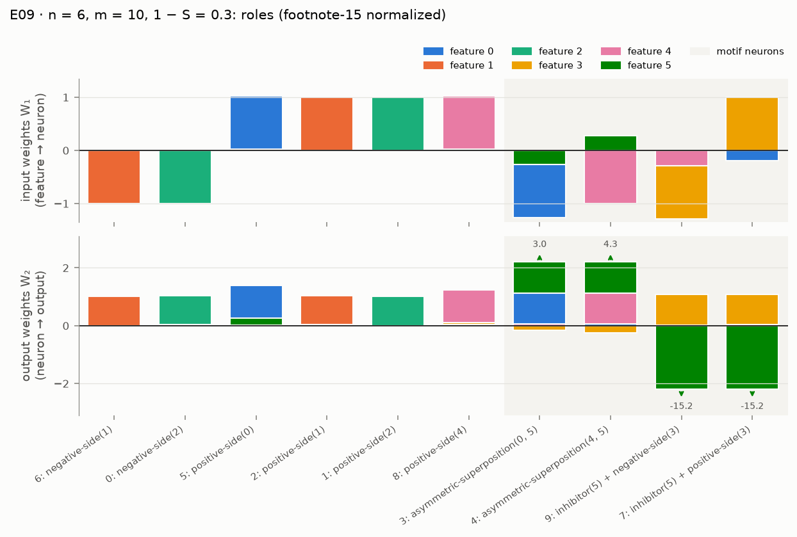

# E09 · mech_interp_abs: reverse-engineering small |x| models (pp. 38–39)

Recipe card for experiment E09. Status today: **PASS 3/3** on criteria that were tightened after
the independent review, with a reported discrepancy on one sub-claim and a regime chosen from a
pilot. Read [01_timeline.md](../01_timeline.md) for when each session happened. Terms are
defined in [GLOSSARY.md](../../GLOSSARY.md).

Labels: **[Documented]** = the cited evidence shows it; **[Reconstructed]** = inferred, with the
basis stated; **[Recommended]** = advice for doing it by hand, not history.

## 1. Claim and pages

- **The model** (p. 35). h = ReLU(W₁x), y′ = ReLU(W₂h + b), target |x|. Inputs are 0 with
  probability S, else U[−1, 1]. The hidden ReLU is needed, because |x| = ReLU(x) + ReLU(−x), so
  the neurons form a privileged basis and each one can be given a *role*. **[Documented:
  `src/superposition/interp.py` module docstring]**
- **The claim** (pp. 38–39). The p. 39 model (6 features, 10 neurons) does only a limited
  amount of superposition. Most of its weights implement |x| the expected way, with *side
  neurons* (one for ReLU(xᵢ), one for ReLU(−xᵢ), p. 36). The rest implement two copies of
  *asymmetric superposition with inhibition*:
  - one neuron stores two features with unequal input weights and reciprocal output weights,
    so the *heavy* feature interferes strongly with the *victim* but not the reverse;
  - a second neuron reads a little of the heavy feature and strongly inhibits the victim. The
    paper says this "converts positive interference … into negative interference" (p. 39).
  **[Documented: docs/REPRODUCTION.md § "E09 … Paper's claims"]**
- **What the paper does not give.** No density, no importance, and no thresholds for "named"
  or "found". Every number in the criteria below is a SPEC proposal or a DECISIONS
  operationalization, not a paper value. **[Documented: D-502; SPEC.md §7 "The thresholds below
  are initial proposals"]**
- **SPEC's version** ([SPEC.md](../../../SPEC.md) §7 E09, §6 `interp.py`): train |x| models in
  the regime with limited superposition; name ≥ 90% of neurons; ablations agree with roles; find
  the motif in at least one model; report a rebuild test. **[Documented]**

Key terms (see the [glossary](../../GLOSSARY.md)): *path gain* G_h[i, j] = |W₁[h, i]|·W₂[j, h],
what output j receives per unit of feature i through neuron h on a 1-sparse input; *ablation*
(zero or mean); *rebuild test* (a model built by hand from the roles, scored by the share of the
trained model's loss reduction over predicting the mean that it recovers).

## 2. Prerequisites

| Kind | What | Why |
|---|---|---|
| Module | `data` (sparse inputs, nonzero values U[−1, 1]) | the |x| task's inputs |
| Module | `models.AbsModel` | the p. 35 model, with a leading instance dimension |
| Module | `train` (multi-instance training, `select_best`) | 20 restarts per setting in one model |
| Module | `metrics.per_feature_loss` (with `shared_samples`), `metrics.normalize_hidden_units` | ablation losses on common inputs; footnote-15 rescaling |
| Module | `interp` (roles, motifs, ablations, rebuild) | the analysis itself |
| Experiment | E08 `abs_computation` | the |x| model, side neurons (p. 36) and the training settings E09 reuses (D-502) |

Build the engine first ([05_engine.md](../05_engine.md); the rebuild kit's milestones M1–M4 in
[rebuild/README.md](../../../rebuild/README.md)). **[Recommended]**

## 3. Config and commands

From [configs/mech_interp_abs.yaml](../../../configs/mech_interp_abs.yaml) **[Documented]**:

| Setting | Value |
|---|---|
| shapes (n, m) | (4, 6), (5, 8), (6, 10): m = 2n − 2, two neurons short of no superposition |
| graded densities 1 − S | 0.3, 0.2 |
| context densities (reported only) | 0.5, 0.1 |
| importance | Iᵢ = 1 (`importance_decay: 1.0`) |
| restarts | 20 per setting |
| training | 10,000 steps, batch 1024, Adam lr 1e-3, constant schedule |
| role thresholds | dead 0.05, self 0.1, clean 0.25, magnitude ratio 2.0, inhibition dominance 1.0, cancel 0.5, ablation rise 0.05 |
| grading bars | named ≥ 0.9, ablation agreement ≥ 0.9, 20,000 analysis samples |

| Profile | Overrides | Run? |
|---|---|---|
| `quick` | none | measured 255 s (cited run) |
| `pilot` | 16 restarts | measured 200 s (cited as `mech_interp_abs:pilot`) |
| `full` | 64 restarts, 30,000 steps | never run; the config estimates about 10× quick, ≈ 45 minutes on a laptop CPU |

Commands. Every cited E09 run used seed 0; E09 has no held-out seed. **[Documented:
docs/cited_runs.yaml]**

```bash
uv run superposition list
```

```bash
uv run superposition run mech_interp_abs --profile quick --device cpu
```

[Verified against manifest] (`20261001T072551Z-3fdd1d10`, also `20260930T184323Z-3fdd1d10` and
`20260929T211826Z-3fdd1d10`)

```bash
uv run superposition run mech_interp_abs --profile pilot --device cpu
```

[Verified against manifest] (`20261001T072229Z-1e8bafbd`, also `20260930T183948Z-1e8bafbd`)

```bash
uv run superposition run mech_interp_abs --profile full --device cpu
```

[Not verified: the full profile was never run (D-R06); estimated about 45 minutes]

```bash
uv run superposition figures mech_interp_abs --run latest --publish
```

[Not verified: needs a run under the git-ignored results/, and overwrites tracked figures in docs/figures/]

```bash
uv run superposition report --pin mech_interp_abs
uv run superposition report --pin mech_interp_abs --run 20261001T072229Z-1e8bafbd --label pilot
```

[Not verified: modifies tracked docs (docs/cited_runs.yaml, docs/REPRODUCTION.md)]

## 4. Procedure

### 4a. The steps as executed

1. **Read p. 39 at high resolution.** The Phase 5 session rendered p. 39 at 200 dpi with
   `pdftoppm` and cropped the figure, then counted 6 features and 10 neurons. **[Documented: S
   57d571bd @ 2026-09-29T19:59Z; D-502]**
   - Check: the count matches m = 2n − 2. If the text layer misses a figure, render it.
     **[Recommended]**
2. **Prototype outside the provenance system.** A scratchpad script (`proto_e09.py`) trained
   n = 6, m = 10 models before any module existed. Its outputs are not in the repository and
   are unknown. **[Documented: S 57d571bd @ 2026-09-29T20:05Z]**
3. **Write the role rules on path gains** (D-501) and sanity-check them on a hand-built motif
   model. **[Documented: S 57d571bd @ 2026-09-29T20:12Z; D-501]**
4. **Run an uncited density pilot.** `pilot_e09.py` over sizes 4×6, 5×8, 6×10, densities 0.5,
   0.3, 0.2, 0.1, 16 restarts. It showed no superposition at 0.5, every neuron named and the
   motif common at 0.3 and 0.2, many unexplained neurons at 0.1. The graded densities were
   then set to 0.3 and 0.2. **[Documented: S 57d571bd @ 2026-09-29T20:12Z; D-502]**
   - *Changed after results were seen:* the pilot showed inhibitors leaking their small read of
     the heavy feature into their secondary role, so inhibitor *triggers* were added and the
     pilot re-run for n = 6, m = 10. The rebuild went from 51–84% to 94–97%; naming was not
     affected. **[Documented: S 57d571bd @ 2026-09-29T20:17Z; D-501 "Rationale"]**
5. **Development run into the scratchpad.** The quick profile was run through the CLI with
   `SUPERPOSITION_RESULTS` pointing at a scratchpad folder, and the figures were fixed. Not in
   `results/`; its numbers are unknown. **[Documented: S 57d571bd @ 2026-09-29T20:22–20:28Z]**
6. **Commit, then run the cited quick profile.** `a8cb60e` (interp), `2e1fed1` (E09), `071e27d`
   (lab tab), `dbe87c8` (notebooks). The session checked `git status --porcelain
   --untracked-files=no` and ran the quick profile from the main tree: run
   `20260929T211826Z-3fdd1d10`, PASS 3/3, 271 s, motif found in 134 of 240 models. It was
   pinned and reported in phase-5.md. **[Documented: S 57d571bd @ 2026-09-29T21:18Z;
   runtable; [phase-5.md](../../progress/phase-5.md) "Acceptance table"]**
7. **Make the pilot a cited run (owner decision D-R03).** Commit `9243d19` added profile
   `pilot`, rebuilt from the original pilot script, which was still in the Phase 5 scratchpad.
   It is not bit-identical, because the module orders the graded densities first, which changes
   each model's instance seed. Runs from a clean detached worktree at `fd32b02`: pilot
   `20260930T183948Z-1e8bafbd` (212 s) and quick `20260930T184323Z-3fdd1d10` (258 s), both PASS
   3/3. The pilot ran first so that the lab, which shows the latest run, shows the quick run.
   **[Documented: S 522eb237 @ 2026-09-30T18:19Z and 18:38–18:47Z; D-R03;
   [rectification.md](../../progress/rectification.md) "Runs"]**
8. **Independent review R4, then tightened criteria (D-604).** The reviewer (an agent with fresh
   context, 2026-09-30T20:18Z → 10-01T06:34Z) found the motif detector matched a weight pattern
   (R4-01), the inhibitor role named random neurons (R4-02), an ablation overclaim (R4-03) and
   that the regime was chosen on the graded quantity (R4-10). Fix `a5caf90`; re-runs from a clean
   worktree at `450938e`: pilot `20261001T072229Z-1e8bafbd` (200 s) and quick
   `20261001T072551Z-3fdd1d10` (255 s), PASS 3/3, motif in 68 of 240 models. Pinned and reported
   in `1773d5a`. **[Documented: S 1584c849 @ 2026-10-01T06:44Z; D-604;
   [REVIEW.md](../../REVIEW.md) § R4; [phase-6.md](../../progress/phase-6.md) "Runs"]**

### 4b. How to do it by hand

1. **Draw the p. 39 model.**
   - Action: from pp. 35–39, write down which neuron reads which feature, with signs and rough
     sizes.
   - Expected: 6 features, 10 neurons; two neurons each hold two features with flipped sizes.
   - Check: your count gives m = 2n − 2.
   - If it fails: render the page as an image; text layers miss figures. **[Recommended]**
2. **Write `path_gains` and the role rules, test-first.**
   - Action: implement G[h, i, j] = |W₁[h, i]|·W₂[j, h] and the roles of D-501, with every
     threshold in a dataclass.
   - Command (the repo's tests are your spec; read them, then run them against the answer key
     to see the expected behavior):

     ```bash
     uv run pytest tests/unit/test_interp.py -q
     ```

   - Expected: all pass (16 tests at the starting commit).
   - Check by hand: the exact model of p. 36 gives only side neurons; zeroing one side neuron
     raises that feature's loss by exactly p/6 (`test_ablations_of_the_exact_model_match_closed_forms`).
   - If it fails: test footnote-15 invariance first (scale a W₁ row by α and the W₂ column by
     1/α; roles must not change). **[Recommended]**
3. **Build the motif by hand.**
   - Action: W₁ = [2, −½] and W₂ = [½, 2] for one neuron (notebook 09, exercise 1).
   - Expected: own gains 1 and 1; heavy → victim 4; victim → heavy ¼.
   - Check: the ratio is 16, the square of the 4× size flip.
   - If it fails: you dropped the absolute value on W₁. **[Recommended]**
4. **Fix the regime before you see the graded quantity.**
   - Action: decide which densities you grade, and by what rule, *before* running anything. If
     you need a pilot, make it a CLI profile so it is logged and citable (the lesson of D-502,
     D-R03 and R4-10).
   - Command: the `pilot` profile above.
   - Expected: no superposition at 0.5; clean naming at 0.3 and 0.2; breakdown at 0.1.
   - Check: the pilot chooses on a quantity *other* than the one graded, or you grade every
     density.
   - If it fails: grade the whole range and report a PARTIAL honestly. **[Recommended]**
5. **Train, then analyze the best restart of each setting.**
   - Command: the `quick` profile above.
   - Expected: about 4–5 minutes on an M2 CPU; overall PASS 3/3.
   - Check: open `results/mech_interp_abs/<run_id>/acceptance.json` and compare `named_roles`,
     `ablations_agree` and `motif_found` with §5.
   - If it fails: check that roles are computed on normalized weights and that ablations share
     samples across variants. **[Recommended]**
6. **Make the motif detector demand the roles, and add a baseline.**
   - Action: count a motif only if the asymmetric neuron *is* asymmetric-superposition(heavy,
     victim) and its partner *is* inhibitor(victim); run the same rules on untrained weights.
   - Expected: role-consistent motifs are rarer than weight patterns (68 against 134 models).
   - Check: `test_role_consistent_motifs_need_the_motif_roles` and
     `test_inhibitor_with_unexplained_content_is_not_fully_named`.
   - If it fails: a rule that names half of a random model's neurons is weak evidence; tighten it
     and say so in DECISIONS. **[Recommended]**
7. **Rebuild.** Build the idealized model from the roles only, score it on common samples, and
   report the recovered share; expect 0.90–0.97 in the graded settings and 1.0 at 0.5.
   **[Recommended]**

## 5. Acceptance

The cited run is `20261001T072551Z-3fdd1d10` (quick, CPU, seed 0, commit `450938e`), with the
pilot `20261001T072229Z-1e8bafbd` as a supplementary citation (D-R07). Values are from their
`acceptance.json`. **[Documented: docs/cited_runs.yaml; results/mech_interp_abs/…/acceptance.json]**

| Criterion | Where it came from | Final status | Value (cited run) | Pilot |
|---|---|---|---|---|
| `named_roles`: ≥ 90% of live neurons fully named | SPEC §7 proposal; "live" and the extra roles from D-501; "nothing unexplained" from D-604 | PASS | 48/48 (1.0), 0 dead | 48/48 |
| `ablations_agree`: zero and mean ablation raise every predicted loss by ≥ 5% of the mean-prediction loss, most on one of them, for ≥ 90% | SPEC §7; operationalized in D-501 | PASS | 48/48 | 48/48 |
| `motif_found`: ≥ 1 model | SPEC §7; role-consistent since D-604 | PASS | 68 of 240 models (8–12 of 20 per graded configuration); weight pattern alone 134 | 55 models; weight pattern 99 |
| `rebuild` | SPEC §6 "reported" | INFO | 0.90–0.97 graded (0.8975 to 0.9679) | 0.89–0.98 graded |
| `named_at_initialization` | D-604 (baseline, R4-02) | INFO | 49–54% named, 30–33% fully named | 49–53%, 30–32% |
| `motif_details` | D-R03 | INFO | net interference < 0 in 5 of 16 best-model motifs; 43 of 129 over all restarts | 3/16; 32/104 |
| `context_densities` | D-502 | INFO | 1 − S = 0.5: no motif, rebuild 1.0; 0.1: n = 6 names 2 of 10, rebuild 0.17 | 0.1: rebuild 0.21, −0.29, 0.57 |

Earlier statuses: PASS 3/3 in Phase 5 (`20260929T211826Z-3fdd1d10`, motif 134/240 by weight
pattern) and in rectification 2 (`20260930T184323Z-3fdd1d10`, same numbers). **[Documented:
runtable; those runs' acceptance.json]**

## 6. What actually happened

- **The regime came from an uncited pilot.** The paper gives no density, so a scratchpad pilot
  chose 1 − S ∈ {0.3, 0.2} (D-502). The owner later had it re-run as a cited profile (D-R03),
  as the planning conversation had recommended. **[Documented: D-502; D-R03; Planning
  conversation, per owner]**
- **The regime was chosen on the graded quantity** (R4-10). The pilot picked the densities where
  every neuron was named, and the criterion grades naming. Grading 1 − S = 0.1 too would give
  62 of 72 neurons fully named (0.86), below the bar. The PASS is now scoped to the regime in
  REPRODUCTION.md. **[Documented: REVIEW R4-10; REPRODUCTION.md E09]**
- **The motif detector was too loose** (R4-01). It matched a weight pattern, including on
  neurons the role table called unexplained. Fixed by D-604: 134 → 68 models. *Changed after
  results were seen*, by a reviewer, and in the strict direction; the status stayed PASS.
  **[Documented: D-604; REVIEW R4-01]**
- **The inhibitor role was too permissive** (R4-02): random weights get a role about half the
  time. "Named" now means fully named, and the baseline row reports it. **[Documented: D-604]**
- **An overclaim corrected** (R4-03): ablations raise the predicted losses, but in 5 of 96
  cases an unnamed feature's loss also rises by 5–8%. The docs had said "exactly".
  **[Documented: REVIEW R4-03]**
- **A sub-claim does not reproduce** (D-R03). The inhibitors cancel the interference rather
  than overshoot it: the victim's net 1-sparse pre-activation ranges −0.045 to +0.075 (median
  +0.023) in the best models' motifs, −1.1% to +2.5% of the interference it cancels. The owner
  decided to report this as a discrepancy on the sub-claim, not as a failed criterion.
  Rectification 2 first gave 6 of 18 negative; after D-604 it is 5 of 16. **[Documented: D-R03;
  REPRODUCTION.md E09 "Discrepancy"; rectification.md item 3]**
- **Reproducibility.** The Phase 6 quick run trains the same models as the rectification-2 run;
  weight-pattern counts and rebuild values are unchanged, and the published figures came out
  byte-identical. **[Documented: REPRODUCTION.md E09 "Run IDs"; phase-6.md "Reproducibility"]**

## 7. Compute

All on an Apple M2 CPU (`--device cpu`), seed 0. **[Documented: each run's manifest.json]**

| Run | Profile | Commit | Wall-clock | Status | Cited |
|---|---|---|---|---|---|
| `20260929T211826Z-3fdd1d10` | quick | `dbe87c8` | 271 s | PASS 3/3 | superseded |
| `20260930T183948Z-1e8bafbd` | pilot | `fd32b02` | 212 s | PASS 3/3 | superseded |
| `20260930T184323Z-3fdd1d10` | quick | `fd32b02` | 258 s | PASS 3/3 | superseded |
| `20261001T072229Z-1e8bafbd` | pilot | `450938e` | 200 s | PASS 3/3 | `mech_interp_abs:pilot` |
| `20261001T072551Z-3fdd1d10` | quick | `450938e` | 255 s | PASS 3/3 | `mech_interp_abs` |

- The scratchpad prototype, pilot and development run: compute unknown (not logged).
- Full profile: never run; ≈ 45 minutes is the config's *estimate*.
- Paper-tier test: "about 5 minutes" per its docstring, an *estimate*. In Phase 5 the three
  E09–E11 replication tests took 20 minutes together. **[Documented: phase-5.md "Test status"]**

## 8. What to look at

- Figures (from the cited run, per `docs/figures/mech_interp_abs/SOURCE.txt`):
  -  The best n = 6, m = 10
    model drawn like p. 39, roles on each neuron, motif neurons shaded.
  - [ablations.png](../../figures/mech_interp_abs/ablations.png),
    [rebuild.png](../../figures/mech_interp_abs/rebuild.png),
    [role_census.png](../../figures/mech_interp_abs/role_census.png).
- The lab: **Neurons** page, tab "E09 · roles and ablations" ([6_Neurons.py](../../../app/pages/6_Neurons.py)).
  It reads the *latest* run, not necessarily the cited one.

  ```bash
  uv run superposition app
  ```

  [Not verified: starts a long-running Streamlit server]
- The notebook: [09_mech_interp.ipynb](../../../notebooks/09_mech_interp.ipynb) (path gains, the
  motif by hand, then E09's models). Open it in your editor with the project's `.venv` kernel.

## 9. Explain it back

1. The victim feature has no neuron of its own in the p. 39 model. Using path gains, say how its
   two sides are computed and why its loss is still small.
2. Why must the inhibitor read the heavy feature with the *same sign* as the asymmetric neuron?
   What happens to the victim if it reads the opposite side?
3. The role rules name about half the neurons of an untrained model. Why does that matter for a
   "≥ 90% named" bar, and what does the baseline row let a reader conclude?

**Drill.** Take the graded n = 4, m = 6, 1 − S = 0.3 best model from the cited run (weights in
`checkpoints/n4_m6.pt`, roles in `roles.parquet` and `acceptance.json`; you need the run on
disk). Neuron 4 is asymmetric-superposition(2, 1) and neuron 0 is inhibitor(1). By hand, compute the net 1-sparse pre-activation of
the victim when the heavy feature fires at value 1: the asymmetric neuron's gain onto the victim,
plus the inhibitor's gain, plus the victim's bias. Compare with the `motif_details` example for
that model (net −0.045 for neurons [4, 0]). Then decide whether it "converts" or "cancels".
Self-check: your sign and magnitude match the example to two decimals.

## 10. Answer key (open after attempting)

- [`src/superposition/interp.py`](../../../src/superposition/interp.py): `path_gains`,
  `neuron_roles`, `NeuronRole.fully_named`, `find_motifs`, `role_consistent_motifs`,
  `ablation_matrix`, `ablation_agrees`, `rebuild_weights`, `rebuild_test`.
- [`src/superposition/experiments/mech_interp_abs.py`](../../../src/superposition/experiments/mech_interp_abs.py):
  `train_shape`, `analyze_model`, `motif_census`, `named_at_initialization`, `evaluate`.
- Tests: [`tests/unit/test_interp.py`](../../../tests/unit/test_interp.py) (`exact_abs_model`,
  `motif_model`), `tests/unit/test_phase5_experiments.py::test_e09_criteria_pass_and_fail`,
  [`tests/replication/test_mech_interp_abs.py`](../../../tests/replication/test_mech_interp_abs.py).
- Decisions: D-501, D-502, D-R03, D-604 in [DECISIONS.md](../../DECISIONS.md).
