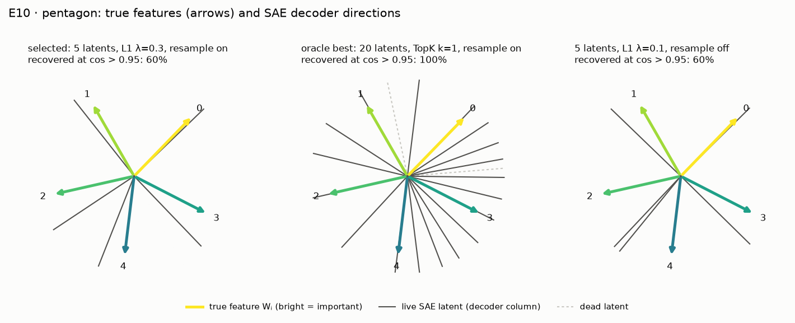

# E10 · sae_recovery: do sparse autoencoders find the true features? (pp. 42–44)

Recipe card for experiment E10. Status today: **PARTIAL 1/3**. It was **PASS 3/3** until the
graded SAE stopped being chosen with ground truth. This card is the repository's clearest case
of *selection by ground truth* and of a criterion rule fixed while earlier results were known.
Read [01_timeline.md](../01_timeline.md) for the sessions, and
[06_debugging_playbook.md](../06_debugging_playbook.md) for the general lesson. Terms are in
[GLOSSARY.md](../../GLOSSARY.md).

Labels: **[Documented]** = the cited evidence shows it; **[Reconstructed]** = inferred, with the
basis stated; **[Recommended]** = advice for doing it by hand, not history.

## 1. Claim and pages

- **The paper's idea** (pp. 42–44, footnote 20). Approach 2 to "solving superposition": take a
  trained model that has superposition and find, after the fact, an overcomplete basis that
  describes how features are embedded. Footnote 20 states it as sparse coding: hidden
  activations H ≈ AB with A sparse. Toy models are where this can be checked, because there the
  true features are known (p. 44). **[Documented: `src/superposition/sae.py` docstring;
  docs/REPRODUCTION.md § "E10 … Paper's claims"]**
- **The paper runs no such experiment.** SPEC §7 E10 turns it into one: train sparse
  autoencoders on the hidden activations of toy models in superposition and ask whether they
  recover the known directions. **[Documented: REPRODUCTION.md E10; [SPEC.md](../../../SPEC.md)
  §7 E10]**
- **SPEC's proposed criteria:** the pentagon's 5 features recovered at cosine > 0.95; for the
  n = 20, m = 5 model, ≥ 90% of represented features at cosine > 0.9. Both are SPEC proposals,
  not paper numbers. **[Documented: SPEC.md §7]**

Key terms: a *sparse autoencoder (SAE)* computes f = ReLU(W_enc(h − b_dec) + b_enc) and
ĥ = W_dec f + b_dec, with loss ‖h − ĥ‖² + λ‖f‖₁; *latent* = one coordinate of f; *dictionary* =
the unit-norm columns of W_dec; *L0* = mean number of active latents per input; *FVU* =
fraction of variance unexplained; *TopK* = keep the k largest latents instead of an L1
penalty; *dead latent* = one that (almost) never fires; *recovered* = some live decoder column
has cosine above the bar with the true direction +Wᵢ. **[Documented: sae.py docstring; D-503]**

## 2. Prerequisites

| Kind | What | Why |
|---|---|---|
| Module | `models.TiedModel` (the ReLU output model) and `train` | the frozen toy models, retrained with their experiments' settings |
| Module | `metrics.represented_mask` | only represented features (‖Wᵢ‖ > 0.5) are scored |
| Module | `sae` (`SparseAutoencoder`, `train_sae`, `resample_dead_latents`, `sae_stats`, `recovery`) | the SAEs and their ground-truth scoring |
| Experiment | E00 `intro_pentagon` (p. 2) | the pentagon: n = 5, m = 2, 1 − S = 0.1 |
| Experiment | E01 `basic_results` (p. 11) | n = 20, m = 5 at 1 − S = 0.01 and 0.001 |
| Experiment | E03 `uniform_geometry` (p. 17) | one n = 400, m = 30 model, reported only |

The toy models are retrained, not loaded from those runs (D-504), so their represented counts
differ from E01's cited run (11 and 13 here, 12 and 14 there). **[Documented: D-504;
REPRODUCTION.md E10 "Discrepancies and notes"]**

## 3. Config and commands

From [configs/sae_recovery.yaml](../../../configs/sae_recovery.yaml) **[Documented]**:

| Toy model | Setting | Graded? | Recovery bar | SAE sweep |
|---|---|---|---|---|
| `pentagon` | n = 5, m = 2, Iᵢ = 0.9ⁱ, 1 − S = 0.1, 8 restarts | yes | cos > 0.95, all 5, needs 5 represented | sizes 5, 10, 20 × λ ∈ {0.03, 0.1, 0.3, 1} × resample off/on, plus TopK k = 1 |
| `n20_m5_p0.01` | n = 20, m = 5, Iᵢ = 0.7ⁱ, 4 restarts | yes | cos > 0.9, ≥ 90% | sizes 20, 40 × same λ × resample, plus TopK k = 1 |
| `n20_m5_p0.001` | same at 1 − S = 0.001 | yes | cos > 0.9, ≥ 90% | same |
| `n400_m30_p0.1` | n = 400, m = 30, Iᵢ = 1, 2 restarts, batch 256 | no | cos > 0.9 | 256 latents, λ ∈ {0.3, 1}, resample on, TopK k ∈ {8, 16} |

- Selection rule: `selection_fvu_max: 0.1` (D-R04).
- SAE training: 10,000 steps, batch 1024, lr 1e-3; resample every 2,000 steps until 60% of
  training, encoder rows at 0.2 × the live norm; 100,000 held-out samples.
- Toy-model training: 10,000 steps, lr 1e-3, constant schedule.

| Profile | Overrides | Run? |
|---|---|---|
| `quick` | none | measured 415 s (cited run) |
| `full` | SAE steps 20,000 | never run; the config estimates ≈ 12 minutes on a laptop CPU |

Commands. Both E10 runs used seed 0; E10 has no held-out seed. **[Documented:
docs/cited_runs.yaml; runtable]**

```bash
uv run superposition run sae_recovery --profile quick --device cpu
```

[Verified against manifest] (`20260930T192302Z-13117b27`, also `20260929T212259Z-fa564b17`)

```bash
uv run superposition run sae_recovery --profile full --device cpu
```

[Not verified: the full profile was never run (D-R06); estimated about 12 minutes]

```bash
uv run superposition figures sae_recovery --run latest --publish
```

[Not verified: needs a run under the git-ignored results/, and overwrites tracked figures in docs/figures/]

```bash
uv run superposition report --pin sae_recovery
```

[Not verified: modifies tracked docs (docs/cited_runs.yaml, docs/REPRODUCTION.md)]

## 4. Procedure

### 4a. The steps as executed

1. **Prototype outside the provenance system.** The Phase 5 session prototyped an SAE sweep on
   the pentagon in an inline script, and an uncited 5,000-step pilot on the E03 model found
   ReLU + L1 SAEs recovering 0–9%, TopK k = 8 100% and TopK k = 16 0%. That pilot set the E03
   grid to λ ∈ {0.3, 1} and k ∈ {8, 16}. **[Documented: S 57d571bd @ 2026-09-29T20:31Z; D-504
   "Rationale"]**
2. **Development run, and a rule changed after it.** The quick profile ran into a scratchpad
   results folder. With the strict dead-latent rule ("never fired since the last check") it
   resampled nothing, although 13–28% of latents fired on none of 100,000 held-out samples. The
   rule became a firing frequency below 1e-5. *Changed after results were seen*, and disclosed.
   **[Documented: S 57d571bd @ 2026-09-29T20:50Z and 20:58Z; D-503 "Rationale"]**
3. **Grade the best SAE chosen by ground truth (D-504).** Commit `3095c5b`; run
   `20260929T212259Z-fa564b17` from the main tree, PASS 3/3 in 406 s. Every graded criterion
   was met by a TopK k = 1 SAE, the sweep's best by recovery. D-504 had considered "the sparsest
   SAE below a reconstruction-error target" and rejected it, and phase-5.md's open issue 2 said
   plainly that a practitioner could not make the oracle choice. **[Documented: runtable; that
   run's acceptance.json; D-504 "Alternatives"; [phase-5.md](../../progress/phase-5.md) "Open
   issues"]**
4. **Owner decision D-R04: a rule without ground truth.** The planning conversation had
   recommended choosing the headline result by a rule that uses no ground truth and reporting
   the oracle as an upper bound. The session wrote the rule: among SAEs with held-out FVU ≤ 0.1,
   the lowest held-out L0, ties by FVU, fallback lowest FVU. It was committed (`de066de`) before
   the run that grades it. **[Documented: Planning conversation, per owner; D-R04; S 522eb237
   @ 2026-09-30T18:30–18:31Z]**
   - *Disclosed:* the previous run's summary was known when the rule was chosen, including that
     7 of 20, 10 of 12 and 2 of 10 low-FVU SAEs recovered the features. **[Documented: D-R04
     "Disclosure"]**
5. **Regrading run.** From a clean detached worktree at `fd32b02`: run
   `20260930T192302Z-13117b27`, PARTIAL 1/3, 415 s. Its toy models and SAEs are identical to the
   Phase 5 run's; only the grading changed. **[Documented: runtable; REPRODUCTION.md E10 "Run
   IDs"; S 522eb237 @ 2026-09-30T19:30Z]**
6. **Paper-tier test rewritten after the regrade.** Commit `51fd697` made the E10 test require
   the oracle upper bound and the rule's contract instead of the selected SAE's outcome. The
   assertions were checked against the cited record; the paper tier itself was not re-run.
   *Changed after results were seen.* **[Documented: `51fd697` message;
   [rectification.md](../../progress/rectification.md) "Test status"]**
7. **Independent review R4.** Findings R4-04 (the sweep is built from the true n), R4-05 (two
   wrong statements about TopK L0 and resampling counts) and R4-11 (the rule's "fixed before the
   run" did not say the same data had been seen). All were resolved as doc corrections in
   `f3932ec`; nothing was re-run. **[Documented: [REVIEW.md](../../REVIEW.md) § R4]**

### 4b. How to do it by hand

1. **Write the SAE for one instance, then vectorize.**
   - Action: implement encode, decode and the loss; renormalize decoder columns after every
     step; add a leading instance dimension so a sweep trains as one model.
   - Command (the repo's tests as your spec):

     ```bash
     uv run pytest tests/unit/test_sae.py -q
     ```

   - Expected: 8 tests pass.
   - Check by hand: an SAE whose decoder is ±e₁, ±e₂ reconstructs any 2D point exactly (FVU 0;
     `test_signed_basis_sae_reconstructs_exactly`).
   - If it fails: check that the L1 penalty cannot be dodged by shrinking f and growing W_dec.
     **[Recommended]**
2. **Write the ground-truth score.**
   - Action: for each represented Wᵢ, the largest *signed* cosine with a *live* decoder column.
   - Expected: a dead latent pointing at a feature does not count.
   - Check: `test_recovery_uses_the_signed_cosine_and_live_latents_only`.
   - If it fails: SAE codes are non-negative, so a latent along −Wᵢ cannot represent feature i.
     **[Recommended]**
3. **Fix the selection rule before any SAE is trained.**
   - Action: write down, in DECISIONS, how a practitioner without ground truth would choose the
     SAE you will grade, and commit it before the first run. Build the sweep without the true n
     if you can (R4-04).
   - Check: `test_e10_selection_without_ground_truth` shows a rule that ignores recovery entirely.
   - If it fails (you already saw results): say so in the entry, as D-R04 did. **[Recommended]**
4. **Run the quick profile and read the record.**
   - Command: the `quick` command above.
   - Expected: about 7 minutes on an M2 CPU; PARTIAL 1/3; the oracle row passes all three.
   - Check: `results/sae_recovery/<run_id>/acceptance.json` against §5.
   - If it fails: compare `pass_rates`; if the oracle also fails, the problem is training, not
     selection. **[Recommended]**
5. **Look at reconstruction against recovery.**
   - Action: plot FVU against recovered share for every SAE (`metrics.parquet`).
   - Expected: many SAEs reconstruct well without recovering the features.
   - Check: 7 of the 20 pentagon SAEs with FVU ≤ 0.1 recover the features.
   - If it fails: you are probably scoring dead latents. **[Recommended]**

## 5. Acceptance

The cited run is `20260930T192302Z-13117b27` (quick, CPU, seed 0, commit `fd32b02`). Values are
from its `acceptance.json`. **[Documented: docs/cited_runs.yaml; results/sae_recovery/…/acceptance.json]**

| Criterion | Where it came from | Final status | Value |
|---|---|---|---|
| `pentagon_selected_sae_recovers`: all 5 at cos > 0.95 | SPEC §7 bar; selection by D-R04 | FAIL | selected 5 latents, λ = 0.3, resample on: 3 of 5 (0.6); mean max cos 0.967; FVU 0.0824; L0 0.63 (true 0.5); 20 of 27 SAEs meet the FVU bar |
| `n20_m5_p0.01_selected_sae_recovers`: ≥ 90% at cos > 0.9 | SPEC §7 bar; D-504 grades both sparse n = 20 models; D-R04 selection | PASS | selected 20 latents, λ = 0.3, resample off: 11 of 11; FVU 0.0996; 12 of 18 meet the bar |
| `n20_m5_p0.001_selected_sae_recovers`: ≥ 90% at cos > 0.9 | as above | FAIL | selected 40 latents, λ = 0.1, resample on: 10 of 13 (0.769); FVU 0.028; L0 0.046 (true 0.013); 10 of 18 meet the bar |
| `oracle_upper_bound` | the graded quantity before D-R04 | INFO | 1.0 on all three (TopK k = 1); E03 model 1.0 (TopK k = 8) |
| `pass_rates` | D-504, D-R04 | INFO | 10/27, 16/18, 6/18; E03 model 1/4 |
| `topk_k_contrast` (E03 model) | D-R04 | INFO | k = 8: recovers 100%, FVU 0.176, 10% dead; k = 16: 2.2%, FVU 0.057, 68% dead, and the rule picks it; true L0 13.4 |
| `reconstruction_vs_recovery` | D-504 | INFO | of SAEs with FVU ≤ 0.1: 7/20, 10/12, 2/10, 0/1 recover |
| `resampling` | D-503 | INFO | fired for 43 latents (ReLU + L1, 1 − S = 0.001), none elsewhere among L1 SAEs |

The Phase 5 run `20260929T212259Z-fa564b17` graded the oracle: PASS 3/3. **[Documented: its
acceptance.json]**

## 6. What actually happened

- **Selection by ground truth** (D-504 → D-R04). The first PASS rested on picking, from each
  sweep, the SAE that best matched the true features. That is information no practitioner has.
  The regrade turned PASS 3/3 into PARTIAL 1/3; the oracle is now an INFO upper bound.
  **[Documented: D-504; D-R04; rectification.md item 4]**
- **The rule was fixed while results were known.** D-R04 discloses that the earlier run's
  summary was known. REPRODUCTION.md adds that the grading run reproduces the inspected run bit
  for bit, so the outcome was computable from data already seen, and that no bar near 0.1
  (0.05, 0.1 or 0.12) changes the count. **[Documented: D-R04 "Disclosure"; REPRODUCTION.md E10;
  REVIEW R4-11]**
- **The FVU bar is fragile.** At 1 − S = 0.001 the SAEs that recover every feature (λ = 0.3)
  explain 88% of the variance (FVU 0.117–0.121) and miss the 0.1 bar; the rule picks a denser
  λ = 0.1 code instead. The bar was not moved. The one PASS also sits close to the bar: its
  selected SAE has FVU 0.0996. **[Documented: REPRODUCTION.md E10; rectification.md open issue 2;
  the cited acceptance.json]**
- **The sweep knows n** (R4-04). Dictionary sizes n, 2n, 4n and TopK k = 1 come from the true
  number of features and sparsity. The reviewer's re-run without the n-sized dictionaries
  changed no outcome (the reviewer's own analysis, not a logged run). **[Documented: REVIEW
  R4-04; D-607 "Caveat"]**
- **TopK and the true L0.** On the E03 model, k = 8 (below the true 13.4 active features)
  recovers everything; k = 16 reconstructs better and recovers almost nothing, and a
  reconstruction-based rule prefers it. Why is an untested hypothesis. **[Documented:
  REPRODUCTION.md E10]**
- **A statement left uncorrected in DECISIONS.** D-R04 still says TopK SAEs have L0 = k by
  construction. Review R4-05 found that wrong (fewer than k fire when fewer than k
  pre-activations are positive) and REPRODUCTION.md was corrected; the D-R04 text was not.
  **[Documented: D-R04 "Rule"; REVIEW R4-05; REPRODUCTION.md E10 notes]**
- **Resampling barely matters here** (Phase 5 open issue 3): best recovery is 100% with and
  without it. **[Documented: phase-5.md; REPRODUCTION.md E10]**

## 7. Compute

| Run | Commit | Device | Wall-clock | Status | Cited |
|---|---|---|---|---|---|
| `20260929T212259Z-fa564b17` | `dbe87c8` | CPU (M2) | 406 s | PASS 3/3 (oracle) | superseded |
| `20260930T192302Z-13117b27` | `fd32b02` | CPU (M2) | 415 s | PARTIAL 1/3 | `sae_recovery` |

**[Documented: manifests]**

- The scratchpad prototype, the E03 pilot and the development run: compute unknown.
- Full profile: never run; ≈ 12 minutes is the config's *estimate*. D-504's "≈ 2 minutes" for
  the 256-latent SAE is also labeled an estimate there.
- Paper-tier test: "about 7 minutes" in its docstring, next to the measured 415 s.

## 8. What to look at

Figures (from the cited run, per `docs/figures/sae_recovery/SOURCE.txt`):

-  The pentagon's
  true features with the decoders of the selected, the oracle-best and the worst 5-latent SAE.
- [recovery_sweep.png](../../figures/sae_recovery/recovery_sweep.png): recovery for every setting.
- [reconstruction_vs_recovery.png](../../figures/sae_recovery/reconstruction_vs_recovery.png).

The lab: **SAE lab** page ([8_SAE_lab.py](../../../app/pages/8_SAE_lab.py)), tabs "Train an SAE
live" and "E10 · SAE sweeps". The rule's SAE is preselected. The page reads the latest run.
**[Documented: rectification.md "What was built"]**

```bash
uv run superposition app
```

[Not verified: starts a long-running Streamlit server]

The notebook: [10_sparse_autoencoders.ipynb](../../../notebooks/10_sparse_autoencoders.ipynb),
sections 1 (an SAE on the pentagon by hand) and 2 (the sweep).

## 9. Explain it back

1. Why is "the best SAE of the sweep by recovery" not a result a practitioner could report on a
   real model? Name the two places where ground truth still leaks into E10 after D-R04.
2. Four latents ±e₁, ±e₂ reconstruct every 2D point exactly. Why does that make a
   reconstruction-based rule risky for the pentagon, and what does L0 add?
3. Why does TopK with k above the true L0 reconstruct better yet recover almost nothing? Give
   your hypothesis and the experiment that would test it.

**Drill.** Load the cited run's `metrics.parquet` (67 SAEs, one row each). Apply the D-R04 rule
yourself at bars 0.05, 0.1 and 0.12, for the three graded toy models, and count passes.
Self-check: the count is 1 of 3 at every bar; at 0.12 the 1 − S = 0.001 pick moves to 20
latents, λ = 0.3, resample on, which recovers 11 of 13 (0.846) and still fails. **[Reconstructed:
computed for this card by applying the D-R04 rule to the cited run's `metrics.parquet`; it agrees
with REPRODUCTION.md's "no bar near 0.1 changes the count"]**

## 10. Answer key (open after attempting)

- [`src/superposition/sae.py`](../../../src/superposition/sae.py): `SparseAutoencoder`
  (`encode`, `decode`, `normalize_decoder`), `resample_dead_latents`, `train_sae`, `sae_stats`,
  `recovery`.
- [`src/superposition/experiments/sae_recovery.py`](../../../src/superposition/experiments/sae_recovery.py):
  `train_toy`, `train_sweep`, `select_without_ground_truth`, `selection_criterion`, `report`.
- Tests: [`tests/unit/test_sae.py`](../../../tests/unit/test_sae.py),
  `tests/unit/test_phase5_experiments.py::test_e10_selection_without_ground_truth`,
  [`tests/replication/test_sae_recovery.py`](../../../tests/replication/test_sae_recovery.py).
- Decisions: D-503, D-504, D-R04 in [DECISIONS.md](../../DECISIONS.md); review R4-04, R4-05,
  R4-11.
