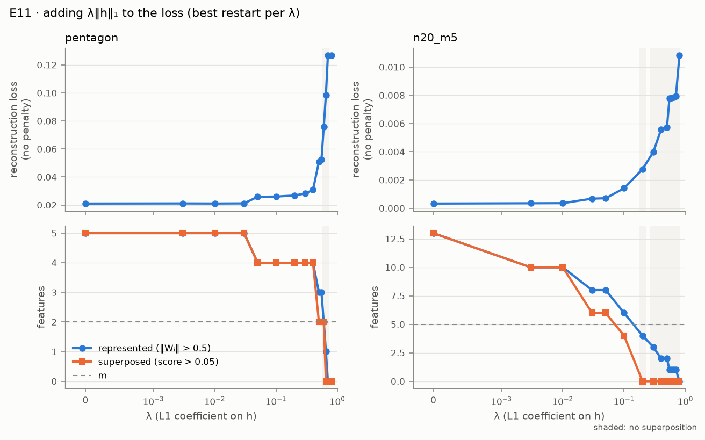

# E11 · l1_removes_superposition: an L1 penalty on h trades loss for less superposition (p. 42)

Recipe card for experiment E11. Status today: **PARTIAL 7/8** on the cited seed, and **PARTIAL
5/8** on a held-out seed. It was **PASS 8/8** in Phase 5, on a λ grid refined after a failed
development run. This card is the repository's example of a *forking path* (an analysis choice
made after seeing data) and of a held-out check that did not confirm it. Read
[01_timeline.md](../01_timeline.md) for the sessions and
[06_debugging_playbook.md](../06_debugging_playbook.md) for the general lesson. Terms are in
[GLOSSARY.md](../../GLOSSARY.md).

Labels: **[Documented]** = the cited evidence shows it; **[Reconstructed]** = inferred, with the
basis stated; **[Recommended]** = advice for doing it by hand, not history.

## 1. Claim and pages

- **The paper's claim** (p. 42, "Approach 1"). Superposition is easy to remove from the toy
  models, at the cost of a higher loss: add λ‖h‖₁ on the hidden activations to the loss. The
  paper reads this as killing features below an importance threshold, especially features that
  are not basis aligned. Footnote 21 adds that a little L1 should reduce superposition with
  almost no effect on performance. **[Documented: `l1_removes_superposition.py` docstring;
  docs/REPRODUCTION.md § "E11 … Paper's claim"]**
- **The paper shows no experiment.** SPEC §7 E11 asks: as λ grows, superposition falls to none
  while the loss rises; report the trade-off curve. **[Documented:
  [SPEC.md](../../../SPEC.md) §7 E11]**
- **Why it is a fair test.** Losses at different sparsities are not comparable (footnote 17),
  but here every λ solves the same task at one sparsity, so the reconstruction loss *without*
  the penalty can be compared across λ. **[Documented: D-505 "Paper"; REPRODUCTION.md E11]**

Key terms: *represented* feature (‖Wᵢ‖ > 0.5); *superposed* feature (represented with
superposition score > 0.05, E01's orthogonality bar); the *formal test* of p. 8 (WᵀW singular on
the represented features); *antipodal pair* (two features on one axis with opposite signs).
**[Documented: D-505]**

## 2. Prerequisites

| Kind | What | Why |
|---|---|---|
| Module | `train(..., l1_hidden=λ)`, one λ per instance; `select_best` | the penalized loss, the whole λ grid in one model |
| Module | `models.TiedModel` (ReLU output model) | the model of pp. 2 and 10–11 |
| Module | `metrics.represented_mask`, `superposition_score`, `is_superposition`, `dims_per_feature`, `gram` | counting represented and superposed features; D* |
| Experiment | E00 `intro_pentagon` (p. 2) | the pentagon: n = 5, m = 2, Iᵢ = 0.9ⁱ, 1 − S = 0.1 |
| Experiment | E01 `basic_results` (p. 11) | n = 20, m = 5, Iᵢ = 0.7ⁱ, 1 − S = 0.01; its orthogonality bar and tolerance |

Engine first: [05_engine.md](../05_engine.md) and the rebuild kit
([rebuild/README.md](../../../rebuild/README.md), milestones M1–M4). **[Recommended]**

## 3. Config and commands

From [configs/l1_removes_superposition.yaml](../../../configs/l1_removes_superposition.yaml)
**[Documented]**:

| Setting | Value |
|---|---|
| λ grid (15 values) | 0, 0.003, 0.01, 0.03, 0.05, 0.1, 0.2, 0.3, 0.4, 0.5, 0.55, 0.6, 0.65, 0.7, 0.8 |
| `pentagon` | n = 5, m = 2, Iᵢ = 0.9ⁱ, 1 − S = 0.1, 16 restarts |
| `n20_m5` | n = 20, m = 5, Iᵢ = 0.7ⁱ, 1 − S = 0.01, 8 restarts |
| thresholds | represented 0.5; superposition score 0.05; count tolerance 1; loss tolerance 0.02; 200,000 shared evaluation samples; "falls to none" needs ≥ 2 features to PASS |
| training | 10,000 steps, batch 1024, Adam lr 1e-3, constant schedule |

| Profile | Overrides | Run? |
|---|---|---|
| `quick` | none | measured 548 s (cited run) |
| `full` | 64 / 32 restarts, 30,000 steps | never run; the config estimates ≈ 12× quick, ≈ 1.8 hours on a laptop CPU |

Commands. The cited run used seed 0; the held-out check used seed 1 with the unchanged quick
profile. **[Documented: docs/cited_runs.yaml; D-R05]**

```bash
uv run superposition run l1_removes_superposition --profile quick --device cpu
```

[Verified against manifest] (`20260930T185653Z-c4feb0cf`, also `20260929T212948Z-027b0327`)

```bash
uv run superposition run l1_removes_superposition --profile quick --seed 1 --device cpu
```

[Verified against manifest] (`20260930T184744Z-e8c803d0`)

```bash
uv run superposition run l1_removes_superposition --profile full --device cpu
```

[Not verified: the full profile was never run (D-R06); estimated about 1.8 hours on CPU]

```bash
uv run superposition figures l1_removes_superposition --run latest --publish
```

[Not verified: needs a run under the git-ignored results/, and overwrites tracked figures in docs/figures/]

```bash
uv run superposition report --pin l1_removes_superposition
uv run superposition report --pin l1_removes_superposition --run 20260930T184744Z-e8c803d0 --label heldout
```

[Not verified: modifies tracked docs (docs/cited_runs.yaml, docs/REPRODUCTION.md)]

## 4. Procedure

### 4a. The steps as executed

1. **Criteria first.** Four criteria per setup were fixed before any run: (1) superposition at
   λ = 0; (2) the superposed count never rises by more than 1 between consecutive λ; (3) some
   λ > 0 gives a superposition-free model; (4) no loss drop above 2% between consecutive λ, and
   a higher loss once free. They were not changed later in Phase 5. **[Documented: D-505
   "History"]**
2. **First development run, outside provenance.** Through the CLI into a scratchpad results
   folder, with 8 / 4 restarts, a grid {0, 0.001, 0.003, 0.01, 0.03, 0.05, 0.1, 0.15, 0.2, 0.3,
   0.4, 0.5, 0.6, 0.8, 1} and losses on independent samples. Result PARTIAL 5/8: a stuck
   pentagon restart at λ = 0.4, 2–3% loss wobble between restarts, and an n = 20 pair
   reappearing at λ = 0.2. **[Documented: S 57d571bd @ 2026-09-29T21:01Z; D-505]**
3. **Fix the evaluation, not the criteria.** Following SPEC §2 (check the implementation, then
   restarts): restarts doubled and every model scored on the same samples (common random
   numbers). **[Documented: S 57d571bd @ 2026-09-29T21:06Z; D-505]**
4. **Second development run.** Every n = 20 criterion passed; the pentagon's "falls to none"
   did not. Its last two features formed an antipodal pair up to λ = 0.6, and everything was
   gone at 0.8. **[Documented: S 57d571bd @ 2026-09-29T21:07–21:14Z; D-505]**
5. **Diagnose, then refine the grid.** From that run's checkpoints, at λ = 0.6 the antipodal
   pair, the orthogonal pair and feature 0 alone had training objectives within 0.4% (0.1234,
   0.1236, 0.1238). The pair wins because the penalty is smaller for it: |x₀ − x₁| ≤ x₀ + x₁
   when both are active. The numbers predicted a single-feature window near λ ≈ 0.61–0.67. The
   grid gained 0.55, 0.65 and 0.7. *Changed after results were seen.* **[Documented: S 57d571bd
   @ 2026-09-29T21:15–21:17Z; D-505]**
6. **Cited run.** Commit `3095c5b`; run `20260929T212948Z-027b0327` from the main tree, PASS
   8/8 in 533 s. The pentagon was free of superposition only at λ = 0.65, with one feature left.
   Phase 5 flagged this pass as narrow, and its replication test did not require the pentagon's
   "falls to none". **[Documented: runtable;
   [phase-5.md](../../progress/phase-5.md) "Open issues" 1 and "Test status"]**
7. **Owner decision D-R05: PARTIAL, plus a held-out seed.** The planning conversation had
   recommended marking the pentagon PARTIAL and adding a fresh-seed check, because the pass
   rested on one λ from a refined grid. Commit `0cd2dd7` made "falls to none" three-way: PASS
   with ≥ 2 features left, PARTIAL with one, FAIL with none. **[Documented: Planning
   conversation, per owner; D-R05; S 522eb237 @ 2026-09-30T18:31Z]**
8. **Held-out seed, then the cited seed.** From a clean detached worktree at `fd32b02`: seed 1
   (`20260930T184744Z-e8c803d0`, PARTIAL 5/8, 546 s), then seed 0 (`20260930T185653Z-c4feb0cf`,
   PARTIAL 7/8, 548 s). Seed 1 ran first so that the lab, which shows the latest run, shows the
   cited one. The seed-0 run reproduces the Phase 5 run in every number. **[Documented: D-R05;
   [rectification.md](../../progress/rectification.md) "Runs"; REPRODUCTION.md E11 "Run IDs"]**
9. **Independent review R4.** R4-06 found that the held-out "tie to 0.03%" compared estimates on
   different samples; on common samples seed 0's state is lower by about 0.25%, so seed 1's
   window is a restart miss and no longer "confirms the window". R4-07: a mechanism claim cited
   a development run no longer on disk. R4-08, R4-09: two overclaims. R4-11: the paper test
   pinned a seed-dependent criterion. Resolved in `f3932ec` (docs) and `bf25fcb` (the test stops
   requiring the pentagon's "declines"). **[Documented: [REVIEW.md](../../REVIEW.md) § R4]**

### 4b. How to do it by hand

1. **Add the penalty to training.**
   - Action: add λ·E‖h‖₁ to each instance's loss, with λ a per-instance tensor, so one model
     trains the whole grid.
   - Command (the repo's test as your spec):

     ```bash
     uv run pytest tests/unit/test_train.py -q -k l1_hidden
     ```

   - Expected: 1 test passes; λ = 0.5 shrinks E‖h‖₁ below 0.8× the λ = 0 value.
   - Check: at λ = 0 the pentagon setup gives E00's picture, five features in superposition.
   - If it fails: the penalty is on h = Wx, before any output ReLU. **[Recommended]**
2. **Choose restarts by the objective you trained, and score on shared samples.**
   - Action: per λ, keep the restart with the lowest *training objective* (loss + penalty);
     report the reconstruction loss *without* the penalty, on the same samples for every λ.
   - Command:

     ```bash
     uv run pytest tests/unit/test_phase5_experiments.py -q -k e11
     ```

   - Expected: 2 tests pass (shared evaluation matches the model's own loss; the criteria logic).
   - Check: losses never fall by more than restart noise between neighbouring λ.
   - If it fails: independent samples and too few restarts produced spurious drops in the first
     development run (D-505). **[Recommended]**
3. **Fix the grid and the criteria before the first run, and plan the held-out seed.**
   - Action: write the λ grid, the four criteria and the held-out seed into DECISIONS and the
     config, then commit. If a later grid change is needed, re-run on a fresh seed and report
     both.
   - Check: the cited and held-out runs use the same profile, differing only in `--seed`.
   - If it fails (you refined after seeing data): disclose it, as D-505 did. **[Recommended]**
4. **Run both seeds and read the trade-off.**
   - Command: the two `quick` commands above (about 9 minutes each on an M2 CPU).
   - Expected: n = 20 free of superposition at λ = 0.2 with four orthogonal features on both
     seeds; the pentagon free only with one feature left, at a seed-dependent λ.
   - Check: the `tradeoff` row of each `acceptance.json` against §5.
   - If it fails: look at the restarts at the failing λ before blaming the claim; states within
     about 1% compete there. **[Recommended]**

## 5. Acceptance

Cited: `20260930T185653Z-c4feb0cf` (seed 0). Held-out: `20260930T184744Z-e8c803d0` (seed 1,
`l1_removes_superposition:heldout`). Both quick, CPU, commit `fd32b02`. Every criterion is a
SPEC §7 claim operationalized in D-505, with "falls to none" re-graded by D-R05.
**[Documented: docs/cited_runs.yaml; both runs' acceptance.json]**

| Criterion | Source | Seed 0 (cited) | Seed 1 (held-out) |
|---|---|---|---|
| pentagon: superposition at λ = 0 | D-505 (1); p. 8 formal test | PASS (5 represented, 5 superposed) | PASS (5, 5) |
| pentagon: superposed count declines | D-505 (2); E01's tolerance | PASS (5 → 4 → 2 → 0) | FAIL (rises by 2 at λ = 0.55 and 0.65) |
| pentagon: falls to none | SPEC; D-505 (3) as revised by D-R05 | PARTIAL (λ = 0.65, only feature 0 left) | PARTIAL (λ = 0.6, only feature 0) |
| pentagon: loss rises | D-505 (4) | PASS (largest drop 0.28%; 0.0211 → 0.0986) | FAIL (drops of 29% and 21%) |
| n20: superposition at λ = 0 | D-505 (1) | PASS (13 superposed) | PASS (11) |
| n20: declines | D-505 (2) | PASS | PASS |
| n20: falls to none | D-505 (3), D-R05 | PASS (λ = 0.2, features {0, 1, 2, 3}) | PASS (λ = 0.2, same features) |
| n20: loss rises | D-505 (4) | PASS (0.000328 → 0.00277, 8.4×) | PASS (0.000319 → 0.002821, 8.8×) |
| Overall | | **PARTIAL 7/8** | **PARTIAL 5/8** |

The Phase 5 run `20260929T212948Z-027b0327` had the same values and PASS 8/8, because "falls to
none" then passed with one feature left. **[Documented: its acceptance.json]**

## 6. What actually happened

- **A grid refined after a failed development run** (D-505). The criteria stayed fixed, the
  diagnosis predicted the window before the cited run, and all of it was disclosed. But the pass
  rested on one λ, found because the grid was moved to where it would be found. *Changed after
  results were seen.* **[Documented: D-505; phase-5.md open issue 1]**
- **The held-out seed did not confirm the window** (D-R05, R4-06). Seed 1 is free of
  superposition at λ = 0.6, not 0.65, and fails "declines" and "loss rises". Its restarts miss
  lower-objective states that seed 0 found. The rectification report first called the two
  states at λ = 0.6 a tie "to 0.03%"; that compared numbers from different samples, and the
  review corrected it. **[Documented: REPRODUCTION.md E11 "Held-out check"; REVIEW R4-06;
  rectification.md question 3]**
- **What does hold on both seeds:** features die from the least important up; basis-aligned
  antipodal pairs outlast everything else; the pentagon is free of superposition only with one
  feature left. That matches p. 42's "killing features below an importance threshold". The
  n = 20 PASS is removal by killing features, not by rearranging them (R4-09). **[Documented:
  REPRODUCTION.md E11]**
- **A lost development run** (R4-07). A mechanism claim once cited a development run that was
  no longer on disk. It now cites the cited run's own restarts at λ = 0.6, read by the reviewer
  (objectives 0.12333, 0.12359, 0.12380). **[Documented: REVIEW R4-07; REPRODUCTION.md E11]**
- **Footnote 21 is not tested** (R4-08). The first λ above 0 is 0.003, where the n = 20 count
  already falls 13 → 10 at a 6% loss rise. The first development grid had λ = 0.001; the final
  grid does not. D-505 lists only 0.15 and 1 as dropped, so when 0.001 left is not recorded.
  **[Reconstructed: from comparing D-505's first-run grid with the config's grid]**
- **Tests adjusted openly.** The Phase 5 replication test required only the pentagon's "at
  zero" and "declines", plus all four n = 20 criteria. phase-5.md says it left only "falls to
  none" free, but the test did not require the pentagon's "loss rises" either. `bf25fcb` (review
  R4-11) then dropped "declines", citing the held-out result. **[Documented: `9154b5b` and
  `bf25fcb` versions of `tests/replication/test_l1_removes_superposition.py`; phase-5.md "Test
  status"]**
- **An engine test margin was relaxed early.** The L1 unit test's bar went from 0.5 to 0.8 with
  the comment "observed ratio ≈ 0.62" in Phase 1. **[Documented: S 35cab3f0 @
  2026-09-29T08:33Z; `tests/unit/test_train.py::test_l1_hidden_shrinks_hidden_activations`]**

## 7. Compute

| Run | Seed | Commit | Wall-clock | Status | Cited |
|---|---|---|---|---|---|
| `20260929T212948Z-027b0327` | 0 | `dbe87c8` | 533 s | PASS 8/8 | superseded |
| `20260930T184744Z-e8c803d0` | 1 | `fd32b02` | 546 s | PARTIAL 5/8 | `l1_removes_superposition:heldout` |
| `20260930T185653Z-c4feb0cf` | 0 | `fd32b02` | 548 s | PARTIAL 7/8 | `l1_removes_superposition` |

All on an Apple M2 CPU. **[Documented: manifests]**

- The two development runs: compute unknown (scratchpad, not on disk).
- Full profile: never run; ≈ 1.8 hours is the config's *estimate*.
- Paper-tier test: "about 9 minutes" in its docstring, next to the measured 548 s.

## 8. What to look at

Figures (from the cited run, per `docs/figures/l1_removes_superposition/SOURCE.txt`):

-  Loss and feature counts
  against λ; shaded where superposition is gone.
- [l1_tradeoff.png](../../figures/l1_removes_superposition/l1_tradeoff.png): the trade-off curve.
- [pentagon_arrows.png](../../figures/l1_removes_superposition/pentagon_arrows.png): the pentagon
  at five λ, in the raw hidden basis, which the penalty makes privileged.
- [n20_m5_weights.png](../../figures/l1_removes_superposition/n20_m5_weights.png): WᵀW of the
  n = 20 model.

The lab: **SAE lab** page, tab "E11 · L1 on h (p. 42)", with a λ slider over the weights
([8_SAE_lab.py](../../../app/pages/8_SAE_lab.py)). It reads the latest run.

```bash
uv run superposition app
```

[Not verified: starts a long-running Streamlit server]

The notebook: [10_sparse_autoencoders.ipynb](../../../notebooks/10_sparse_autoencoders.ipynb),
section 3.

## 9. Explain it back

1. Show that λ‖h‖₁ charges an antipodal pair on one hidden axis less than two orthogonal
   features with the same norms when both are active. What does this predict about which states
   survive large λ?
2. Why is the restart at each λ chosen by the training objective, but scored by the loss
   without the penalty? What goes wrong if you choose by the reconstruction loss instead?
3. Seed 0 and seed 1 put the pentagon's superposition-free model at different λ. What may you
   claim about "the λ where superposition ends", and what may you not?

**Drill.** From the cited run's `tradeoff` row (in `acceptance.json`), plot reconstruction loss
against the number of superposed features for both setups, and compute the loss ratio at the
first superposition-free λ. Repeat for the held-out run. Self-check: n = 20 gives 8.4× (seed 0)
and 8.8× (seed 1); the pentagon gives 4.7× (0.021053 → 0.098584) on seed 0. Then write one
sentence a reviewer would accept about footnote 21, given the grid. **[Recommended]**

## 10. Answer key (open after attempting)

- [`src/superposition/experiments/l1_removes_superposition.py`](../../../src/superposition/experiments/l1_removes_superposition.py):
  `train_l1_sweep`, `shared_evaluation`, `sweep_table`, `superposition_free`, `evaluate_setup`.
- [`src/superposition/train.py`](../../../src/superposition/train.py): the `l1_hidden` argument.
- Tests: `tests/unit/test_phase5_experiments.py` (`test_e11_shared_evaluation_matches_the_model`,
  `test_e11_criteria`), `tests/unit/test_train.py::test_l1_hidden_shrinks_hidden_activations`,
  [`tests/replication/test_l1_removes_superposition.py`](../../../tests/replication/test_l1_removes_superposition.py).
- Decisions: D-505, D-R05, D-R07 in [DECISIONS.md](../../DECISIONS.md); review R4-06 to R4-09,
  R4-11.
