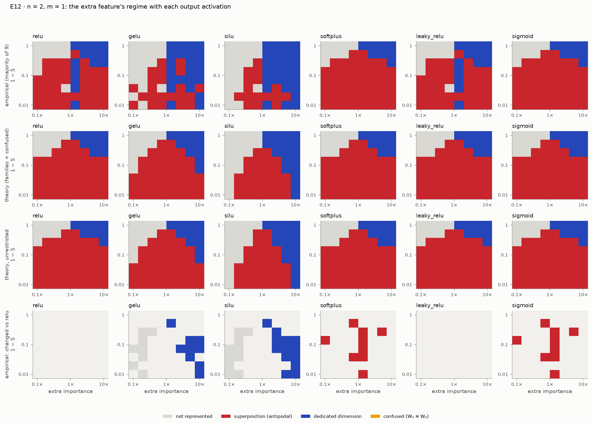

# E12 · activation_functions: E02's phase diagrams with six output activations (p. 51; extension)

Recipe card for experiment E12. Status: **INFO**. E12 is an extension with no pass/fail; it
reports differences. It was re-run after the independent review because its first run lacked
rows the write-up needed, and the review reshaped what the results may be read to mean
(landscape against optimization). Read [01_timeline.md](../01_timeline.md) for the sessions.
Terms are in [GLOSSARY.md](../../GLOSSARY.md).

Labels: **[Documented]** = the cited evidence shows it; **[Reconstructed]** = inferred, with the
basis stated; **[Recommended]** = advice for doing it by hand, not history.

## 1. Claim and pages

- **The remark** (p. 51, Comments & Replications). Redwood Research replicated the phase
  diagrams of pp. 14–16 and reported that the diagrams change with the activation function,
  which would mean the choice of activation changes how much polysemanticity the toy model has.
  **[Documented: `activation_functions.py` docstring; docs/REPRODUCTION.md § "E12 … Paper's
  claim"]**
- **What the paper does not say:** which activations, which problem size, whether the diagrams
  were empirical or theoretical, or which way the differences went. **[Documented:
  REPRODUCTION.md E12]**
- **SPEC's version** ([SPEC.md](../../../SPEC.md) §7 E12): recompute E02 for relu, gelu, silu,
  softplus, leaky_relu and sigmoid; no pass/fail; report the differences. **[Documented]**
- **The setup it varies** (E02, pp. 14–15): n = 2 features in m = 1 dimension, the output model
  x′ = σ(WᵀWx + b); each cell of an (importance, density) grid is labeled by what happens to the
  extra feature: *not learned*, *superposition* (an antipodal pair) or *dedicated* dimension.
  E12 swaps the output ReLU for σ. **[Documented: D-602; E02's module]**
- **Why σ matters** (p. 13): on a 1-sparse input the ReLU turns negative interference into a
  free 0, which makes an antipodal pair cheap. GELU and SiLU dip below zero; softplus and
  sigmoid never reach 0. **[Documented: notebook 11 § 1; REPRODUCTION.md E12]**

## 2. Prerequisites

| Kind | What | Why |
|---|---|---|
| Module | `models.ACTIVATIONS` / `get_activation` | the registered output nonlinearities (leaky_relu at PyTorch's default slope 0.01) |
| Module | `theory`: exact expected losses (p. 13), `activation_square_integral`, `activation_error_1d`, `tied_output_expected_losses`, the weight families and their optimizer | the theoretical diagram for each σ (D-601) |
| Experiment | E02 `phase_change`: `train_phase_grid`, `families_for`, `extra_feature_regime`, `initial_sign_outcomes`, `cell_frame` | E12 reuses E02 exactly: labels and vote (D-304), batch 256 (D-309), starting sign (D-605) |

Do E02 by hand first; E12 is E02 with one argument changed. **[Recommended]**

## 3. Config and commands

From [configs/activation_functions.yaml](../../../configs/activation_functions.yaml)
**[Documented]**:

| Setting | Value |
|---|---|
| activations | relu (reference), gelu, silu, softplus, leaky_relu, sigmoid |
| problem | n = 2, m = 1 (p. 15) |
| grid | 8 × 8: relative importance 0.1–10, density 0.01–1 |
| models | 10 per cell; the highest-loss one is dropped and the other nine vote (p. 14) |
| theory search | scale ≤ 4, bias in [−8, 4], 41 × 121 grid, 30 golden-section steps, 12 quadrature nodes, re-checked with 24 |
| thresholds | represented 0.5, superposition score 0.05 (E02's) |
| training | 10,000 steps, batch 256, Adam lr 1e-3, constant schedule |

| Profile | Overrides | Run? |
|---|---|---|
| `quick` | none | measured 507 s (cited run) |
| `full` | adds n = 3, m = 2 (p. 16) on a 12 × 12 grid | never run; the config estimates ≈ 1 hour on an Apple M2 CPU |

Commands. Every E12 run used seed 0; there is no held-out seed (R5-07, open). **[Documented:
runtable; REVIEW.md "Open items"]**

```bash
uv run superposition run activation_functions --profile quick --device cpu
```

[Verified against manifest] (`20261001T112822Z-6151c7ff`, also `20261001T073009Z-e72fab4f` and
`20261001T064053Z-e72fab4f`)

```bash
uv run superposition run activation_functions --profile full --device cpu
```

[Not verified: the full profile was never run (D-R06); estimated about 1 hour]

```bash
uv run superposition figures activation_functions --run latest --publish
```

[Not verified: needs a run under the git-ignored results/, and overwrites tracked figures in docs/figures/]

```bash
uv run superposition report --pin activation_functions
```

[Not verified: modifies tracked docs (docs/cited_runs.yaml, docs/REPRODUCTION.md)]

## 4. Procedure

### 4a. The steps as executed

1. **Read p. 51 and its neighbours.** The Phase 6 session extracted pp. 50–53 with
   `pdftotext`. **[Documented: S 1584c849 @ 2026-09-30T20:14Z]**
2. **Measure before designing, outside provenance.** Scratchpad scripts benchmarked training
   speed per activation and checked quadrature accuracy and speed. Their numbers are not in the
   repository, except where D-601 states the accuracy (also covered by unit tests).
   **[Documented: S 1584c849 @ 2026-09-30T20:18Z and 20:22Z; D-601 "Accuracy"]**
3. **Generalize the theory and the trainer.** The family optimizer and E02's grid trainer took
   an activation argument. Then a session limit hit at 20:27Z; work resumed at 06:24Z the next
   day. **[Documented: S 1584c849 @ 2026-09-30T20:21–20:27Z, 2026-10-01T06:24Z]**
4. **Register E12, tune for the time budget, test.** Config and smoke test, a timing of 40
   against 30 golden-section steps (30 kept), a quadrature-error sweep over the search box,
   theory and E12 unit tests, the reduced slow test. Commits `ad8ad78`, `79ed991`, `aa8e6b0`,
   `79f1937`. `ad8ad78` went in first (06:39:21Z); the next commit attempt failed, and the other
   three were committed at 06:39:48–49Z after checking the working tree; phase-6.md reports two `index.lock` collisions with VS Code's git in this
   session. **[Documented: S 1584c849 @ 2026-10-01T06:26–06:39Z; phase-6.md "Before changing
   anything"]**
5. **First run, from a clean worktree.** `20261001T064053Z-e72fab4f` at `79f1937` (548 s). While
   it ran, the session added the `initial_sign` rows (D-605, commit `22b7f1e`), so this run lacks
   them. A second run, `20261001T073009Z-e72fab4f` at `450938e` (477 s), has them.
   **[Documented: S 1584c849 @ 2026-10-01T06:40Z and 06:45Z; both runs' acceptance.json]**
6. **Independent review R5,** on the first run (agent 06:51Z → 07:16Z). Its main findings:
   R5-01 the empirical differences come mostly from optimization; R5-02 softplus and sigmoid
   have not converged at sparse densities; R5-03 "identical theoretical diagrams" is an artifact
   of the grid and of the restricted families; R5-04 the run predates new rows and the config's
   runtime comment was stale; R5-05 the "best model" was chosen by a sampled loss.
   **[Documented: S 1584c849 @ 2026-10-01T06:51Z; [REVIEW.md](../../REVIEW.md) § R5]**
7. **Fix, after the review saw results (D-608).** Two more session limits (07:16Z, 07:38Z);
   resumed 11:21Z. Added the *unrestricted* optimum (all four parameters free, compass search
   from every family optimum), best models by exact loss, tied rankings, and an
   activation-aware lab scorer. Commits `40b002b`, `0ad3679`. *Changed after results were
   seen*: these are new INFO rows, not changed thresholds. **[Documented: S 1584c849 @
   2026-10-01T11:23–11:28Z; D-608]**
8. **Final run and write-up.** `20261001T112822Z-6151c7ff` at `0ad3679` (507 s), from the clean
   worktree; every value it shares with the earlier runs is identical. Section written, run
   pinned, figures published, notebook 11 executed (`1773d5a`, `a298d7b`). **[Documented: S
   1584c849 @ 2026-10-01T11:28–11:38Z; REPRODUCTION.md E12 "Run IDs";
   [phase-6.md](../../progress/phase-6.md) "Runs"]**

### 4b. How to do it by hand

1. **Generalize the exact loss.**
   - Action: write ∫∫ (γx − σ(αx + βy + c))² over [0, 1]² with Gauss–Legendre rules on pieces
     where σ's argument keeps one sign (D-601).
   - Command:

     ```bash
     uv run pytest tests/unit/test_theory.py -q -k activation
     ```

   - Expected: 11 tests pass.
   - Check: for the ReLU your rule matches the closed form to 1e-12; for GELU it matches
     adaptive quadrature (scipy) to about 1e-9.
   - If it fails: split the domain where the argument changes sign; the kink breaks a single
     Gauss rule. **[Recommended]**
2. **Pre-register what you will report.** E12 has no pass/fail. Decide the rows (regions,
   agreement with own theory, changes against ReLU, within-cell losses, shares, starting sign,
   quadrature check) before the first run, and note which comparisons footnote 17 allows.
   **[Recommended]**
3. **Run a reduced grid first.**
   - Command:

     ```bash
     uv run pytest -m slow tests/replication/test_activation_functions.py -q
     ```

   - Expected: 1 test passes (relu and gelu on a 4 × 4 grid; the ReLU corners behave as in E02).
   - Check: `quadrature_check` changes no label.
   - If it fails: compare the ReLU column with E02's cited run before touching other σ.
     **[Recommended]**
4. **Run the quick profile and separate landscape from training.**
   - Command: the `quick` command above (about 8–9 minutes on an M2 CPU).
   - Expected: §5's table.
   - Check: for each activation, does the *lowest-loss* model in each cell agree with that σ's
     unrestricted theory even where the vote does not? If yes, the vote's difference is
     optimization.
   - If it fails: look at `initial_sign` before concluding anything about σ. **[Recommended]**
5. **Test the restriction.** Search all parameters freely from each family optimum and report
   where the label changes; a restricted family can make two diagrams look identical (R5-03).
   **[Recommended]**

## 5. Acceptance

No graded criteria: SPEC §7 makes E12 report-only, and every row is INFO. The rows come from
D-602 (regions, agreement, changes, losses, shares), D-605 (`initial_sign`), D-608
(`unrestricted_theory`) and D-601 (`quadrature_check`). Cited run: `20261001T112822Z-6151c7ff`
(quick, CPU, seed 0, commit `0ad3679`). **[Documented: docs/cited_runs.yaml; its
acceptance.json]**

Cells in superposition out of 64, and what training reaches:

| σ | Vote | Family theory | Unrestricted theory | Vote agrees with family theory | Same-sign starts reaching superposition |
|---|---|---|---|---|---|
| relu | 39 | 46 | 48 | 0.859 | 117 of 223 |
| leaky_relu | 39 | 46 | 48 | 0.859 | 117 of 223 |
| gelu | 22 | 42 | 42 | 0.688 | 3 of 204 |
| silu | 16 | 28 | 30 | 0.812 | 2 of 133 |
| softplus | 48 | 46 | 46 | 0.969 | 216 of 223 |
| sigmoid | 48 | 46 | 48 | 0.969 | 223 of 223 |

**[Documented: rows `regions`, `agreement_with_own_theory`, `initial_sign`]**

Other rows:
- **Best model against unrestricted theory:** agreement 1.0 for every σ except softplus
  (0.984). **[Documented: `agreement_with_own_theory`]**
- **Within-cell losses** (median theory optimum relative to the ReLU's): GELU 2.33×, SiLU
  3.04×, softplus 3.49×, sigmoid 1.78×, leaky ReLU 1.007×. Softplus and sigmoid best models reach
  up to 1.66× and 2.28× their own optimum. **[Documented: `losses`]**
- **Quadrature check:** re-evaluating every family optimum with 24 nodes changes no label; the
  largest relative change is below 1e-10. **[Documented: `quadrature_check`]**
- **Unrestricted search:** 2 cells move to superposition for relu, leaky_relu, silu and sigmoid,
  none for gelu and softplus. **[Documented: `unrestricted_theory`]**

## 6. What actually happened

- **An extension with no criterion,** so the risk is not a wrong PASS but a wrong reading. The
  reviewer found the pipeline numerically sound; its findings were about what the rows can be
  read to mean. **[Documented: REVIEW.md § R5 preamble]**
- **Landscape against optimization** (R5-01, D-608). The votes order the activations
  differently from the theory. GELU and SiLU show far less superposition in the vote (22, 16)
  than in their own theory (42, 28), because models that start with same-sign weights rarely
  cross zero to form the pair. Softplus and sigmoid show more than the ReLU's vote, in cells
  where the *ReLU's* models got stuck. The write-up now attributes every difference to the
  landscape or to training. **[Documented: REPRODUCTION.md E12; REVIEW R5-01]**
- **A restriction that hid differences** (R5-03). The families tie each factor to one weight
  scale, so equal theory labels could be an artifact; the unrestricted optimum barely changes
  the labels. The reviewer's own bisection put the boundaries at different densities for ReLU,
  sigmoid and softplus, below the grid's resolution; that analysis is not in a logged run.
  **[Documented: REVIEW R5-03; REPRODUCTION.md E12; D-607 "Caveat"]**
- **Not converged** (R5-02). Softplus and sigmoid have not converged at sparse densities after
  10,000 steps, so their trained loss ratios overstate the cost. Activations are compared by
  their theoretical optima. A longer-training variant is open. **[Documented: REVIEW R5-02]**
- **Re-run after review** (R5-04). Three runs exist; the cited one is the third. The first lacks
  `initial_sign`, the first two lack `unrestricted_theory`. The config's runtime comment was
  corrected. **[Documented: the three runs' acceptance.json; REVIEW R5-04]**
- **The reviewer's extra training** (20,000 more steps for stuck GELU and SiLU models, 3 of 200
  and 7 of 149 escaped) is cited in REPRODUCTION.md as "not in the run". **[Documented:
  REPRODUCTION.md E12]**
- **Open:** one seed (R5-07), sub-cell boundaries (R5-03), the full profile with n = 3 (R5-11),
  longer training (R5-02). **[Documented: REVIEW.md "Open items" 6]**

## 7. Compute

| Run | Commit | Wall-clock | Rows | Cited |
|---|---|---|---|---|
| `20261001T064053Z-e72fab4f` | `79f1937` | 548 s | no `initial_sign`, no `unrestricted_theory` | no (the run the review read) |
| `20261001T073009Z-e72fab4f` | `450938e` | 477 s | no `unrestricted_theory` | no |
| `20261001T112822Z-6151c7ff` | `0ad3679` | 507 s | all | `activation_functions` |

All quick profile, Apple M2 CPU, seed 0. **[Documented: manifests]**

- Scratchpad benchmarks and quadrature checks: compute unknown.
- The config says the unrestricted search costs about 20 s more; no separate measurement of it
  is recorded. **[Documented: config comment]**
- Full profile: never run; ≈ 1 hour is an *estimate* from E02's measured training time.
- The whole slow tier, which includes E12's reduced test, took 429 s in Phase 6.
  **[Documented: phase-6.md "Test status"]**

## 8. What to look at

Figures (from the cited run, per `docs/figures/activation_functions/SOURCE.txt`):

-  Rows: the vote, the
  family theory, the unrestricted theory, and the cells whose vote differs from the ReLU's.
- [shares_n2_m1.png](../../figures/activation_functions/shares_n2_m1.png): the share of cells in
  each regime per activation.

The lab: **Phase diagrams** page, tab "E12 · other output activations"
([2_Phase_diagrams.py](../../../app/pages/2_Phase_diagrams.py)); a cell's models are ordered by
exact loss. It reads the latest run.

```bash
uv run superposition app
```

[Not verified: starts a long-running Streamlit server]

The notebook: [11_extensions.ipynb](../../../notebooks/11_extensions.ipynb), sections 1–4 (six
activations, one cell exactly, the diagrams, landscape or optimization).

## 9. Explain it back

1. Why does a negative lobe (GELU, SiLU) make negative interference cost something, and why
   does that shrink the region where an antipodal pair is optimal?
2. In a cell where the vote says "dedicated" but the lowest-loss model and the theory say
   "superposition", what happened during training? Which row of the record tells you?
3. Why may losses be compared across activations within one cell, but not across cells
   (footnote 17)? What does a loss ratio against the ReLU mostly measure here (R5-08)?

**Drill.** Load the cited run's `cells.parquet` (384 rows: 6 activations × 64 cells). For each
activation, count the cells labeled `superposition` in the columns `empirical`, `theory` and
`relaxed_theory`. Then list the cells where `empirical` differs from `relaxed_theory` and check
`best_model` there. Self-check: relu 39 / 46 / 48, gelu 22 / 42 / 42, silu 16 / 28 / 30. **[Recommended]**

## 10. Answer key (open after attempting)

- [`src/superposition/theory.py`](../../../src/superposition/theory.py):
  `activation_square_integral`, `activation_error_1d`, `pair_output_loss(activation=…)`,
  `tied_output_expected_losses`, `OptimizerSettings.activation`.
- [`src/superposition/experiments/activation_functions.py`](../../../src/superposition/experiments/activation_functions.py):
  `compute_activation_theory`, `compass_search`, `relaxed_theory`, `exact_model_losses`,
  `evaluate_activations`, `tied_ranking`.
- E02's [`phase_change.py`](../../../src/superposition/experiments/phase_change.py):
  `train_phase_grid`, `extra_feature_regime`, `initial_sign_outcomes`.
- Tests: `tests/unit/test_theory.py` (the `activation` tests),
  [`tests/unit/test_phase6_experiments.py`](../../../tests/unit/test_phase6_experiments.py),
  [`tests/replication/test_activation_functions.py`](../../../tests/replication/test_activation_functions.py).
- Decisions: D-601, D-602, D-605, D-608 in [DECISIONS.md](../../DECISIONS.md); review R5-01 to
  R5-11.
